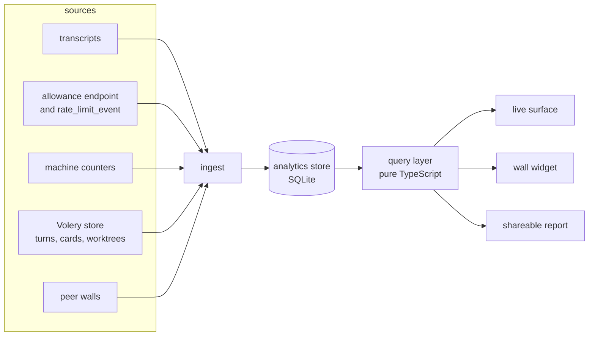
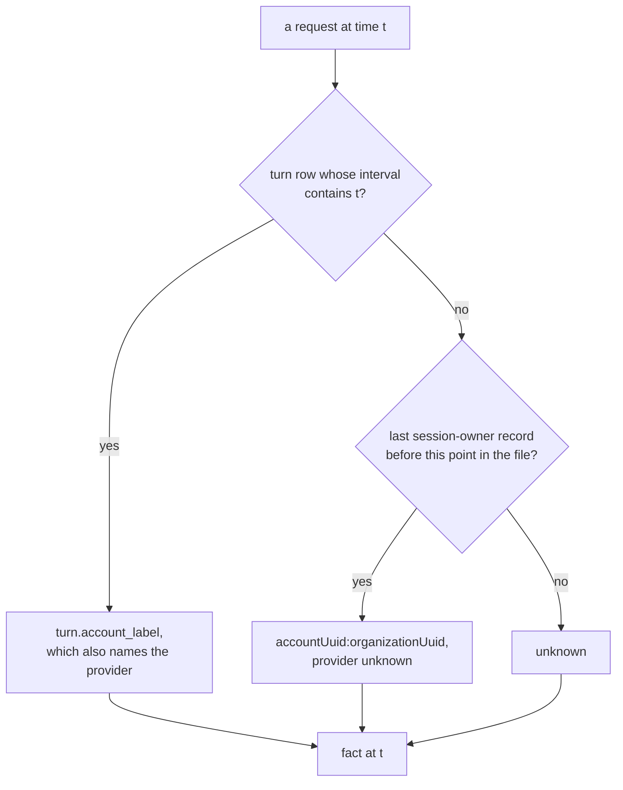

# Analytics

Managing an allowance is the part of agentic development nobody can see. Volery draws what
is happening on the wall right now, beautifully, and forgets all of it by the time the window
closes. The question this subsystem answers is older and wider than the wall: **what have I
spent, on what, across every machine and every account, and what does that predict about what
I have left?**

Three facts make that question harder than it looks, and all three are load-bearing:

- **The bill is per account, not per conversation.** A turn taken in a terminal on another
  laptop spends the same weekly allowance a card here does. Nothing in a card's own state can
  see it.
- **The transcripts are the only complete record, and they are temporary.** Claude Code writes
  every request to `~/.claude/projects/**/*.jsonl`, terminal sessions included, and deletes
  them after its cleanup period. A reading that only ever looks at the last eight days can
  never answer a question about last month.
- **Allowance percentages and tokens are different currencies.** Dollars are a list-price
  equivalent of work done. The weekly percentage is the resource actually being metered. A
  system that shows only one of them will always be wrong about the other.

This document designs a subsystem that keeps the record, attributes it, reconciles two
independent measurements against each other, and draws the result live on the wall, historically
in a full screen, and statically in a file somebody without Volery can open.

No implementation yet. The experiments that shaped it are named where they mattered.

---

## 1. What exists today, and what each reader is for

| reader | source | window | survives a restart | attributes |
|---|---|---|---|---|
| `usage.rs` / `usage.ts` | transcripts | 8 days, in memory | no | this machine, aggregate |
| `limits.rs` / `limits.ts` | `/api/oauth/usage` | current windows | no | per account, live |
| `turn` table | Volery cards only | forever | yes | per card, per account, no CLI version |
| `credits.rs` | `turn` rows | month | yes | credits only |
| `perf.rs` | process sampler | live | no | per card, no history |
| flyway `Facts` | each wall | live | no | per wall: rate, cards, allowance |
| `chronicle` | events | forever | yes | events, not measures |
| tool calls | transcripts only | 8 days, in memory | no | nothing today |

Each is right for what it does. None of them is a memory, and that is the gap.

The five blind spots, in the order they hurt:

1. **No history.** Restart the app and the cost reading starts again from whatever the last
   eight days of transcripts still contain. A month is not recoverable, and the transcripts
   that would have answered it are deleted on a schedule nobody here controls.
2. **No attribution outside Volery.** Terminal turns are counted in the total and cannot be
   split by project, model, or account. The `turn` table knows the cards; the transcripts know
   everything; nothing joins the two.
3. **No machine history.** CPU, memory, GPU, disk and network are sampled only while a meter
   widget is up, and only in memory. There is no way to ask what a month of parallel cards
   cost the machine.
4. **No cross-machine history.** The flyway carries a wall's *current* rate, card count and
   allowance. It carries no past. A laptop that was off last Tuesday has no Tuesday to send.
5. **No reading of what the tools cost.** The transcripts carry every tool call, its result,
   its latency and its error, and nothing folds them. A slow or failing MCP server is a tax on
   every card that touches it, and today it is invisible.

---

## 2. The spine: facts, not readings

The system is three layers, and the boundary between them is the whole design.



- **Ingest** writes facts. It makes no judgements about cost, windows or meaning.
- **The store** is append-only per host, durable, and mergeable across machines.
- **Query** is pure TypeScript over facts. Everything a person argues about (what a unit is,
  what a filter means, what an axis says) lives here and is tested without a webview.

This is the split `perf.rs`/`perf.ts`, `limits.rs`/`limits.ts` and `usage.rs`/`usage.ts`
already draw. Analytics is the same shape at a larger scale.

### Two measurements, reconciled

The subsystem deliberately keeps **two independent measurements of the same spending**:

1. **Transcript facts**: what each known request carried, priced and attributed.
2. **Allowance deltas**: the account's own counter moving from one sampled percentage to the
   next, whichever machine caused it.

Neither alone is enough. Transcripts are complete on a machine that runs Volery and blind
everywhere else. Allowance deltas are complete for the account and say nothing about what
spent it. Together they do something neither can: **the difference between them is a
measurement of the blind spot.**

If a week's weekly window rose by 42 points, and the walls on the flyway can only account
for 31 of them, the remaining 11 are real, not noise. That residual is drawn as its own band,
named *unattributed*, and it is the honest answer to "how much am I using across all
machines" when one of those machines has never run Volery.

The reconciliation is a query-time operation, not a stamp written at ingest. A wall cannot
know its peers' requests when it ingests, and a later peer joining the flyway must be able to
improve the attribution of a week that is already stored. Section 5 has the arithmetic.

---

## 3. What a fact is

### 3.1 Grain

`usage_fact` is one row per **five-minute bucket, session, agent, model, effort and CLI
version**, carrying the five token kinds and a request count. Five minutes is `usage.rs`'s
existing bucket and is fine enough for every window anybody reads: the trailing edge of a
rolling window moves by at most one bucket.

A session is the unit of attribution. Subagents get their own `agent` id under the same
session, which is how their spend stays attached to the card that caused it without being
confused with the card's own turns.

```sql
usage_fact(
  at, host, session, agent, model, effort, cli,
  source, account, provider, project, provenance,
  in_tok, out_tok, cache_read, write_5m, write_1h, requests
)
PRIMARY KEY (at, host, session, agent, model, effort, cli, source, account, provider)
```

`source`, `account`, `provider` and `project` are denormalized onto the fact rather than held
only in a session row, because a card can change account or provider mid-session and a
terminal session can be resumed under a different one. They are also **in the key**: two
requests in one bucket under two accounts (a swap) must not be merged into one row, or the
history loses exactly the thing it exists to record. The session table carries the *first*
and *last* of each; the fact carries what was true for that bucket. A query that wants "what
did this card cost" sums the facts rather than trusting a single label.

`provenance` is `transcript`, `turn` or `rollup`. It is what lets a backfilled `turn` day sit
beside transcript facts without being mistaken for them, and what lets a query prefer the
finer source for a day that has both.

### 3.2 The session dimension

```sql
analytics_session(
  session, host, project, source,
  card_id, started_at, ended_at, cli_min, cli_max,
  account_first, account_last, provider_first, provider_last,
  turns, endings_json
)
```

This is the per-card and per-terminal row: which Volery card it was (if any), where it ran,
when it started and ended, which CLI versions it spanned, and how its turns ended. It is
written when a session is first seen and updated as more is learned. It is what makes
"cost per card" and "performance vs cost" possible without joining a million facts.

**The account and provider are `first` and `last` on purpose, and nothing may read them as
"the" account.** A session that swapped funding is the case the names exist to warn a reader
about; the facts carry the per-interval truth (section 4). A query that wants "what did this
card cost on tx-team" sums facts, never the session row.

`endings_json` is opaque and normalised on read, the `widget.config_json` bargain. The ending
vocabulary is `classify.ts`'s and must not get a second home in Rust.

### 3.3 Allowance samples

```sql
allowance_fact(
  at, host, account, kind, scope,
  used, resets_at, severity, plan, source
)
```

`used` is a fraction, 0 to 1, not a percentage. The server reports a decimal and the whole
system converts once, at the boundary. `source` is `poll`, `stream` (a `rate_limit_event` off
a card's own request) or `peer` (a reading another wall took, arriving as an age).

A sample is a *point*, not an interval. The curve between two points is reconstructed at
query time and drawn as a step, because that is what is actually known.

### 3.4 Machine facts

```sql
machine_fact(
  at, host,
  cpu, mem_used, mem_total,
  gpu, gpu_mem,
  disk_read, disk_write, disk_free,
  net_rx, net_tx,
  procs, cards, cards_working, worktrees
)
```

One row per minute per host. CPU is the whole machine 0 to 100. `gpu` is the busiest engine's
utilization on the primary adapter, 0 to 100. Disk and network are bytes per second. `procs`
is the process count, which is the one figure that says whether a wall is leaking.

### 3.5 The rate history, because a price is a fact about a date

`usage.ts::RATES` is a constant, and `usage.md` records why a constant is the wrong shape for
a bill: it went stale for a month, and it silently priced Sonnet 4 as Sonnet 5. Historical
analytics makes that failure much worse, because a reading of last March computed with today's
table is wrong in a way nobody can see.

So the price table becomes data with a validity window:

```sql
rate(
  model, clock, from_at, to_at,
  input, output, cache_read, write_5m, write_1h, source
)
PRIMARY KEY (model, clock, from_at)
```

`clock` is `peak` or `off_peak`, because DeepSeek already bills two rates by time of day and a
single row per model cannot express it. `to_at` is an exclusive upper bound, and
`9223372036854775807` means "still in force" rather than `NULL`, because SQLite's `PRIMARY KEY`
does not imply `NOT NULL` and a null in a key is a row that sorts nowhere.

`analytics.rs` seeds it from `RATES` today. A price change appends a row rather than editing
one. A cost at time `t` is computed with the row whose window contains `t` and whose clock
matches the fact's local time. When the published rates differ from what the CLI charged, both
are kept: `usd_modeled` is the rate-history figure, `usd_reported` is what the CLI or the
`turn` table said for that request. The face says which one it is showing, and the default is
modeled with the date it was modeled from.

This is the systemic fix `usage.md` asked for: not a better constant, but a table that cannot
be right about the future and wrong about the past at the same time.

**A provider card is the one case the table cannot price**, and the rule is stated here rather
than discovered at the face. A DeepSeek card's transcript carries a Claude alias, so the table
has no way to know the tokens were billed by DeepSeek at all. For a turn whose funding is a
provider sentinel, `usd_reported` from `turn.usd` (computed at settle with the real provider
model) wins, and `usd_modeled` is `null` rather than a number that looks authoritative. The
inspector says which source priced the row. Section 4.1 has the measurement behind this.

### 3.6 Rollups

Three retention tiers, each with a job:

| tier | grain | kept | synced | used for |
|---|---|---|---|---|
| fine | 5 minutes | 90 days | on request, day at a time | live, this week, drilling in |
| hourly | 1 hour | 3 years | yes, by default | months, cross-machine |
| daily | 1 day | forever | derived | year-over-year, reports |

The hourly tier has two tables, because tools are a different grain from tokens: `usage_hour`
and `tool_hour`. A month of "which MCP server is slow on the other laptop" is a question about
the second, and folding it into the first would have meant a token row per tool call.

Hourly is the sync grain rather than daily because a day boundary is a timezone, and two
machines in two timezones would disagree about which day an hour belongs to. UTC hours
re-bucket into any local timezone with at most one hour of edge error, and a daily view is a
sum of 24 of them.

Rollups are stored, not computed on every query, because a three-year view over fine facts is
millions of rows and a stored rollup is tens of thousands. The rollup writer is part of
ingest, not a cron: a pass that writes a fine fact also adds to the current hour and day rows.

### 3.7 Tool and server facts, because how the work was done is also the bill

A token total says what a turn cost. It does not say whether the money went on reading files,
running a shell, calling an MCP server, or loading a skill. The transcripts answer that exactly,
and the answer is the difference between an analytics system and a bill.

Every assistant record carries `tool_use` blocks: a `name`, an `input`, an `id`. Every result
carries a `tool_result` with the same `tool_use_id`, an `is_error`, and a `toolUseResult` whose
shape says what kind of thing it was. Measured over five days on this machine, the top of the
list already reads like a budget:

```text
Bash 24,165 · Edit 2,351 · Read 2,269 · Write 1,298 · Grep 1,165
mcp__skein__send 468 · mcp__browser__browser_run_code_unsafe 463
SendMessage 298 · Agent 277 · ToolSearch 201
mcp__skein__ask_user 136 · mcp__skein__wake_me 92 · mcp__skein__wisp 87
```

An MCP tool's name is `mcp__<server>__<tool>`, so the server is a dimension without a second
record. Built-ins have no server, and the fact says `builtin` rather than inventing one.

```sql
tool_fact(
  at, host, session, agent,
  kind,          -- builtin | mcp | skill | agent
  server,        -- the middle segment of mcp__server__tool, or ''
  tool,          -- the name, or the last segment
  target,        -- skill name, subagent type, or ''
  calls, errors, ms_total, out_bytes,
  turn_usd,
  PRIMARY KEY (at, host, session, agent, kind, server, tool, target)
)
```

- **`ms_total` is measured**, not estimated: the result record and the call record are joined
  on `tool_use_id`, and the difference of their timestamps is the wall-clock wait. A call with
  no result (a turn that died, a parallel call still running) contributes `calls` and no time,
  so a median is over completed calls and the count is over all of them.
- **`errors`** is the `is_error` of the result, which is the CLI's own word rather than a guess
  from the exit code. A tool that answers `Error: …` without setting it is a success by this
  reading, and that is worth saying in the method note.
- **`out_bytes`** is the size of the result content, summed from the blocks, and **the content
  itself is never stored**. A tool result can be a file, a screenshot or a token; the analytics
  store keeps `42,318` and not the bytes. That is the line between analytics and conversation
  content, and it is drawn in the schema, not in a policy.
- **`turn_usd`** is the turn's reported or modeled cost, copied once, and the per-call figure is
  `turn_usd / calls` in the query layer, labelled *apportioned*. It is a division of a measured
  number, not a guess at a hidden one. The inspector says which of the two it is, always.
- **Skills and agents are tool calls, and a second signal.** An explicit `Skill` call carries
  the skill name in its input; an `Agent`/`Task` call carries the subagent type. Separately,
  every assistant record carries `attributionAgent` and `attributionPlugin`, which name the kit
  skill or agent that produced the turn even when no tool call did. Both are kept, and the
  behaviour view says which it used: *invoked* against *attributed*.
- **A spawn is a `spawn` MCP call or an `Agent` call, and the store has the lineage.** The
  transcript counts what was asked for; `spawned` and `flyway_child` say what was opened and by
  whom. The behaviour view uses the transcript for *tendency* and the store for *outcome*.

The same three fields answer the MCP-server question the brief implies: calls, error rate and
median latency **per server**, and which project and card each came through. A server that
answers slowly and fails a third of the time is a tax on every card that touches it, and until
now there was no way to see it.

---

## 4. Attribution: who spent it

A fact is only useful if it can say what it belongs to. **The attribution unit is the request
interval, never the conversation.** That is the rule the rest of this section serves, because a
card can change account, model, effort and provider mid-life, and the conversation's current row
knows only the last of each.

The order, applied to a request at time `t`:

1. **The turn that contains it, for account and funding.** `turn.account_label` and
   `turn.ended_at` (`migrate_v59`) are written by the waterfall's own swap, so a card that moved
   from `lyss` to `tx-team` at 15:40 attributes everything before that instant to `lyss` and
   everything after to `tx-team`. The conversation's current `account_label` is never applied to
   the whole transcript.
2. **The nearest preceding `session-owner` record, for a terminal session or a request outside
   any recorded turn.** The record carries `accountUuid` and `organizationUuid`, the exact
   identity `accounts.rs` stores. Measured on this machine on 2026-11-11: present in 70 of 105
   sessions, and written **repeatedly through a session** rather than once at its start (149
   records in one 738-assistant file), which makes it a positional checkpoint. It carries no
   timestamp, so it dates itself by its position in the file, and the owner in force is the last
   one before the request.
3. **`unknown`.** A terminal session with no owner record, or a request the ladder cannot place,
   is not folded into the nearest account. It is unknown, and section 5's residual is what
   accounts for it.



Coverage measured on this machine: 70 of 105 sessions carry a `session-owner`. The gap is not
random: the unowned sessions were `@deepseek` cards (no OAuth identity to name), chat cards,
and a handful the CLI did not stamp. For a Volery card the turn row covers them; for a
terminal session with no owner, `unknown` is the truth.

### 4.1 A conversation is not one funding

This has its own heading because the obvious implementation is wrong in a way that looks right.

**What was measured.** A `@deepseek` card's transcript does not contain `deepseek-flash`
anywhere. Its assistant records say `claude-opus-5-5` or `claude-sonnet-5-5`, and so do its
`api-request` records, because `provider::cli_model` translates the provider model to a Claude
alias at spawn and that alias is what the CLI sends. Across five `@deepseek` sessions on this
machine the assistant models were Claude aliases in every case, while `conversation.model` held
`deepseek-flash` or `deepseek-v4-pro`.

So three rules follow, and each one is a correction to the obvious design:

- **Provider is an app-side fact, not a transcript fact.** It comes from the same interval as
  the account: `@deepseek` in `turn.account_label` (or the conversation row, for a session with
  no turn) means DeepSeek; `@credits` means an Anthropic API key; a registered label or NULL
  means the Claude subscription. **A terminal session is `unknown`**, because nothing in the
  file names its provider and the common case is not evidence. The face draws an unknown group
  rather than folding it into Claude, and the allowance residual still accounts for its spend.
- **A provider card's model cannot be recovered from its transcript.** The alias names the tier
  the CLI sent, not the provider's model. `turn.usd` was computed at settle with the real
  provider model (`priceOf` in `usage.ts`), so for a provider turn it is the authoritative
  figure and is stored as `usd_reported`. Re-pricing its tokens at the transcript's Claude
  alias would overcharge every DeepSeek flash turn by roughly an order of magnitude.

  `turn.usd` is one figure for a whole turn, and a turn is several requests. It is apportioned
  across that turn's facts **by token share**, which is the only per-request shape available.
  The inspector says the figure is apportioned rather than measured, and the sum over the turn
  equals the reported figure exactly, so no money is invented or lost.
- **Going forward, the turn row records `model` and `provider` as columns.** That is a schema
  rung, and it makes future provider history re-modelable and filterable. History before the
  rung keeps `usd_reported` and an `unknown` provider model; it is not guessed.

**A turn has an end and no recorded start**, so its interval is reconstructed from the row
before it: from the previous settled turn's `ended_at` (or the conversation's `born_at` for the
first) to its own `ended_at`. That is sound because turns in one conversation are sequential,
and it is the same reconstruction `usage.ts::blocks` already does for the five-hour window. A
turn still in flight has no row and takes the conversation's **current** label, which is
correct rather than a compromise: a swap ends the process before the next turn starts, so the
turn currently running is on the account the card is on now. The moment it settles, the turn
row pins its label and the reconstruction takes over.

The worked example the acceptance tests replay:

```text
15:00  card on lyss, claude-opus-5-5      turns 1..8    account lyss,      provider claude
15:40  waterfall swaps to tx-team         turn 9        account tx-team,   provider claude
16:20  /provider deepseek                 turn 12       account @deepseek, provider deepseek
16:21  a subagent under the same session                account @deepseek, provider deepseek
```

The conversation's current row says `@deepseek` for all of it. The facts say otherwise, per
interval, which is the whole point.

`turn.model` and `turn.provider` are appended by the analytics rung rather than by a second
rung of their own, and `record_turn` takes them as `Option` with a fallback to the card's
current values. A Tauri argument the front end forgets must not fail the whole command, which
is the `lastTier` lesson and the reason `kind` is optional too.

### 4.2 What each record already carries

Measured on the same scan. These fields are present across the assistant records, and the
common shape carries all of them; an older or unusual record may omit one, and a missing field
is `unknown` rather than a default. That is why the historical questions in the brief are
answerable retroactively rather than only from today:

| field | what it answers |
|---|---|
| `timestamp` | when |
| `message.model` | what the CLI sent, which is the model for a Claude card and the alias for a provider card |
| `requestedModel` | what was asked for, so a fallback is visible |
| `message.usage` | five token kinds |
| `version` | Claude Code version, per request |
| `cwd` | project (basename kept; full path stays local) |
| `entrypoint` | `sdk-cli` for a `--print` card, `cli` for an interactive terminal |
| `effort` | reasoning effort |
| `sessionId`, `agentId`, `isSidechain` | which session, which subagent |
| `attributionAgent`, `attributionPlugin` | which kit skill or agent produced the turn |
| `gitBranch` | branch, useful for cost per feature |
| `slug` | session title slug |

Two fields that look like they answer the provider question and do not: `message.model` and
`api-request.params.model`. Both are Claude aliases on a DeepSeek card. `requestedModel` is the
same. There is no field in the transcript that names the upstream provider, which is why the
app-side interval is the only honest source.

The CLI version distribution on this machine over three days was 2.1.312 through 2.1.322,
which is exactly the axis "cost vs Claude Code version" needs. Before this subsystem there was
no way to join it to a cost.

### 4.3 Version of Volery

A request record does not name Volery. The honest source is a **build heartbeat with a
validity window**:

```sql
host_build(host, from_at, to_at, build, dev, os)
```

written when the wall starts and again whenever the version changes, never once per day. A day
with an update has two rows, which a single `host_day` row would have had to lie about. A fact
joins by its own timestamp to the window that contains it. For time before this feature exists
in the record, the value is `unknown`, and the query layer draws an unknown group rather than
dropping the rows. This is the same honesty `gist.ts` enforces for a remote card: unknown is
`null`, never zero.

The window is UTC, for the reason section 3.6 gives about rollups: two machines in two
timezones must not disagree about which interval a request belongs to. Display buckets are
local, computed at query time from the viewer's own offset.

---

## 5. Allowance as a counter, and the attribution arithmetic

This is the core idea, so it is written out.

An allowance window is monotonic inside its own reset. It only goes up until it rolls. That
gives us three properties no transcript can give:

1. **The total is exact.** The last sample minus the first sample of a window instance is what
   the account actually spent, whatever caused it.
2. **A sample is a floor, not a guess.** A reading ten minutes old says the window is at
   *least* that full. That is `accounts.ts::keptThrough`'s argument, used here for history.
3. **A roll is visible.** `resets_at` changes, or `used` drops, and a new window instance
   begins. Nothing is carried across it.

### 5.1 Reconstructing the curve

For each `(account, kind, scope)`, sort samples by time and group by `resets_at` (with a
tolerance, because the server's microsecond reset stamp can wobble by a few hundred
milliseconds). Each group is one window instance.

Between two consecutive samples `i` and `i+1`:

```text
delta = max(0, used[i+1] - used[i])
span  = [at[i], at[i+1])
```

A negative delta or a changed reset closes the instance; the next sample opens a new one.

The curve is drawn as a step function: `used[i]` holds from `at[i]` until `at[i+1]`. That is
not a smoothing choice. It is the only shape the data supports. A straight line between two
samples would invent a rate for the interval where only the endpoints are known.

A fact bucket that straddles a sample boundary is split **by the fraction of its width on each
side**, because a five-minute bucket has no finer time resolution than that. The split is
stated in the inspector's method line, so a reader can see which side of a sample a request was
counted on. Inventing a per-request timestamp would be pretending to a resolution the bucket
does not have.

### 5.2 Attributing a delta to requests

For each interval, gather every fact whose bucket overlaps `span` from every host on the
flyway. Let `c_j` be the modeled cost of fact `j` in that interval. Then:

```text
share_j  = c_j / sum(c over the interval, all hosts)
points_j = delta * share_j
```

If the interval contains no known requests, the whole delta is unattributed. If it contains
some, the known requests divide the delta among themselves and **none of them is scaled up to
fill the gap**, which is the important part: scaling would make every known card look more
expensive on a week when an unseen machine was busy, and the error would move around with
data nobody can inspect. The residual stays residual.

This gives every card a reading in **allowance points**, a currency that is comparable across
models, machines and providers. It is an estimate of distribution, and an exact total. The
face says so, in those words, wherever the measure appears.

### 5.3 The residual

```text
residual = sum(delta) - sum(attributed points)
```

Drawn as its own series, named *unattributed*. Over a week it answers the question the brief
opens with better than any single wall can: *how much am I using across all machines?* The
answer is the account's window, and the residual is the part no wall can explain. When a new
wall joins and pushes its history, the residual for those days shrinks and the attribution
improves, with nothing else changing.

A residual that is consistently zero on a single-machine wall is evidence the model is sound.
A residual that grows is evidence of a machine outside the flyway, a terminal session with no
identity, or a bug. All three are worth seeing.

### 5.4 Sampling without a new poll

The subsystem does not add a poller. It folds events that already exist:

- **`rate_limit_event`** arrives on a card's own request stream whenever a window's rounded
  percentage, reset or status moves. `waterfall.observe` already receives it; the analytics
  collector notes the window as a sample, with `source: "stream"`.
- **`limits.rs`'s existing poll** (three minutes, one request a minute at worst) is noted as a
  sample with `source: "poll"`. It already runs for the waterfall and the widget.
- **A peer's reading** arrives as an age (`accounts.rs`, *Readings travel as ages*) and is
  noted as `source: "peer"` with the age folded into its time.

The result is denser sampling during activity, where it matters, and sparser sampling while
idle, where the value cannot change without a reset. No new request goes to the endpoint, and
the hush and floor keep their existing authority.

### 5.5 What this cannot know

- **A machine that never runs Volery** contributes only to the residual. It can never be
  attributed to a project or a model.
- **A window with no samples across a spend** attributes nothing: the delta is real, the shape
  is unknown.
- **The endpoint's percentage is rounded.** A small turn may not move it at all. Attribution
  inside a quiet interval is therefore coarser than inside a busy one, and the UI should not
  pretend otherwise.
- **The five-hour and weekly windows are not interchangeable.** A turn contributes a delta to
  both, and the points are not additive across windows. The UI never sums them.

---

## 6. Machine facts

### 6.1 What is collected, and from where

| measure | source | cost |
|---|---|---|
| CPU, per core, memory | `sysinfo`, already a dependency | cheap; no process walk |
| GPU utilization | PDH, `\GPU Engine(*)\Utilization Percentage`, aggregated per adapter | cheap at 60s |
| VRAM | DXGI `QueryVideoMemoryInfo`, if the `windows` feature is available | cheap |
| disk throughput | PDH, `\PhysicalDisk(_Total)\Disk Read/Write Bytes/sec` | cheap |
| disk free | `GetDiskFreeSpaceExW` per fixed volume | trivial |
| network | PDH, `\Network Interface(*)\Bytes Received/Sent/sec`, loopback excluded | cheap |
| processes | `sysinfo` process walk | the expensive one |
| cards, working | the supervisor, already known | free |
| worktrees | the project scanner, already knows the roots | cheap |

**The split matters.** `perf.rs`'s attach-only bound exists because enumerating every process
is the expensive part of a sample, and a wall with no meter should pay nothing. The machine
series does not need the process walk: CPU, memory, GPU, disk and network are system counters,
and refreshing them is a handful of syscalls. So the machine collector can run every 60 seconds
while the wall is up without waking the meter's machinery, and the per-process table stays
exactly as bounded as it is today.

That the counter refreshes are cheap is a **claim to measure in phase 5**, not a fact
established here. `sysinfo`'s `refresh_cpu_usage` reads every core and `refresh_memory` reads
the system table; neither walks processes, and the first phase should print the wall time of
one sample on this machine before the cadence is fixed. If it is not cheap, the answer is a
30-second cadence rather than a second sampler.

The rule this bends, and why it is allowed to: *read nothing while nobody is watching* is
about the network and about work whose result nobody is going to read. A history that is not
recorded is not available later, and a machine series is the only way to answer "was last
Tuesday slow because the GPU was pinned". The bend is bounded to local, cheap, non-process
counters, at one minute, with a switch.

### 6.2 GPU, which is the new dependency

Windows has no single tidy GPU API. The choices:

- **PDH performance counters.** `PdhOpenQueryW`, `PdhAddEnglishCounterW` with
  `\GPU Engine(*)\Utilization Percentage`, `PdhCollectQueryData`, read instances. Fast,
  per-engine, no COM, no DirectX object to own. English counter names avoid the localized-name
  trap. This is the recommendation.
- **DXGI + D3D11.** More accurate per-adapter and gives VRAM, but it owns a device and a
  swapchain, and the app already has enough graphics state through the webview.
- **WMI.** Convenient, and far too slow for a 60-second sampler on a machine with agents on it.

Use PDH for utilization, DXGI only for VRAM if it stays cheap. Both are behind
`#[cfg(windows)]`, with a non-Windows arm that reports `None` rather than zero, which is the
same rule `perf.rs` follows.

**What it must never do is report 0 for "could not read".** A GPU at 0% and a GPU this build
cannot see are different facts, and the analytics face distinguishes them everywhere.

### 6.3 Cadence

- **60 seconds** into `machine_fact`, always while the wall is up and recording.
- **2 seconds** into a bounded in-memory ring while an analytics view or widget is watching,
  for the live graph. This reuses the existing meter's ring and attach/detach discipline: one
  sampler, however many readers, stopped by the last detach.
- **Never** a second process walk for analytics. The meter's sample already has it.

The live view therefore has two resolutions of the same truth: a 2-second ring for the last
few minutes, and 1-minute rows for everything older. The handover is seamless because both are
stamped, not counted, which is the rule `Cores.svelte` already follows.

---

## 7. Ingest

### 7.1 One reader, not two

`usage.rs` is already the one thing that walks the transcripts, deduplicates requests and cuts
five-minute buckets. Analytics does not get a second walker. It gets a **sink** on the same
pass:

```text
usage.rs::absorb(record) -> bucket totals (as today)
                           + analytics_fact (if the store is recording)
                           + analytics_seen key (for idempotence)
```

A pass already called by the ledger's twenty-second beat is a pass the analytics collector
reuses. Two walkers would mean two offset tables, two dedupe maps, and a class of bug where one
of them sees a request the other does not.

### 7.2 Durability

The in-memory offset map becomes a table:

```sql
usage_file(path, offset, mtime, size)
usage_seen(key, at)   -- message.id | requestId, pruned to the fine window
```

The offset makes a restart incremental. The `seen` table makes a re-read idempotent, which
matters because a file replaced rather than appended to is re-read from zero, and without
idempotence a shrink would double a bucket. The table is pruned on the same clock as the fine
facts, so it stays bounded (roughly 450,000 rows over 90 days on this machine's rate).

Every pass writes its facts in **one transaction**. A crash leaves either the pass or not, not
half a bucket, which is the lesson `migrate` and `set_mid_turn` both paid for: bookkeeping that
records how far something got must land with the thing it records.

### 7.3 When a pass runs

- **The first launch after this feature lands does one deep pass.** `usage.rs`'s eight-day
  cutoff is the steady-state optimization, not the backfill rule: the first pass walks every
  transcript that still exists, up to the fine tier's retention, because this is the only
  chance to capture whatever Claude Code has not yet deleted. After that, the cutoff is the
  window's own.
- **On a file event** under `~/.claude/projects`, debounced two seconds. `notify` is the
  maintained, pure-Rust choice and is the recommendation; it handles the recursive watch and
  the platform differences. If it is not wanted, the fallback is a 60-second timer, which is
  the same cadence as the machine series and costs one directory walk.
- **On a peer's request** for a history backfill, section 8.

The file-event path is the "prefer events over polling" rule applied where it is genuinely
possible: a transcript append is a filesystem event, and the OS will tell us. The deep first
pass is a one-time cost of reading what is already on disk (about 476MB across 507 files on
this machine, measured 2026-08-14), and it is bounded by the retention it fills.

**Recording is not syncing, and the difference is the answer to "what if only one wall is
open".** The ingest pass above is local: it reads this machine's transcripts and writes this
machine's facts, and it touches no network. The **flyway sync** is a separate operation that
ships hourly rollups to peers and keeps them on disk here. So:

- A wall that has been open knows what its peers consumed from the rollups they sent, and
  **keeps that knowledge when a peer goes dark**. Closing every wall and reopening one does not
  erase the others' history; the merged rollups are rows in this wall's own store.
- A wall that was off while a peer was on asks for the missing days when it comes back
  (section 8.2's `analytics_day`), and merges them. The history is a property of the fleet's
  store, not of who happens to be listening.
- A wall that was off while a peer was *also* off has nothing to receive for that period, and
  the allowance residual is what says so. That is the one case no amount of syncing can fix,
  and it is drawn rather than hidden.

**What crosses is analytics, never conversation content.** No prompt text, no tool arguments,
no tool results, no file contents, no paths beyond a project name. The rows are counts,
dimensions, costs and sizes. `tool_fact` keeps `out_bytes` and never the bytes, and the
session row keeps a project name and never the working directory. This is a rule the schema
enforces: there is no column a conversation could fit in.

### 7.4 Backfill from what Volery already stored

`turn` rows survive from before this feature and carry per-card cost, tokens, account and
ending. They are not the same grain as a transcript fact, but they are better than a hole. A
one-time backfill writes a **daily aggregate per card** with `provenance: "turn"`, so:

- old history is visible,
- it is visibly coarser than the transcript facts beside it,
- it never double-counts a day that transcript facts also cover, because the query layer
  prefers transcript facts for a (session, day) and drops the turn-only row.

`turn.usd` is the CLI's own figure, so this backfill has `usd_reported` and no `usd_modeled`.
That is honest and it is labelled. For a `@deepseek` or `@credits` turn, this is also the
*only* correct cost, per section 4.1.

---

## 8. Across machines

### 8.1 Ownership, not consensus

Every fact has exactly one owner: the host that produced it. Two walls never write the same
`(host, session, bucket)`. That makes the merge a **union**, not a last-write-wins register:
no conflict is possible, and replaying the same frame twice is a no-op.

This is deliberately simpler than the accounts CRDT in `flyway-core/src/accounts.rs`. That
one merges *decisions* about one shared thing, so it needs stamps and tie-breaks. This merges
*observations* of disjoint things, so it needs a key and nothing else. Using the CRDT here
would have been machinery without a problem.

### 8.2 What travels, and when

```text
Facts::can        gains  "analytics"
Facts::build      already says the Volery version
Facts             gains  analytics_from: i64       -- the oldest UTC hour this wall holds
Facts             gains  now: Option<Now>          -- the live reading, below
frame "analytics"      { host, days: [{ day, digest }] }
frame "analytics_day"  { host, day, rows }         -- one day of hourly rows, on request
frame "analytics_pull" { host, day }                -- fine facts for one day
frame "analytics_fine" { host, day, rows }
```

- On a greeting, a wall says which UTC days it holds and a digest per day.
- A peer that is missing a day asks for it with `analytics_day`.
- The answer is bounded to one day, checked against the digest, and refused whole if it does
  not match. Nothing partial is stored, the rule `tail.rs::fit` follows for a transcript.
- Rows are capped and scrubbed on the way in (`crate::clean`), and every string is a dimension
  value with a length ceiling. A peer is trusted by the flyway key, but a different build's
  numbers still must not be able to put a bad value in a column this wall reads.

### 8.3 Live, without a new poll

The roster already carries `rate`, `cards_live`, `cards_working` and `allowance_used` per wall,
refreshed on the existing tick. Add one compact struct:

```rust
struct Now {
    at: i64,                 // owner clock
    cpu: f32,
    mem_used: u64,
    mem_total: u64,
    gpu: Option<f32>,
    net_rx: u64,
    net_tx: u64,
    worktrees: u16,
    // rate, cards_live and cards_working are already in Facts
}
```

Sized to a few dozen bytes, sent in every announcement, read only while an analytics view is
open. A wall quiet past the fleet's 90 seconds contributes nothing, and is drawn as *not heard
from*, never as zero. That is `elsewhere.md`'s rule and `rate.ts::fleetRate`'s, one measure
wider.

**The roster announces every thirty seconds** (`ANNOUNCE_EVERY_MS`), and that is the floor for
a cross-machine live view. A faster reading is affordable and is the decided direction: a
`live` frame every two seconds while an analytics view is open, on **its own stream**, so a
slow or stuck live exchange can never sit in front of a prompt, an answer or a close. The
numbers are in section 20.1: at roughly 1 KB a frame, three walls at two seconds is about
5 MB an hour, which is under half a percent of a 720p video and three orders of magnitude below
anything that could matter on this link. What matters is not the bytes; it is that the live
frames never share a stream with the work. The front end draws the age of each reading and
never interpolates between two samples, so a missed frame is a small gap and not an invented
line.

The live fleet view therefore costs **no requests at all**: it is the roster, which already
travels, plus the allowance readings, which already travel as ages.

### 8.4 Fine history on demand

The synced grain is hourly. A view that wants 5-minute resolution for a day on another machine
pulls it:

```text
frame "analytics_pull" { host, day }
frame "analytics_fine"  { host, day, rows }
```

Bounded like a tail read (one day, a row cap, a byte cap), answered on the same stream, never
gossiped. This is the "infinitely powerful when desired" part of the brief without putting a
year of fine facts on every wall's disk. The common case (this machine, this week) is local;
the rare case (that laptop, the Tuesday it was slow) is one pull.

### 8.5 Clocks

Every figure that crosses is either an age or an epoch on the owner's clock, and every
comparison subtracts two values from the same clock. The digest of a day is computed over the
rows as the owner wrote them, so a timezone or a clock difference cannot make two walls
disagree about whether they hold the same day. This is `elsewhere.md`'s *idleOf* argument,
applied to a rollup.

---

## 9. The query layer

Pure TypeScript, in `analytics.ts` and friends, tested directly.

### 9.1 Vocabulary

- **Dimension**: `host`, `account`, `provider`, `model`, `cli`, `effort`, `project`, `source`,
  `session`, `card`, `branch`, `tool`, `server`, `skill`, `subagent`.
- **Measure**: `tokens` (by kind), `usd_modeled`, `usd_reported`, `requests`, `allowance_points`,
  `residual_points`, `cpu`, `gpu`, `mem`, `disk`, `net`, `cards_working`, `worktrees`,
  `turns`, `ended_ok`, `ended_failed`, `calls`, `errors`, `error_rate`, `ms_p50`, `ms_p95`,
  `out_bytes`, `swaps`, `spawns`, `fan_out`, `skill_calls`.
- **Bucket**: 1m, 5m, 15m, 1h, 1d, 1w.
- **Aggregate**: `sum`, `mean`, `p50`, `p95`, `max`, `last`, `count`.
- **Filter**: a map of dimension to a list of values, with `*` for all. An empty list means
  none, which is different from all, and the UI never produces it by accident.

`card` and `branch` are resolved through `analytics_session`, not carried on every fact, so a
filter on either costs one join and no extra columns. `session`, `agent` and `model` are on the
fact because they are the grain.

Every measure carries its unit, its provenance (`measured`, `modeled`, `attributed`,
`reported`), and whether it is additive across buckets. `p95` is not additive; a spec that asks
for it at a coarser bucket gets the p95 **of the finer buckets**, not of the underlying
requests, and the face says so. The distinction matters: a p95 of five-minute totals is a
different animal from a p95 of requests, and a chart that silently swaps one for the other is
lying about its own axis.

### 9.2 The view spec

```json
{
  "v": 1,
  "name": "weekly allowance, by account",
  "span": "7d",
  "bucket": "auto",
  "filter": { "host": ["*"] },
  "panels": [
    {
      "form": "area",
      "measure": "allowance_points",
      "split": "account",
      "filter": {},
      "stack": true,
      "annotate": ["reset", "residual"]
    }
  ]
}
```

The spec is data. It is stored in `analytics_view.config_json`, carried inside a widget's own
`config_json`, and embedded in a report. A normaliser runs on every read, the
`widget.config_json` bargain: a retired form, a renamed measure or an unknown dimension
degrades to something drawable rather than throwing.

One spec, three surfaces (the overlay, the widget, the report) is the same rule as `Said` and
the glance: one reader, one reading, so two faces cannot disagree.

### 9.3 Bucketing

`bucket: "auto"` targets 80 to 200 points across the panel's width. It chooses from the fixed
ladder, never an arbitrary width, so two panels side by side cannot have axes that nearly
agree. A span shorter than the bucket floor uses the fine facts; longer than 90 days uses the
hourly rollups; longer than a year uses the daily rollups. The query layer chooses the tier;
the caller never has to know which one answered.

### 9.4 Derived measures

- **`usd_modeled`**: tokens priced through `rate` at the fact's own timestamp.
- **`allowance_points`**: section 5's attributed delta.
- **`residual_points`**: the unaccounted share, drawn only in views that include allowance.
- **`pace`**: for a window instance, `used / expected(now)`, where `expected` is the chosen
  curve between the window's start and reset. Section 14.
- **`per_card`**: cost divided by completed turns, or by merged outcomes where an outcome is
  known. Never a ratio of unlike things silently: the divisor is named on the face.

### 9.5 One axis

No dual-axis chart, anywhere. Two measures of different scale are two panels, small multiples,
or a scatter. The temptation is strongest for "cost vs performance", which is exactly a
scatter: cost on x, throughput on y, one point per card or per day. That is the honest form
and it is also the more useful one.

### 9.6 Joining the two subjects

Questions like "performance vs cost" and "cost vs parallel conversations" join `usage_fact`
to `machine_fact` on **the same bucket and host**. The join is an interval join, not an
equality on a timestamp: a usage bucket may fall between two machine samples, and the reading
in force is the last one before it, the same rule the allowance curve uses. A bucket with no
machine sample at all is a **gap**, not a zero. That distinction is what stops a laptop that
was asleep from reading as a laptop that was idle and cheap.

The join exists in the query layer, not in a materialized table. A materialized join would
have to choose a grain for both subjects and would then be wrong for the other one; the
tables are small enough that joining at query time is a scan, and it keeps each subject's
sampling honest.

`cards_working` is the measure that answers "parallel conversations", and it comes from the
machine series because that is the only place it is recorded historically. A card count
reconstructed from `conversation.born_at`/`closed_at` is possible for Volery cards and would
miss terminal sessions, so it is offered as a second measure with that label rather than
substituted for the first.

### 9.7 Behaviour, not only spend

The same facts answer questions about *how* you work, which is where the second-order savings
are. These are measures over the session and tool tables, not a new store:

| question | measure | source |
|---|---|---|
| how often do cards change account? | `swaps` | transitions in consecutive `turn.account_label` |
| provider? model? effort? | `swaps` split by kind | the same, over `turn.provider` and `turn.model` |
| how many cards do I open a day? | `spawns` | sessions with `source = card`, grouped by day/project/opener |
| do agents open cards, or do I? | `spawns` split by `opened_by` | `analytics_session.opened_by` |
| how wide do I fan out? | `fan_out` | `Agent`/`Task` calls per session, and concurrent `agent` ids |
| which skills do I use most? | `skill_calls` | `tool_fact` where `kind = skill` |
| which skills cost most? | `skill_cost` | the same, with the turn's cost apportioned |
| which MCP server is slow or failing? | `ms_p50`, `ms_p95`, `error_rate` per server | `tool_fact` |
| which tool results are huge? | `out_bytes` per tool | `tool_fact` |

**The lifetime split is a view, not a different number.** Filtering a card and splitting by
`account`, `provider` and `model` over its whole life gives the breakdown the question asked
for, and every row still sums to the card's total. What the design refuses is a *single*
label on the card: the conversation row's current account is never presented as the account
that paid for the transcript.

**Two signals for skills, kept apart.** `skill_calls` counts explicit `Skill` tool calls;
`attributionPlugin` and `attributionAgent` on assistant records count what produced a turn
without a call. A view says which it is reading, because they answer different questions: what
you invoke, and what the kit attributes. Neither is silently added to the other.

**`opened_by` is from the store, not guessed.** `spawned` names the parent card for a spawn an
agent made; a session with no parent was opened by a person. A remote spawn (`flyway_child`)
counts as an agent's when its parent card exists, and as a person's when the opening wall says
so. A session with no lineage record is `unknown`, not *person*.

---

## 10. The visual system

### 10.1 The palette, and why it is cool

Volery's chrome is warm ink (`#151210`), its surface is warm (`#1e1a18`), and its status hues
sit in the warm half of the wheel: celadon `#7fb8a4`, amber `#e9a13b`, rust `#c5603f`. That
leaves the categorical palette with a real constraint: **warm hues are already spoken for by
status**, and a series that looks like a warning is a chart that lies.

So the data palette lives in the cool half, and the validator was run against the app's own
surface rather than assumed:

```text
Palette (dark, surface #1e1a18, categorical): 5 slots
  [PASS] Lightness band         all 5 inside L 0.48-0.67
  [PASS] Chroma floor           all 5 >= 0.1
  [PASS] CVD separation         worst adjacent #c98500<->#199e70 dE 8.4 (protan), tritan 9.4
  [PASS] Normal-vision floor    worst adjacent #9085e9<->#d55181 dE 19.7 (normal)
  [PASS] Contrast vs surface    all 5 >= 3:1
```

| slot | hue | hex | first used for |
|---|---|---|---|
| 1 | blue | `#3987e5` | the account or series you are asking about |
| 2 | magenta | `#d55181` | the second |
| 3 | yellow | `#c98500` | the third; direct labels become mandatory here |
| 4 | aqua | `#199e70` | the fourth |
| 5 | violet | `#9085e9` | the fifth, and the ceiling |

The order is the CVD mechanism, not taste: the first three (`blue`, `magenta`, `yellow`) pass
the stricter all-pairs test, so they are the only three a scatter or a small-multiple may use.
Beyond three on an all-pairs form, fold to *other* or facet. Beyond five anywhere, fold or
facet. Hues are assigned in this fixed order and never cycled; a filter that changes the series
count does not repaint the survivors, because the series keeps its slot by identity.

**Status is never a series colour.** A threshold, a spent window, a failed turn is drawn as a
dashed rule or a badge with an icon and a label, in the status hue. That is the secondary
encoding the warm/cool proximity requires, and it is also the house rule: colour on this wall
is status. In analytics, a coloured mark means identity and a dashed labelled mark means state.
The two never swap clothes.

**Sequential** is one hue, blue, dark near the surface to bright at the top for a dark ground:
`#1b3a5c` -> `#3987e5` -> `#9ec5f4`. **Diverging** is blue against rust, with the neutral
midpoint at `--st-rest`; it is used only for ahead/behind pacing, where the poles really are
opposite decisions. That is a polarity encoding, not identity: the two poles carry labels, and
the scale never appears in the same chart as a categorical series.

### 10.2 Forms, by the job

| the reader must | form | colour |
|---|---|---|
| know the one number that matters now | hero figure over a stat tile | ink, status only if it is a warning |
| see the week filling up | area, one series, with the plan curve beneath | blue |
| compare accounts or hosts | stacked area, or a small multiple | categorical |
| see when in the day the burn happens | heatmap, hour x weekday | sequential blue |
| relate cost to throughput | scatter, one point per card or day | categorical, 3 max |
| see a distribution | ranked bars, one hue | sequential |
| read exact values | table | text tokens only |
| see a state | badge, icon plus label | status |

A stat tile is the default for a widget-sized analytics face. A chart with one series and no
comparison is usually a stat tile with a sparkline, and the catalogue should offer that shape
first rather than forcing a 40-pixel line.

### 10.3 Marks

Thin marks, 2px lines, 4px rounded data ends anchored to the baseline, and a 2px surface gap
between stacked segments and adjacent bars. Markers at least 8px. The grid is recessive
(`--edge`), the axis is `--paper-faint`, and values and labels wear text tokens, never the
series colour. A legend is present for two or more series; one series is named by the title.

**Direct labels are mandatory at four series and above**, which is where the warm/cool
proximity starts to bite. A chart too small for direct labels is a chart with too many series
for its size, and the right answer is a small multiple, not smaller type.

### 10.4 Motion

The wall has a measured motion budget (`motion.md`): a status glow that animated `box-shadow`
held about 8% of the GPU per working card, and the lesson was that the present rate, not the
painted area, is the term that matters. Analytics obeys it:

- **The live view runs on the wall's existing one-second tick.** No second timer, no
  `requestAnimationFrame` loop of its own. A line that gains a point once a second reads as
  live and costs one redraw a second while the view is visible.
- **Historical charts animate on change, not continuously.** A 180ms opacity and transform
  transition when a span or filter changes. No path morphing, which is paint-bound.
- **Nothing animates while the overlay is closed or the window is hidden.** The attach/detach
  bound is the same one the meter and ledger use, and it is what makes an expensive-looking
  surface cheap when nobody is looking.
- **`motion` settings are honoured.** A wall set to still gets the new value immediately.

The one flourish allowed is the live strip: the newest point pulses in opacity, and the fleet
row's dots breathe with the same 1 Hz. Both are compositor-friendly and both stop with the
overlay.

### 10.5 Accessibility and the honest table

Every chart has a table view, reachable by keyboard, carrying the same numbers with their
units and provenance. The texture channel is available for CVD, print and forced-colors, and
is off by default. A legend is never the only identity: position, direct label and the table
all carry it.

---

## 11. The surface

A full-screen overlay, opened from the wall, not a panel. Analytics is a room you go into, and
the panel's narrow column cannot hold a KPI row, a chart and a filter rail at once.

```text
+--------------------------------------------------------------------------+
|  analytics     [week] [month] [year]        search  save  pin  export     |
+--------------------------------------------------------------------------+
| 88% weekly   |  $412 today  |  2.4M tok/min  |  7 cards  |  11% unattributed |
|  resets 3d 4h |  vs  $388   |  fleet        |  working  |  this week        |
|  ~~~~~~~~~~  |  ~~~~~~~~~   |  ~~~~~~~~~~~  |           |                   |
+--------------------------------------------------------------------------+
| filters: host *  account *  model *  provider *  project *  source *      |
+--------------------------------------------------------------------------+
|                                                    |                     |
|   weekly allowance, all accounts                   |  inspector          |
|   (area, one band per account, plan line)          |  what is selected   |
|                                                    |  provenance         |
|                                                    |  a table of rows    |
|                                                    |                     |
+----------------------------------------------------+---------------------+
|  cost by model        |  burn by hour      |  cards vs cost (scatter)  |
+--------------------------------------------------------------------------+
```

### 11.1 The live strip

Five stat tiles, each a value, a delta and a sparkline:

1. **the binding allowance window** across all accounts, with its reset countdown;
2. **today's modeled cost** against the previous day;
3. **the fleet burn rate**, from `rate.ts::fleetRate`, with each wall's share in the tooltip;
4. **cards working across the fleet**, with the local machine's share;
5. **unattributed points this week**, which is the honest blind-spot reading.

A tile that cannot be measured says so. It never shows zero for *unknown*.

### 11.2 The canvas

The main area holds one or more panels from the view spec, laid out on a grid the user can
rearrange. A panel is a chart, a table, or a stat tile. Panels resize; the chart re-buckets to
its own width, which is why the bucket ladder is fixed.

### 11.3 The filter rail

One row of comboboxes above the canvas, plus a chip row for the active filters. Every dimension
is filterable, and every filter is a list rather than a boolean, so "lyss and tx-team, but not
alice" is sayable. A filter can be **pinned to a panel** or **global**; a panel's own filter
intersects the global one, and the panel says which is in force when they differ.

The date range is the span control, with presets (today, last 7, last 30, last 90, month to
date, custom). A custom range is a calendar, not a text field.

### 11.4 The inspector

Selecting a point, a bar or a row opens the inspector: the exact values, the facts behind them,
the window instance and its reset, the samples the attribution used, and the provenance of
each measure. This is where "infinitely powerful" lives without cluttering the canvas. It is
also where a suspicion is checked: if a card's cost looks wrong, the inspector shows the
requests and the rate that priced them.

### 11.5 Keyboard

The house rule: every action and every menu has a key, in the same shape as the rest of the
wall.

- The overlay opens from **`<space>n n`**, a new `n` family for numbers. `n` is the only free
  letter whose word is the subject: `p` is the pile, `b` is the readings, `a` is accounts, `m`
  is the machine. `nn` doubles the family letter after `ff`, `ss`, `vv` and `rr`; `np` pins the
  current view, `ne` exports a report, `ns` saves it under a name, and `nl` opens the saved
  views. The family is spent once, which is the argument `t` already makes.
- `j`/`k` or the arrows move the selection; Enter opens the inspector; Escape closes it.
- `[` and `]` step the span; `b` cycles the bucket; `g` opens the group-by picker.
- `f` focuses the filter row; typing filters the focused dimension; Enter applies.
- `s` saves the view, `p` pins it to the wall, `e` exports a report.
- The palette (`space` alone) lists every analytics verb, so nothing is mouse-only.

### 11.6 Saved views

Named, stored, and listed in a library. A view can be duplicated, renamed, deleted, and
exported as JSON on the clipboard, the `theme.ts::exportThemes` precedent. The library is a
list of specs, not a screenshot: reopening one re-runs it against current data.

### 11.7 The control surface

`control.md`'s rule holds: a wall test must be able to drive this, and a reading it cannot
reach is one it can only watch fail. One op, four arms:

```text
analytics query  <spec-json>      -> the same Series[] the overlay draws
analytics facts  <filter-json>    -> raw fact rows, capped and paged
analytics export <model-json>     -> writes the HTML report, returns its path
analytics record on|off           -> the recording switch
```

`snapshot.analytics` reports `recording`, `lastPassAt`, `files`, `requests`, `fineRows`,
`hourRows`, `residual` and `fault` apart from each other. `recording` and `lastPassAt` are
reported separately for `meter.sampling`'s reason: a collector that is on with a pass that has
never completed looks exactly like one that is off from outside.

`query` and `facts` read the store; they do not force a pass. The forced pass is
`analytics record now`, one op, and it obeys the same one-pass-at-a-time lock as the timer. A
test that could trigger a pass per call would be a test that walks the transcripts once per
assertion.

### 11.8 Chat view: the same numbers, read as a document

Chat view is a second presentation of the same wall, so analytics gets a second presentation
rather than a second implementation. The query layer, the view spec, the anonymizer and the
report model are shared; only the drawing changes.

Two surfaces, and they are the same distinction the widget already draws:

- **The page** is the room. It opens from the sidebar's `analytics` row, from the palette, and
  from `space n n` while chat view is in front. The sidebar stays; the reading column gets a
  wider figure plate than `--cv-measure` for charts, and returns to the measure for prose.
- **The sheet** is the glance. `analytics` carries a `sheet` letter in `widgets.ts`, so
  `space b a` opens the same face in `ReadingSheet.svelte` over either view, with the
  widget's own knobs. That is the existing `b` family, and it costs one letter.

**The chat page is editorial, not instrumental.** The wall's version is a panel you operate;
this is a document you read. The differences are all in the skin, never in the marks:

| | the wall | chat view |
|---|---|---|
| type | UI sans, 11–13px labels | the book's face (`--body`, Sitka/Georgia) for prose, UI sans for axes |
| measure | fills the room | 44rem of prose, a 64rem plate for a figure |
| ground | `--surface` panel | `--cv-ground`, with the grain and the lamp |
| the week | an area chart under a KPI strip | a hero sentence, then one large annotated figure |
| colour | series slots on a dark panel | the same slots, warmed by the ground; the fill is a gradient, not a flat wash |
| motion | one tick a second | a 650ms entrance flourish on the hero, then nothing at rest |
| density | everything at once | sections with space between them; the detail is a scroll away |

The hero sentence is **generated from the numbers, never by a model**: a pure `storyOf(model)`
with a small template table, so it cannot hallucinate a figure and cannot cost a turn. It says
the week's percentage, the pace against the plan, the largest single day, and the residual.
When the data is missing it says that instead of inventing a cheerful sentence.

**The register is part of the design.** The page says *a little ahead of plan*, *nothing is
held*, *not yet accounted for*, and *the weekly limit* rather than *the stop*. A percentage is
a fact about a week, not a verdict on the person reading it. The rule is the house one, one
step further: prose in the UI is lowercase, quiet and sentence-shaped, and on a page about
money that also means no alarm where a fact will do. The chart's limit line is amber; rust is
reserved for a limit that has actually been reached.

**The ornamental layer is deliberately not here, and this is a first-version visual layer.**
Two passes at a bird and at a flourish read first as a logo and then as a random curve, and
neither is worth shipping as a stand-in for a designed mark. The page ships with its ground and
nothing pinned to it: the warm dawn, the grain, and the watermark numeral are the whole of the
decoration, and they are enough because they are the room rather than a mark stuck to the page.
The information design, the ground, the chart grammar and the motion are the design; the
decorative layer is expected to be replaced by a dedicated visual pass, with the layout and the
tokens as its constraints. Nothing in the data layer depends on it. The one thing not to do is
let a generated glyph stand in for a designed one.

**The page moves as you read it**, which is the second half of the ask:

- **The page arrives on a soft diagonal wipe.** A 1.9-second `mask-image` gradient travels from
  the top-left corner with a 60% feathered edge, so the content is revealed through a wide,
  smooth gradient rather than switched on. No hard `clip-path`, and no fully-visible-or-fully-
  invisible opacity.
- **Sections are tied to the scroll, not to a timer.** A section's opacity and vertical offset
  are a function of how far it has come into the viewport, recomputed on scroll in one rAF. It
  is still moving when it is genuinely in sight at a normal pace, and it never finishes its
  transition below the fold. It starts at 0.45 and rises to 1 with a 30px settle over two
  thirds of a viewport of scroll, so the change is spread wide and the words are readable the
  whole way.
- **The hero line draws once**, 950ms of `stroke-dashoffset` when the page opens.
- Nothing else animates, there is no animated gradient and no pulse at rest, and every one of
  these answers reduced motion and the `motion` settings. The motion budget is the one
  `motion.md` measures: a mask and a transform on scroll, and nothing when the page is not in
  front.

This is the one place in the app where a long-form page is read rather than operated, and the
motion is calibrated to that: it is tied to reading (scroll), it is slower than a panel, and it
never competes with a live number.

The figure is the same weekly-window chart, with three changes that are about reading rather
than data: a warm gradient under the measured area, the marginal annotations in the book's
italic, and the projection drawn as a dotted continuation rather than a second line. The
`stop` remains a labelled rule, and the residual remains a hatch. A reader who has seen the
wall's version recognizes every mark; a reader who has only seen the document can still read
it.

The page is also where the longer story lives: **what changed**, **where it went**, and **how
you worked**, sections 9.7's measures, laid out as prose with small multiples rather than as
one dense dashboard. The wall is for the glance; the page is for the month.

### 11.9 The behaviour page: tools, servers, skills and habits

A page in both views, reached from the analytics room's `behaviour` tab and from
`space n b`. It answers the questions a spend chart cannot:

- **Tools.** Calls, errors, p50 and p95 latency, result bytes, and the turn's cost apportioned
  per call. Built-ins and MCP tools in one table, sortable by any column, with the server
  column empty for a built-in rather than filled with a guess.
- **MCP servers.** One row per server: calls, error rate, p50/p95, bytes, and the cards and
  projects that used it. A server whose error rate is high and whose p95 is long is a tax on
  every card that touches it, and the row is the first place that is visible.
- **Skills and agents.** Explicit `Skill` calls and `Agent`/`Task` calls, by name, with the
  attributed-plugin column beside them. A toggle chooses *invoked* or *attributed*, because
  the two are different questions and adding them would answer neither.
- **Habits.** Spawns per day and per hour, split by opener (person or agent), project, provider
  and model; swaps per card; fan-out width; concurrent cards. This is the "spawning
  tendencies, parallel agents tendencies" reading.
- **A scatter** of server latency against error rate, bubble size = calls, is the one chart
  that makes the trade-off visible at a glance. Categorical colour caps at three servers; the
  rest fold to *other* or facet.

Every figure on this page carries its provenance. Counts and latencies are measured; cost per
call is apportioned from the turn and says so; a skill's cost is the turn that invoked it, not
a hidden per-token meter.

### 11.10 A card's life: where the lifetime split lives

The lifetime split is not a setting and not a second chart type. It is what **selecting a card**
does, in three places that all open the same view:

- **In the analytics room**, selecting a card (or a row in any table) opens it in the inspector
  on the right. The inspector's first block is the card's life: total cost, tokens and
  allowance points, then a small stacked bar by account, provider and model, then a change
  timeline.
- **From the card itself**, the right-click gains `analytics…` (and `<space> c a` is not free;
  the chord is `<space> n a` on the focused card). It opens the room with that card selected.
- **In chat view**, a conversation row's menu gains the same row, and the page keeps the card
  selected so the back button returns to it.

The change timeline is the part that makes the split honest. One row per transition, with the
date and the reason the app already knows:

```text
15:00  opened on lyss · claude-opus-5-5
15:40  swapped to tx-team            waterfall · session window spent
16:20  moved to deepseek · flash     /provider
16:44  model changed to v4-pro       /model
```

A row with no reason is `reason unknown`, never a guess. The current account is drawn as a
chip at the top (`now on @deepseek`), and it is **never** the caption of the total. The total's
caption is *paid by*, and the bar under it says in what shares. That is the difference the
question was pointing at: the card is a history, not a label.

```text
+ card ----------------------------------------------------------------+
| nova · agent audit                    now on @deepseek · 42 turns   |
|                                                                      |
| $38.10                            paid by                            |
| 1.2M tok   [lyss 62% ############][tx-team 30% ######][ds 8% ##]     |
|                                                                      |
| changes                                                              |
| 15:00  opened on lyss · claude-opus-5-5                              |
| 15:40  swapped to tx-team            session window spent            |
| 16:20  moved to deepseek · flash     /provider                       |
| 16:44  model changed to v4-pro       /model                          |
+----------------------------------------------------------------------+
```

The same block is the inspector's first section in the room, the card page in chat view, and
the panel a card's `analytics…` row opens. One component, three entries.

Two more things the card view answers without a new query: **how long it lived** (born to last
turn) and **what it cost per settled turn**, both from the session row. A card with no turns
says so rather than dividing by zero.

**Live tools come off the card's own stream, not the store.** A tool call is an event the
front end already folds for the transcript, so the last ten minutes of a tools view can be
drawn from the live fold with no read at all. The store answers the history behind it. The
two meet at the same boundary the machine series uses: live ring, stored rows, a stamped
handover. A tools view with no card working shows the stored history and says the live edge is
quiet, rather than an empty table.

---

## 12. The widget

A new kind, `analytics`, in `widgets.ts`. Its `config_json` holds either a **saved-view id** or
an **inline view spec**, plus a size intent:

- `stat`: one measure, a hero figure, a delta and a sparkline.
- `chart`: one panel, no filter rail, direct labels only.
- `board`: two or three panels stacked, for a large widget.

A widget referencing a saved view is a *reading*: editing that view from the overlay updates
every widget pointing at it. A widget with an inline spec is a copy, and editing it is local
to that widget. The two are distinguishable in the menu (`shared: weekly allowance` against
`this widget only`), because the difference is exactly the sort of thing that is invisible
until somebody edits one and wonders why another moved.

The widget draws through the same `WidgetFace` arm as every other kind, and the same
`normalizeWidget` degrades a spec from a newer build. A widget that cannot draw its spec is
left off the wall rather than guessed at, the existing rule. A widget whose saved view was
deleted keeps its last drawn spec and says the view is gone, rather than blanking, which is
the recoverable failure of the two.

**Attaching is one gesture.** From the overlay, `pin` puts the current view on the wall at the
focused card's side, or at the pointer. From a widget, `open in analytics` opens the overlay
with that view loaded and that widget's filters applied.

The live nature follows the existing bound: the widget attaches when it is on the wall and
detaches when it is taken down. One `Analytics` holder and one machine sampler serve however
many widgets, the `Meter`/`Ledger` pattern.

The frame knob applies as it does to every widget. A `bare` analytics widget over the ambience
is the one place a chart might be furniture rather than an instrument, and the rule that keeps
it readable is the same as the clock's: the reading is opaque when framed and when plated, and
`bare` is a deliberate choice.

---

## 13. Reports

A report is a single HTML file, opened by double-clicking it, with no network and no Volery.
It is generated from the same query layer and the same view spec, so it cannot disagree with
the app.

### 13.1 What it carries

- a cover: title, range, generated at, which hosts and accounts are included, the Volery and
  Claude Code versions in the data, and whether the report is anonymized;
- the KPI strip;
- every panel the author chose, rendered as live SVG with hover, tooltips, filter chips and a
  table toggle;
- a methodology appendix: what is measured, what is modeled, what is attributed, what is
  residual, and what was excluded.

The data is embedded as one JSON object, bounded by the report's own ceiling (the same rule as
`tail.rs::fit`: all or nothing per panel, never a truncated series). A report too large to
carry is a report with too many panels, and the export says so rather than silently dropping
rows.

### 13.2 How it is built

The renderer is one vanilla module, no framework, no imports beyond the pure analytics
modules it shares with the app. It is built as a second Vite entry into one IIFE file, shipped
as a Tauri bundle resource, and composed into the HTML by `analytics export`, which takes the
already-anonymized `ReportModel` from the front end and writes one file. The in-app preview
imports the same source directly, which is what keeps a shared report and the app from drawing
one model two ways.

The model is built in the front end because that is where the query layer, the anonymizer and
the view spec already are. Rust writes bytes and nothing else; a second query implementation
in Rust would be a second set of numbers waiting to disagree.

Two build-order traps, both from `build.md`:

- **A `bundle.resources` path must exist before the build starts.** The report runtime is
  produced by a `tools/` step invoked by `check-gnu.sh`, `build-gnu.ps1` and `release.yml`,
  not by a build script. Anything else produces the "resource path does not exist" failure
  that names nothing useful.
- **The gnu overlay is only for things that do not exist under MSVC.** The report asset exists
  on every toolchain, so it belongs in `tauri.conf.json`, not the overlay.

### 13.3 Anonymize

A report for a manager or a team does not need account emails or project paths. The export
offers:

- **labels anonymized** to *account A, B, C* in a stable order, with the real labels in a
  private appendix only if the author opts in;
- **projects reduced to names**, never paths, and optionally renamed;
- **dollar figures** replaced by allowance points, or by an index, if the author does not want
  to publish a bill.

The anonymization is applied to the model before it is embedded, not in the renderer, so a
rendered file cannot be un-anonymized by opening the console.

### 13.4 Print

The same file prints: a print stylesheet hides the filter chrome, keeps the legends and the
methodology, and paginates on panel boundaries. PDF is the print dialog, not a second export.

---

## 14. Pacing: the future goal

Not built in the first release, but the facts it needs are the ones the rest of this design
stores, so the design is shaped to make it a view rather than a second subsystem.

### 14.1 The plan

For each account and each weekly window, a **budget curve**: how much of the window may be
spent by each moment. The default is linear from the reset to the next reset. Other shapes are
allowed (more on workdays, less on weekends, a flat daily allowance), and the chosen shape is
stored with the account, not with the view.

### 14.2 The reading

```text
expected(now) = curve(now)
actual(now)   = the allowance sample, interpolated as a step
pace          = actual / expected
projected     = actual + recent_rate * (reset - now)
```

`pace > 1` is ahead of the plan. `projected > 1` means the week runs out before the reset.
Both are drawn against the plan line on the same area chart, so the picture answers "am I
going to make it" without a paragraph.

### 14.3 The advice, and the three levels of acting on it

**Allowance planning is one switch, off by default.** With it off, the pace is a reading and
the wall holds nothing. With it on, **throttling new work is the default**, because turning
planning on is the decision to let the plan act; a mode that only advised would be a reading
with a switch that does nothing.

| the plan is | what happens |
|---|---|
| off | the pace is drawn if the view asks; nothing is held |
| on, `throttle` (default) | new spawns and wakes are held when the projection passes 1.0; running turns continue |
| on, `brake` | new work is held when `pace` passes a chosen threshold; running turns continue |

The existing hold machinery already does the hard part: `admit::queued`, the held queue, and
the wall-global `held` state. Pacing adds a *reason* to hold that is not an account being
spent.

**It does not go through `blockersFor`.** That function answers "which window on this account
is preventing work", and a pace is not a window: adding it there would make the waterfall think
an account is spent and move cards to another account, which is the opposite of what pacing
wants. The pace belongs to the **wall's admission gate** (`admit::queued` / `held_for`), which
already has a wall-global reason and a release path. The dock says *paced until the week
resets* to distinguish it from *no account has room*, and the reset is the weekly window's
`resets_at`, which the allowance reading already carries.

**It must never stop a turn in flight.** A paused turn loses the context it just paid to
build, and the whole point of pacing is to spend less, not to spend badly.

**It must be escapable in one gesture.** Escape on a paced card drops the hold and returns
your words to the draft, the same gesture and the same meaning an account hold already has. A
boost or a bypass ignores the pace exactly as it ignores a cap. A pacing system that cannot be
overruled on the afternoon that matters is one nobody leaves on.

### 14.4 The five-hour window is not a budget

The five-hour window is a burst limit. Pacing it as though it were a weekly budget would
produce nonsense: it refills four times a day, and a quiet morning is not a credit. The
five-hour gets a gauge, a warning near the ceiling, and the waterfall's existing swap. The
weekly gets the plan.

### 14.5 What it cannot do

- It cannot see a machine outside the flyway, so its projection is only as good as the
  residual is small.
- It cannot make a fixed amount of work cost less; it can only move work in time and across
  accounts. The honest claim is *smoothing*, not *saving*.
- It cannot know that tomorrow will be heavier than the plan. The plan is a decision, and a
  decision is allowed to be wrong; the view shows the error rather than hiding it.

---

## 15. Honesty rules

Every one of these is a bug the subsystem must not have, and each is cheap to state.

| the temptation | the rule |
|---|---|
| show a zero for a wall that is quiet | draw *not heard from*, and keep it out of the sum |
| show a percentage for an account with no OAuth | say the windows do not exist, do not invent 0% |
| smooth a line between samples | draw the step; the interval is unknown |
| scale known spend up to fill a gap | keep the residual, never inflate the known |
| price history with today's table | price at the fact's date, and say so |
| sum the five-hour and the weekly | never; they are different currencies |
| show a chart with no table | every chart has a table view |
| a filter that silently means "all" | an empty filter is none, and the face says which |
| a stale reading passed as current | mark it, with its age (`keptThrough`'s rule) |
| a report that drops rows to fit | refuse the report and name the ceiling |
| an anonymized report that still carries a path | anonymize the model, not the rendering |
| stamp a card's current account across its whole transcript | attribute per request interval; the conversation row carries first and last only |
| infer a provider from a model id | read the funding sentinel at that interval; a provider card's transcript says Claude |

---

## 16. Performance budget

The point of stating these is that each one is checkable from outside, and each has a
measured or reasoned basis.

- **Ingest**: one incremental pass over appended bytes. On this machine that is ~5,000 requests
  a day, a few hundred kilobytes. A pass writes one transaction and does no network. The
  first-ever pass is the deep backfill section 7.3 describes, and every pass after it is
  bounded by the fine window's mtime cutoff, the same rule `usage.rs` already uses to skip 399
  of 507 files.
- **Storage**: 90 days of fine facts is roughly 450,000 rows and tens of megabytes on this
  machine's rate, because the grain is a bucket-session-model row and not a row per request.
  Three years of hourly rollups is on the order of 100,000 rows. Both numbers are stated so the
  first measurement can challenge them; if the fine tier is heavier than expected, it drops to
  30 days and the hourly tier already holds everything older.
- **Query**: a week at 5-minute buckets is ~2,000 rows per series, which is a single indexed
  scan. A year at hourly is ~9,000. The query layer is O(rows), not O(rows x buckets), because
  it buckets in one pass.
- **Render**: SVG for a few hundred marks; canvas for a heatmap or a scatter past ~2,000
  points. No chart redraws on the wall's tick unless the value changed.
- **Live**: at most one redraw a second, only while visible. The sampler's ring is bounded at
  the same size `Cores.svelte` already uses.
- **Memory**: the live ring is a few thousand floats; the store is on disk; the query result is
  released when the span or filter changes.

---

## 17. Schema

One new schema rung (the store is at v60), with the tables above. All additive, all through
`add_column` or `CREATE TABLE` in a numbered `migrate_vN`, and the rung stamps its own version
in the same transaction.

```sql
-- v61: analytics
CREATE TABLE analytics_session (
  session        TEXT NOT NULL,
  host           TEXT NOT NULL,
  project        TEXT NOT NULL DEFAULT '',
  source         TEXT NOT NULL DEFAULT 'unknown',
  card_id        TEXT,
  parent_card    TEXT,
  opened_by      TEXT NOT NULL DEFAULT 'unknown',   -- person | agent | unknown
  worktree       TEXT,
  started_at     INTEGER NOT NULL,
  ended_at       INTEGER,
  cli_min        TEXT,
  cli_max        TEXT,
  -- First and last, never "the" account or provider. A session that swapped
  -- funding is the case these names exist to warn a reader about; the facts
  -- carry the per-interval truth.
  account_first  TEXT NOT NULL DEFAULT 'unknown',
  account_last   TEXT NOT NULL DEFAULT 'unknown',
  provider_first TEXT NOT NULL DEFAULT 'unknown',
  provider_last  TEXT NOT NULL DEFAULT 'unknown',
  turns          INTEGER NOT NULL DEFAULT 0,
  endings_json   TEXT NOT NULL DEFAULT '{}',
  PRIMARY KEY (session, host)
);

-- One row per five-minute bucket, session, agent, tool and target. The payload
-- is reduced to counts and sizes here and never stored: `out_bytes` is a
-- measurement of a result, not the result.
CREATE TABLE tool_fact (
  at        INTEGER NOT NULL,
  host      TEXT NOT NULL,
  session   TEXT NOT NULL,
  agent     TEXT NOT NULL DEFAULT '',
  kind      TEXT NOT NULL,                 -- builtin | mcp | skill | agent
  server    TEXT NOT NULL DEFAULT '',
  tool      TEXT NOT NULL,
  target    TEXT NOT NULL DEFAULT '',
  calls     INTEGER NOT NULL DEFAULT 0,
  errors    INTEGER NOT NULL DEFAULT 0,
  ms_total  INTEGER NOT NULL DEFAULT 0,
  out_bytes INTEGER NOT NULL DEFAULT 0,
  turn_usd  REAL NOT NULL DEFAULT 0,
  PRIMARY KEY (at, host, session, agent, kind, server, tool, target)
);

CREATE TABLE usage_fact (
  at          INTEGER NOT NULL,
  host        TEXT NOT NULL,
  session     TEXT NOT NULL,
  agent       TEXT NOT NULL DEFAULT '',
  model       TEXT NOT NULL,
  effort      TEXT NOT NULL DEFAULT '',
  cli         TEXT NOT NULL DEFAULT '',
  source      TEXT NOT NULL,
  account     TEXT NOT NULL,
  provider    TEXT NOT NULL,
  project     TEXT NOT NULL,
  provenance  TEXT NOT NULL DEFAULT 'transcript',
  in_tok      INTEGER NOT NULL DEFAULT 0,
  out_tok     INTEGER NOT NULL DEFAULT 0,
  cache_read  INTEGER NOT NULL DEFAULT 0,
  write_5m    INTEGER NOT NULL DEFAULT 0,
  write_1h    INTEGER NOT NULL DEFAULT 0,
  requests    INTEGER NOT NULL DEFAULT 0,
  usd_reported REAL NOT NULL DEFAULT 0,
  PRIMARY KEY (at, host, session, agent, model, effort, cli, source, account, provider)
);

CREATE TABLE allowance_fact (
  at         INTEGER NOT NULL,
  host       TEXT NOT NULL,
  account    TEXT NOT NULL,
  kind       TEXT NOT NULL,
  scope      TEXT NOT NULL DEFAULT '',
  used       REAL NOT NULL,
  resets_at  INTEGER,
  severity   TEXT NOT NULL DEFAULT 'normal',
  plan       TEXT,
  source     TEXT NOT NULL,
  PRIMARY KEY (at, host, account, kind, scope)
);

CREATE TABLE machine_fact (
  at            INTEGER NOT NULL,
  host          TEXT NOT NULL,
  cpu           REAL,
  mem_used      INTEGER,
  mem_total     INTEGER,
  gpu           REAL,
  gpu_mem       INTEGER,
  disk_read     REAL,
  disk_write    REAL,
  disk_free     INTEGER,
  net_rx        REAL,
  net_tx        REAL,
  procs         INTEGER,
  cards         INTEGER,
  cards_working INTEGER,
  worktrees     INTEGER,
  PRIMARY KEY (at, host)
);

CREATE TABLE usage_hour (
  hour     INTEGER NOT NULL,   -- UTC hour start, epoch ms
  host     TEXT NOT NULL,
  account  TEXT NOT NULL,
  provider TEXT NOT NULL,
  model    TEXT NOT NULL,
  source   TEXT NOT NULL,
  project  TEXT NOT NULL,
  in_tok, out_tok, cache_read, write_5m, write_1h, requests INTEGER NOT NULL DEFAULT 0,
  usd_reported REAL NOT NULL DEFAULT 0,
  PRIMARY KEY (hour, host, account, provider, model, source, project)
);

-- The tool half of the hourly tier: the same day, counted by server and tool.
CREATE TABLE tool_hour (
  hour      INTEGER NOT NULL,   -- UTC hour start, epoch ms
  host      TEXT NOT NULL,
  account   TEXT NOT NULL,
  provider  TEXT NOT NULL,
  project   TEXT NOT NULL,
  kind      TEXT NOT NULL,
  server    TEXT NOT NULL DEFAULT '',
  tool      TEXT NOT NULL,
  target    TEXT NOT NULL DEFAULT '',
  calls     INTEGER NOT NULL DEFAULT 0,
  errors    INTEGER NOT NULL DEFAULT 0,
  ms_total  INTEGER NOT NULL DEFAULT 0,
  out_bytes INTEGER NOT NULL DEFAULT 0,
  turn_usd  REAL NOT NULL DEFAULT 0,
  PRIMARY KEY (hour, host, account, provider, project, kind, server, tool, target)
);

-- One digest per (host, UTC day), over that day's hourly rows. The manifest
-- frame carries these; a peer compares before it asks for a day.
CREATE TABLE usage_day_digest (
  host   TEXT NOT NULL,
  day    TEXT NOT NULL,        -- YYYY-MM-DD, UTC
  digest TEXT NOT NULL,
  rows   INTEGER NOT NULL,
  PRIMARY KEY (host, day)
);

CREATE TABLE rate (
  model      TEXT NOT NULL,
  clock      TEXT NOT NULL DEFAULT 'peak',   -- 'peak' or 'off_peak'
  from_at    INTEGER NOT NULL,
  to_at      INTEGER NOT NULL,               -- exclusive; i64::MAX means "in force"
  input      REAL NOT NULL,
  output     REAL NOT NULL,
  cache_read REAL NOT NULL,
  write_5m   REAL NOT NULL,
  write_1h   REAL NOT NULL,
  source     TEXT NOT NULL,
  PRIMARY KEY (model, clock, from_at)
);

CREATE TABLE host_build (
  host      TEXT NOT NULL,
  from_at   INTEGER NOT NULL,
  to_at     INTEGER NOT NULL,   -- exclusive; i64::MAX means "still running"
  build     TEXT NOT NULL,
  dev       INTEGER NOT NULL DEFAULT 0,
  os        TEXT NOT NULL DEFAULT '',
  PRIMARY KEY (host, from_at)
);

CREATE TABLE usage_file (
  path   TEXT PRIMARY KEY,
  offset INTEGER NOT NULL,
  mtime  INTEGER NOT NULL,
  size   INTEGER NOT NULL
);

CREATE TABLE usage_seen (
  key TEXT PRIMARY KEY,
  at  INTEGER NOT NULL
);

CREATE TABLE analytics_view (
  id          TEXT PRIMARY KEY,
  name        TEXT NOT NULL,
  config_json TEXT NOT NULL,
  created_at  INTEGER NOT NULL,
  updated_at  INTEGER NOT NULL
);

-- The two columns section 4.1 needs going forward. Optional on the command,
-- so a front end that forgets them cannot lose a turn row (the `lastTier`
-- lesson); an old row keeps NULL, which reads as unknown.
ALTER TABLE turn ADD COLUMN model    TEXT;
ALTER TABLE turn ADD COLUMN provider TEXT;
```

Indexes: `usage_fact(at)`, `usage_fact(host, at)`, `usage_fact(session)`,
`usage_fact(account, at)`, `tool_fact(at)`, `tool_fact(session)`, `tool_fact(server, at)`,
`allowance_fact(account, at)`, `machine_fact(at)`, `usage_hour(hour)`, `tool_hour(hour)`,
`host_build(host, from_at)`.

The view table is a `CREATE TABLE IF NOT EXISTS` and a `config_json` column for the same
reason `widget` has one: the shape belongs to the front end, and a renamed form must degrade
rather than need a migration.

The `turn` columns are added by this rung rather than a rung of their own because they exist
for this subsystem's attribution rule and for nothing else. `record_turn` takes both as
`Option`, and a row written by an older front end stays NULL, which the query layer reads as
unknown rather than as Claude.

---

## 18. Build order

Each phase is useful on its own and commits on its own.

1. **Facts and ingest.** Schema, the sink in `usage.rs`, durable offsets, the `seen` table,
   the rate history, the deep first backfill, and a control-surface op to read raw facts. No
   UI. This is the half that cannot be added later, because the transcripts it reads are on a
   deletion clock.
2. **The query layer.** Dimensions, measures, buckets, the view spec, the residual arithmetic,
   all pure and tested. This is where the arguments live, so it is worth having before a
   pixel is drawn.
3. **The overlay, minimal.** KPI strip, one area chart, one filter row, the inspector, the
   table view, the keyboard. Enough to answer the weekly question.
4. **Widgets and saved views.** The `analytics` kind, pin and open, size intents.
5. **Machine facts.** CPU, memory, disk, network, cards, worktrees; GPU behind its own probe.
6. **Flyway history and the live fleet.** Hourly rollups, the manifest, the day pull, `Now`,
   and the two-second `live` frame on its own stream.
7. **Reports.** The second entry, the asset, the exporter, anonymization.
8. **Pacing.** The plan curve, the measures, the advice, the opt-in holds.
9. **The persistent live channel**, when the live tool feed exists to justify it. Specified in
   section 20.1, deliberately not before.

The order is chosen so that phase 1 starts recording before anything can make the record
incomplete, and phase 8 is allowed to be wrong for a while without costing history.

---

## 19. Acceptance

What "done" means, per part. These are the tests, or the thing a wall test drives.

- **Ingest is idempotent.** Running the same pass twice over one transcript produces the same
  totals. A shrunk file re-read from zero does not double a bucket.
- **Ingest survives a restart.** Kill the app mid-week, relaunch, and the week's total is
  unchanged.
- **Attribution is measured, not assumed.** A fixture with a `session-owner` record resolves
  to an identity; one without resolves through `turn.account_label`; one with neither is
  `unknown` and lands in the residual.
- **A mid-life swap is attributed per interval.** The worked example in section 4.1 produces
  three different accounts and two different providers across one session, and the
  conversation's current `account_label` appears on none of the facts before the swap. The
  same fixture with the swap removed produces one account throughout, so the test can fail in
  both directions.
- **A provider card is priced from `usd_reported`, not from its alias.** A DeepSeek fixture
  whose transcript says `claude-opus-5-5` produces a cost from `turn.usd` and leaves
  `usd_modeled` null. A test that priced the same tokens as Opus would be visibly larger, so
  the wrong answer cannot pass by being close.
- **A provider is never inferred from the model id.** A fixture with a `@deepseek` turn and a
  Claude alias model is DeepSeek; a terminal session with the same alias is `unknown`, not
  DeepSeek.
- **A tool call is joined to its result, and its payload is not stored.** A fixture with a
  `tool_use` and its `tool_result` produces one call, one latency, one error flag and a byte
  count; the result's text appears in no column and in no fact.
- **An MCP server is split from its tool exactly once.** `mcp__srv__do` is server `srv`, tool
  `do`; a built-in is `builtin` with an empty server; a name with two separators is not
  guessed at.
- **The fleet history survives a peer going dark.** A wall with merged rollups closes every
  peer but one, relaunches, and the closed peers' days are still there; the reopened wall asks
  for and merges any day it lacked.
- **A reopened wall does not invent a live reading.** Its peers are drawn as *not heard from*
  with the last-known age, never as zero, and the residual explains the difference.
- **The rate history prices by date.** A fact from before a price change uses the old rate; a
  fact after uses the new one; a gap is refused rather than guessed.
- **Allowance deltas reconcile.** On a fixture with complete attribution, attributed points
  plus residual equals the window delta, to the rounding unit. On one with a missing host,
  the residual is the missing share and no known card is scaled up.
- **A rolled window starts a new instance.** A drop in `used`, or a changed `resets_at`,
  never produces a negative delta.
- **A quiet wall is not zero.** A fleet view with one wall unheard shows four walls and a
  *not heard from* label, and the sum excludes it.
- **The merge is a union.** Two walls exchange the same day twice and the row count is
  unchanged.
- **The palette is validated.** The categorical order passes the six checks on
  `--surface #1e1a18`, and the first three pass `--pairs all`.
- **Every chart has a table.** A wall test opens the table from the keyboard and reads the
  same totals.
- **The widget and the overlay agree.** One view spec, two surfaces, one number.
- **A report is self-contained.** It opens from a copied file with the network off, draws
  every panel, and carries no path and no token when anonymized.
- **Motion is bounded.** With the overlay closed, the CPU cost of the analytics collector is
  the sampler's, and nothing redraws.

---

## 20. Decisions taken

These were put to Lyss on 2026-11-11 and answered. They are recorded here so the reasoning is
not re-opened by accident.

1. **Recording** is always on, with a switch that defaults to on. The ingest pass is a local
   incremental read with no network; the **flyway sync is a separate operation** and it is
   what makes a reopened wall remember what its peers consumed while they were on. Merged
   rollups are stored on every wall, so a peer going dark does not erase its history.
   Analytics only; no conversation content crosses or is stored.
2. **Fine history** is 90 days at five minutes, hourly for three years. The fine tier is tens
   of megabytes at the rate measured here.
3. **The residual is shown by default**, with a line saying what it means. It is the honest
   answer to the cross-machine question and it is not a number to bury.
4. **Dollars and allowance points are both kept**, with the lead measure chosen by funding:
   allowance points on a subscription, dollars on an API-funded card. Every panel says which.
5. **Pacing is opt-in.** Allowance planning is one switch, off by default; when it is on,
   throttling new work is the default. Running turns are never stopped.
6. **Reports are one interactive HTML file**, with a print stylesheet for the PDF a manager
   forwards.
7. **GPU starts whole-machine**, with per-process only if the reading turns out to matter.
8. **The overlay stands over the wall**, and chat view gets its own page (section 11.8).
9. **A swap is attributed per interval**, and a card's lifetime split is a view over those
   intervals, never a single label. Behaviour analytics (swaps, spawns, fan-out, skills, tools
   and MCP servers) are part of the first design, section 9.7.
10. **The ornament is deferred.** The page ships with its ground and no decorative mark; a
    dedicated visual pass can add one later. Two generated attempts were rejected rather than
    shipped, which is the right outcome for a mark that would otherwise be the first thing a
    person sees.

### 20.1 One left: how live is another machine

The word to drop is *fabric*; there is none here. What exists is the **flyway**, the sealed
link between walls, and a heartbeat every wall already sends (`Facts`, every 30 seconds) that
carries its burn rate, card count and allowance. The question is whether a live analytics view
needs a faster signal than that.

| option | what it costs | how fresh another wall reads | what it is good for |
|---|---|---|---|
| **A. piggyback on the roster** | nothing new; ~40 bytes on an announcement that already goes out | up to 30s old | the fleet strip, history, anything that moves in minutes |
| **B. a 2s `live` exchange on its own stream, while a view is open** | 30 exchanges/min per pair, under 1 KB a frame; about 5 MB an hour for three walls; isolated from the prompt stream | 2s | a fleet graph that visibly moves |
| **C. pull once when the view opens, then the roster** | one round trip per peer per open | fresh at the moment you look, then up to 30s | the common gesture: open, look, close |
| **D. a persistent stream from each peer** | a long-lived connection per pair and a new failure mode; the flyway is request/response, not pub/sub | continuous | nothing this design needs |

**Decided: B, on its own stream.** A `live` frame every two seconds while an analytics view is
open somewhere, sent as an exchange of its own rather than inside the greeting, so it can
never queue in front of a prompt, an answer or a close. The link already does this for a
pictured prompt (`push_pictured` gives it an exchange of its own), so the isolation is the
existing pattern rather than a new one. A live frame that is slow or lost is abandoned, never
retried, and the roster is the backstop. Closing the view ends the frames on the next tick.

**What it costs, in the units that matter.** One `live` frame is a host, a timestamp, five
machine numbers, a card count and a worktree count, sealed: under a kilobyte with the frame and
the seal. At two seconds:

| walls (full mesh) | exchanges a minute | bytes a minute | a working day (8h) | a day (24h) |
|---|---|---|---|---|
| 2 (one pair) | 60 | ~60 KB | ~29 MB | ~86 MB |
| 3 (three pairs) | 180 | ~180 KB | ~86 MB | ~260 MB |
| 5 (ten pairs) | 600 | ~600 KB | ~288 MB | ~864 MB |

For scale, a 720p video is about 1.1 GB an hour; even five walls at two seconds is roughly a
hundredth of one. **The bytes are not the risk, and the round trips are only a risk if they
share a stream with the work.** Hence the separate stream and the no-retry rule. The other
real cost is waking an idle machine: the frames only exist while an analytics view is open, so
a wall with nobody looking pays nothing at all, and the local sampler's own ring is the only
thing running.

The face shows the age of each reading. It never interpolates between two samples, because a
line drawn through two two-second points and a line drawn through two thirty-second points
are the same lie at different resolutions; the gap is drawn as a gap.

#### Persistent stream, weighed

The obvious next step is not a faster poll but a connection that stays open. It is worth
knowing what that buys and what it costs before anybody builds it.

**What it buys.** One connection per pair instead of an exchange every two seconds, so no
repeated setup and no per-exchange timeout bookkeeping. The peer can push the moment a value
changes rather than on a clock, which is the difference between "every two seconds" and "when
it happens". It is the natural carrier for a live feed that is genuinely event-driven: a tool
call starting, a card changing tier, a turn's last line. And it costs fewer round trips for the
same freshness.

**What it costs.** A long-lived connection has a state the exchange model does not: keepalive,
half-open detection, reconnect, and a way to tell "the stream is down" from "the wall is
quiet". The flyway's existing exchanges are bounded at twenty seconds and retried on the tick;
a stream needs a second failure model, and a dead stream that looks like a quiet wall is the
worst failure this dashboard can have. One stuck stream can block others unless the transport
multiplexes, which iroh does but the link layer would have to be told. An idle laptop holding a
connection may keep its radio awake more than a two-second poll, which is a thing to measure
rather than assume. And a long-lived authenticated channel is more state to rekey and more to
get wrong.

**The honest comparison.** At two seconds, the request/response exchange already *is* a slow
stream, and it reuses the path whose timeout, refusal and backoff semantics are already tested.
A persistent stream buys sub-second latency, which a two-second reading cannot use. It becomes
worth building when the thing being watched is event-driven and sub-second: live tool calls,
a live transcript edge, a card's tier changing. Not for machine numbers.

**Decided: design both, build the two-second frame first.** The persistent channel is specified
now so the 2s frame is not built in a shape that has to be undone: one multiplexed channel per
pair, a `live` subscription with topics (`machine`, `tool`, `card`), a keepalive, a `live` or
`dark` state the roster can trust, and a hard rule that prompts, answers and closes never share
it. It is built when the live tool feed lands, because that is the first thing that is genuinely
event-driven and sub-second. Until then the 2s exchange carries the machine reading, and a dead
one is a missed frame rather than a state.

**What each would take.** The two are not close.

| | what has to be built | estimate | the risk |
|---|---|---|---|
| 2s own-stream | one `live` frame, one cadence, a `wants_live` flag, a separate exchange with a two-second bound and no retry, four control-surface readings, two lab walls | **1–2 days**, including the wall test | low: it reuses the exchange path whose timeout and backoff are already tested |
| persistent stream | a long-lived stream per pair, its own reader loop, keepalive and half-open detection, reconnect with backoff, a live/quiet state that the roster and the face can trust, backpressure, rekeying, sleep/standby behaviour, and a two-wall test that kills and resumes one side | **1–2 weeks**, and most of it is the failure model rather than the happy path | medium-high: a dead stream that looks like a quiet wall is the exact failure this dashboard exists to prevent, and it is easy to build a version that passes every happy-path test |

The 2s frame is a few hundred bytes of payload and a well-understood exchange; the persistent
stream is a new lifecycle. That is the whole reason for the split, and it is worth saying out
loud before anybody spends a fortnight on sub-second freshness that a two-second reading cannot
use.
