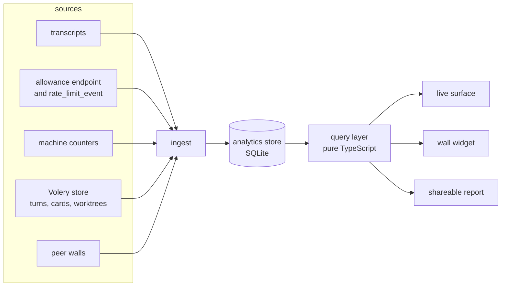
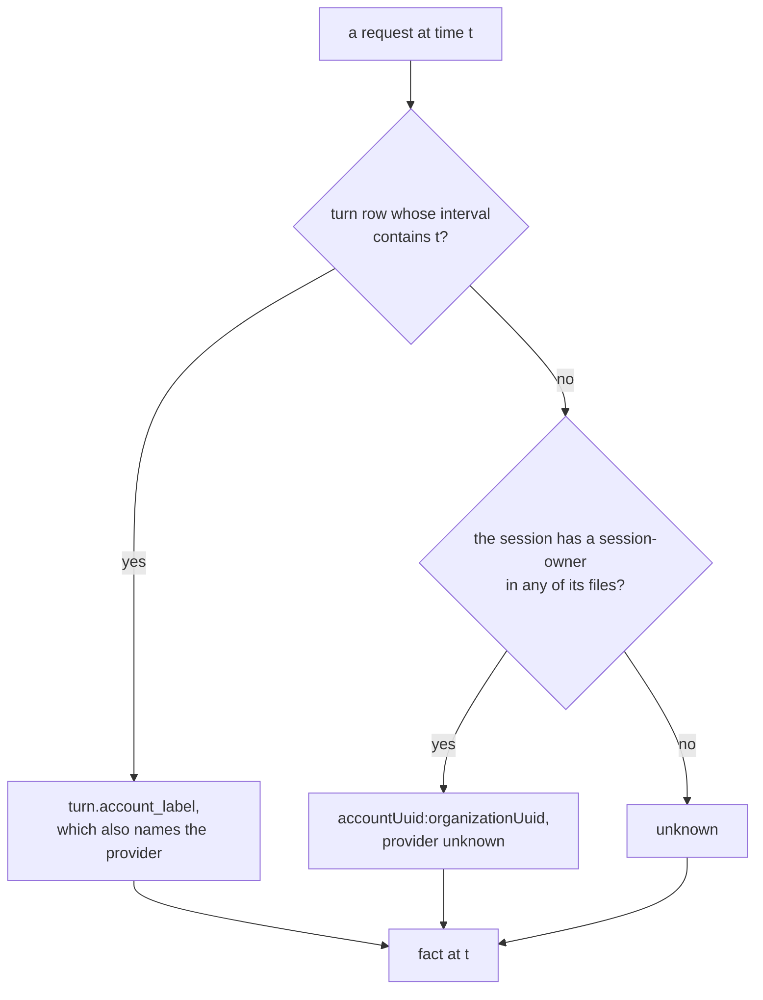

# Analytics

Managing an allowance is the part of agentic development nobody can see. Volery draws what
is happening on the wall right now, beautifully, and forgets all of it by the time the window
closes. The question this subsystem answers is older and wider than the wall: **what have I
spent, on what, across every machine and every account, and what does that predict about what
I have left?**

Three facts make that question harder than it looks, and all three are load-bearing:

- **The bill is per account, not per conversation.** A turn taken in a terminal on another
  laptop spends the same weekly allowance a card here does. Nothing in a card's own state can
  see it.
- **The transcripts are the only complete record, and they are temporary.** Claude Code writes
  every request to `~/.claude/projects/**/*.jsonl`, terminal sessions included, and deletes
  them after its cleanup period. A reading that only ever looks at the last eight days can
  never answer a question about last month.
- **Allowance percentages and tokens are different currencies.** Dollars are a list-price
  equivalent of work done. The weekly percentage is the resource actually being metered. A
  system that shows only one of them will always be wrong about the other.

This document designs a subsystem that keeps the record, attributes it, reconciles two
independent measurements against each other, and draws the result live on the wall, historically
in a full screen, and statically in a file somebody without Volery can open.

No implementation yet. The experiments that shaped it are named where they mattered.

---

## 1. What exists today, and what each reader is for

| reader | source | window | survives a restart | attributes |
|---|---|---|---|---|
| `usage.rs` / `usage.ts` | transcripts | 8 days, in memory | no | this machine, aggregate |
| `limits.rs` / `limits.ts` | `/api/oauth/usage` | current windows | no | per account, live |
| `turn` table | Volery cards only | forever | yes | per card, per account, no CLI version |
| `credits.rs` | `turn` rows | month | yes | credits only |
| `perf.rs` | process sampler | live | no | per card, no history |
| flyway `Facts` | each wall | live | no | per wall: rate, cards, allowance |
| `chronicle` | events | forever | yes | events, not measures |
| tool calls | transcripts only | 8 days, in memory | no | nothing today |

Each is right for what it does. None of them is a memory, and that is the gap.

The five blind spots, in the order they hurt:

1. **No history.** Restart the app and the cost reading starts again from whatever the last
   eight days of transcripts still contain. A month is not recoverable, and the transcripts
   that would have answered it are deleted on a schedule nobody here controls.
2. **No attribution outside Volery.** Terminal turns are counted in the total and cannot be
   split by project, model, or account. The `turn` table knows the cards; the transcripts know
   everything; nothing joins the two.
3. **No machine history.** CPU, memory, GPU, disk and network are sampled only while a meter
   widget is up, and only in memory. There is no way to ask what a month of parallel cards
   cost the machine.
4. **No cross-machine history.** The flyway carries a wall's *current* rate, card count and
   allowance. It carries no past. A laptop that was off last Tuesday has no Tuesday to send.
5. **No reading of what the tools cost.** The transcripts carry every tool call, its result,
   its latency and its error, and nothing folds them. A slow or failing MCP server is a tax on
   every card that touches it, and today it is invisible.

---

## 2. The spine: facts, not readings

The system is three layers, and the boundary between them is the whole design.



- **Ingest** writes facts. It makes no judgements about cost, windows or meaning.
- **The store** is append-only per host, durable, and mergeable across machines.
- **Query** is pure TypeScript over facts. Everything a person argues about (what a unit is,
  what a filter means, what an axis says) lives here and is tested without a webview.

This is the split `perf.rs`/`perf.ts`, `limits.rs`/`limits.ts` and `usage.rs`/`usage.ts`
already draw. Analytics is the same shape at a larger scale.

### Two measurements, reconciled

The subsystem deliberately keeps **two independent measurements of the same spending**:

1. **Transcript facts**: what each known request carried, priced and attributed.
2. **Allowance deltas**: the account's own counter moving from one sampled percentage to the
   next, whichever machine caused it.

Neither alone is enough. Transcripts are complete on a machine that runs Volery and blind
everywhere else. Allowance deltas are complete for the account and say nothing about what
spent it. Together they do something neither can: **the difference between them is a
measurement of the blind spot.**

If a week's weekly window rose by 42 points, and the walls on the flyway can only account
for 31 of them, the remaining 11 are real, not noise. That residual is drawn as its own band,
named *unattributed*, and it is the honest answer to "how much am I using across all
machines" when one of those machines has never run Volery.

The reconciliation is a query-time operation, not a stamp written at ingest. A wall cannot
know its peers' requests when it ingests, and a later peer joining the flyway must be able to
improve the attribution of a week that is already stored. Section 5 has the arithmetic.

---

## 3. What a fact is

### 3.1 Grain

`usage_fact` is one row per **five-minute bucket, session, agent, parent agent, depth, model,
effort, CLI version, source, account, provider, project and provenance**, carrying the five
token kinds and a request count. Five minutes is `usage.rs`'s existing bucket and is fine
enough for every window anybody reads: the trailing edge of a rolling window moves by at most
one bucket. The full key is written once, in section 17, and the block below is that key
rather than a second statement of it.

A session is the unit of attribution. Subagents get their own `agent` id under the same
session, which is how their spend stays attached to the card that caused it without being
confused with the card's own turns.

```sql
usage_fact(
  at, host, session, agent, parent_agent, depth, model, effort, cli,
  source, account, account_identity, provider, project, provenance,
  in_tok, out_tok, cache_read, write_5m, write_1h, requests, usd_reported
)
PRIMARY KEY (at, host, session, agent, parent_agent, depth, model, effort, cli,
             source, account, provider, project, provenance)
```

`source`, `account`, `provider` and `project` are denormalized onto the fact rather than held
only in a session row, because a card can change account or provider mid-session and a
terminal session can be resumed under a different one. They are also **in the key**: two
requests in one bucket under two accounts (a swap) must not be merged into one row, or the
history loses exactly the thing it exists to record. The session table carries the *first*
and *last* of each; the fact carries what was true for that bucket. A query that wants "what
did this card cost" sums the facts rather than trusting a single label.

Two columns that sound alike are not: **`source` is `card | terminal | unknown`** (who ran
it), and **`provenance` is `transcript | turn`** (where the row came from). Both are in the
key, so a backfilled `turn` day and a transcript fact for the same bucket cannot collide and
the query can prefer the finer one. There is no `rollup` provenance: a rollup is an
aggregation of facts that already say where they came from, and giving it a third value
would describe the same row twice.

### 3.2 The session dimension

```sql
analytics_session(
  session, host, project, source,
  card_id, parent_card, opened_by, branch,
  started_at, ended_at, cli_min, cli_max,
  account_first, account_last, provider_first, provider_last,
  turns, endings_json
)
```

Section 17 has the same table as it is built; this block names the columns the prose below
reads. This is the per-card and per-terminal row: which Volery card it was (if any), where it ran,
when it started and ended, which CLI versions it spanned, and how its turns ended. It is
written when a session is first seen and updated as more is learned. It is what makes
"cost per card" and "performance vs cost" possible without joining a million facts.

**The account and provider are `first` and `last` on purpose, and nothing may read them as
"the" account.** A session that swapped funding is the case the names exist to warn a reader
about; the facts carry the per-interval truth (section 4). A query that wants "what did this
card cost on tx-team" sums facts, never the session row.

`endings_json` is opaque and normalised on read, the `widget.config_json` bargain. The ending
vocabulary is `classify.ts`'s and must not get a second home in Rust.

### 3.3 Allowance samples

```sql
allowance_fact(
  at, host, account, kind, scope,
  used, resets_at, severity, plan, source
)
```

`used` is a **percentage, 0 to 100**, in the same unit `limits.rs::Window.used` and
`limits.ts::Window.used` already carry. There is no conversion anywhere: the collector writes
the source's number and the delta arithmetic in section 5 is in points. A fraction was the
first draft and it was wrong in the most expensive way, because `27` written as a fraction is
`2,700%` and every downstream figure inherits the factor. One unit, the source's, and a test
asserts a sample at 27 reads 27. `source` is `poll`, `stream` (a `rate_limit_event` off a
card's own request) or `peer` (a reading another wall took, arriving as an age).

A sample is a *point*, not an interval. The curve between two points is reconstructed at
query time and drawn as a step, because that is what is actually known.

**As built.** `allowance_fact` is schema v71 and the primary key is
`(at, host, account, kind, scope)`. That key dedupes **two sources on one wall reading one
instant of one window**, which is the case a poll and a card's event can produce together; the
host in it is what keeps a peer's row distinct, since a `peer` row carries the name of the wall
that took the reading. The subsystem still adds no poller. The
front end notes what already arrives — `waterfall.svelte.ts` writes the poll's answers with
`source: "poll"` (or `"peer"` where the report says *read on <host>*, and the row keeps that
host's name so a residual can see it) and a card's `rate_limit_event` with
`source: "stream"` — through `note_allowance_samples`. **Only the windows the event itself
named** are taken from the stream: the rest of that reading is held from the last poll, and
noting it at the event's instant would claim a read that did not happen. `accounts.ts` answers
which those are (`observedKinds`), because a kind filter cannot tell a held window from one the
event just read when they are the same kind.

**The unit is the source's and is not converted.** A writer that sent a fraction would be
writing 0.27 where every reader expects 27; the command clamps to 0–100 and leaves the scale
alone, and a test reads a sample noted at 27 back as 27. `used` is clamped rather than refused
because the clamp cannot invent headroom against a ceiling someone set, where a silent multiply
would make a wrong caller look right on its own face. A value that is not a number at all is
refused, because a NaN is not a reading of zero.

**Only a change is written.** The curve is a step, so a poll whose `used`, `resets_at` and
`severity` match the last stored row for that window adds a point that carries no information;
skipping it is what keeps an install-wide three-minute poll from filling the table, and the
read's ceiling is sized from what remains. Samples prune at ninety days with the other fine
tiers, though nothing asks for more than eight.

**The wall keeps the waterfall attached for the life of the app** (`skein.svelte.ts`), so
samples are noted whether or not this room is open; the room asks for one poll as it opens, so
the strip is drawn from a reading taken now rather than from one taken before an idle hour, and
it watches the ledger while it is up so this wall's burn rate is computed at all. A wall whose
poll has not answered yet says *no sample yet*; the room is not what makes sampling happen.

### 3.4 Machine facts

```sql
machine_fact(
  at, host,
  cpu, mem_used, mem_total,
  gpu, gpu_mem,
  disk_read, disk_write, disk_free,
  net_rx, net_tx,
  procs, cards, cards_working, worktrees
)
```

One row per minute per host. CPU is the whole machine 0 to 100. `gpu` is the busiest engine's
utilization on the primary adapter, 0 to 100. Disk and network are bytes per second. `procs`
is the process count, which is the one figure that says whether a wall is leaking.

### 3.5 The rate history, because a price is a fact about a date

`usage.ts::RATES` is a constant, and `usage.md` records why a constant is the wrong shape for
a bill: it went stale for a month, and it silently priced Sonnet 4 as Sonnet 5. Historical
analytics makes that failure much worse, because a reading of last March computed with today's
table is wrong in a way nobody can see.

So the price table becomes data with a validity window:

```sql
rate(
  model, clock, from_at, to_at,
  input, output, cache_read, write_5m, write_1h, source
)
PRIMARY KEY (model, clock, from_at)
```

`clock` is `peak` or `off_peak`, because DeepSeek already bills two rates by time of day and a
single row per model cannot express it. **A model with one clock has one row, used at every
hour**; only a model with an `offPeak` entry in `usage.ts` gets two. Read literally, "the row
whose clock matches the fact's time" would find no row for every Claude fact outside DeepSeek's
peak, which is the whole day. The peak windows are DeepSeek's and they are **UTC**
(`usage.ts::deepseekPeak`), not the fact's local time; the collector uses those same windows.

`to_at` is written for display and is **not the join**. The query takes the row with the
greatest `from_at <= t` for that `(model, clock)`, so a price change is a new row with a later
`from_at` and a superseding row can never leave two rows matching one instant. `to_at` is
`9223372036854775807` for "still in force" rather than `NULL`, because a null in a key sorts
nowhere. When a row is superseded its `to_at` may be written to the new row's `from_at`, but
the answer does not depend on it.

`analytics.rs` seeds the table from `RATES` today. When the published rates differ from what
the CLI charged, both are kept: `usd_modeled` is the rate-history figure, `usd_reported` is what
the CLI or the `turn` table said for that request. The face says which one it is showing, and
the default is modeled with the date it was modeled from.

This is the systemic fix `usage.md` asked for: not a better constant, but a table that cannot
be right about the future and wrong about the past at the same time.

**A provider card is the one case the table cannot price**, and the rule is stated here rather
than discovered at the face. A DeepSeek card's transcript carries a Claude alias, so the table
has no way to know the tokens were billed by DeepSeek at all. For a turn whose funding is a
provider sentinel, `usd_reported` from `turn.usd` (computed at settle with the real provider
model) wins, and `usd_modeled` is `null` rather than a number that looks authoritative. The
inspector says which source priced the row. Section 4.1 has the measurement behind this.

### 3.6 Rollups

Three retention tiers, each with a job:

| tier | grain | kept | synced | used for |
|---|---|---|---|---|
| fine | 5 minutes | 90 days | on request, day at a time | live, this week, drilling in |
| hourly | 1 hour | 3 years | yes, by default | months, cross-machine |
| daily | 1 day | forever | derived | year-over-year, reports |

The hourly tier has two tables, because tools are a different grain from tokens: `usage_hour`
and `tool_hour`. A month of "which MCP server is slow on the other laptop" is a question about
the second, and folding it into the first would have meant a token row per tool call.

**The hourly tier keeps the dimensions that survive three years, and no more.** `effort` and
`cli` are carried; `card`, `session` and `agent` are not, because a three-year rollup keyed by
session is a rollup of every conversation ever taken. So card-level questions stop at the fine
tier's 90 days, and the face says which tier answered. `tool_hour` carries a compact latency
histogram (`ms_under_50`, `_200`, `_1s`, `_5s`, `_over_5s`) instead of only `ms_total`, because
a mean cannot produce a p95 and a p95 is the reading that names a slow server. A percentile
over months is an estimate from those buckets, labelled as one; an exact p50/p95 is a 90-day
reading.

Hourly is the sync grain rather than daily because a day boundary is a timezone, and two
machines in two timezones would disagree about which day an hour belongs to. UTC hours
re-bucket into any local timezone with at most one hour of edge error, and a daily view is a
sum of 24 of them.

Rollups are stored, not computed on every query, because a three-year view over fine facts is
millions of rows and a stored rollup is tens of thousands. The rollup writer is part of
ingest, not a cron: a pass that writes a fine fact also adds to the current hour row. The daily
tier is derived from hours rather than stored, because a stored day would be the same sum with
a second timezone in it, and the table's only job is the year view.
**The hourly row carries the fact's `provenance` and has it in its key**, because otherwise a
backfilled `turn` day and the transcript facts covering the same hours add into one row, and
the preference for the finer source, which section 7.4 defines for the fine tier, would stop
holding the moment the fine rows aged out at ninety days and left the double-count behind in
the tier that outlives them.

### 3.7 Tool and server facts, because how the work was done is also the bill

A token total says what a turn cost. It does not say whether the money went on reading files,
running a shell, calling an MCP server, or loading a skill. The transcripts answer that exactly,
and the answer is the difference between an analytics system and a bill.

Every assistant record carries `tool_use` blocks: a `name`, an `input`, an `id`. Every result
carries a `tool_result` with the same `tool_use_id`, an `is_error`, and a `toolUseResult` whose
shape says what kind of thing it was. Measured over five days on this machine, the top of the
list already reads like a budget:

```text
Bash 24,165 · Edit 2,351 · Read 2,269 · Write 1,298 · Grep 1,165
mcp__skein__send 468 · mcp__browser__browser_run_code_unsafe 463
SendMessage 298 · Agent 277 · ToolSearch 201
mcp__skein__ask_user 136 · mcp__skein__wake_me 92 · mcp__skein__wisp 87
```

An MCP tool's name is `mcp__<server>__<tool>`, so the server is a dimension without a second
record. Built-ins have no server, and the fact says `builtin` rather than inventing one.

```sql
tool_fact(
  turn_id,       -- turn.id; 0 for a call no turn claimed
  at, host, session, agent,
  kind,          -- builtin | mcp | skill | agent
  server,        -- the middle segment of mcp__server__tool, or ''
  tool,          -- the name, or the last segment
  target,        -- skill name, subagent type, or ''
  child_agent, requested_model,   -- set on an Agent/Task call
  calls, errors, ms_total, out_bytes,
  turn_usd,
  PRIMARY KEY (turn_id, at, host, session, agent, kind, server, tool, target, child_agent)
)
```

**The grain is the turn, not the five-minute bucket**, because the apportionment is exact only
if every row belongs to one turn and one cost. A turn writes one row per tool it used, at the
turn's `ended_at`; a call no turn claims keeps the bucket grain with `turn_id = 0`. A long
turn's calls therefore land in the hour it ended, which is deliberate: the turn is one bill,
and spreading it over the hours it ran would invent a distribution the cost does not carry.
Section 17 has the same table as it is built.

- **`ms_total` is measured**, not estimated: the result record and the call record are joined
  on `tool_use_id`, and the difference of their timestamps is the wall-clock wait. A call with
  no result (a turn that died, a parallel call still running) contributes `calls` and no time,
  so a median is over completed calls and the count is over all of them.
- **`errors`** is the `is_error` of the result, which is the CLI's own word rather than a guess
  from the exit code. A tool that answers `Error: …` without setting it is a success by this
  reading, and that is worth saying in the method note.
- **`out_bytes`** is the size of the result content, summed from the blocks, and **the content
  itself is never stored**. A tool result can be a file, a screenshot or a token; the analytics
  store keeps `42,318` and not the bytes. That is the line between analytics and conversation
  content, and it is drawn in the schema, not in a policy.
- **`turn_usd` is apportioned across the turn's calls, and the apportionment is why the rows
  are written after the turn settles.** The turn's cost is divided by its calls, and each row
  carries `turn_usd × calls_in_row / calls_in_turn`, so a sum over the turn equals the turn.
  Copying the whole turn onto each tool row would multiply it by the number of tools, and
  dividing it by each tool's own calls would give that tool the whole turn. The divisor is not
  known while the calls are still landing, so the pending rows accumulate and the facts are
  written in one pass once the turn has a cost. That also keeps `tool_fact` append-only, which
  is what the union merge in section 8.1 rests on. The per-call figure is `turn_usd / calls`,
  labelled *apportioned*: a division of a measured number, not a guess at a hidden one. The
  inspector says which of the two it is, always.

- **The settle signal is Volery's own `record_turn`, not anything in the transcript.** The
  measurement is blunt: across **466 transcript files on this machine, `"type":"result"`
  appears in none of them**, and neither does `system/init`. Both are stdout events the live
  stream carries; the transcript records `assistant`, `user`, `attachment`, `api-request` and
  the rest, and it never marks where a turn began or ended. So the analytics pass folds the
  `turn` rows Volery writes, and the row is written at the open (§4) rather than reconstructed
  from the previous one.

- **A call is claimed by its own timestamp against a stored interval, never by "whatever is
  open now".** The pass runs on a clock and can be a prompt behind, so asking which turn is
  currently open would stamp turn N's tail with turn N+1's id and apportion it N+1's cost.
  The interval is `[turn.opened_at, turn.ended_at)`, both stored facts, and every call in it is
  that turn's. A subagent's call is claimed by the turn its **spawning call** fell in, not by
  the turn running when the subagent happened to act: that is the only rule that keeps a
  background agent's work out of the card's next turn. Where the spawn cannot be resolved, the
  call falls back to its own timestamp, and a call whose interval names no turn is no-turn.

- **The fold is one transaction, and it clears what it consumed.** A turn is folded once its
  `ended_at` is a short grace old, which is what lets a result landing just after the turn's
  end be written rather than swept. The pass then, in **one transaction**: writes the
  `tool_fact` rows, adds each row's share to `tool_hour`, inserts `analytics_fold(turn_id NOT
  NULL PRIMARY KEY, at)`, and **deletes the `tool_pending` rows it folded**. It folds every
  eligible turn before it sweeps. Without the delete, every settled turn's calls would later
  satisfy the sweep and be written a second time as no-turn rows: the same call counted twice,
  on the ordinary path, before any crash is involved. With `tool_hour` outside the
  transaction, a crash in that window would lose the monthly reading of those calls for good,
  which the marker then prevents a re-fold from repairing. There is no "between" to reason
  about: a crash before the commit rolls the whole fold back and the next pass writes it once,
  and a crash after it leaves the marker that skips it. The fact's own key is a belt on the
  same braces (`INSERT … ON CONFLICT DO NOTHING`), not the mechanism.

- **A fold that never happens is bounded.** A turn from before this feature, or one whose
  transcript is gone, writes the marker and no facts, so the pass does not reconsider it every
  minute.

- **An unresolved call is written once, as `no-result`, and stays that way.** A pending row
  whose result has not arrived when its turn folds is written with its `calls` and no time,
  and deleted with the rest. A result landing after that finds no pending row and is dropped:
  the row keeps `no-result`. The alternative, writing the late result as a no-turn row, would
  put one call in two rows, and `tool_fact` has no `tool_use_id` to match them by. Losing a
  late latency is the smaller loss and it is bounded by the grace. It also loses the late
  `child_agent` on an `Agent` receipt that arrives after it, so a slow receipt leaves an
  `agent` tool call with no child named: a tree with one missing branch, not a wrong one, and
  the price of one row per call.

- **A call can belong to no turn, and it is kept rather than dropped.** A terminal session has
  no `turn` row at all, and a background agent's calls can finish after its card's. The sweep
  writes any pending row that falls inside no turn's interval, **open or settled**, and is
  older than a bounded wait, with `turn_id = 0` and `turn_usd = 0`, labelled *no-turn*. A call
  inside a live turn is inside its open interval, so it is not swept however old it is: **the
  claim is the test, not the age.** A killed card's
  turn is closed by the reader thread with its real span and no cost, so its calls fold into
  that turn rather than becoming no-turn. Its calls, errors, latency and bytes survive; only
  the money is absent, which is the right way round for a table whose second job is to name a
  slow server. The denominator is the turn's own rows, so a no-turn row is outside it by
  construction and the turn still sums to exactly its reported cost.
- **Skills and agents are tool calls, and a second signal.** An explicit `Skill` call carries
  the skill name in its input; an `Agent`/`Task` call carries the subagent type. Separately,
  every assistant record carries `attributionAgent` and `attributionPlugin`, which name the kit
  skill or agent that produced the turn even when no tool call did. Both are kept, and the
  behaviour view says which it used: *invoked* against *attributed*.
- **A spawn is a `spawn` MCP call or an `Agent` call, and the store has the lineage.** The
  transcript counts what was asked for; `spawned` and `flyway_child` say what was opened and by
  whom. The behaviour view uses the transcript for *tendency* and the store for *outcome*.

The same three fields answer the MCP-server question the brief implies: calls, error rate and
median latency **per server**, and which project and card each came through. A server that
answers slowly and fails a third of the time is a tax on every card that touches it, and until
now there was no way to see it.

**Two things about the reader, and both are costs the first draft hid.** A `tool_use` is on an
`assistant` record, but its result is a `user` record with a `tool_result` block, and
`usage.rs`'s cheap gate deliberately skips every `user` record: those are the largest records
in the file, and parsing them is most of what a full pass would cost. So the tool half needs a
reader of its own, or a second branch in the same pass, and the per-pass cost in section 16 is
the cost of the assistant half only until that is measured.

And a call and its result are not one record: the result can arrive in a later pass, a
different five-minute bucket, or, for `Agent`, `Monitor`, `Workflow` and a background `Bash`,
never as work at all but as a receipt that returns immediately (`turns.md`). So a **mutable
`tool_pending` row keyed by `tool_use_id`** (never by bucket) is written with the call, and the
result updates it with `ms_total`, `errors`, `out_bytes`, and for an `Agent`/`Task` call the
`child_agent` the result carries beside the `requested_model` the call's input carried. The
immutable `tool_fact` rows are written together once the turn has a `turn` row to apportion
against, from the pending rows (see `turn_usd` above); a pending row whose result never
arrived is written then as `no-result`, and a row no turn ever claims is written by the sweep
with `turn_usd = 0` rather than dropped. A receipt is marked `async` and its latency is the
receipt's, not the work's, and the face says so. Without that row, a slow background tool
reads as a fast one, which is the opposite of the truth.

**What the call's input actually carries, measured over 373 `Agent`/`Task` calls on this
machine:** `description` (373), `prompt` (373), `subagent_type` (368), `run_in_background`
(300), and `model` on **7**. No call carries an `effort` or `thinking` key at all. So the
requested model is a reading worth keeping and is usually `unknown`, and the requested effort
does not exist as a field: the effort a subagent actually ran at comes off its own assistant
records, per request, which is the stronger fact anyway. The schemas say `requested_model`
and no `requested_effort`, rather than a column that would be empty forever.

### 3.8 Prompt facts: the form, a redacted body, and a vault

The transcripts carry every human prompt, including the ones typed into a terminal, and they
carry a great deal that is not a prompt. Measured over five days on this machine, with the
filter the codebase already uses. Each record falls in exactly one class, decided in the order
`prompt_of` rejects them, so the column sums to the total:

```text
user records            29,268
  tool results          19,694   (a tool's output, not a person)
  subagent turns         7,858   (isSidechain)
  human prompts            832
  task notifications       362   (<task-notification>)
  oversize                 341   (over 256 KB, never parsed)
  system reminders         111   (isMeta)
  injected commands         27   (<local-command-*>, the caveat sentence)
  compaction summaries      23   (isCompactSummary)
  stop notes                19   ([Request interrupted by user...)
  no text                    1   (a user record carrying neither)
```

**The order is what makes it a partition rather than seven overlapping counts, and it is
`prompt_of`'s own order: the length gate, then the three flags, then the content.** Oversize is
decided before the parse, so such a record is `oversize` before it can be anything else; the
flags come next, so a tool result inside a subagent is counted as a subagent turn and not
twice; the content classes come last. Counting each marker independently gave 28,962 against a
total of 28,879, which is what a set of overlapping predicates looks like when it is read as a
breakdown.

**The filter is `sessions.rs::prompt_of`'s rejection rule, shared rather than re-derived.**
One shape change is owed first, because `prompt_of` ends by flattening the prompt onto one
line (`split_whitespace().join(" ")`) for the titling grid, and that is exactly the newlines
and fences the form counts. So the function is split in two: a fold that decides whether the
record is somebody speaking and returns the text **unflattened**, and `prompt_of` on top of it
as flatten-and-clip for a title. The ingestor calls the fold. Nothing about the rejection
logic changes, and a second copy of the marker list is what this arrangement exists to
prevent. That function already
rejects `isMeta`, `isSidechain`, `isCompactSummary`, the eight injected markers
(`<local-command-caveat>`, `<command-name>`, `<command-message>`, `<command-args>`,
`<local-command-stdout>`, `<task-notification>`, the local-command caveat sentence, and
`[Request interrupted by user`), strips a `<system-reminder>` out of a genuine prompt, and
treats a tool result as no prompt at all because it carries no text block. Re-deriving that list
would have shipped three bugs at once: a stop note, a task notification and a compaction
summary each read as a human prompt, and the reminder's own text, which can name paths and file
contents, stayed inside the stored body. It also caps the line at 256 KB, which is the one
unbounded parse in the walk.

**A record the wall itself wrote is not a prompt either, and it is dropped rather than
counted.** Relay messages, wakes, rousing's resume and jobs prompts, the background-job
notification, a pick-up, a carry-on and the heal's resend mark all land in a transcript shaped
exactly like something typed. Counted, the kind mix and the nudge rate would measure Volery
talking to itself, which is the one number the trace exists to make trustworthy. So they are a
second list beside the injected markers, each with the class it is, rejected by the same fold.
The list is a copy of strings the composers write (`relay.ts`, `rousing.ts`, `classify.ts`) and
`test/prompt.test.ts` holds every entry to the composer it came from. The resend mark is
**appended** rather than prefixed, so it is found by its shape anywhere: the alternative is
every healed turn polluting the counts, and a person typing two newlines and
`skein: attempt N of M at this prompt.` is the rarer case. The counts in the table above were
measured before this exclusion, so a wall with traffic will come out slightly lower.

**Deduplicate by `(host, prompt_id)`, keeping the first occurrence.** A repeated id carries a
different timestamp, so `at` cannot be the key; the stop note also reuses the prompt's id, and
`prompt_of` excludes it before dedupe. In the five-day window there are 832 prompts and 832
distinct ids, so this window holds no duplicate at all; a replay can still produce one, which
is why the key exists rather than because one was seen. The row's `at` is the first time it
was said, and `seen_count` says how many records carried it.

A prompt's content is a string or text blocks; image blocks are counted and never stored.

**A prompt the wall wrote is not a person's prompt.** A relay message, a wake, a resume prompt,
a job prompt, a nudge and a pick-up are all `user` records, and counting them would put
Volery's own words into the kind mix and into any redirect or nudge rate, which is the one
number the trace exists to make trustworthy. They are rejected by their openings the same way
an injected marker is (the openings come from the app's own composers rather than from this
list, and `test/prompt.test.ts` holds the two together), plus the mark a heal appends to a
retry, which is detected anywhere because it is a sentence this app composes. They are
**dropped rather than recorded**: the trace is the person's, and a count of wall chatter is a
different reading nobody asked for.

What is kept is the **form**: characters, words, lines, code fences, code lines, images,
question marks, the kind, and the redaction counts. Length is measured *before* redaction, so
taking out a key does not change the shape being read.

#### The body, and the vault

The raw prompt is never written by analytics. It stays in Claude Code's transcript, which this
subsystem does not copy and cannot delete. The copy analytics keeps is **redacted, capped at
8 KB, and sealed**:

- **Redaction first, over-redact.** Private-key blocks, known token prefixes (`sk-`, `ghp_`,
  `github_pat_`, `xox…`, `AKIA`, JWTs, `Bearer`), key/value assignments, connection strings,
  URLs with userinfo, emails, GUIDs, commit SHAs and 7+ hex tokens, IPs, MACs, phone-shaped
  numbers, absolute paths **that name a home directory** (the extension kept), and long
  base64/hex runs. Fenced code is replaced whole with
  `<code omitted: N lines>`; the fence and language stay. A prefix is anchored at a word
  boundary with a minimum body length, so `task-` and `risk-` survive; a **false-positive corpus**
  asserts that an ordinary design brief comes through unchanged, beside the fake-secret corpus
  that asserts every pattern is taken out. A backstop takes any remaining high-entropy token,
  and withholds the whole body if there are more than eight. Both corpora run on every
  `cargo test`, and by `tools/lift-redact.ts` on a machine that cannot link the crate.

  **"Absolute paths" was narrowed to a home directory after it was written**, and that is the
  one place this list changed. A design brief is mostly paths, and a body with
  `src/lib/analytics.ts` and `C:\workbench\volery\src-tauri` taken out of it is a body nobody
  can follow: the false-positive corpus asserts they come through. What names a person is the
  directory they live in, so `C:\Users\<n>\…`, `/home/<n>/…`, `/Users/<n>/…` and `~/…` are what
  goes, and the extension stays because `.rs` and `.png` are the part that says what the thing
  was. The key/value rule learned the same lesson in the other direction: `DB_PASSWORD=…` must
  go, so the key name is matched at a *segment* boundary and not only a word boundary, while
  `tokenizer` survives because no `:` or `=` follows it.
- **Then sealed with a key only you hold.** A 32-byte data key is generated once and sealed
  with a key derived from your passphrase (Argon2id, 64 MiB, three passes, one lane). Each body
  is sealed with **ChaCha20-Poly1305 (`ring`), a fresh random 12-byte nonce**, and the blob is
  **`nonce(12) ‖ ciphertext ‖ tag`** in one column, so the reader needs no second field and no
  implementer can quietly reuse a nonce. The associated data is
  `(vault_id, host, session, prompt_id, first_at)`, so a ciphertext cannot be moved to another
  row. The wrapped data key, its salt and its key-wrap nonce live in `prompt_vault`, keyed by
  `vault_id`; **the passphrase does not live anywhere**. That is the password-protected zip: the
  archive is on disk and on the flyway, and it is opaque until you unlock it.
- **The key is memory-only.** Unlocking derives the key-encryption key, unwraps the data key,
  and keeps it in a `Secret` that is zeroized on lock, quit or a fifteen-minute idle. If the
  vault is locked when a prompt is ingested, the form is recorded, the body is marked `locked`,
  and a **local-only locator** is kept in a table of its own, `prompt_locator(host, prompt_id,
  path, off)`, so the `seal pending` pass can seek straight to the line and seal it when you
  unlock. It is a separate table rather than two columns on `prompt_fact` because `prompt_fact`
  is what the archive serializer writes, and a path a serializer never sees is a path it
  cannot carry. A locator is deleted the moment its body is sealed. A prompt whose transcript
  is already gone keeps its form and stays `locked`.
- **A forgotten passphrase is a lost archive.** There is no recovery, by construction. `reset
  vault` deletes the wrapped key and every sealed body, emits a tombstone for each, keeps the
  form counts, and asks twice.
- **The threat model, stated with its one real limit.** The vault protects the **redacted
  archive**: a copied SQLite file, a backup, a peer's disk. It does **not** protect the original
  prompt, because the raw transcript is plaintext in `~/.claude/projects` on the same machine,
  and a stolen laptop takes both. It does not protect a running, unlocked app, a keylogger, or a
  process that can read this process's memory. A passphrase is required to be at least twelve
  characters or generated by the app, because the wrapped key is offline-crackable if it is
  weak and the record travels to peers.

#### Across the flyway

The counts travel freely: `prompt_hour` is the analytics and carries no text. **A sealed body
may travel too, because a peer cannot read it without the passphrase.** That is the version of
"everything travels" that is actually true: the ciphertext is a small opaque blob, so a wall
can hold the archive without being able to read it.

- **A per-peer switch, off by default,** decides whether this wall will serve its sealed bodies
  to a peer (`prompt_grant`). The peer asks, day by day, and stores the ciphertext; the read
  gate is the passphrase, not the switch. The switch is policy for a lab or a colleague's wall,
  not a cryptographic boundary: a key holder can already read the raw transcript through the
  recall path (`seeing.rs`), and the design says so rather than implying a guarantee it cannot
  make.
- **The vault record syncs, the passphrase never does.** A new machine receives the wrapped
  data key, salt and nonce from a peer (or from a small export file), and the same passphrase
  unwraps it. That is what makes a fleet-wide archive readable from any wall. **A key pair is
  not needed for one person**: the wrapped data key is the shared secret, and a teammate share,
  if it ever matters, encrypts that data key to their public key rather than re-keying every
  body.
- **Two walls may each have made a vault, and neither may lose.** `prompt_vault` is keyed by
  `vault_id`, not a single row, and every body names its vault (`prompt_fact.vault_id`). A wall
  can hold several; the reader unlocks each with the same passphrase (or one passphrase per
  vault, listed), and a new body uses the active vault. Whichever record arrived first never
  overwrites the other, because discarding a data key makes its bodies unreadable forever.
- **The archive is its own frame, paged and verifiable.** A peer asks with `prompt_archive_ask
  { owner, day, page }` and gets `prompt_archive { owner, vaults, rows, sessions, page, pages,
  digest, page_digest, count }`: the sealed rows, the vault records and the session sidecar a
  prompt's card and branch resolve through, **repeated on every page** so no page is a special
  case. Each page carries its own `page_digest`, and the day's `digest` covers the pages
  concatenated in prompt-id order. **The receiver stores nothing until every page is present
  and both checks pass**: pages are held in memory, and a crash drops them rather than leaving
  a partial day on disk. A missing or tampered page leaves the day absent, and the face says
  the day is incomplete and offers the pull again. **Only a settled UTC day is served**, never
  the one being written: a day that is still growing would have page 1 and page 2 drawn from
  two different days, and no digest could reconcile them. The manifest therefore lists only
  days before the current one. It is never gossiped and never in a greeting; a wall that does
  not announce `prompts` in `Facts::can` is refused before the request.
- **A delete is a durable tombstone, not a message.** `prompt_tombstone(owner_host, prompt_id,
  at, reason, acked)` is an outbox retained until every grantee acknowledges; it is pushed when
  a peer connects and when one is written, so a peer that was offline applies it on its return,
  and `reset vault` emits one per body it deletes. A deleted body is `body_state='deleted'`, not `none`, so a deletion is
  distinguishable from a prompt analytics never captured. A peer that received a *relayed*
  copy, or one no longer on the grant list, is outside what a delete can reach; the face says
  so rather than claiming a deletion that cannot be delivered.
- **A favourite outlives the prune** (`prompt_favourite`): a title, tags and a sealed note,
  kept until you delete it. The body is the same sealed row, so the hall needs no second copy.

#### The kind

`design`, `redirect`, `nudge`, `task`, `question`, `issue`, `other`, decided deterministically
in Rust (`prompt.rs`) because the ingestor is the only thing that sees the text. A model with
one rate has one rate row; a prompt with one kind has one kind. The TypeScript vocabulary is
display only and held to the Rust enum by `test/prompt.test.ts`, the pattern
`test/afar.test.ts` uses. A manual `kind_override` is local and is a reading, not training
data. **An override updates the `prompt_hour` row in the same transaction**: the old kind's
counts go down, the new kind's go up, so the mix, the redirect rate and the nudge rate follow
the correction rather than going on counting the automatic answer. Which hourly row that is
comes off the fact, which is why `prompt_fact` carries `hour`, `account` and `provider` beside
its own fields: without them the fine row names no rollup row to move the counts in, and the
correction would stop at the trace.

#### Retention, which is not ninety days for the things you keep

Form metrics and kinds live in the hourly rollup for three years, and the prompt archive is
**not** on the fine tier's 90-day clock:

- a sealed body is kept **until you delete it**, with a prune option (90 days, a year, forever
  is the default), because the point is to see the work evolve;
- a favourite is exempt from every prune;
- `forget prompts` deletes bodies and leaves the counts; `forget everything` is a bigger,
  separately confirmed gesture.

A sealed body is about a kilobyte and the volume is a few hundred a day, so a year of archive
is on the order of a hundred megabytes. That is the cost of the hall, and it is a disk cost,
not a privacy one, because the disk holds ciphertext.

### 3.9 Work facts: what the money bought

Cost alone makes parallelism look like a leak. Ten cards cost more per hour than one, and a
chart of dollars per hour says only that. The gain is in what those hours produced, and without
it the wall cannot answer the question a manager actually asks: *was the fan-out worth it?*

So the store also records **artifacts and coordination cost**, from the same walk that records
tokens and tools:

| kind | what it is | where it comes from |
|---|---|---|
| `commit` | a commit, its branch and its lines | a `git commit` receipt, or git history |
| `push` | a branch published | a `git push` receipt |
| `pr_open`, `pr_merge` | a pull request opened, merged | `gh pr create` / `gh pr merge` receipts |
| `merge`, `rebase` | a branch integrated | the tool receipt, with `CONFLICT` lines when it conflicted |
| `conflict` | an integration that collided, its files and its latency | the same receipt |
| `worktree`, `branch` | a tree or branch made | a `spawn` with a worktree key, or `git worktree add` |

**Lines are part of the artifact, not a footnote.** A commit carries `files`, `added`,
`removed`, `net` (added minus removed) and `churn` (added plus removed). Churn without net
progress is the signature of rework: a card that rewrites the same forty lines three times
produced no more code than one that wrote them once, and the cost column already says which
was dearer. The face draws them together and never as a score for a person.

**Two sources, and the provenance column keeps them apart.**

- **A receipt is exact.** A card commits through its `Bash` tool, and the CLI's own output names
  the branch and the short sha (`[main 8adbaaa] subject`), the PR URL, the conflicted paths.
  The tool half of the ingest already parses those records (§3.7), so the work fact is a second
  reader of the same parse: `provenance = 'receipt'`, `session` and `card` known, `ms` the
  call's own latency. No text is stored beyond the branch, the sha and the counts.
- **Git history is a backfill and it is `attributed`, never `measured`.** A commit made from a
  terminal, by a person, or by a card whose transcript has aged out is in the repository and
  nowhere in the transcript. A bounded observer reads `git log --numstat` per territory and per
  worktree group, records the commit with its parents (a merge is one with two), and attributes
  it by three signals in order: the branch the card's tree had checked out, the turn intervals
  in which the commit's author time falls, and the `file_touch` rows for its changed paths. A
  commit no card can claim is left `card = ''` and counts toward the project, not a card. The
  face says which of the two it is, and never adds an attributed commit to a card's exact count
  without saying so.

**A conflict is an episode, not an event, and the episode is what cost money.** The moment is
the first `CONFLICT` line in a merge, rebase, cherry-pick or pull; the tool call's latency is
the time it was blocked in the command; and the episode runs to the next successful commit or
merge on that branch, bounded at thirty minutes, because the resolution is the edits and the
turns after it rather than the command. `conflict_minutes` is that span, and `conflicts_per_100_commits` is the rate that says whether coordination is improving.

**Overlap is the quieter half.** Two cards touching the same file within a window is not a
conflict yet, and it is the leading indicator of one. `file_touch` already records it for the
shared-tree warning, so `overlap_minutes` is a reading over rows the wall already keeps: which
pairs of cards shared a file, for how long, and whether one of them later conflicted. That is
the difference between a fan-out that was parallel and a fan-out that was queued behind itself.

#### Invalidation: making everybody read again

Some actions do not spend tokens themselves, they spend everybody else's. A cache is keyed by
the account, the model and the prefix, so anything that changes one of those makes the next
request pay to write the whole context again. On a wall of long cards that is the largest
avoidable cost there is, and it is invisible today: the card that caused it looks cheap.

| event | what it invalidates | who pays |
|---|---|---|
| a write to `CLAUDE.md` | the prefix of every card whose tree reads it | every other card in that tree, when it next **starts** (a running process does not re-read it: §20 decision 19) |
| a write to a `.claude/rules/` file | the prefix of cards that open a governed path | those cards, when they next touch one |
| an account switch | the cache, which is per account | the card, on its first turn on the new account |
| a provider switch | the provider's cache, which is separate | the card |
| a model change | the cache, which is per model | the card |
| a compaction | the running context | the card, once |
| a renewal | everything; that is its purpose | the card, and it is the one deliberate case |

- **The write is exact; the cost is attributed.** A `Write`/`Edit` receipt names the path, and
  an account or model move is a Volery action already recorded, so the event is a fact. What
  follows is an inference: the first request each affected card makes after the event is
  compared with that card's own recent median, and the excess is the re-read. It is labelled
  `attributed`, and the mechanism was measured before it was trusted
  (`tools/probe-invalidate.ts`, 2026-11-12): a 14 KB `CLAUDE.md` was invisible to the running
  process, and a `--resume` of the same session read it as **3,795 fresh input tokens with no
  cache creation at all**. So the excess is measured in two buckets, each against its own
  median and priced at its own rate: `tokens` for a cache write, `in_tokens` for fresh input.
  A probe that only looked for the first would have reported every real invalidation on this
  machine as free.
- **The wait for that request is the lookback, not a turn's span.** Because the excess is paid
  at a card's next *start*, a card at rest is the ordinary payer and it may be roused hours
  later; a thirty-minute bound left the commonest case on a quiet wall unmeasured for ever.
  Attribution re-derives the payer set on every pass, so a card joins it when its session row
  grows to cover the event. The one rule the longer wait needs: **a re-read belongs to the
  latest event on that tree before the paying request**, or two writes hours apart would both
  claim one resume. It is the churn sentence one timescale out, and it is why the earlier
  write's excess is measured at zero rather than counted twice.
- **A churn episode is a run of writes, not a write.** Three edits to `CLAUDE.md` in ten
  minutes is one episode, and its cost is the excess after the *last* write, because the
  earlier ones were overwritten before anybody read them. The episode is what the page draws
  and what the advice is about.
- **The tree is the scope for instructions and the card is the scope for funding.** A write
  affects every card standing in the same directory: `conversation.cwd` for a shared checkout,
  `worktree::run_dir(cwd, worktree)` for a card in a group, and the transcript's own `cwd` for
  a session no card owns. The tree is a path in the fine tier only; `analytics_session`
  deliberately carries no path (it is synced), so the join is session to `conversation` and
  then a resolved-path comparison. A switch affects one card. Both are joinable because
  `analytics_session` carries the interval.
- **Account and model moves get a timing reading, not just a total.** A switch while the other
  cards are mid-turn costs more than the same switch at rest, because it invalidates the turn
  that is running as well as the next one. `invalidate_usd` for a switch is attributed to the
  moment it happened, and the coordination strip shows it against the cards that were working.
- **The wall can say so before it happens.** An account switch is a Volery gesture, so the
  estimate is available at the moment of asking: *three cards are live in this tree, switching
  now re-reads about 640k tokens*. `#moveTo` can offer it rather than report it afterwards.
  This is the one place the analytics is allowed to speak before the spend, because the
  decision is right there.
- **Write advice, not a ban.** The alternative to editing `CLAUDE.md` is a path-scoped rule,
  which is read only when a file it governs is opened, and the wall's own standing instructions,
  which reach new cards and not live ones. The page says which of the three fits the change,
  and never tells somebody not to document something.
- **The benchmark is per card, not per wall.** A card with a 600k context pays ten times what a
  card at 60k pays for the same invalidation, so the excess is measured against *that* card's
  median, and a wall-wide average would hide exactly the case worth finding.

```sql
work_fact(
  at, host, session, card, agent,
  kind,              -- commit | push | pr_open | pr_merge | merge | rebase | conflict | worktree | branch
  ref,               -- the sha, the PR number, the branch or the worktree key
  branch, project,
  files, added, removed,   -- 0 where the source does not say
  conflict_files,
  ms,                -- the tool call's latency; 0 for a history backfill
  provenance,        -- receipt | history
  PRIMARY KEY (at, host, session, card, kind, ref, branch, project, provenance)
);

work_hour(
  hour, host, project, branch, kind,
  count, files, added, removed, conflict_ms,
  PRIMARY KEY (hour, host, project, branch, kind)
);
```

The hourly row is the synced and three-year one, for §3.6's reason: a three-year view of
artifacts is a count per hour, not a row per commit. The fine tier keeps the rows, with the
same ninety days as the usage facts.

**What the face does with it**, and the rule that stops it becoming a leaderboard:

- **cost against output, always as a pair.** Dollars per hour and artifacts per hour are two
  panels, never one axis, because §9.5 forbids the dual axis and because the point is to read
  them together. A scatter of cards, x = cost, y = merged pull requests (or net lines), is the
  single clearest picture of which work paid and which did not.
- **per unit of output, not per card.** `cost_per_merged_pr`, `cost_per_1k_net_lines`,
  `tokens_per_commit`, `commit_rate`. A card with no commits is not a failure and is drawn as
  *no artifact*, which is a different reading from *expensive and idle*; analysis, reviews and
  questions are work and have no commit.
- **coordination as its own cost.** Cancellation: conflict minutes × the card's burn rate is the
  dollars coordination spent. The coordination view draws each card as a bar over the day, with
  overlap bands where two touched a file and conflict episodes marked on the branch, so the
  moment two cards collided and the time it took to untangle is visible rather than inferred.
- **a note that the measure is incomplete.** Lines and commits favour work that lands as code.
  A design card, a review card and a question answered well produce none, and the page says so
  instead of ranking them at zero.

The work observer costs one bounded `git log` per repository and per worktree group, no
network, and only for repositories a card is already working in. It is the fourth thing that
goes and looks rather than folding an event, and it earns the exception the way the release
check does: a commit made with `git commit` inside a card is a receipt and needs no poll, while
a commit made in a terminal emits nothing this app can hear.

---

## 4. Attribution: who spent it

A fact is only useful if it can say what it belongs to. **The attribution unit is the request
interval, never the conversation.** That is the rule the rest of this section serves, because a
card can change account, model, effort and provider mid-life, and the conversation's current row
knows only the last of each.

The order, applied to a request at time `t`:

1. **The turn that contains it, for account and funding.** `turn.account_label` and
   `turn.ended_at` (`migrate_v59`) are written by the waterfall's own swap, so a card that moved
   from `lyss` to `tx-team` at 15:40 attributes everything before that instant to `lyss` and
   everything after to `tx-team`. The conversation's current `account_label` is never applied to
   the whole transcript.
2. **The `session-owner` in force for that session, for a terminal session or a request outside
   any recorded turn.** The record carries `accountUuid` and `organizationUuid`, the exact
   identity `accounts.rs` stores. It is resolved **per session**, by reading the owner from any
   file that carries that `sessionId`, not from the request's own file. That distinction is not
   cosmetic: a subagent's transcript is a separate file with the parent's `sessionId` and **no
   owner record of its own** (measured: 355 subagent files, 0 with a `session-owner`), and those
   files carry 31% of this machine's assistant records. The owner repeats through the parent
   file (149 records in one 738-assistant file) but carries no timestamp, so within the parent
   it dates itself by position, and every file of the session inherits the owner in force there.
3. **`unknown`.** A terminal session with no owner record, or a request the ladder cannot place,
   is not folded into the nearest account. It is unknown, and section 5's residual is what
   accounts for it.



Coverage measured on this machine: 70 of 105 sessions carry a `session-owner`. The gap is not
one cause, and the first draft's explanation was too tidy. Of the 36 session files without an
owner, **7 are among the 11 `@deepseek` cards, 1 is a chat card, 2 are provider probes, and
about 26 are ordinary `sdk-cli` sessions** in `workbench`, `nova`, `eos`, `volery` and
`asset_extraction`; 4 of the 11 `@deepseek` sessions do carry an owner. So the turn row covers
the Volery cards among them, the probes are not conversations, and the ordinary sessions are
`unknown` and residual. The honest reading is that the CLI does not stamp every session, and
the design measures the gap rather than explaining it away. The per-session resolution is the fix
for the first version's real gap: applying the owner per file left every subagent request in a
terminal session as `unknown` even when the parent had an owner.

**One namespace for the account key, because a UUID is not a label.** `session-owner` yields
`<account uuid>:<organization uuid>` and `turn.account_label` yields a label, and the fact has
to choose. It carries the **label** in `account`, because that is the key the allowance windows
and section 5.2's denominator use, and the identity in `account_identity` when the transcript
named one. The label is a lookup this design has to add, `accounts::label_for(identity)`
running `SELECT label FROM account WHERE identity = ?`; `accounts.rs` has `identity` as a
field on the account row and no such mapping today, so naming one that already existed would
have sent an implementer looking for a function that is not there. An identity this wall has
never registered, or whose label has not been learned, is `account = unknown` with the identity
kept, and it lands in the residual. The two namespaces are never mixed in one column, and a
query groups by the label.

### 4.1 A conversation is not one funding

This has its own heading because the obvious implementation is wrong in a way that looks right.

**What was measured.** Across the **11** `@deepseek` conversations in the live store, every
assistant record named a Claude alias (`claude-opus-5-5` or `claude-sonnet-5-5`) or
`<synthetic>`, because `provider::cli_model` translates the provider model to a Claude alias at
spawn and that alias is what the CLI sends. That is the record the tokens and the billing model
live on.

A separate `api-request` record can name a provider model: five transcripts on this machine
carry `deepseek-flash` or `deepseek-v4-pro` in `params.model`. All five are provider probes,
none is a conversation in the store, and **none carries a real assistant record**. So the field
is a **hint**, not the authority: it names what was sent when the caller set it, and it is
absent or a Claude alias on an ordinary card. The app-side turn row remains the source.

So three rules follow, and each one is a correction to the obvious design:

- **Provider is an app-side fact, not a transcript fact.** It comes from the same interval as
  the account: `@deepseek` in `turn.account_label` (or the conversation row, for a session with
  no turn) means DeepSeek; `@credits` means an Anthropic API key; a **registered label** means
  the Claude subscription. **`NULL` is `unknown`**, not Claude: it is what every pre-v59 row
  carries and what a front end that forgot the argument writes, and reading it as Claude would
  silently shrink the residual. **A terminal session is `unknown`**, because nothing in the
  file reliably names its provider and the common case is not evidence. The face draws an
  unknown group rather than folding it into Claude, and the allowance residual still accounts
  for its spend.
- **A provider card's model cannot be recovered from its transcript.** The alias names the tier
  the CLI sent, not the provider's model. `turn.usd` was computed at settle with the real
  provider model (`priceOf` in `usage.ts`), so for a provider turn it is the authoritative
  figure and is stored as `usd_reported`. Re-pricing its tokens at the transcript's Claude
  alias would overcharge every DeepSeek flash turn by roughly an order of magnitude.

  `turn.usd` is one figure for a whole turn, and a turn is several requests. It is apportioned
  across that turn's facts **by token share**, which is the only per-request shape available.
  The inspector says the figure is apportioned rather than measured, and the sum over the turn
  equals the reported figure exactly, so no money is invented or lost.
- **Going forward, the turn row records `model` as a column, and `provider` beside it only
  when there is a provider fact to write.** Model is read off the card at the open. Provider is
  **derived from `account_label`** by `provider::of`, the same mapping the spawn uses, because a
  provider is a sentinel in that column rather than a fact of its own; `turn.provider` stays
  NULL until a build has a value that is not just the label parsed a second way, and the fold
  reads the label. History before the rung keeps `usd_reported` and an `unknown` provider
  model; it is not guessed.

**A turn is a row from its open, and that is a change to the turn table rather than a
reconstruction in the analytics layer.** The table has always recorded an end and no start, and
the first draft rebuilt an interval from the row before it. That works until a prompt is
queued, and then the interval it invents overlaps the running turn's. The fix belongs upstream:
`turn.opened_at` is written when the turn begins, and `ended_at` is NULL until it settles. The
row is then the open turn, carrying its id, session, account, model and provider while it runs.

- **The rung rebuilds the table**, because `ended_at` is `NOT NULL` today and SQLite cannot
  relax that with an `ALTER`: create, copy, drop, rename, in the one transaction with its
  `user_version` every rung owes. The copy sets `opened_at = ended_at` for existing rows, the
  only value history knows, and the analytics fold treats such a row as boundaryless and
  writes no facts for it, which is the same answer as having no history.
- **One command at the boundary the front end already sees.** `#beginTurn` is where a turn
  actually starts, and it is the same fold for a prompt you typed, one a relay wrote, and one
  the CLI took up from its own queue; the Rust-side turn mark does not see the last of those
  because nothing writes it a second time. So `#beginTurn` calls `open_turn`, which inserts the
  row, and `record_turn` closes it by conversation (`ended_at IS NULL`), so **no id travels
  back and forth** and there is no argument to forget. The existing
  `set_mid_turn` flag stays as it is: it answers *is a prompt on the wire*, which is a
  different question and is wanted at `ExitRequested`, and neither replaces the other. A
  `record_turn` that finds no open row inserts a settled one with `opened_at = ended_at`, which
  is what an older front end or a lost open produces, and the fold writes no facts for it.
- **A prompt typed into a working card opens nothing.** The CLI queues it; its turn begins
  later, and that is the next `open_turn`. A turn that has not started has no row, so there is
  no second open row, no queued state, and no interval to clamp.
- **The label is the one in force when the turn opened**, read from the conversation row by
  `open_turn`. That is safe by construction rather than by care: a reactive swap settles the
  turn before it moves the card, and a `/account` changes the label only while nothing is
  running. No separate open table and no lookup at settle.
- **A killed card's turn is closed rather than lost.** The reader thread settles it when the
  stream closes without a `result`, with `ended_at` set to the last event it saw, the tier
  failed and `usd = 0`. It does the same at a clean quit, so a wall closed mid-turn comes back
  with the lost turn named as a span instead of only a flag, and `interrupted` keeps its job of
  prompting the agent. **The close is bounded by the stream, not by event time** (a row can
  only belong to this stream if it opened before the stream ended, and `open_turn` runs on the
  front end after a batched fold, so a turn killed before it spoke opens *after* the last event
  the reader saw), and it closes only a row that opened **after the last `result` this stream
  saw**, which is what tells the lost turn from the settled one whose `record_turn` is still on
  its way. **A hard crash runs no reader thread**, so launch closes any row still open with
  `ended_at = opened_at`, a zero-length row the fold treats as boundaryless: that turn's calls
  are then no-turn, which is the honest answer, and without the close its interval would run to
  the end of time and swallow every later call in the session.
- **A turn the wall gives back is closed too.** `#beginTurn` opens the row on the gesture,
  before the prompt is routed, and five paths then decide the turn never happened: held for an
  account, refused by the send, kept for a renewal, contradicted by an interrupt that found
  nothing running, and a held round cancelled. Each already sets `working` false; each now also
  closes the row at zero length (`abandon_turn`). Without that, `turn_one_open` makes the next
  open a no-op and the turn that finally runs is dated from the moment you typed, on the
  account in force then. The command refuses while the process holds a turn of its own
  (`supervisor::turn_open`), so a relay's or a wake's unspoken turn cannot be mistaken for the
  gesture's.
- **A session driven from a terminal has no turn rows**, unchanged. Analytics reads its tokens
  and tools by interval and reports no cost.

**Nothing is held back, because the row exists while the turn runs.** The ingest writes a fact
for a request as soon as it reads it: the session, account, model and provider are already on
the open row. Only `turn_usd` waits, and it shapes the tool fold rather than the token facts.
The previous version of this section had the pass hold a session's tail until its turn
settled; that hold existed only because the row did not, and it is gone.

**What the row makes unnecessary, and each of these was in the previous design only to work
around the missing start:**

```text
was                                                  is
turn_prompt(open_id, state, open_at)                 turn.opened_at, ended_at
one open per session by partial unique index         one row per turn; a queued prompt has none
queued -> promoted with open_at = ended_at           the turn opens when the CLI starts it
open_id minted in deliver_blocks                     turn.id, minted by the insert
tool_pending.turn_id                                 the claim is an interval query
a sweep testing claimed vs open vs folded            a sweep for rows outside every settled turn
the analytics tail hold                              nothing; the row is there
```

**The rebuild is the one thing this asks of the existing schema beyond columns, and it is
worth it for what it removes.** The readers that sum `turn` gain one rule: skip a row with
`ended_at IS NULL`, which is correct for the day's figure because an open turn has no reported
cost yet. `MAX(ended_at)` ignores a NULL on its own, so the activity queries are unaffected.

The worked example the acceptance tests replay:

```text
15:00  card on lyss, claude-opus-5-5      turns 1..8    account lyss,      provider claude
15:40  waterfall swaps to tx-team         turn 9        account tx-team,   provider claude
16:20  /provider deepseek                 turn 12       account @deepseek, provider deepseek
16:21  a subagent under the same session                account @deepseek, provider deepseek
```

The conversation's current row says `@deepseek` for all of it. The facts say otherwise, per
interval, which is the whole point.

`turn.model` is read off the conversation by `open_turn`, and `turn.provider` is left NULL and
derived from `account_label` (§4.1), so neither travels as an argument and there is nothing for
a front end to forget. `kind` and `account_label` stay optional on `record_turn` for the
`lastTier` reason: they are facts only the front end has, and a required one would lose the
whole row rather than a label.

### 4.2 What each record already carries

Measured on the same scan. These fields are present across the assistant records, and the
common shape carries all of them; an older or unusual record may omit one, and a missing field
is `unknown` rather than a default. That is why the historical questions in the brief are
answerable retroactively rather than only from today:

| field | what it answers |
|---|---|
| `timestamp` | when |
| `message.model` | what the CLI sent, which is the model for a Claude card and the alias for a provider card |
| `requestedModel` | what was asked for, so a fallback is visible |
| `message.usage` | five token kinds |
| `version` | Claude Code version, per request |
| `cwd` | project (basename kept; full path stays local) |
| `entrypoint` | `sdk-cli` for a `--print` card, `cli` for an interactive terminal |
| `effort` | reasoning effort |
| `sessionId`, `agentId`, `isSidechain` | which session, which subagent |
| `attributionAgent`, `attributionPlugin` | which kit skill or agent produced the turn |
| `gitBranch` | branch, useful for cost per feature |
| `slug` | session title slug |

Two fields that look like they answer the provider question and do not: `message.model` and
`requestedModel` are the CLI's alias on a DeepSeek card. `api-request.params.model` is the
third: in a card it is the alias, and in a provider probe it can be the provider id, but a
probe is not a conversation and the record carries no usage. So no field is both present and
authoritative for a card, which is why the app-side interval is the honest source and the
`api-request` field is only a corroboration when it happens to name a provider.

The CLI version distribution on this machine over thirteen days was 2.1.312 through 2.1.322,
which is exactly the axis "cost vs Claude Code version" needs. Before this subsystem there was
no way to join it to a cost.

### 4.3 Version of Volery

A request record does not name Volery. The honest source is a **build heartbeat with a
validity window**:

```sql
host_build(host, from_at, to_at, build, dev, os)
```

written when the wall starts and again whenever the version changes, never once per day. A day
with an update has two rows, which a single `host_day` row would have had to lie about. A fact
joins to the row with the **greatest `from_at <= t`**, the same rule as the rate table, so a
version change within a day cannot leave two rows matching one instant; `to_at` is advisory.
For time before this feature exists in the record, the value is `unknown`, and the query layer
draws an unknown group rather than dropping the rows. This is the same honesty `gist.ts`
enforces for a remote card: unknown is `null`, never zero.

The window is UTC, for the reason section 3.6 gives about rollups: two machines in two
timezones must not disagree about which interval a request belongs to. Display buckets are
local, computed at query time from the viewer's own offset.

### 4.4 A subagent is its own agent, not a fraction of its card

The first draft carried `agent` on the fact and stopped there, which is not enough for the
question you asked. A subagent can run at a different **model** and a different **thinking
effort** from the card that spawned it, and a worktree full of subagents is the shape most of
the spend takes. So the attribution has three levels, not two:

```text
card (conversation, account, provider)
  └── turn (account_label, usd, ending)
        └── agent (agentId, requested model, parent, depth)
              └── request (billed model, effort, tokens)
```

- **`usage_fact` carries `agent`, `parent_agent` and `depth`.** The agent id is the subagent's
  own; `parent_agent` is the agent that spawned it (empty when the card did); `depth` is 1 for a
  card-spawned agent, 2 for one it spawned, and so on. `model` and `effort` are per record, so a
  subagent on Sonnet at high effort beside a card on Opus at max is two rows and two costs, not
  one blended number.
- **`analytics_agent` is one row per subagent.** It keeps the **requested** model where the
  call named one, the actual model and effort as they came off the subagent's own records, the
  type, the parent, the depth, the start and end, the turns and the cost. A difference between
  requested and actual is a fallback, and the face can say so. **There is no requested
  effort**, because the call has no such field: over 373 `Agent`/`Task` calls on this machine
  the input keys are `description`, `prompt`, `subagent_type`, `run_in_background` and `model`
  (on 7), and never `effort` or `thinking`. A requested model is therefore present on about
  two calls in a hundred and `unknown` on the rest, which is a reading and not a fallback; the
  effort the subagent actually ran at is on every request and is the stronger fact anyway.
- **The `Agent` tool call carries `child_agent` and `requested_model`** on `tool_fact`, so the
  fan-out and the intent are visible beside what it actually cost. The child's id arrives in
  the call's *result*, so it is staged on `tool_pending` until the turn's facts are written.
- **Account and provider are inherited, and that is a fact rather than an approximation.** A
  subagent is a turn inside the card's own process: the same credential store, the same base
  URL, the same provider. It cannot switch funding. A card opened with `spawn` is a **session of
  its own** with its own account and provider, linked by `spawned`/`flyway_child`, not an agent
  under this one. So a subagent's `account`/`provider` are the parent interval's, and the card's
  per-agent cost sum is the card's total.
- **A depth the record cannot prove is `0` (unknown), not 1.** The parent link is the
  `Agent`/`Task` call's result, whose `agentId` is the child (the same id the receipt's
  `task-id` names), paired with the `agentId` of the request that made the call. **It is
  never `parentUuid`**: that field is the message chain *inside* one file, so the first record
  of a subagent file has it null and every later one points at an earlier record in the same
  file, and no amount of reading it produces an agent. Where the call has no result, the agent
  is drawn as a root with an unknown parent rather than guessed into the card.
- **The agent view is a fine-tier reading.** `usage_hour` and `tool_hour` do not carry
  `agent`, `session` or `card`, because a three-year rollup keyed by subagent is a rollup of
  every subagent ever run. Agent-level and per-agent-tree questions stop at 90 days, and the
  face says so.
- **Subagent transcripts are the files with no owner record of their own** (355 of them on this
  machine), which is why section 4 resolves the owner per session rather than per file. Their
  records carry `agentId`, `model`, `effort` and `version`, so the attribution below the session
  needs nothing from the parent file.

---

## 5. Allowance as a counter, and the attribution arithmetic

This is the core idea, so it is written out.

An allowance window is monotonic inside its own reset. It only goes up until it rolls. That
gives us three properties no transcript can give:

1. **The total is exact.** The last sample minus the first sample of a window instance is what
   the account actually spent, whatever caused it.
2. **A sample is a floor, not a guess.** A reading ten minutes old says the window is at
   *least* that full. That is `accounts.ts::keptThrough`'s argument, used here for history.
3. **A roll is visible.** `resets_at` changes, or `used` drops, and a new window instance
   begins. Nothing is carried across it.

### 5.1 Reconstructing the curve

For each `(account, kind, scope)`, sort samples by time and group by `resets_at`, with a
tolerance of under a second for a stamp that moves between reads. The probes so far show a
stable stamp, so the tolerance is a guard rather than a measured wobble. A sample whose
`resets_at` is `NULL` is a scoped window nobody has touched: it is one instance for its
`(account, kind, scope)`, it contributes no delta, and it is never carried across a sample
with a real reset.

Between two consecutive samples `i` and `i+1`:

```text
delta = max(0, used[i+1] - used[i])
span  = [at[i], at[i+1])
```

A negative delta or a changed reset closes the instance; the next sample opens a new one.

The curve is drawn as a step function: `used[i]` holds from `at[i]` until `at[i+1]`. That is
not a smoothing choice. It is the only shape the data supports. A straight line between two
samples would invent a rate for the interval where only the endpoints are known.

A fact bucket that straddles a sample boundary is split **by the fraction of its width on each
side**, because a five-minute bucket has no finer time resolution than that. The split is
stated in the inspector's method line, so a reader can see which side of a sample a request was
counted on. Inventing a per-request timestamp would be pretending to a resolution the bucket
does not have.

### 5.2 Attributing a delta to requests

For each interval, gather every fact whose bucket overlaps `span` from every host on the
flyway **that belongs to the same account**. The denominator is the account's own work, not the
whole flyway's: a tx-team card on the same machine must not take points from lyss's delta, and
`@deepseek` or `@credits` spend never touches the subscription at all. Those facts are excluded
from a subscription window's delta and residual; they are priced and counted in their own
currency. Facts whose account is `unknown` stay out of the denominator and remain residual.
Let `c_j` be the modeled cost of fact `j` in that interval. Then:

```text
share_j  = c_j / sum(c over the interval, same account)
points_j = delta * share_j
```

If the interval contains no known requests, the whole delta is unattributed. If it contains
some, the known requests divide the delta among themselves and **none of them is scaled up to
fill the gap**, which is the important part: scaling would make every known card look more
expensive on a week when an unseen machine was busy, and the error would move around with
data nobody can inspect. The residual stays residual.

This gives every card a reading in **allowance points**, a currency that is comparable across
models, machines and providers. It is an estimate of distribution, and an exact total. The
face says so, in those words, wherever the measure appears.

### 5.3 The residual

```text
residual = sum(delta) - sum(attributed points)
```

Drawn as its own series, named *unattributed*. Over a week it answers the question the brief
opens with better than any single wall can: *how much am I using across all machines?* The
answer is the account's window, and the residual is the part no wall can explain. When a new
wall joins and pushes its history, the residual for those days shrinks and the attribution
improves, with nothing else changing.

A residual that is consistently zero on a single-machine wall is evidence the model is sound.
A residual that grows is evidence of a machine outside the flyway, a terminal session with no
identity, or a bug. All three are worth seeing.

### 5.4 Sampling without a new poll

The subsystem does not add a poller. It folds events that already exist:

- **`rate_limit_event`** arrives on a card's own request stream whenever a window's rounded
  percentage, reset or status moves. `waterfall.observe` already receives it; the analytics
  collector notes the window as a sample, with `source: "stream"`.
- **`limits.rs`'s existing poll** (three minutes, one request a minute at worst) is noted as a
  sample with `source: "poll"`. It already runs for the waterfall and the widget.
- **A peer's reading** arrives as an age (`accounts.rs`, *Readings travel as ages*) and is
  noted as `source: "peer"` with the age folded into its time.

The result is denser sampling during activity, where it matters, and sparser sampling while
idle, where the value cannot change without a reset. No new request goes to the endpoint, and
the hush and floor keep their existing authority.

### 5.5 What this cannot know

- **A machine that never runs Volery** contributes only to the residual. It can never be
  attributed to a project or a model.
- **A window with no samples across a spend** attributes nothing: the delta is real, the shape
  is unknown.
- **The endpoint's percentage is rounded.** A small turn may not move it at all. Attribution
  inside a quiet interval is therefore coarser than inside a busy one, and the UI should not
  pretend otherwise.
- **The five-hour and weekly windows are not interchangeable.** A turn contributes a delta to
  both, and the points are not additive across windows. The UI never sums them.

---

## 6. Machine facts

### 6.1 What is collected, and from where

| measure | source | cost |
|---|---|---|
| CPU, per core, memory | `sysinfo`, already a dependency | cheap; no process walk |
| GPU utilization | PDH, `\GPU Engine(*)\Utilization Percentage`, aggregated per adapter | cheap at 60s |
| VRAM | DXGI `QueryVideoMemoryInfo`, if the `windows` feature is available | cheap |
| disk throughput | PDH, `\PhysicalDisk(_Total)\Disk Read/Write Bytes/sec` | cheap |
| disk free | `GetDiskFreeSpaceExW` per fixed volume | trivial |
| network | PDH, `\Network Interface(*)\Bytes Received/Sent/sec`, loopback excluded | cheap |
| processes | `sysinfo` process walk | the expensive one |
| cards, working | the supervisor, already known | free |
| worktrees | the project scanner, already knows the roots | cheap |

**The split matters.** `perf.rs`'s attach-only bound exists because enumerating every process
is the expensive part of a sample, and a wall with no meter should pay nothing. The machine
series does not need the process walk: CPU, memory, GPU, disk and network are system counters,
and refreshing them is a handful of syscalls. So the machine collector can run every 60 seconds
while the wall is up without waking the meter's machinery, and the per-process table stays
exactly as bounded as it is today.

That the counter refreshes are cheap is a **claim to measure in phase 5**, not a fact
established here. `sysinfo`'s `refresh_cpu_usage` reads every core and `refresh_memory` reads
the system table; neither walks processes, and the first phase should print the wall time of
one sample on this machine before the cadence is fixed. If it is not cheap, the answer is a
30-second cadence rather than a second sampler.

The rule this bends, and why it is allowed to: *read nothing while nobody is watching* is
about the network and about work whose result nobody is going to read. A history that is not
recorded is not available later, and a machine series is the only way to answer "was last
Tuesday slow because the GPU was pinned". The bend is bounded to local, cheap, non-process
counters, at one minute, with a switch.

### 6.2 GPU, which is the new dependency

Windows has no single tidy GPU API. The choices:

- **PDH performance counters.** `PdhOpenQueryW`, `PdhAddEnglishCounterW` with
  `\GPU Engine(*)\Utilization Percentage`, `PdhCollectQueryData`, read instances. Fast,
  per-engine, no COM, no DirectX object to own. English counter names avoid the localized-name
  trap. This is the recommendation.
- **DXGI + D3D11.** More accurate per-adapter and gives VRAM, but it owns a device and a
  swapchain, and the app already has enough graphics state through the webview.
- **WMI.** Convenient, and far too slow for a 60-second sampler on a machine with agents on it.

Use PDH for utilization, DXGI only for VRAM if it stays cheap. Both are behind
`#[cfg(windows)]`, with a non-Windows arm that reports `None` rather than zero, which is the
same rule `perf.rs` follows.

**What it must never do is report 0 for "could not read".** A GPU at 0% and a GPU this build
cannot see are different facts, and the analytics face distinguishes them everywhere.

### 6.3 Cadence

- **60 seconds** into `machine_fact`, always while the wall is up and recording.
- **2 seconds** into a bounded in-memory ring while an analytics view or widget is watching,
  for the live graph. This reuses the existing meter's ring and attach/detach discipline: one
  sampler, however many readers, stopped by the last detach.
- **Never** a second process walk for analytics. The meter's sample already has it.

The live view therefore has two resolutions of the same truth: a 2-second ring for the last
few minutes, and 1-minute rows for everything older. The handover is seamless because both are
stamped, not counted, which is the rule `Cores.svelte` already follows.

---

## 7. Ingest

### 7.1 One reader, not two

`usage.rs` is already the one thing that walks the transcripts, deduplicates requests and cuts
five-minute buckets. Analytics does not get a second walker. It gets a **sink** on the same
pass:

```text
usage.rs::absorb(record) -> bucket totals (as today)
                           + analytics_fact (if the store is recording)
                           + analytics_seen key (for idempotence)
```

**The pass is the analytics collector's, not the ledger's.** The ledger's twenty-second beat
only runs while a usage widget is attached (`ledger.svelte.ts::#tick` is guarded by `#watchers`,
and `detach` stops the timer), so reusing it alone would mean "always on" recorded nothing on a
wall with no usage widget, which is the common case. The collector starts the pass itself, at
60 seconds and on a file event, and the ledger's beat is an additional caller when a widget is
up. One `Usage` state, one `absorb`, two callers, and the cost of being on is stated in section
16 rather than hidden behind a widget. Two walkers would be two offset tables and a class of
bug where one sees a request the other does not, so it is still one reader.

The same pass also needs a branch for `user` records, because a tool result is a `user` record
and the current gate skips them. That branch is where `tool_pending` is filled and resolved;
its cost is measured in phase 1, not assumed from the assistant-only pass.

### 7.2 Durability

The in-memory offset map becomes a table:

```sql
usage_file(path, offset, mtime, size)
usage_seen(key, at)   -- message.id | requestId, pruned to the fine window
```

The offset makes a restart incremental. The `seen` table makes a re-read idempotent, which
matters because a file replaced rather than appended to is re-read from zero, and without
idempotence a shrink would double a bucket. The table is pruned on the same clock as the fine
facts. It is one row per request, so on this machine's rate it is the larger of the two: roughly
450,000 rows over 90 days. `usage_fact` is one row per bucket, session, agent and model, which
is far fewer; the two numbers in the first draft were the same figure used for both, and they
are not. Phase 1 measures each.

A pass writes its facts in **transactions of a bounded size**, not one for the whole batch. The
deep pass is ~90,000 requests, and the store mutex it holds is the one every command waits on,
so one transaction is a freeze of the wall for as long as it takes. The batch is cut into
`CHUNK_REQUESTS` (1,000) and each chunk commits on its own, inside a lock taken and released for
that chunk alone. What must still land together is a fact and its `usage_seen` key, the pair
that makes a re-read a no-op. The **file offsets advance only in a final, small transaction**
after every chunk is durable: the record of how far the pass got lands as one thing, never
partly written, so it cannot claim bytes whose facts did not commit. (Landing it *with* each
chunk would be the one arrangement that breaks the re-read: a crash after chunk one would have
moved the offset past requests chunk two never wrote.) So a crash between chunks leaves
committed facts whose offsets are still old; the next pass re-reads those bytes, finds their
keys, and writes nothing twice. It really does hold half a bucket after such
a crash, briefly and visibly repaired by the next pass, and that is the trade for a wall that
does not stop painting.

### 7.3 When a pass runs

- **The first launch after this feature lands does one deep pass.** `usage.rs`'s eight-day
  cutoff is the steady-state optimization, not the backfill rule: the first pass walks every
  transcript that still exists, up to the fine tier's retention, because this is the only
  chance to capture whatever Claude Code has not yet deleted. After that, the cutoff is the
  window's own.
- **On a file event** under `~/.claude/projects`, debounced two seconds. `notify` is the
  maintained, pure-Rust choice and is the recommendation; it handles the recursive watch and
  the platform differences. If it is not wanted, the fallback is a 60-second timer, which is
  the same cadence as the machine series and costs one directory walk.
- **On a peer's request** for a history backfill, section 8.

The file-event path is the "prefer events over polling" rule applied where it is genuinely
possible: a transcript append is a filesystem event, and the OS will tell us. The deep first
pass is a one-time cost of reading what is already on disk (about 476MB across 507 files on
this machine, measured 2026-08-14), and it is bounded by the retention it fills.

**Recording is not syncing, and the difference is the answer to "what if only one wall is
open".** The ingest pass above is local: it reads this machine's transcripts and writes this
machine's facts, and it touches no network. The **flyway sync** is a separate operation that
ships hourly rollups to peers and keeps them on disk here. So:

- A wall that has been open knows what its peers consumed from the rollups they sent, and
  **keeps that knowledge when a peer goes dark**. Closing every wall and reopening one does not
  erase the others' history; the merged rollups are rows in this wall's own store.
- A wall that was off while a peer was on asks for the missing days when it comes back
  (section 8.2's `analytics_day`), and merges them. The history is a property of the fleet's
  store, not of who happens to be listening.
- A wall that was off while a peer was *also* off has nothing to receive for that period, and
  the allowance residual is what says so. That is the one case no amount of syncing can fix,
  and it is drawn rather than hidden.

**What crosses by default is analytics, never conversation content.** No prompt text, no tool
arguments, no tool results, no file contents, no paths beyond a project name. The rows are
counts, dimensions, costs and sizes. `tool_fact` keeps `out_bytes` and never the bytes, the
session row keeps a project name and never the working directory, and neither `usage_hour` nor
`tool_hour` has a column a conversation could fit in. The one exception is deliberate and
narrow: the **sealed prompt archive** of section 3.8, which crosses only to a peer you name on
the grant list, and only as ciphertext that peer cannot open without the passphrase. It is
still the only text that leaves this machine, so a reader who needs the short version should
hear it as *counts by default; sealed bodies to named peers*, not as *nothing but counts ever
crosses*. The distinction is drawn in the schema too: the replicate-by-default tables have no
text column at all, and the archive's only text column is `body_sealed`.

### 7.4 Backfill from what Volery already stored

`turn` rows survive from before this feature and carry per-card cost, tokens, account and
ending. They are not the same grain as a transcript fact, but they are better than a hole. A
one-time backfill writes two things: an **hourly aggregate** with `provenance = 'turn'` into
`usage_hour` (a turn row carries a start and a cost, not a five-minute distribution, so the
hour is the finest grain it can honestly claim), and a **fine fact at that hour** for as long
as the fine tier keeps it. The hourly row is per project and account, because `usage_hour` has
no card or session column by design, so per-card backfilled history stops at the fine tier's
ninety days in the same way every other card-level question does. It follows that:

- old history is visible,
- it is visibly coarser than the transcript facts beside it, at every tier,
- it never double-counts an hour that transcript facts also cover, because both hourly rows
  exist and the query layer prefers the transcript one. That preference survives the fine
  tier's 90-day drop, which is why `provenance` is in `usage_hour`'s key and not only in
  `usage_fact`'s.

`turn.usd` is the CLI's own figure, so this backfill has `usd_reported` and no `usd_modeled`.
That is honest and it is labelled. For a `@deepseek` or `@credits` turn, this is also the
*only* correct cost, per section 4.1.

**The join is the thing the first draft never named.** A `turn` row is keyed by
`conversation_id`; a transcript fact is keyed by the transcript's `sessionId`. The bridge is
`conversation.agent_session_id`, which is the session in force *now*. After a `/clear` or a
`/renew` one conversation has several sessions, and a turn row from before the clear cannot be
mapped to its session from the store alone. So the backfill is explicit about what it knows:

- a conversation that has never been cleared maps every turn to its one session, and its fine
  fact carries that session, so the card question answers for the whole ninety days;
- a conversation that has been cleared cannot be mapped to one session, so its fine fact
  carries the synthetic session `turn:<conversation_id>` and an `analytics_session` row is
  written with that key and the card id, which is what the card dimension joins through; its
  hourly row carries only `provenance = 'turn'` and
  `source = 'card'`, because the hourly tier has no session or card column. Beyond ninety days
  it is project-and-account history with no card, and the face says so;
- going forward, `turn.agent_session_id` is recorded at the open (the same schema rung as
  `turn.model` and `turn.provider`), so the join is exact for every new row.

That is more words than "join on the session", and it is the difference between a backfill that
is right and one that quietly attributes an old conversation's money to the session that
replaced it.

---

## 8. Across machines

### 8.1 Ownership, not consensus

Every fact has exactly one owner: the host that produced it. Two walls never write the same
`(host, session, bucket)`. That makes the merge a **union**, not a last-write-wins register:
no conflict is possible, and replaying the same frame twice is a no-op.

This is deliberately simpler than the accounts CRDT in `flyway-core/src/accounts.rs`. That
one merges *decisions* about one shared thing, so it needs stamps and tie-breaks. This merges
*observations* of disjoint things, so it needs a key and nothing else. Using the CRDT here
would have been machinery without a problem.

**Usage facts are append-only; a tool fact is written once, from a mutable pending row.** The
one thing that is updated is `tool_pending`, keyed by `tool_use_id`, while a call waits for its
result. That row never leaves the wall, and a tool fact is still written exactly once, at the
turn's end, when the cost it is apportioned against is known. The distinction is worth keeping
in the prose because "append-only" is what makes the union merge safe, and a mutable fact
would undo it.

### 8.2 What travels, and when

```text
Facts::can        gains  "analytics", "prompts"
Facts::build      already says the Volery version
Facts             gains  now: Option<Now>          -- the live reading, below
frame "analytics"        { hosts: [{ host, days: [{ day, digest }] }] }
frame "analytics_day"    { host, day, rows, sessions }        -- hourly rows + their sessions
frame "analytics_pull"   { host, day }                        -- fine facts for one day
frame "analytics_fine"   { host, day, rows, sessions, agents }
frame "prompt_manifest_ask"   { owner, after_day? }            -- ask for the manifest
frame "prompt_manifest"       { owner, days: [{ day, rows, bytes, digest }] }
frame "prompt_tombstones_ask" { owner }                        -- ask for the outbox
frame "prompt_tombstones"     { owner, rows: [{ prompt_id, at, reason }] }
frame "prompt_tombstones_ack" { owner, prompt_ids }
frame "prompt_archive_ask"    { owner, day, page }             -- one page, one request
frame "prompt_archive"        { owner, vaults, rows, sessions, page, pages, digest, page_digest, count }
```

`owner` is the host that produced the rows, which is the same value `host` means on a fact;
the prompt frames spell it `owner` because on these frames it is who may be asked, not where
the row sits.

- **A day's rows are useless without its dimensions, so they travel together.** `card` and
  `branch` are resolved through `analytics_session`, and a tree is resolved through
  `analytics_agent`; neither table is a fact, and neither was in any frame, so a remote fine
  row could not be joined to the card or the agent that made it. Both frames now carry the
  sidecars for the sessions and agents they name. They are per-session rows rather than
  per-bucket, so a day is a few hundred at most.
- **The prompt manifest is how a returning peer learns what it lacks**, and the tombstone
  outbox is how it learns what it must delete. Both are asked for rather than broadcast:
  `prompt_manifest_ask { owner, after_day }` is the request and the answer is the next page of
  days, so a three-year archive is never one frame; a peer asks again with the last day it
  holds until the answer is short. `prompt_tombstones_ask { owner }` is the other request, and
  a wall that has just forgotten pushes its outbox without being asked. Neither rides the
  thirty-second greeting, which is re-sent forever and times the whole exchange out. The
  answer to a push is `prompt_tombstones_ack` naming the ids applied, which is what clears
  `prompt_tombstone.acked` and what lets the face name the peers that acknowledged. Re-applying
  is a no-op, the rule the union merge follows everywhere else.

- **The manifest is keyed by the owner, not by the sender.** A wall that has merged A's and B's
  rollups must be able to say "I have A's Tuesday and B's Tuesday", so the frame carries a list
  of owner hosts, each with its own days. `Facts::analytics_from` is gone: once merged rows are
  stored, "the oldest hour this wall holds" names no single host and is not worth a field.
- A peer that is missing a day asks for it by `(owner, day)` with `analytics_day`. The answer is
  bounded to one day, checked against the digest the owner published, and refused whole if it
  does not match. Nothing partial is stored, the rule `tail.rs::fit` follows for a transcript.
- **A peer may re-serve another owner's day; the digest is what makes that safe.** The digest is
  over the owner's rows, so a relay can pass them on but cannot alter them without the digest
  disagreeing. A day is written by its owner, and the owner is authoritative: a late row changes
  the digest, the manifest carries the new one, and a peer holding the old day replaces it. The
  digest is a correction mechanism, not a freeze, and the "refused whole" rule is about a frame
  whose rows do not match its own digest.
- Rows are capped and scrubbed on the way in (`crate::clean`), and every string is a dimension
  value with a length ceiling. A peer is trusted by the flyway key, but a different build's
  numbers still must not be able to put a bad value in a column this wall reads.
- **A card's own watch never crosses.** `spend_watch` is a preference about one card, not an
  observation about the fleet: a second wall holding the same card's history does not inherit
  it, and no frame carries it. Its breach is a local notice and a line in that card's reading.

### 8.3 Live, without a new poll

The roster already carries `rate`, `cards_live`, `cards_working` and `allowance_used` per wall,
refreshed on the existing tick. Add one compact struct:

```rust
struct Now {
    at: i64,                 // owner clock
    cpu: f32,
    mem_used: u64,
    mem_total: u64,
    gpu: Option<f32>,
    net_rx: u64,
    net_tx: u64,
    worktrees: u16,
    // rate, cards_live and cards_working are already in Facts
}
```

Six machine numbers plus a timestamp and a count, a few hundred bytes as JSON and far less
sealed, sent in every announcement, read only while an analytics view is
open. A wall quiet past the fleet's 90 seconds contributes nothing, and is drawn as *not heard
from*, never as zero. That is `elsewhere.md`'s rule and `rate.ts::fleetRate`'s, one measure
wider.

**The roster announces every thirty seconds** (`ANNOUNCE_EVERY_MS`), and that is the floor for
a cross-machine live view. A faster reading is affordable and is the decided direction: a
`live` frame every two seconds while an analytics view is open, on **its own stream**, so a
slow or stuck live exchange can never sit in front of a prompt, an answer or a close.

The arithmetic, with one stated assumption: one frame is under 1 KB, each wall sends its own
`Now` to each peer, and every exchange is a fresh dial (`link.rs`), so the counts are directed.
A pair has two directed streams; three walls have six. At two seconds:

| walls | directed streams | exchanges/min | bytes a minute | a working day (8h) |
|---|---|---|---|---|
| 2 | 2 | 60 | ~60 KB | ~29 MB |
| 3 | 6 | 180 | ~180 KB | ~86 MB |
| 5 | 20 | 600 | ~600 KB | ~288 MB |

A 720p video is about 1.1 GB an hour, so five walls at two seconds is roughly a thirtieth of
one, not a hundredth. **The bytes are not the risk; the dials are.** Thirty exchanges a minute
per directed stream is thirty connections a minute, and that is the number to measure before
the cadence is fixed. What matters for interaction is that the live frames never share a
stream with the work, which the separate exchange gives by construction.

The front end draws the age of each reading and never interpolates between two samples, so a
missed frame is a small gap and not an invented line. **With no analytics view open the frames
do not exist**, and the roster is the whole cost; the "no requests at all" claim was true of
the first draft and is not true of the decided cadence.

### 8.4 Fine history on demand

The synced grain is hourly. A view that wants 5-minute resolution for a day on another machine
pulls it:

```text
frame "analytics_pull" { host, day }
frame "analytics_fine"  { host, day, rows, sessions, agents }
```

The `sessions` and `agents` sidecars are part of the answer rather than a second pull, because
the rows cannot be joined to a card, a branch or an agent without them (section 8.2).

Bounded like a tail read (one day, a row cap, a byte cap), answered on the same stream, never
gossiped. This is the "infinitely powerful when desired" part of the brief without putting a
year of fine facts on every wall's disk. The common case (this machine, this week) is local;
the rare case (that laptop, the Tuesday it was slow) is one pull.

### 8.5 Clocks

Every figure that crosses is either an age or an epoch on the owner's clock, and every
comparison subtracts two values from the same clock. The digest of a day is computed over the
rows as the owner wrote them, so a timezone or a clock difference cannot make two walls
disagree about whether they hold the same day. This is `elsewhere.md`'s *idleOf* argument,
applied to a rollup.

---

## 9. The query layer

Pure TypeScript, in `analytics.ts` and friends, tested directly.

### 9.1 Vocabulary

- **Dimension**: `host`, `account`, `provider`, `model`, `cli`, `effort`, `project`, `source`,
  `session`, `card`, `branch`, `tool`, `server`, `skill`, `subagent`.
- **Measure**: `tokens` (by kind), `usd_modeled`, `usd_reported`, `requests`, `allowance_points`,
  `residual_points`, `cpu`, `gpu`, `mem`, `disk`, `net`, `cards_working`, `worktrees`,
  `turns`, `ended_ok`, `ended_failed`, `calls`, `errors`, `error_rate`, `ms_p50`, `ms_p95`,
  `out_bytes`, `swaps`, `spawns`, `fan_out`, `skill_calls`.
- **Output measures** (§3.9): `commits`, `pushes`, `prs_opened`, `prs_merged`, `merges`,
  `lines_added`, `lines_removed`, `lines_net`, `churn`, `files_changed`, `cost_per_commit`,
  `cost_per_merged_pr`, `cost_per_1k_net_lines`, `tokens_per_commit`, `commit_rate`.
- **Coordination measures** (§3.9): `conflict_minutes`, `conflict_share` (conflict minutes per
  card-hour), `conflicts_per_100_commits`, `overlap_minutes`, `coordination_usd` (conflict
  minutes times the card's burn rate).
- **Invalidation measures** (§3.9): `invalidate_events`, `invalidate_usd`, `invalidate_share`
  (the excess as a share of the window's spend), `churn_episodes`, `churn_write_count`, by
  `kind` and by `tree`. `invalidate_usd` is `null`, not zero, where the event could not be
  measured: an unmeasured invalidation and a free one are different readings.
  A ratio whose divisor is zero is `null`, never `0`: a card with no merged pull requests has
  no cost per merged pull request, and drawing it as zero would put it at the top of a chart.
- **Bucket**: 1m, 5m, 15m, 1h, 1d, 1w.
- **Aggregate**: `sum`, `mean`, `p50`, `p95`, `max`, `last`, `count`.
- **Filter**: a map of dimension to a list of values, with `*` for all. An empty list means
  none, which is different from all, and the UI never produces it by accident.

`card` and `branch` are resolved through `analytics_session`, not carried on every fact, so a
filter on either costs one join and no extra columns. `session`, `agent` and `model` are on the
fact because they are the grain.

**Not every dimension reaches every tier.** `session`, `agent` and `card` are fine-tier
readings: a three-year rollup keyed by session is a rollup of every conversation ever taken.
`effort`, `cli`, `account`, `provider`, `model`, `project` and `source` are in the hourly
rollup. A spec that asks for a session split over a year is refused with the tier named, not
silently answered from the coarse rows.

Every measure carries its unit, its provenance (`measured`, `modeled`, `attributed`,
`reported`), and whether it is additive across buckets. `p95` is not additive; a spec that asks
for it at a coarser bucket gets the p95 **of the finer buckets**, not of the underlying
requests, and the face says so. The distinction matters: a p95 of five-minute totals is a
different animal from a p95 of requests, and a chart that silently swaps one for the other is
lying about its own axis.

### 9.2 The view spec

```json
{
  "v": 1,
  "name": "weekly allowance, by account",
  "span": "7d",
  "bucket": "auto",
  "filter": { "host": ["*"] },
  "panels": [
    {
      "form": "area",
      "measure": "allowance_points",
      "split": "account",
      "filter": {},
      "stack": true,
      "annotate": ["reset", "residual"]
    }
  ]
}
```

The spec is data. It is stored in `analytics_view.config_json`, carried inside a widget's own
`config_json`, and embedded in a report. A normaliser runs on every read, the
`widget.config_json` bargain: a retired form, a renamed measure or an unknown dimension
degrades to something drawable rather than throwing.

One spec, three surfaces (the overlay, the widget, the report) is the same rule as `Said` and
the glance: one reader, one reading, so two faces cannot disagree. **Presentation is not in the
spec.** Which skin draws it, the room or the page, is the surface's decision and the host mode
only picks the default (§11.15); a report and a widget have no host mode to pick from.

### 9.3 Bucketing

`bucket: "auto"` targets 80 to 200 points across the panel's width. It chooses from the fixed
ladder, never an arbitrary width, so two panels side by side cannot have axes that nearly
agree. A span shorter than the bucket floor uses the fine facts; longer than 90 days uses the
hourly rollups; longer than a year sums those hours into days at query time, since the daily
tier is derived rather than stored. The query layer chooses the tier; the caller never has to
know which one answered.

**And a reader that draws at most 200 points may choose an earlier boundary, because the
cost of the finer tier is rows off the disk rather than detail on the screen.** A week of
five-minute facts is 2,016 rows to draw sixteen of them, so the room reads fine facts up to 48
hours and the hourly rollups past it. That is the room's own rule in `analyticsroom.ts`, not a
change to `tierFor`: a saved view or a widget that names its own grain still gets this
section's answer, and a spec that asks for five-minute detail over a week still gets the data
it asked for, priced as the rows it is.

### 9.4 Derived measures

- **`usd_modeled`**: tokens priced through `rate` at the fact's own timestamp.
- **`allowance_points`**: section 5's attributed delta.
- **`residual_points`**: the unaccounted share, drawn only in views that include allowance.
- **`pace`**: for a window instance, `used / expected(now)`, where `expected` is the chosen
  curve between the window's start and reset. Section 14.
- **`per_card`**: cost divided by completed turns, or by merged outcomes where an outcome is
  known. Never a ratio of unlike things silently: the divisor is named on the face.

### 9.5 One axis

No dual-axis chart, anywhere. Two measures of different scale are two panels, small multiples,
or a scatter. The temptation is strongest for "cost vs performance", which is exactly a
scatter: cost on x, throughput on y, one point per card or per day. That is the honest form
and it is also the more useful one.

### 9.6 Joining the two subjects

Questions like "performance vs cost" and "cost vs parallel conversations" join `usage_fact`
to `machine_fact` on **the same bucket and host**. The join is an interval join, not an
equality on a timestamp: a usage bucket may fall between two machine samples, and the reading
in force is the last one before it, the same rule the allowance curve uses. A bucket with no
machine sample at all is a **gap**, not a zero. That distinction is what stops a laptop that
was asleep from reading as a laptop that was idle and cheap.

The join exists in the query layer, not in a materialized table. A materialized join would
have to choose a grain for both subjects and would then be wrong for the other one; the
tables are small enough that joining at query time is a scan, and it keeps each subject's
sampling honest.

`cards_working` is the measure that answers "parallel conversations", and it comes from the
machine series because that is the only place it is recorded historically. A card count
reconstructed from `conversation.born_at`/`closed_at` is possible for Volery cards and would
miss terminal sessions, so it is offered as a second measure with that label rather than
substituted for the first.

### 9.7 Behaviour, not only spend

The same facts answer questions about *how* you work, which is where the second-order savings
are. These are measures over the session and tool tables, not a new store:

| question | measure | source |
|---|---|---|
| how often do cards change account? | `swaps` | transitions in consecutive `turn.account_label` |
| provider? model? effort? | `swaps` split by kind | the same, over `turn.provider` and `turn.model` |
| how many cards do I open a day? | `spawns` | sessions with `source = card`, grouped by day/project/opener |
| do agents open cards, or do I? | `spawns` split by `opened_by` | `analytics_session.opened_by` |
| how wide do I fan out? | `fan_out` | `Agent`/`Task` calls per session, and concurrent `agent` ids |
| which skills do I use most? | `skill_calls` | `tool_fact` where `kind = skill` |
| which skills cost most? | `skill_cost` | the same, with the turn's cost apportioned |
| which MCP server is slow or failing? | `ms_p50`, `ms_p95`, `error_rate` per server | `tool_fact` |
| which tool results are huge? | `out_bytes` per tool | `tool_fact` |

**The lifetime split is a view, not a different number.** Filtering a card and splitting by
`account`, `provider` and `model` over its whole life gives the breakdown the question asked
for, and every row still sums to the card's total. What the design refuses is a *single*
label on the card: the conversation row's current account is never presented as the account
that paid for the transcript.

**Two signals for skills, kept apart.** `skill_calls` counts explicit `Skill` tool calls;
`attributionPlugin` and `attributionAgent` on assistant records count what produced a turn
without a call. A view says which it is reading, because they answer different questions: what
you invoke, and what the kit attributes. Neither is silently added to the other.

**`opened_by` is from the store, not guessed.** `spawned` names the parent card for a spawn an
agent made; a session with no parent was opened by a person. A remote spawn (`flyway_child`)
counts as an agent's when its parent card exists, and as a person's when the opening wall says
so. A session with no lineage record is `unknown`, not *person*.

---

## 10. The visual system

### 10.1 The palette, and why it is cool

Volery's chrome is warm ink (`#151210`), its surface is warm (`#1e1a18`), and its status hues
sit in the warm half of the wheel: celadon `#7fb8a4`, amber `#e9a13b`, rust `#c5603f`. That
leaves the categorical palette with a real constraint: **warm hues are already spoken for by
status**, and a series that looks like a warning is a chart that lies.

So the data palette lives in the cool half, and the validator was run against the app's own
surface rather than assumed:

```text
Palette (dark, surface #1e1a18, categorical): 5 slots
  [PASS] Lightness band         all 5 inside L 0.48-0.67
  [PASS] Chroma floor           all 5 >= 0.1
  [PASS] CVD separation         worst adjacent #c98500<->#199e70 dE 8.4 (protan), tritan 9.4
  [PASS] Normal-vision floor    worst adjacent #9085e9<->#d55181 dE 19.7 (normal)
  [PASS] Contrast vs surface    all 5 >= 3:1
```

| slot | hue | hex | first used for |
|---|---|---|---|
| 1 | blue | `#3987e5` | the account or series you are asking about |
| 2 | magenta | `#d55181` | the second |
| 3 | yellow | `#c98500` | the third; direct labels become mandatory here |
| 4 | aqua | `#199e70` | the fourth |
| 5 | violet | `#9085e9` | the fifth, and the ceiling |

The order is the CVD mechanism, not taste: the first three (`blue`, `magenta`, `yellow`) pass
the stricter all-pairs test, so they are the only three a scatter or a small-multiple may use.
Beyond three on an all-pairs form, fold to *other* or facet. Beyond five anywhere, fold or
facet. Hues are assigned in this fixed order and never cycled; a filter that changes the series
count does not repaint the survivors, because the series keeps its slot by identity.

**Status is never a series colour.** A threshold, a spent window, a failed turn is drawn as a
dashed rule or a badge with an icon and a label, in the status hue. That is the secondary
encoding the warm/cool proximity requires, and it is also the house rule: colour on this wall
is status. In analytics, a coloured mark means identity and a dashed labelled mark means state.
The two never swap clothes.

**Sequential** is one hue, blue, dark near the surface to bright at the top for a dark ground:
`#1b3a5c` -> `#3987e5` -> `#9ec5f4`. **Diverging** is blue against rust, with the neutral
midpoint at `--st-rest`; it is used only for ahead/behind pacing, where the poles really are
opposite decisions. That is a polarity encoding, not identity: the two poles carry labels, and
the scale never appears in the same chart as a categorical series.

### 10.2 Forms, by the job

| the reader must | form | colour |
|---|---|---|
| know the one number that matters now | hero figure over a stat tile | ink, status only if it is a warning |
| see the week filling up | area, one series, with the plan curve beneath | blue |
| compare accounts or hosts | stacked area, or a small multiple | categorical |
| see when in the day the burn happens | heatmap, hour x weekday | sequential blue |
| relate cost to throughput | scatter, one point per card or day | categorical, 3 max |
| see a distribution | ranked bars, one hue | sequential |
| read exact values | table | text tokens only |
| see a state | badge, icon plus label | status |

A stat tile is the default for a widget-sized analytics face. A chart with one series and no
comparison is usually a stat tile with a sparkline, and the catalogue should offer that shape
first rather than forcing a 40-pixel line.

### 10.3 Marks

Thin marks, 2px lines, 4px rounded data ends anchored to the baseline, and a 2px surface gap
between stacked segments and adjacent bars. Markers at least 8px. The grid is recessive
(`--edge`), the axis is `--paper-faint`, and values and labels wear text tokens, never the
series colour. A legend is present for two or more series; one series is named by the title.

**Direct labels are mandatory at four series and above**, which is where the warm/cool
proximity starts to bite. A chart too small for direct labels is a chart with too many series
for its size, and the right answer is a small multiple, not smaller type.

### 10.4 Motion

The wall has a measured motion budget (`motion.md`): a status glow that animated `box-shadow`
held about 8% of the GPU per working card, and the lesson was that the present rate, not the
painted area, is the term that matters. Analytics obeys it:

- **The live view runs on the wall's existing one-second tick.** No second timer, no
  `requestAnimationFrame` loop of its own. A line that gains a point once a second reads as
  live and costs one redraw a second while the view is visible.
- **Historical charts animate on change, not continuously.** A 180ms opacity and transform
  transition when a span or filter changes. No path morphing, which is paint-bound.
- **Nothing animates while the overlay is closed or the window is hidden.** The attach/detach
  bound is the same one the meter and ledger use, and it is what makes an expensive-looking
  surface cheap when nobody is looking.
- **`motion` settings are honoured.** A wall set to still gets the new value immediately.

The one flourish allowed is the live strip: the newest point pulses in opacity, and the fleet
row's dots breathe with the same 1 Hz. Both are compositor-friendly and both stop with the
overlay.

### 10.5 Accessibility and the honest table

Every chart has a table view, reachable by keyboard, carrying the same numbers with their
units and provenance. The texture channel is available for CVD, print and forced-colors, and
is off by default. A legend is never the only identity: position, direct label and the table
all carry it.

---

## 11. The surface

A full-screen overlay, opened from the wall, not a panel. Analytics is a room you go into, and
the panel's narrow column cannot hold a KPI row, a chart and a filter rail at once.

```text
+--------------------------------------------------------------------------+
|  analytics     [week] [month] [year]        search  save  pin  export     |
+--------------------------------------------------------------------------+
| 88% weekly   |  $412 today  |  2.4M tok/min  |  7 cards  |  11% unattributed |
|  resets 3d 4h |  vs  $388   |  fleet        |  working  |  this week        |
|  ~~~~~~~~~~  |  ~~~~~~~~~   |  ~~~~~~~~~~~  |           |                   |
+--------------------------------------------------------------------------+
| filters: host *  account *  model *  provider *  project *  source *      |
+--------------------------------------------------------------------------+
|                                                    |                     |
|   weekly allowance, all accounts                   |  inspector          |
|   (area, one band per account, plan line)          |  what is selected   |
|                                                    |  provenance         |
|                                                    |  a table of rows    |
|                                                    |                     |
+----------------------------------------------------+---------------------+
|  cost by model        |  burn by hour      |  cards vs cost (scatter)  |
+--------------------------------------------------------------------------+
```

### 11.1 The live strip

Five stat tiles, each a value, a delta and a sparkline:

1. **the binding allowance window** across all accounts, with its reset countdown;
2. **today's modeled cost** against the previous day;
3. **the fleet burn rate**, from `rate.ts::fleetRate`, with each wall's share in the tooltip;
4. **cards working across the fleet**, with the local machine's share;
5. **unattributed points this week**, which is the honest blind-spot reading.

A tile that cannot be measured says so. It never shows zero for *unknown*.

**As built.** The strip is `analyticstiles.ts::stripModel`, drawn by the room and folded by the
shell so a presentation swap cannot give it two values. What each tile reads:

- **The binding window** from allowance samples: the fullest instance that has not reset,
  across every account. Its sparkline is the instance's own step curve.
- **Today against yesterday** from the fine-tier cost read (`allowance_costs`, five-minute
  buckets priced at each fact's own model and date). `yesterday` is a dash when the read's
  window does not reach its midnight rather than a partial day drawn as a whole one.
- **The fleet burn and the fleet's cards** from the shell's ledger and roster: the rate over
  every wall heard lately, and the working cards with this machine's share under them.
- **Unattributed points** is §5.1's split run over the last week: every sample interval's delta
  divided among the account's own facts by modeled cost, bucket by bucket, with a bucket that
  straddles a boundary cut by its width. The residual is what no fact explains, and the tile
  says *partial* when a host sampled the account and sent no facts. **It is read on the week's
  own window and nothing else.** The five-hour window moves with every request too, and the
  two are not additive (§5.5), so an account read only on the five-hour window makes the tile
  say *no weekly sample* rather than report session points as a week.

The residual read is its own command because the spend window answers hourly above a day and an
hourly bucket is too coarse to cut at a sample boundary. `allowance_costs` is fine-tier, carries
`session` and `provenance`, and the front end applies `prefer_transcript` per `(session, hour)`
as `spend.rs` does. A fact the price table cannot place contributes no cost, so its tokens stay
out of the denominator rather than being counted at zero, which would make an unknown model look
free and the residual smaller than it is.

Two states the strip deliberately keeps apart: **no sample yet** (a wall that has not polled) and
**not read** (a read that failed). Neither draws 0%.

### 11.2 The canvas

The main area holds one or more panels from the view spec, laid out on a grid the user can
rearrange. A panel is a chart, a table, or a stat tile. Panels resize; the chart re-buckets to
its own width, which is why the bucket ladder is fixed.

### 11.3 The filter rail

One row of comboboxes above the canvas, plus a chip row for the active filters. Every dimension
is filterable, and every filter is a list rather than a boolean, so "lyss and tx-team, but not
alice" is sayable. A filter can be **pinned to a panel** or **global**; a panel's own filter
intersects the global one, and the panel says which is in force when they differ.

The date range is the span control, with presets (today, last 7, last 30, last 90, month to
date, custom). A custom range is a calendar, not a text field.

### 11.4 The inspector

Selecting a point, a bar or a row opens the inspector: the exact values, the facts behind them,
the window instance and its reset, the samples the attribution used, and the provenance of
each measure. This is where "infinitely powerful" lives without cluttering the canvas. It is
also where a suspicion is checked: if a card's cost looks wrong, the inspector shows the
requests and the rate that priced them.

### 11.5 Keyboard

The house rule: every action and every menu has a key, in the same shape as the rest of the
wall.

- The overlay opens from **`<space>n n`**, a new `n` family for numbers. `n` is the only free
  letter whose word is the subject: `p` is the pile, `b` is the readings, `a` is accounts, `m`
  is the machine. `nn` doubles the family letter after `ff`, `ss`, `vv` and `rr`; `np` pins the
  current view, `ne` exports a report, `ns` saves it under a name, and `nl` opens the saved
  views. The family is spent once, which is the argument `t` already makes.
- `j`/`k` or the arrows move the selection; Enter opens the inspector; Escape closes it.
- `[` and `]` step the span; `b` cycles the bucket; `g` opens the group-by picker.
- `f` focuses the filter row; typing filters the focused dimension; Enter applies.
- `s` saves the view, `p` pins it to the wall, `e` exports a report.
- The palette (`space` alone) lists every analytics verb, so nothing is mouse-only.

### 11.6 Saved views

Named, stored, and listed in a library. A view can be duplicated, renamed, deleted, and
exported as JSON on the clipboard, the `theme.ts::exportThemes` precedent. The library is a
list of specs, not a screenshot: reopening one re-runs it against current data.

### 11.7 The control surface

`control.md`'s rule holds: a wall test must be able to drive this, and a reading it cannot
reach is one it can only watch fail. One op, four arms:

```text
analytics query  <spec-json>      -> the same Series[] the overlay draws
analytics facts  <filter-json>    -> raw fact rows, capped and paged
analytics export <model-json>     -> writes the HTML report, returns its path
analytics record on|off           -> the recording switch
```

**As built, this surface has no analytics ops yet.** `control.rs` carries none of the four
arms above: the wall test drives the overlay through the app's own commands, and the report
export needs a path from a native save dialog, which a headless op cannot open. If `export`
is added it will take a destination path explicitly rather than opening a dialog, and that is
the reason it is not one of the four the design named.

`snapshot.analytics` reports `recording`, `lastPassAt`, `files`, `requests`, `fineRows`,
`hourRows`, `residual` and `fault` apart from each other. `recording` and `lastPassAt` are
reported separately for `meter.sampling`'s reason: a collector that is on with a pass that has
never completed looks exactly like one that is off from outside.

`query` and `facts` read the store; they do not force a pass. The forced pass is
`analytics record now`, one op, and it obeys the same one-pass-at-a-time lock as the timer. A
test that could trigger a pass per call would be a test that walks the transcripts once per
assertion.

### 11.8 Chat view: the same numbers, read as a document

Chat view is a second presentation of the same wall, so analytics gets a second presentation
rather than a second implementation. The query layer, the view spec, the anonymizer and the
report model are shared; only the drawing changes.

Three surfaces, and they are the same distinction the widget already draws:

- **The room** is the instrument, and `space b d` opens it from either mode without changing
  the mode (§11.15). From chat view it mounts over the reading column rather than over the
  wall; closing it returns the column's scroll and focus. `d` for data, because `a` is Asana
  and `n` is the billboard; the letter is free, and `test/leader.test.ts` holds the family
  unique.
- **The page** is the document presentation, the default in chat view. It opens from the
  sidebar's `analytics` row, from the palette, and from `space n n` while chat view is in
  front. The sidebar stays; the reading column gets a wider figure plate than `--cv-measure`
  for charts, and returns to the measure for prose.
  **Built as a full-surface overlay over either host** (§11.15's rule, and phase four's
  cut): the plate is the page's own 64rem and the prose its 44rem, and a reading column that
  widened for a figure would have to narrow again for the paragraph under it. The sidebar row
  is still the door, and closing returns the column's scroll and focus untouched.
- **The sheet** is the glance, and it waits for the widget kind (phase 6): a `sheet` letter in
  `widgets.ts` and a face in `ReadingSheet.svelte`, over either mode, with the widget's own
  knobs. It is the third and smallest presentation, not the same thing as the room.

**The page is editorial, not instrumental.** The room is a panel you operate; the page is a
document you read. The differences are all in the skin, never in the marks, and §11.15 makes
them independent of which mode is in front:

| | the room | the page |
|---|---|---|
| type | UI sans, 11–13px labels | the book's face (`--body`, Sitka/Georgia) for prose, UI sans for axes |
| measure | fills the room | 44rem of prose, a 64rem plate for a figure |
| ground | `--surface` panel | `--cv-ground`, with the grain and the lamp |
| the week | an area chart under a KPI strip | a hero sentence, then one large annotated figure |
| colour | series slots on a dark panel | the same slots, warmed by the ground; the fill is a gradient, not a flat wash |
| motion | one tick a second | a 650ms entrance flourish on the hero, then nothing at rest |
| density | everything at once | sections with space between them; the detail is a scroll away |

The hero sentence is **generated from the numbers, never by a model**: a pure `storyOf(model)`
with a small template table, so it cannot hallucinate a figure and cannot cost a turn. It says
the week's percentage, the pace against the plan, the largest single day, and the residual.
When the data is missing it says that instead of inventing a cheerful sentence.

**The register is part of the design.** The page says *a little ahead of plan*, *nothing is
held*, *not yet accounted for*, and *the weekly limit* rather than *the stop*. A percentage is
a fact about a week, not a verdict on the person reading it. The rule is the house one, one
step further: prose in the UI is lowercase, quiet and sentence-shaped, and on a page about
money that also means no alarm where a fact will do. The chart's limit line is amber; rust is
reserved for a limit that has actually been reached.

**The ornamental layer is deliberately not here, and this is a first-version visual layer.**
Two passes at a bird and at a flourish read first as a logo and then as a random curve, and
neither is worth shipping as a stand-in for a designed mark. The page ships with its ground and
nothing pinned to it: the warm dawn, the grain, and the watermark numeral are the whole of the
decoration, and they are enough because they are the room rather than a mark stuck to the page.
The information design, the ground, the chart grammar and the motion are the design; the
decorative layer is expected to be replaced by a dedicated visual pass, with the layout and the
tokens as its constraints. Nothing in the data layer depends on it. The one thing not to do is
let a generated glyph stand in for a designed one.

**The page moves as you read it**, which is the second half of the ask:

- **The page arrives on a soft diagonal wipe.** A 1.9-second `mask-image` gradient travels from
  the top-left corner with a 60% feathered edge, so the content is revealed through a wide,
  smooth gradient rather than switched on. No hard `clip-path`, and no fully-visible-or-fully-
  invisible opacity.
- **Sections are tied to the scroll, not to a timer.** A section's opacity and vertical offset
  are a function of how far it has come into the viewport, recomputed on scroll in one rAF. It
  is still moving when it is genuinely in sight at a normal pace, and it never finishes its
  transition below the fold. It starts at 0.45 and rises to 1 with a 30px settle over two
  thirds of a viewport of scroll, so the change is spread wide and the words are readable the
  whole way.
- **The hero line draws once**, 950ms of `stroke-dashoffset` when the page opens.
- Nothing else animates, there is no animated gradient and no pulse at rest, and every one of
  these answers reduced motion and the `motion` settings. The motion budget is the one
  `motion.md` measures: a mask and a transform on scroll, and nothing when the page is not in
  front.

This is the one place in the app where a long-form page is read rather than operated, and the
motion is calibrated to that: it is tied to reading (scroll), it is slower than a panel, and it
never competes with a live number.

The figure is the same weekly-window chart, with three changes that are about reading rather
than data: a warm gradient under the measured area, the marginal annotations in the book's
italic, and the projection drawn as a dotted continuation rather than a second line. The
`stop` remains a labelled rule, and the residual remains a hatch. A reader who has seen the
wall's version recognizes every mark; a reader who has only seen the document can still read
it.

The page is also where the longer story lives: **what changed**, **where it went**, and **how
you worked**, sections 9.7's measures, laid out as prose with small multiples rather than as
one dense dashboard. The wall is for the glance; the page is for the month.

### 11.9 The behaviour page: tools, servers, skills and habits

A page in both views, reached from the analytics room's `behaviour` tab and from
`space n b`. It answers the questions a spend chart cannot:

- **Tools.** Calls, errors, p50 and p95 latency, result bytes, and the turn's cost apportioned
  per call. Built-ins and MCP tools in one table, sortable by any column, with the server
  column empty for a built-in rather than filled with a guess.
- **MCP servers.** One row per server: calls, error rate, p50/p95, bytes, and the cards and
  projects that used it. A server whose error rate is high and whose p95 is long is a tax on
  every card that touches it, and the row is the first place that is visible.
- **Skills and agents.** Explicit `Skill` calls and `Agent`/`Task` calls, by name, with the
  attributed-plugin column beside them. A toggle chooses *invoked* or *attributed*, because
  the two are different questions and adding them would answer neither.
- **Habits.** Spawns per day and per hour, split by opener (person or agent), project, provider
  and model; swaps per card; fan-out width; concurrent cards. This is the "spawning
  tendencies, parallel agents tendencies" reading.
- **A scatter** of server latency against error rate, bubble size = calls, is the one chart
  that makes the trade-off visible at a glance. Categorical colour caps at three servers; the
  rest fold to *other* or facet.

Every figure on this page carries its provenance. Counts and latencies are measured; cost per
call is apportioned from the turn and says so; a skill's cost is the turn that invoked it, not
a hidden per-token meter.

**As built.** The tab is in the surface as `behaviour` (`4`, or `space n b`), in both
presentations. It reads `tool_totals`, `session_facts` and the moves the work page already
reads (`invalidate_facts`), all over the shared span. The rollup is summed in the query to one
row per (kind, server, tool, target); the four views are grouped on top of that in the page,
because the grouping is a drawing and the window is not. Summing there is also what lets the
tab offer the spend tab's year: a year of hours x tools x projects is hundreds of thousands of
rows for dozens of groups.

What the drawing does **not** do, and why:

- **An attributed half does not exist to be toggled.** `tool_hour` records what was invoked and
  nothing records what the kit attributed, so the skills and agents views draw the invoked half
  and say the other is missing rather than offering a switch with one side empty (sink
  `[5a01695e]`).
- **The scatter's p95 is estimated from the hourly bands.** The rollup is kept where the
  per-call facts are pruned at ninety days, so a percentile over months cannot be exact by
  construction; every face that draws one labels it.
- **A server row is a server and its tools** until the page merges them, which is why the count
  beside the servers view is servers and not rows.
- **The design bullets above go further than this build.** There is no per-hour spawn split and
  no server row naming the cards and projects that used it; the query drops the project
  dimension deliberately, because the tab draws no filter over it yet. A model split is blocked
  on the session row recording one (sink `[5c212348]`).

The habits count a *spawn* as a session the wall opened inside the window, so a renewal counts
again and a card opened before the window is in its sessions but not its spawns. "Working at
once" counts cards, not adopted terminal sessions, and fan-out divides the window's agent calls
by every card session working in it rather than only the ones opened in it, since an old card
can fan out this morning.

### 11.10 A card's life: where the lifetime split lives

The lifetime split is not a setting and not a second chart type. It is what **selecting a card**
does, in three places that all open the same view:

- **In the analytics room**, selecting a card (or a row in any table) opens it in the inspector
  on the right. The inspector's first block is the card's life: total cost, tokens and
  allowance points, then a small stacked bar by account, provider and model, then a change
  timeline.
- **From the card itself**, the right-click gains `analytics…` (and `<space> c a` is not free;
  the chord is `<space> n a` on the focused card). It opens the room with that card selected.
- **In chat view**, a conversation row's menu gains the same row, and the page keeps the card
  selected so the back button returns to it.

The change timeline is the part that makes the split honest. One row per transition, with the
date and the reason the app already knows:

```text
15:00  opened on lyss · claude-opus-5-5
15:40  swapped to tx-team            waterfall · session window spent
16:20  moved to deepseek · flash     /provider
16:44  model changed to v4-pro       /model
```

A row with no reason is `reason unknown`, never a guess. The current account is drawn as a
chip at the top (`now on @deepseek`), and it is **never** the caption of the total. The total's
caption is *paid by*, and the bar under it says in what shares. That is the difference the
question was pointing at: the card is a history, not a label.

```text
+ card ----------------------------------------------------------------+
| nova · agent audit                    now on @deepseek · 42 turns   |
|                                                                      |
| $38.10                            paid by                            |
| 1.2M tok   [lyss 62% ############][tx-team 30% ######][ds 8% ##]     |
|                                                                      |
| changes                                                              |
| 15:00  opened on lyss · claude-opus-5-5                              |
| 15:40  swapped to tx-team            session window spent            |
| 16:20  moved to deepseek · flash     /provider                       |
| 16:44  model changed to v4-pro       /model                          |
+----------------------------------------------------------------------+
```

The same block is the inspector's first section in the room, the card page in chat view, and
the panel a card's `analytics…` row opens. One component, three entries.

Two more things the card view answers without a new query: **how long it lived** (born to last
turn) and **what it cost per settled turn**, both from the session row. A card with no turns
says so rather than dividing by zero.

**Live tools come off the card's own stream, not the store.** A tool call is an event the
front end already folds for the transcript, so a tools view can be drawn from the live fold
with no read at all while a turn is running. The store answers the history behind it, and
**the boundary is the turn, not a stamp**: a turn's calls enter `tool_fact` when the turn
settles, so during a long turn the live fold is the only reading and the page says the row is
*live, not yet folded* rather than implying the store is complete. There is no hole, because
the fold holds every call the turn has made, including the ones the store has not seen. A
tools view with no card working shows the stored history and says the live edge is quiet,
rather than an empty table.

**As built.** One command, `card_life(card)`, answers the whole block for one card and no
window: a card is a history, so widening a chart must not redraw it. It reads four things that
must not leak into each other, and each has its own rule:

- **Sessions** from `analytics_session WHERE card_id`, all time.
- **Spend** grouped by `(session, account, provider, model)` by `spend::payer_split`, which is
  the one fold that owns `prefer_transcript`: a backfilled turn day and the transcript facts
  over the same hour must not be added twice, and a second copy of that rule would be a second
  answer. Dollars are modelled per fact at the fact's own instant from the same `pricing.json`
  both sides read.
- **Moves** from `invalidate_fact`, receipts of kind `account`, `provider` or `model` only. An
  attributed row is one paying card's excess at the same instant, not a transition.
- **The reported cost** from the `turn` table, which is not pruned, so the dollar total is the
  card's whole life. **The token half is not**: the fine tier keeps ninety days, so the read
  also returns `facts_from`, the oldest fact the wall still holds. When the card was born
  before it, the page says where the token half begins instead of drawing a lifetime share
  over a recent window.

**A move now outlives the fine tier.** Retention used to delete every `invalidate_fact` row
past ninety days, which would have made the timeline say a card that swapped accounts last
spring never did. An account, provider or model change is a fact about a card's history rather
than about a moment, the distinction `analytics_session` and the walk mark already make, so
those three kinds of receipt are kept and every other invalidation still goes at ninety days.
An `attributed` row of the same kind is one paying card's measurement at that instant, not the
mover's history, and prunes with the rest. The card read is served by
`invalidate_fact(card, at)`, added in schema v70: the table had indexes on `(tree, at)` and
`(at)` and neither answers a query by card.

The block is one component, `AnalyticsCardLife.svelte`, drawn in the room's inspector beside
the body (a column, so it narrows the charts rather than covering them) and unchanged in the
page presentation. It is reached from the card's `analytics…` row, from `<space> n a` on the
focused card, and from chat view's conversation row, which is the same `menu.ts` row and the
same dispatch. **A card on another wall is offered no row**: the answer is read from this
wall's store, and that card's figures are kept there.

What the timeline draws, and what it refuses to invent:

- **Two clocks meet here, and the page is written knowing it.** `usage_fact.at` is a
  five-minute bucket floor while a session's start and a move's instant are exact, so the
  opening row is scoped by session id rather than by comparing the group's stamp with
  `started_at`, and a move is matched to the end of the group's own bucket rather than to its
  stamp. Without that, every opening row loses its model and every real move is drawn twice.
- The opening row names the funding and model of the first session's first request.
- One row per later session, because a renewal or a clear is a new session and its funding is
  measured rather than inferred.
- One row per move, with the new value the wall recorded and **`reason unknown`**. The move row
  carries no why; the ingest can see a funding change and not its cause, and a guessed reason
  is worse than an unanswered one.
- Where a funding and model begins with no move row beside it (a wall from before the moves
  were kept, or a change the ingest saw), a row says *first spent on* that funding. It is a
  measured instant, not an inferred move, and it is suppressed when a session row or a move
  already explains the change, so one transition is never drawn twice.

Still not built from this section: **selecting a row in the room's tables to open the
inspector**, because none of the four tables has a card dimension yet; the **live tools view**
drawn from the card's own fold while a turn is running (the behaviour tab answers the stored
half, and the inspector shows no tools of its own); a model column on `analytics_session`,
which is what the split would read if it did not read the facts, so a wall whose fine tier has
already been pruned loses the earliest half of the token split and says when it begins; and a
reason on a move row, which the wall does not record.

### 11.11 The prompt trace

A page in both views, reached from the analytics room's `prompts` tab, from `space n t` (`t`
for trace; `p` is already the pin), and from a card's `prompts…` row. It is the page the vault exists for, and it says the vault's
state at the top rather than letting a locked archive look empty.

- **The strip**: prompts today and this week, median and p90 length, redirect rate, nudge rate,
  redaction rate, withheld count. Each is a form reading; none needs the body. Over the fine
  window the percentiles are exact; over years they are estimated from the `prompt_hour` word
  buckets and labelled as estimates, because a sum cannot produce a median.
- **The kind mix over time**, a stacked area or bar by kind. This is the "how do I work" chart:
  a week of design briefs reads differently from a week of nudges and redirects.
- **Length by kind**, a ranked distribution rather than a box plot, because the reader is
  comparing six named groups and a ranked bar compares them better than a box.
- **The trace**: time, card, origin, kind, length, redactions, and the redacted body in a detail
  pane. Local rows read from this wall's store; a row from another wall is drawn from the
  synced counts, and its body is readable only if that wall replicated it and the vault is
  unlocked. Filterable by kind, project and card; a full-text index is deliberately absent.
- **A correction**, not training: the kind cell can be set by hand (`kind_override`), and the
  correction is local and visible.
- **The live prompt** of a card is not a fact; it is already in the card's own transcript fold.
  The trace reads the store, the card reads its own lines.

With the vault locked the page still draws every count, and each row says `locked` where the
body would be. Unlocking is one field and one gesture, and locking again is another.

### 11.12 The hall of fame

The reason the body is kept beyond 90 days: the prompts that shaped the work are worth reading
again. A hall entry is a favourite, and it is a row of its own:

```text
+ hall ----------------------------------------------------------------+
| agent audit is never one prompt            [favourite] design · 2026-11-10 |
| [nova] [orchestration] [allowance]                                    |
| "design the analytics so a card that swaps account ..."  (sealed)     |
| opened 9 cards · 42 turns · closed clean                              |
| note: the four currents idea came from this one.                      |
+----------------------------------------------------------------------+
```

- **A favourite is a marker, not a copy.** `prompt_favourite` holds the title, the tags, a
  sealed note and the pointer; the body is the same sealed prompt row. Nothing is duplicated,
  and a deleted prompt takes its hall entry with it.
- **The gallery** filters by tag, project, kind and year, and sorts by date or by the card's
  cost. It is the long view: a year of prompts, the ones that mattered, and the notes on why.
- **The note is sealed too**, because "why this one mattered" is as likely to name a client as
  the prompt is. The title and tags are plaintext so the gallery can be indexed; they are short
  and you wrote them for a label.
- **The evolution view** sits beside it: prompts per month, the kind mix, median length and the
  projects they touched, over years. That is the hourly rollup, not the archive; it survives
  even if every body is deleted.
- **A report may include the hall** only with the explicit opt-in, because a report is a
  plaintext export. Default off, and the warning says what the file will contain.

### 11.13 A card's own reading, and its own warning

Everything above is the wall's view. A card needs the other direction: **what have I spent**,
and **what did I say I would care about**. Today `allowance` answers the account's windows and
the wall's last day, which is a general reading; a card cannot see its own turns, its own
subagents, or the cost of the turn it is in.

One file beside `limits.rs`, and **four verbs across two tools**:

```text
spend read                    -- what this card has used
spend list                    -- the watches on this card, and whether they have fired
spend_watch watch <measure> <at> [period] [scope]
spend_watch unwatch <id>
```

The split is not tidiness. Claude Code refuses an MCP tool to a planning card
unless it declares `readOnlyHint`, and a planning card deciding what it can afford is exactly
who the reading is for — while `watch` writes a row and, on breach, a notice in the person's
queue, which is the one thing that hint may not cover (`ask.rs` asserts both directions). One
tool cannot be both, so the reading and the listing are one and the setting is the other. A
card finds the second through the first's own description and through `allowance`'s answer.

**What `read` answers**, all of it measured from this card's own rows and none of it another
card's unless asked:

| reading | source | note |
|---|---|---|
| `session` | facts for this card's sessions | the current session from its first request |
| `today` | the same, from local midnight | the wall's own day, not UTC |
| `lifetime` | every session this card has had | a card that cleared has several |
| `turn` | the open turn, if one is running | partial by construction |
| `by_model`, `by_subagent` | the facts, grouped | a subagent's share is its own depth, not folded |
| `requests`, `cache_hit_share` | the facts | the shape behind the number |
| `context_tokens` | the conversation fold | what every request re-reads |
| `next_turn_usd` | modelled | labelled, from context × the model's rates |
| `children` | spawn lineage, opt-in | cards it opened are separate sessions and are not its own |

- **It catches up first, and that is what makes it a reading rather than a report.** The pass
  runs on a minute; a card asking mid-turn deserves the turn it is in. So `read` runs the
  ingest for its own session over what is new since the last offset, walking forward so no
  byte is skipped, bounded to the current file and a few megabytes, and then answers. It costs one local read and no API turn. The answer
  carries `as_of` and `live_turn`, so a card can tell a caught-up figure from a stale one.
- **`children` is opt-in, and the sum is explicit.** A spawned card is a session of its own
  (§4.4); including it silently would answer a different question from the one asked. The
  coordinator skill asks with `children: true`.
- **The card's own allowance share is a share, not a window.** `allowance` keeps its job of
  reporting the account's counters. `spend` adds `share_of_window`: how much of the window's
  attributed delta this card's facts account for, which is the number a card can act on when it
  is deciding whether to fan out.

**A watch is a bookmark, not a brake.** `spend_watch watch usd 10 session` is a card saying *tell me
when I pass ten dollars in this session*; it is stored per conversation and never synced.

- **On breach, three things happen and none of them stops anything.** A `notice` row is
  written for the person (the card's own words: `$10.40 of $10, this session`), the watch is
  marked fired for that period instance, and every later `read` answers `breached` with the
  numbers until the period rolls or the watch is acknowledged. The turn carries on. A threshold
  that could stop work would be a second allowance gate nobody configured, and the first one
  already exists.
- **Once per period instance**, not once per ingest. The period is `session`, `day`, `turn`,
  or `window` (the account's current allowance window, for a share watch). A rolling clock
  restarts the next instance, so a card that warned yesterday is not silent today.
- **A card sets its own; the person may edit it.** Both write the same row, and the card page
  shows the watches beside its spend. That is the point of the feature: the card is the only
  thing that knows what it is about to attempt.
- **It is a local preference, never a fleet fact.** `spend_watch` does not travel (§8.2), and a
  report carries it only as a line in the card's own history, never as a target someone else
  is measured against.
- **The obvious defaults are not shipped.** No watch exists until a card sets one, because a
  wall-wide default is a number that is wrong for most cards. The coordinator skill suggests
  one in the brief it hands each worker, which is where the intent actually lives.

The watch is the first analytics reading an agent can *write for itself*, and it stays inside
the rule the roster follows: a tool that changes something asks, a tool that reads does not.
`watch` is the card's own preference, so it needs no confirmation; it can only change its own
row.

**The two mockups this was agreed against are in `docs/analytics/`**, kept because they are the
record of a decision rather than a preview of the build: `analytics-mockup.html` is the wall
room with a card's page in the inspector, and `analytics-chat-mockup.html` is the same numbers
read as a chat page. They show layout, palette and data shape; the chrome around them is
approximate, and no number in them is a measurement. The screenshots beside each are what the
HTML renders.

### 11.14 What it bought: output, and what coordination cost

A tab of its own in the room, and a chapter in chat view, because it answers a question the
spend pages cannot: whether the work was worth what it cost. §3.9 is the data.

```text
+ work ----------------------------------------------------------------+
| week · all projects                     cost $412   merged PRs 14    |
|                                                                      |
|  cost per hour            artifacts per hour                         |
|  $$$$      ##             ####   ##                                  |
|  $$   ##  ####           ##  ## ###                                  |
|  $ ## ### ####           #    #  ##                                  |
|  mon tue wed thu fri      mon tue wed thu fri                        |
|                                                                      |
|  per card                 cost    commits  merged  net lines  $/PR   |
|  nova · auth               $98       31       4      +2,410   24.50 |
|  rise · import             $61       12       2      +640     30.50 |
|  volery · analytics        $143      44       5      +3,180   28.60 |
|  terminal (attributed)     $110      18       3      +900     36.70 |
+----------------------------------------------------------------------+
```

- **Cost and output are two panels, never one axis**, and the pair is the reading: a week where
  cost doubled and artifacts tripled is a good week, and the same page with only the cost line
  would draw it as a bad one.
- **The scatter is the manager's picture.** One dot per card, cost against merged pull requests
  or net lines; a dot far right and low is expensive work that did not land, and it is a
  question rather than a verdict.
- **The coordination strip is under it**: each card a bar across the day, overlap bands where
  two touched a file, conflict episodes marked where they happened, with the minutes and the
  dollars they took, and instruction-churn episodes drawn on the same strip (§3.9). A re-reads
  row under the bars carries one mark per episode, a square for an instruction and a diamond
  for a rule, sized by how many writes the run swallowed; the sunburst of status colour is the
  wall's own, never decoration. Opening a mark names the path, the time, the card that wrote
  it and the cards that paid. That is the moment-to-moment answer to "where did parallel work
  fight itself".
- **The invalidation summary is a row, not a headline.** Events, episodes, and attributed
  dollars, or the word *unmeasured* where no paying card's next request was seen: an
  unmeasured invalidation and a free one are different readings (§9.1). A table under it lists
  the episodes worth acting on by tree, path, time, whether it was a churn run, the cards that
  paid and the cost, and one sentence of advice stands beside it: a path-scoped rule is read
  only when a governed file is opened, and the wall's standing instructions reach new cards and
  not live ones. It is advice, never a ban on documenting something.
- **A card with no artifact is drawn as *no artifact*, not as zero output.** Design, review and
  answers are work; §3.9's caveat is on the page in one sentence, and there is no ranking of
  people anywhere in it.

### 11.15 Two presentations, and the mode does not decide which

The room and the page are two presentations of one view, so the choice between them is a
redraw and never a second implementation. The design tied them to the host mode, which was the
mistake: a presentation belongs to the surface, and **the host mode only chooses the default.**

| mode in front | opens by default | because |
|---|---|---|
| wall | **the room** | it is the wall's own instrument, and the overview lives here |
| chat view | **the page** | it is the document that belongs in a reading column |

The default is the native one. What matters is that it is only a default: **either
presentation can be reached from either mode**, and the switch never changes the app mode.

- **`v` swaps them**, and a small achromatic control beside the title does the same. The
  choice is remembered per mode (`skein.analytics.presentation.wall` and `.chat`, the
  `localStorage` bargain `berth` strikes), so a wall switched to the page stays there and chat
  view is unaffected.
- **The view spec is untouched by it.** Span, filters and panels carry across, because both
  presentations read the same surface state; only the drawing changes. §9.2's spec has no
  presentation field on purpose: a report and a widget have no host mode to default from.
- **Both open over the host and close back into it.** The wall's viewport and focused card, or
  the chat column's scroll and focus, are exactly where you left them. Switching presentation
  never changes the app mode, and changing the app mode never changes the presentation you
  chose.
- **The sheet is the third and smallest presentation**, and it waits for the widget kind
  (phase 6). `space b d` is the room today; when the glance exists it gets a letter of its own
  rather than sharing the room's, because they are different surfaces and not a `v` swap.
- **The numbers must agree across the swap.** `test/analyticsroom.test.ts` renders the room's
  series and the page's figures from one fixture and asserts they are the same values, so a
  skin change cannot quietly become a data change.

---

## 12. The widget

A new kind, `analytics`, in `widgets.ts`. Its `config_json` holds either a **saved-view id** or
an **inline view spec**, plus a size intent:

- `stat`: one measure, a hero figure, a delta and a sparkline.
- `chart`: one panel, no filter rail, direct labels only.
- `board`: two or three panels stacked, for a large widget.

A widget referencing a saved view is a *reading*: editing that view from the overlay updates
every widget pointing at it. A widget with an inline spec is a copy, and editing it is local
to that widget. The two are distinguishable in the menu (`shared: weekly allowance` against
`this widget only`), because the difference is exactly the sort of thing that is invisible
until somebody edits one and wonders why another moved.

The widget draws through the same `WidgetFace` arm as every other kind, and the same
`normalizeWidget` degrades a spec from a newer build. A widget that cannot draw its spec is
left off the wall rather than guessed at, the existing rule.

A shared widget holds an id, so "keeps its last drawn spec" needs a snapshot to be true. It has
one: the widget stores the **resolved spec** on its last successful read, beside the id. When
the saved view is deleted it keeps drawing the snapshot and says the view is gone; the first
edit from the widget turns the snapshot into an inline spec, which is the `this widget only`
state and is honest about what just happened. A widget that has never drawn, on a launch where
the view is already gone, is left off the wall, which is the existing rule and the only case
where there is no spec to draw.

**Attaching is one gesture.** From the overlay, `pin` puts the current view on the wall in the
middle of what you are looking at, which is where every other *on the wall* lands: it is a
reading of the facts rather than of a card, so it does not go and stand beside one. From a
widget, `open in analytics` opens the overlay with that view loaded and that widget's filters
applied.

The live nature follows the existing bound: the widget attaches when it is on the wall and
detaches when it is taken down. One `Analytics` holder and one machine sampler serve however
many widgets, the `Meter`/`Ledger` pattern.

The frame knob applies as it does to every widget. A `bare` analytics widget over the ambience
is the one place a chart might be furniture rather than an instrument, and the rule that keeps
it readable is the same as the clock's: the reading is opaque when framed and when plated, and
`bare` is a deliberate choice.

**As built**: `analyticswidget.ts` is the pure half (the config resolved against the library,
the three intents' readings, the snapshot and the fork); `analyticsholder.svelte.ts` is the one
reader behind however many are up, and it asks for the window before a `stat`'s window only
where a figure is drawn; `AnalyticsFace.svelte` draws them through the same `splitSeries` the
room and the page call. The pin is `p` in the overlay and a row action in the library, and
`.claude/rules/widgets.md` carries what building it cost.

---

## 13. Reports

A report is a single HTML file, opened by double-clicking it, with no network and no Volery.
It is generated from the same query layer and the same view spec, so it cannot disagree with
the app.

### 13.1 What it carries

- a cover: title, range, generated at, which hosts and accounts are included, the Volery and
  Claude Code versions in the data, and whether the report is anonymized;
- the KPI strip;
- every panel the author chose, rendered as live SVG with hover, tooltips, filter chips and a
  table toggle (as built: **the panel on screen**, one of them, as SVG with a `<title>` tooltip
  per bucket and a `<details>` table; filter chips and a panel picker are not built);
- a methodology appendix: what is measured, what is modeled, what is attributed, what is
  residual, and what was excluded.

The data is embedded as one JSON object, bounded by the report's own ceiling (the same rule as
`tail.rs::fit`: all or nothing per panel, never a truncated series). A report too large to
carry is a report with too many panels, and the export says so rather than silently dropping
rows.

### 13.2 How it is built

**As built, and it is simpler than this section first proposed.** The renderer is one vanilla
module, no framework, no imports beyond the pure analytics modules it shares with the app. The
first draft planned a second Vite entry, an IIFE bundle resource and an `analytics export`
control op composing the file in Rust; none of that was needed, because `AnalyticsExport.svelte`
imports `analyticsreport.ts` directly and the file is produced where the model already is. The
bytes reach the disk through `write_report`, which takes the rendered HTML and checks its
shape: absolute path, `.html` suffix, a size ceiling, `off_main`.

The model is built in the front end because that is where the query layer, the anonymizer and
the view spec already are. Rust writes bytes and nothing else; a second query implementation
in Rust would be a second set of numbers waiting to disagree. A second Vite entry would have
been a second place for the renderer's source to drift from the app's.

### 13.3 Anonymize

A report for a manager or a team does not need account emails, hostnames, branch names or
project paths. The export offers:

- **labels anonymized** to *account A, B, C* in a stable order, with the real labels in a
  private appendix only if the author opts in (as built: the letters, not the appendix);
- **hosts anonymized** to *machine A, B, C*, because a hostname is an inventory of somebody's
  machines;
- **projects reduced to names**, never paths, and optionally renamed (as built: the leading
  project and the split's own labels lettered together, so the KPI and the series agree);
- **branches reduced to `<branch>`**, because a branch name can name a client;
- **tool, server and skill names replaced by the kind alone**, because `mcp__acme_crm__…` is a
  client name in a tool id (as built: `tool`, `server`, `skill`, not `tool A`);
- **cards reduced to `card`**, because a card title is free text somebody typed;
- **sessions and subagents lettered**, because an id is an identity even when it is opaque,
  and a `!` exclusion keeps its `!` rather than turning into a selection of a fictitious
  account;
- **dollar figures** replaced by allowance points, or by an index, if the author does not want
  to publish a bill (**not built**: the report carries the surface's own unit);
- **the embedded view spec's filter values anonymized too**, not only the rows it selected: a
  `filter: { account: ["lyss"] }` in the JSON is as readable as a label on a chart, and the
  first cut anonymized the model while leaving the spec alone. **And the methodology's filter
  sentence is rebuilt from the renamed values**, which the first shipped cut did not do: the
  file's lede said `anonymized` while its own methods paragraph named the raw account, session
  and project.

The anonymization is applied to the model before it is embedded, not in the renderer, so a
rendered file cannot be un-anonymized by opening the console.

### 13.4 Print

The same file prints: a print stylesheet hides the filter chrome, keeps the legends and the
methodology, and paginates on panel boundaries. PDF is the print dialog, not a second export.

**As built.** `analyticsreport.ts` builds and renders the file; `write_report` writes the bytes
and is narrow on purpose (absolute path, `.html`, a size ceiling), the same bargain
`portage.rs` strikes. The panel is `AnalyticsExport.svelte`, opened by `e` on the spend tab or
`space n e`, and it asks the one question the export has: whether the names travel.

What this build carries, and what it deliberately does not:

- **The spend surface only.** The cover, the KPI strip, the panel on screen drawn as an area
  chart (stacked as both app presentations stack it, with a dot for a one-bucket series), a
  per-bucket tooltip and a "numbers behind it" table, and the methodology. The tools, servers,
  work and prompt-trace tabs have no report yet and the methodology says so in as many words
  rather than leaving a reader to wonder.
- **One model, embedded once.** The JSON is the model the app drew, escaped so a name with
  `</script>` in it cannot end the element, and the size ceiling is checked on the model
  *before* anything is rendered. All or nothing, as §13.1 asks.
- **Anonymised before it is embedded**, in `anonymizeReport`: accounts to `account A, B, C` in
  a stable sorted order, hosts to `machine A…`, the leading project and the spec's filter
  values with them, and the fold's own `other` left alone because it is not an identity. A
  chart's series labels are the split's values, and the split is known at the call site —
  guessing a dimension from a label renamed an account called `volery` as a project in the
  first draft.
- **No external anything.** No font, script, image or stylesheet by URL; the test asserts the
  file contains no `http(s)://` at all. `<title>` on a per-bucket hit band is the tooltip, so
  the file needs no JavaScript to be read.
- **Not built:** the dollar-as-points substitution §13.3 offers, the private appendix of real
  labels, filter chips in the file, a panel picker (the report carries the panel on screen),
  and a preview inside the app (the browser preview's `?report=1` renders the same file, which
  is how it is looked at on a machine with no MSVC).

---

## 14. Pacing: the future goal

Not built in the first release, but the facts it needs are the ones the rest of this design
stores, so the design is shaped to make it a view rather than a second subsystem.

### 14.1 The plan

For each account and each weekly window, a **budget curve**: how much of the window may be
spent by each moment. The default is linear from the reset to the next reset. Other shapes are
allowed (more on workdays, less on weekends, a flat daily allowance), and the chosen shape is
stored with the account, not with the view.

### 14.2 The reading

```text
expected(now) = curve(now)
actual(now)   = the allowance sample, interpolated as a step
pace          = actual / expected
projected     = actual + recent_rate * (reset - now)
```

`pace > 1` is ahead of the plan. `projected > 1` means the week runs out before the reset.
Both are drawn against the plan line on the same area chart, so the picture answers "am I
going to make it" without a paragraph.

### 14.3 The advice, and the three levels of acting on it

**Allowance planning is one switch, off by default.** With it off, the pace is a reading and
the wall holds nothing. With it on, **throttling new work is the default**, because turning
planning on is the decision to let the plan act; a mode that only advised would be a reading
with a switch that does nothing.

| the plan is | what happens |
|---|---|
| off | the pace is drawn if the view asks; nothing is held |
| on, `throttle` (default) | new spawns and wakes are held when the projection passes 1.0; running turns continue |
| on, `brake` | new work is held when `pace` passes a chosen threshold; running turns continue |

The existing hold machinery already does the hard part: `admit::queued`, the held queue, and
the wall-global `held` state. Pacing adds a *reason* to hold that is not an account being
spent.

**It does not go through `blockersFor`.** That function answers "which window on this account
is preventing work", and a pace is not a window: adding it there would make the waterfall think
an account is spent and move cards to another account, which is the opposite of what pacing
wants. The pace belongs to the **wall's admission gate** (`admit::queued` / `held_for`), which
already has a wall-global reason.

**And it needs a release path of its own, because the gate's existing one is account-driven.**
`admit` releases a held prompt when an account finds room; a pace hold has no account to find
room, so it would sit until something unrelated moved. The pace release is the wall's own tick:
the projection is recomputed from the latest allowance samples once a second while anything is
held, and the hold is released when the projection falls back under the threshold, when the
weekly `resets_at` passes, or when the person raises the plan or turns it off. The hold carries
`reason: pace` and `until: min(next recompute, resets_at)`, and the same one-minute sweep that
covers a blocker with no named reset covers it. The dock says *paced until the week resets* to
distinguish it from *no account has room*.

**It must never stop a turn in flight.** A paused turn loses the context it just paid to
build, and the whole point of pacing is to spend less, not to spend badly.

**It must be escapable in one gesture.** Escape on a paced card drops the hold and returns
your words to the draft, the same gesture and the same meaning an account hold already has. A
boost or a bypass ignores the pace exactly as it ignores a cap. A pacing system that cannot be
overruled on the afternoon that matters is one nobody leaves on.

### 14.4 The five-hour window is not a budget

The five-hour window is a burst limit. Pacing it as though it were a weekly budget would
produce nonsense: it refills four times a day, and a quiet morning is not a credit. The
five-hour gets a gauge, a warning near the ceiling, and the waterfall's existing swap. The
weekly gets the plan.

### 14.5 What it cannot do

- It cannot see a machine outside the flyway, so its projection is only as good as the
  residual is small.
- It cannot make a fixed amount of work cost less; it can only move work in time and across
  accounts. The honest claim is *smoothing*, not *saving*.
- It cannot know that tomorrow will be heavier than the plan. The plan is a decision, and a
  decision is allowed to be wrong; the view shows the error rather than hiding it.

---

## 15. Honesty rules

Every one of these is a bug the subsystem must not have, and each is cheap to state.

| the temptation | the rule |
|---|---|
| show a zero for a wall that is quiet | draw *not heard from*, and keep it out of the sum |
| show a percentage for an account with no OAuth | say the windows do not exist, do not invent 0% |
| smooth a line between samples | draw the step; the interval is unknown |
| scale known spend up to fill a gap | keep the residual, never inflate the known |
| price history with today's table | price at the fact's date, and say so |
| sum the five-hour and the weekly | never; they are different currencies |
| show a chart with no table | every chart has a table view |
| a filter that silently means "all" | an empty filter is none, and the face says which |
| a stale reading passed as current | mark it, with its age (`keptThrough`'s rule) |
| a report that drops rows to fit | refuse the report and name the ceiling |
| an anonymized report that still carries a path | anonymize the model, not the rendering |
| stamp a card's current account across its whole transcript | attribute per request interval; the conversation row carries first and last only |
| infer a provider from a model id | read the funding sentinel at that interval; a provider card's transcript says Claude |
| compute a residual from a host that sent samples but no facts | require the same host set on both sides, or label the residual *partial* and keep it out of the headline |
| let an account's cards take points from another account's delta | the denominator is the account's own work; `@deepseek` and `@credits` never enter a subscription delta |

---

## 16. Performance budget

The point of stating these is that each one is checkable from outside, and each has a
measured or reasoned basis.

- **Ingest**: one incremental pass over appended bytes. On this machine the assistant half is
  ~5,000 requests a day, a few hundred kilobytes. **The tool half is not in that figure**: a
  `tool_result` is a `user` record and is often the largest record in a file, so the tool
  branch parses the bytes the current assistant-only gate skips. That cost is measured in phase
  1 before the cadence is fixed; if it is heavy, the tool pass runs on a longer beat than the
  usage pass and the two are reported apart. A pass writes chunk-sized transactions and does no
  network.
  The first-ever pass is the deep backfill section 7.3 describes.
- **Storage**: the two tables were given one number in the first draft and they are not one
  table. `usage_seen` is one row per request, roughly 450,000 rows over 90 days on this
  machine's rate. `usage_fact` is one row per bucket, session, agent and model, which is far
  fewer. Three years of hourly rollups is on the order of 100,000 rows. Each is measured in
  phase 1 rather than asserted here; if the fine tier is heavier than expected, it drops to 30
  days and the hourly tier already holds everything older.
- **Query**: a week at 5-minute buckets is ~2,000 rows per series, which is a single indexed
  scan. A year at hourly is ~9,000. The query layer is O(rows), not O(rows x buckets), because
  it buckets in one pass.
- **Render**: SVG for a few hundred marks; canvas for a heatmap or a scatter past ~2,000
  points. No chart redraws on the wall's tick unless the value changed.
- **Live**: at most one redraw a second, only while visible. The sampler's ring is bounded at
  the same size `Cores.svelte` already uses.
- **Memory**: the live ring is a few thousand floats; the store is on disk; the query result is
  released when the span or filter changes.

---

## 17. Schema

**Two rungs, because the turn had to come first.** `migrate_v61` rebuilds `turn` (§4) and
`migrate_v62` creates the tables below; each stamps its own version in the same transaction.
**The SQL below is the shape each table has, not a script to paste.** Every added column goes
through `add_column`, every index is `CREATE INDEX IF NOT EXISTS`, and every table is
`CREATE TABLE IF NOT EXISTS`, because a rung that is ever re-run must not fail on its own
second pass; that is the v9 lockout in `CLAUDE.md`, and a bare `ALTER`/`CREATE INDEX` in an
illustrative block is exactly how it gets copied in.

```sql
-- v62: the analytics facts (v61 rebuilt `turn`; see §4)
CREATE TABLE analytics_session (
  session        TEXT NOT NULL,
  host           TEXT NOT NULL,
  project        TEXT NOT NULL DEFAULT '',
  source         TEXT NOT NULL DEFAULT 'unknown',
  card_id        TEXT,
  parent_card    TEXT,
  opened_by      TEXT NOT NULL DEFAULT 'unknown',   -- person | agent | unknown
  -- No worktree path: it is a filesystem path and this table is synced. The
  -- machine fact carries a count, which is the reading; the path stays in
  -- `conversation.worktree` on the wall that made it.
  branch         TEXT NOT NULL DEFAULT '',
  started_at     INTEGER NOT NULL,
  ended_at       INTEGER,
  cli_min        TEXT,
  cli_max        TEXT,
  -- First and last, never "the" account or provider. A session that swapped
  -- funding is the case these names exist to warn a reader about; the facts
  -- carry the per-interval truth.
  account_first  TEXT NOT NULL DEFAULT 'unknown',
  account_last   TEXT NOT NULL DEFAULT 'unknown',
  provider_first TEXT NOT NULL DEFAULT 'unknown',
  provider_last  TEXT NOT NULL DEFAULT 'unknown',
  turns          INTEGER NOT NULL DEFAULT 0,
  endings_json   TEXT NOT NULL DEFAULT '{}',
  PRIMARY KEY (session, host)
);

-- One row per subagent, so a tree can be read as a tree. The requested model
-- comes from the Agent call's input (7 of 373 calls carried one); the actual
-- model and effort are in usage_fact, and a difference is a fallback worth
-- seeing. There is no requested_effort column because no call carries one.
CREATE TABLE analytics_agent (
  agent_id        TEXT NOT NULL,
  session         TEXT NOT NULL,
  host            TEXT NOT NULL,
  parent_agent    TEXT NOT NULL DEFAULT '',   -- '' when the card spawned it
  depth           INTEGER NOT NULL DEFAULT 0, -- 0 = the record proves no parent
  kind            TEXT NOT NULL DEFAULT 'subagent', -- subagent | task | workflow
  requested_model TEXT NOT NULL DEFAULT '',   -- '' = the call named none
  started_at      INTEGER NOT NULL,
  ended_at        INTEGER,
  turns           INTEGER NOT NULL DEFAULT 0,
  cost_usd        REAL NOT NULL DEFAULT 0,
  account         TEXT NOT NULL DEFAULT 'unknown',
  provider        TEXT NOT NULL DEFAULT 'unknown',
  PRIMARY KEY (agent_id, session, host)
);

-- One row per turn, session, agent, tool and target (per bucket instead for a
-- call no turn claimed). The payload
-- is reduced to counts and sizes here and never stored: `out_bytes` is a
-- measurement of a result, not the result.
CREATE TABLE tool_fact (
  turn_id   INTEGER NOT NULL DEFAULT 0,   -- turn.id; 0 for a call no turn claimed
  at        INTEGER NOT NULL,              -- the turn's end, or the call's bucket
  host      TEXT NOT NULL,
  session   TEXT NOT NULL,
  agent     TEXT NOT NULL DEFAULT '',
  kind      TEXT NOT NULL,                 -- builtin | mcp | skill | agent
  server    TEXT NOT NULL DEFAULT '',
  tool      TEXT NOT NULL,
  target    TEXT NOT NULL DEFAULT '',      -- subagent type or skill name
  child_agent TEXT NOT NULL DEFAULT '',    -- the agent an Agent/Task call opened
  requested_model TEXT NOT NULL DEFAULT '',-- the model the call's input named
  calls     INTEGER NOT NULL DEFAULT 0,
  errors    INTEGER NOT NULL DEFAULT 0,
  ms_total  INTEGER NOT NULL DEFAULT 0,
  out_bytes INTEGER NOT NULL DEFAULT 0,
  -- The turn's cost apportioned across the turn's calls: every row's share
  -- sums to the turn, unlike a copy of the whole turn on each row. 0 on a
  -- no-turn row, where there is no measured cost to divide.
  turn_usd  REAL NOT NULL DEFAULT 0,
  PRIMARY KEY (turn_id, at, host, session, agent, kind, server, tool, target, child_agent)
);

-- The prompts written into a child, open or waiting behind the running turn.
-- Written by deliver_blocks (the one door into a child's stdin) after the pipe
-- The turn table is rebuilt rather than extended: `ended_at` is NOT NULL today
-- and SQLite cannot relax that with an ALTER. One transaction with its
-- user_version, like every rung. A row exists from the turn's open to its
-- settle, so it is the turn's identity while it runs. Existing rows are copied
-- with opened_at = ended_at, the only boundary history knows, and the analytics
-- fold writes no facts for a zero-length row.
CREATE TABLE turn (
  id               INTEGER PRIMARY KEY AUTOINCREMENT,
  conversation_id  TEXT NOT NULL REFERENCES conversation(id) ON DELETE CASCADE,
  opened_at        INTEGER NOT NULL,
  ended_at         INTEGER,                       -- NULL while the turn is open
  status_tier      TEXT,
  kind             TEXT,
  in_tokens        INTEGER NOT NULL DEFAULT 0,
  out_tokens       INTEGER NOT NULL DEFAULT 0,
  cache_tokens        INTEGER NOT NULL DEFAULT 0,
  cache_read_tokens   INTEGER NOT NULL DEFAULT 0,
  cache_write_tokens  INTEGER NOT NULL DEFAULT 0,
  usd              REAL NOT NULL DEFAULT 0,
  account_label    TEXT,
  account_identity TEXT,
  model            TEXT,
  provider         TEXT,
  agent_session_id TEXT,
  broadcast_id     TEXT
);
CREATE INDEX turn_by_session ON turn(agent_session_id, ended_at);
CREATE INDEX turn_by_conversation ON turn(conversation_id, ended_at);

-- Which settled turns have been folded into tool facts. The settle signal is
-- a `turn` row; a transcript has no `result` record to fold. NOT NULL on
-- purpose: SQLite's PRIMARY KEY does not imply it, and a NULL key would let
-- the same turn fold again on every pass.
CREATE TABLE analytics_fold (
  turn_id INTEGER NOT NULL PRIMARY KEY,
  at      INTEGER NOT NULL
);

-- A call in flight: mutable, local, never synced. The result lands later and
-- resolves this row; the turn's settle then folds it into tool_fact, or the
-- sweep writes it with no turn. child_agent arrives with the result, so it is
-- staged here.
CREATE TABLE tool_pending (
  tool_use_id TEXT PRIMARY KEY,
  at          INTEGER NOT NULL,
  host        TEXT NOT NULL,
  session     TEXT NOT NULL,
  agent       TEXT NOT NULL DEFAULT '',
  kind        TEXT NOT NULL,
  server      TEXT NOT NULL DEFAULT '',
  tool        TEXT NOT NULL,
  target      TEXT NOT NULL DEFAULT '',
  child_agent TEXT NOT NULL DEFAULT '',
  requested_model TEXT NOT NULL DEFAULT '',
  async       INTEGER NOT NULL DEFAULT 0,
  resolved_at INTEGER
);

CREATE TABLE usage_fact (
  at          INTEGER NOT NULL,
  host        TEXT NOT NULL,
  session     TEXT NOT NULL,
  agent       TEXT NOT NULL DEFAULT '',   -- the subagent id, '' for the card
  parent_agent TEXT NOT NULL DEFAULT '',  -- the agent that spawned it
  depth       INTEGER NOT NULL DEFAULT 0,
  model       TEXT NOT NULL,
  effort      TEXT NOT NULL DEFAULT '',
  cli         TEXT NOT NULL DEFAULT '',
  source      TEXT NOT NULL,              -- card | terminal | unknown
  account     TEXT NOT NULL,              -- the label, or 'unknown'
  account_identity TEXT NOT NULL DEFAULT '', -- uuid:org, when the transcript named it
  provider    TEXT NOT NULL,
  project     TEXT NOT NULL,
  provenance  TEXT NOT NULL DEFAULT 'transcript', -- transcript | turn
  in_tok      INTEGER NOT NULL DEFAULT 0,
  out_tok     INTEGER NOT NULL DEFAULT 0,
  cache_read  INTEGER NOT NULL DEFAULT 0,
  write_5m    INTEGER NOT NULL DEFAULT 0,
  write_1h    INTEGER NOT NULL DEFAULT 0,
  requests    INTEGER NOT NULL DEFAULT 0,
  usd_reported REAL NOT NULL DEFAULT 0,
  PRIMARY KEY (at, host, session, agent, parent_agent, depth, model, effort, cli,
               source, account, provider, project, provenance)
);

CREATE TABLE allowance_fact (
  at         INTEGER NOT NULL,
  host       TEXT NOT NULL,
  account    TEXT NOT NULL,
  kind       TEXT NOT NULL,
  scope      TEXT NOT NULL DEFAULT '',
  used       REAL NOT NULL,
  resets_at  INTEGER,
  severity   TEXT NOT NULL DEFAULT 'normal',
  plan       TEXT,
  source     TEXT NOT NULL,
  PRIMARY KEY (at, host, account, kind, scope)
);

CREATE TABLE machine_fact (
  at            INTEGER NOT NULL,
  host          TEXT NOT NULL,
  cpu           REAL,
  mem_used      INTEGER,
  mem_total     INTEGER,
  gpu           REAL,
  gpu_mem       INTEGER,
  disk_read     REAL,
  disk_write    REAL,
  disk_free     INTEGER,
  net_rx        REAL,
  net_tx        REAL,
  procs         INTEGER,
  cards         INTEGER,
  cards_working INTEGER,
  worktrees     INTEGER,
  PRIMARY KEY (at, host)
);

CREATE TABLE usage_hour (
  hour     INTEGER NOT NULL,   -- UTC hour start, epoch ms
  host     TEXT NOT NULL,
  account  TEXT NOT NULL,
  provider TEXT NOT NULL,
  model    TEXT NOT NULL,
  effort   TEXT NOT NULL DEFAULT '',
  cli      TEXT NOT NULL DEFAULT '',
  source   TEXT NOT NULL,
  project  TEXT NOT NULL,
  provenance TEXT NOT NULL DEFAULT 'transcript',  -- transcript | turn
  in_tok, out_tok, cache_read, write_5m, write_1h, requests INTEGER NOT NULL DEFAULT 0,
  usd_reported REAL NOT NULL DEFAULT 0,
  PRIMARY KEY (hour, host, account, provider, model, effort, cli, source, project, provenance)
);

-- The tool half of the hourly tier. The latency buckets are what let a month
-- answer a p95; ms_total alone is a mean and cannot.
CREATE TABLE tool_hour (
  hour       INTEGER NOT NULL,   -- UTC hour start, epoch ms
  host       TEXT NOT NULL,
  account    TEXT NOT NULL,
  provider   TEXT NOT NULL,
  project    TEXT NOT NULL,
  kind       TEXT NOT NULL,
  server     TEXT NOT NULL DEFAULT '',
  tool       TEXT NOT NULL,
  target     TEXT NOT NULL DEFAULT '',
  calls      INTEGER NOT NULL DEFAULT 0,
  errors     INTEGER NOT NULL DEFAULT 0,
  receipts   INTEGER NOT NULL DEFAULT 0,   -- async receipts, latency not the work
  ms_total   INTEGER NOT NULL DEFAULT 0,
  ms_under_50 INTEGER NOT NULL DEFAULT 0,
  ms_under_200 INTEGER NOT NULL DEFAULT 0,
  ms_under_1s  INTEGER NOT NULL DEFAULT 0,
  ms_under_5s  INTEGER NOT NULL DEFAULT 0,
  ms_over_5s   INTEGER NOT NULL DEFAULT 0,
  out_bytes  INTEGER NOT NULL DEFAULT 0,
  turn_usd   REAL NOT NULL DEFAULT 0,
  PRIMARY KEY (hour, host, account, provider, project, kind, server, tool, target)
);

-- v66: the work tables (§3.9). The tool tables above are v62; v66 adds
-- `tool_pending.errors` and `tool_pending.out_bytes`, a `tool_seen` memo keyed
-- by `tool_use_id` (a re-read of a replaced transcript would otherwise stage a
-- call a second time), and the four indexes the work queries need.
--
-- What the money bought (§3.9). A receipt from a card's own tool call is
-- `provenance = 'receipt'`; a commit found in git history and attributed is
-- `'history'`, and the two are never summed without saying so.
CREATE TABLE work_fact (
  at             INTEGER NOT NULL,
  host           TEXT NOT NULL,
  session        TEXT NOT NULL DEFAULT '',
  card           TEXT NOT NULL DEFAULT '',
  agent          TEXT NOT NULL DEFAULT '',
  kind           TEXT NOT NULL,   -- commit | push | pr_open | pr_merge | merge | rebase | conflict | worktree | branch
  ref            TEXT NOT NULL DEFAULT '',  -- sha, PR number, branch or worktree key
  branch         TEXT NOT NULL DEFAULT '',
  project        TEXT NOT NULL DEFAULT '',
  files          INTEGER NOT NULL DEFAULT 0,
  added          INTEGER NOT NULL DEFAULT 0,
  removed        INTEGER NOT NULL DEFAULT 0,
  conflict_files INTEGER NOT NULL DEFAULT 0,
  ms             INTEGER NOT NULL DEFAULT 0,  -- the tool call's latency; 0 for history
  provenance     TEXT NOT NULL DEFAULT 'receipt',
  PRIMARY KEY (at, host, session, card, kind, ref, branch, project, provenance)
);

CREATE TABLE work_hour (
  hour       INTEGER NOT NULL,
  host       TEXT NOT NULL,
  project    TEXT NOT NULL,
  branch     TEXT NOT NULL DEFAULT '',
  kind       TEXT NOT NULL,
  count      INTEGER NOT NULL DEFAULT 0,
  files      INTEGER NOT NULL DEFAULT 0,
  added      INTEGER NOT NULL DEFAULT 0,
  removed    INTEGER NOT NULL DEFAULT 0,
  conflict_ms INTEGER NOT NULL DEFAULT 0,
  PRIMARY KEY (hour, host, project, branch, kind)
);

-- An event that made somebody read the context again: a change to an
-- instruction file, or a move of account, provider or model that retired a
-- cache. The event is exact; `usd` is the attributed excess on the requests
-- that followed, and `provenance` says which half a reader is looking at.
CREATE TABLE invalidate_fact (
  at         INTEGER NOT NULL,
  host       TEXT NOT NULL,
  session    TEXT NOT NULL DEFAULT '',
  card       TEXT NOT NULL DEFAULT '',
  kind       TEXT NOT NULL,   -- instructions | rule | account | provider | model | compact | renew
  ref        TEXT NOT NULL DEFAULT '',  -- path, account label, model or provider
  tree       TEXT NOT NULL DEFAULT '',  -- the directory the agent stood in; scopes who pays
  affected   INTEGER NOT NULL DEFAULT 0, -- write: other card sessions overlapping the run
                                         -- switch: cards working at the instant
  -- The attributed excess, in the two buckets a retired prefix can land in.
  -- Each is measured against that bucket's own median and priced at its own
  -- rate by the front end; Rust never prices (usage.rs's rule). The one
  -- exception is the card-facing `spend` tool, which must decide a dollar
  -- threshold inside the ingest that enforces it — §11.13, §20 decision 20.
  tokens     INTEGER NOT NULL DEFAULT 0, -- cache-write excess, 1.25x input
  in_tokens  INTEGER NOT NULL DEFAULT 0, -- fresh-input excess, 1x input
  usd        REAL NOT NULL DEFAULT 0,    -- a writer that knows dollars; 0 from the ingest
  provenance TEXT NOT NULL DEFAULT 'receipt',  -- receipt | attributed
  -- `provenance` is in the key because one event has a receipt row *and* a row
  -- per paying card at the same instant and path. Without it the second write
  -- would replace the first.
  PRIMARY KEY (at, host, session, card, kind, ref, tree, provenance)
);

CREATE INDEX invalidate_fact_by_tree ON invalidate_fact(tree, at);
CREATE INDEX invalidate_fact_by_at   ON invalidate_fact(at);

-- The one-off backfill's mark: a transcript read from its beginning once, and
-- never again. A table of its own because the walk must not touch the
-- collector's offsets in `usage_file`.
CREATE TABLE invalidate_walk (
  path TEXT PRIMARY KEY, host TEXT NOT NULL,
  size INTEGER NOT NULL, mtime INTEGER NOT NULL, done_at INTEGER NOT NULL
);

-- One digest per (host, UTC day), over that day's hourly rows. The manifest
-- frame carries these; a peer compares before it asks for a day.
CREATE TABLE usage_day_digest (
  host   TEXT NOT NULL,
  day    TEXT NOT NULL,        -- YYYY-MM-DD, UTC
  digest TEXT NOT NULL,
  rows   INTEGER NOT NULL,
  PRIMARY KEY (host, day)
);

CREATE TABLE rate (
  model      TEXT NOT NULL,
  clock      TEXT NOT NULL DEFAULT 'peak',   -- 'peak' or 'off_peak'
  from_at    INTEGER NOT NULL,
  to_at      INTEGER NOT NULL,               -- advisory; the query takes the latest from_at
  input      REAL NOT NULL,
  output     REAL NOT NULL,
  cache_read REAL NOT NULL,
  write_5m   REAL NOT NULL,
  write_1h   REAL NOT NULL,
  source     TEXT NOT NULL,
  PRIMARY KEY (model, clock, from_at)
);

CREATE TABLE host_build (
  host      TEXT NOT NULL,
  from_at   INTEGER NOT NULL,
  to_at     INTEGER NOT NULL,   -- exclusive; i64::MAX means "still running"
  build     TEXT NOT NULL,
  dev       INTEGER NOT NULL DEFAULT 0,
  os        TEXT NOT NULL DEFAULT '',
  PRIMARY KEY (host, from_at)
);

CREATE TABLE usage_file (
  path   TEXT PRIMARY KEY,
  offset INTEGER NOT NULL,
  mtime  INTEGER NOT NULL,
  size   INTEGER NOT NULL
);

CREATE TABLE usage_seen (
  key TEXT PRIMARY KEY,
  at  INTEGER NOT NULL
);

CREATE TABLE analytics_view (
  id          TEXT PRIMARY KEY,
  name        TEXT NOT NULL,
  config_json TEXT NOT NULL,
  created_at  INTEGER NOT NULL,
  updated_at  INTEGER NOT NULL
);

-- A threshold a card set on its own spend (§11.13). Local, never synced:
-- this is a preference about one card, not an observation about a fleet.
CREATE TABLE spend_watch (
  id              INTEGER PRIMARY KEY AUTOINCREMENT,
  conversation_id TEXT NOT NULL REFERENCES conversation(id) ON DELETE CASCADE,
  measure         TEXT NOT NULL,   -- usd | tokens | allowance_points
  period          TEXT NOT NULL,   -- session | day | turn | window
  at_value        REAL NOT NULL,
  scope           TEXT NOT NULL DEFAULT 'self',  -- self | self+children
  created_at      INTEGER NOT NULL,
  fired_for       TEXT,            -- the period instance it last fired for
  fired_at        INTEGER
);

-- The prompt vault: a data key sealed with a passphrase-derived key. The
-- passphrase is never stored; without it the bodies are ciphertext. Keyed by
-- vault_id because two walls may each have made one and neither may lose.
CREATE TABLE prompt_vault (
  vault_id    TEXT PRIMARY KEY,
  salt        BLOB NOT NULL,
  nonce       BLOB NOT NULL,
  wrapped_key BLOB NOT NULL,
  kdf         TEXT NOT NULL,        -- argon2id parameters, versioned
  created_at  INTEGER NOT NULL
);

CREATE TABLE prompt_fact (
  host          TEXT NOT NULL,
  prompt_id     TEXT NOT NULL,
  at            INTEGER NOT NULL,   -- first occurrence
  hour          INTEGER NOT NULL,   -- the rollup row this fact counts in
  seen_count    INTEGER NOT NULL DEFAULT 1,
  session       TEXT NOT NULL,
  card          TEXT NOT NULL DEFAULT '',
  project       TEXT NOT NULL DEFAULT '',
  source        TEXT NOT NULL DEFAULT 'unknown',
  account       TEXT NOT NULL DEFAULT 'unknown',  -- the interval's, as on usage_fact
  provider      TEXT NOT NULL DEFAULT 'unknown',
  vault_id      TEXT NOT NULL DEFAULT '',
  kind          TEXT NOT NULL DEFAULT 'other',
  kind_override TEXT,
  chars         INTEGER NOT NULL DEFAULT 0,
  words         INTEGER NOT NULL DEFAULT 0,
  lines         INTEGER NOT NULL DEFAULT 0,
  fences        INTEGER NOT NULL DEFAULT 0,
  code_lines    INTEGER NOT NULL DEFAULT 0,
  images        INTEGER NOT NULL DEFAULT 0,
  questions     INTEGER NOT NULL DEFAULT 0,
  redactions    INTEGER NOT NULL DEFAULT 0,
  withheld      INTEGER NOT NULL DEFAULT 0,
  body_state    TEXT NOT NULL DEFAULT 'none', -- sealed | locked | withheld | deleted | none
  body_truncated INTEGER NOT NULL DEFAULT 0,
  body_sealed   BLOB,                          -- nonce(12) || ciphertext || tag
  PRIMARY KEY (host, prompt_id)
);

-- Where a body that was ingested while locked can be found again. A table of
-- its own, and local-only, so the archive serializer has no path to carry.
CREATE TABLE prompt_locator (
  host      TEXT NOT NULL,
  prompt_id TEXT NOT NULL,
  path      TEXT NOT NULL,
  off       INTEGER NOT NULL,
  PRIMARY KEY (host, prompt_id)
);

CREATE TABLE prompt_hour (
  hour       INTEGER NOT NULL,
  host       TEXT NOT NULL,
  account    TEXT NOT NULL,
  provider   TEXT NOT NULL,
  project    TEXT NOT NULL,
  source     TEXT NOT NULL,
  kind       TEXT NOT NULL,
  prompts    INTEGER NOT NULL DEFAULT 0,
  chars      INTEGER NOT NULL DEFAULT 0,
  words      INTEGER NOT NULL DEFAULT 0,
  lines      INTEGER NOT NULL DEFAULT 0,
  code_lines INTEGER NOT NULL DEFAULT 0,
  questions  INTEGER NOT NULL DEFAULT 0,
  fences     INTEGER NOT NULL DEFAULT 0,
  images     INTEGER NOT NULL DEFAULT 0,
  redactions INTEGER NOT NULL DEFAULT 0,
  withheld   INTEGER NOT NULL DEFAULT 0,
  -- A median cannot come from sums; these buckets are what a year of prompt
  -- length can honestly answer. The bands are exclusive and exhaustive:
  -- 0-15, 16-63, 64-255, 256-1023, 1024+. They sum to `prompts`, and a test
  -- asserts it, so a band added without its neighbour subtracted is caught.
  words_under_16 INTEGER NOT NULL DEFAULT 0,
  words_under_64 INTEGER NOT NULL DEFAULT 0,
  words_under_256 INTEGER NOT NULL DEFAULT 0,
  words_under_1024 INTEGER NOT NULL DEFAULT 0,
  words_over_1024 INTEGER NOT NULL DEFAULT 0,
  PRIMARY KEY (hour, host, account, provider, project, source, kind)
);

CREATE TABLE prompt_tombstone (
  owner_host TEXT NOT NULL,
  prompt_id  TEXT NOT NULL,
  at         INTEGER NOT NULL,
  reason     TEXT NOT NULL DEFAULT '',
  acked      TEXT NOT NULL DEFAULT '',
  PRIMARY KEY (owner_host, prompt_id)
);

CREATE TABLE prompt_grant (
  host      TEXT PRIMARY KEY,
  allowed   INTEGER NOT NULL DEFAULT 0,
  since     INTEGER NOT NULL,
  last_read INTEGER
);

CREATE TABLE prompt_favourite (
  host        TEXT NOT NULL,
  prompt_id   TEXT NOT NULL,
  vault_id    TEXT NOT NULL DEFAULT '',
  title       TEXT NOT NULL DEFAULT '',
  note_sealed BLOB,                 -- nonce(12) || ciphertext || tag
  tags        TEXT NOT NULL DEFAULT '[]',
  created_at  INTEGER NOT NULL,
  PRIMARY KEY (host, prompt_id)
);

-- The prompt archive's completeness check, beside usage_day_digest. A count
-- and a digest make a truncated day visible instead of stored as whole.
CREATE TABLE prompt_day_digest (
  host   TEXT NOT NULL,
  day    TEXT NOT NULL,
  digest TEXT NOT NULL,
  rows   INTEGER NOT NULL,
  bytes  INTEGER NOT NULL,
  PRIMARY KEY (host, day)
);

-- The `turn` rebuild above is the last statement of the rung; there is no
-- ALTER for it, because relaxing `ended_at`'s NOT NULL needs the copy.
```

Indexes: `usage_fact(at)`, `usage_fact(host, at)`, `usage_fact(session)`,
`usage_fact(account, at)`, `tool_fact(at)`, `tool_fact(session)`, `tool_fact(server, at)`, `tool_fact(turn_id)`,
`tool_pending(session)`, `turn(agent_session_id, ended_at)`, `turn(conversation_id, ended_at)`,
`work_fact(at)`, `work_fact(card, at)`, `work_fact(project, at)`, `work_hour(hour)`,
`invalidate_fact(at)`, `invalidate_fact(tree, at)`, `allowance_fact(account, at)`,
`machine_fact(at)`,
`usage_hour(hour)`, `tool_hour(hour)`, `host_build(host, from_at)`, `prompt_fact(at)`,
`prompt_fact(kind, at)`, `prompt_fact(card)`, `prompt_hour(hour)`.

The view table is a `CREATE TABLE IF NOT EXISTS` and a `config_json` column for the same
reason `widget` has one: the shape belongs to the front end, and a renamed form must degrade
rather than need a migration.

The `turn` rebuild is this rung rather than a rung of its own because every column it adds or
relaxes exists for this subsystem's attribution rule. `model` is read off the conversation by
`open_turn`, and `provider` is left NULL and derived from `account_label` (§4.1), so neither is
an argument a caller can drop. `opened_at` is set by that same insert and `record_turn` only
closes the row, so there is nothing for a front end to forget. `agent_session_id` is the join
section 7.4 needs; a row written before this rung has none, and the backfill says so instead of
guessing.

---

## 18. Build order

Each phase is useful on its own and commits on its own.

1. **The turn row's own half first, because everything else dates from it.** Rebuild `turn`
   with `opened_at` and a nullable `ended_at`, add `open_turn`, make `record_turn` close the
   open row, close a lost turn from the reader thread, and add the two indexes. This is a
   change to existing behaviour rather than new tables, so it lands alone and its own tests
   say the day's figure and the activity queries are unchanged.
2. **Facts and ingest, including prompts, work and the vault.** Schema, the sink in `usage.rs`,
   the `user`-record branch for tool results, durable offsets, the `seen` table, the rate
   history, the prompt redactor and `prompt.rs`, the vault and `seal pending`, the work
   receipts (commits, pushes, pull requests, merges and conflicts from the same tool parse) and
   the bounded git-history observer, the invalidation events (instruction-file writes and the
   account, provider and model moves, with the excess measured on the request that follows),
   the deep first backfill, and a control-surface op to read raw facts. No UI. This is the half
   that cannot be added later, because the transcripts it reads are on a deletion clock, and
   because a commit noticed only after it is a week old is attributed by guesswork rather than
   by a receipt.
3. **The query layer, and the card's own reading.** Dimensions, measures, buckets, the view
   spec, the residual arithmetic, the prompt kind vocabulary, all pure and tested. The same
   layer answers `spend read`, so a card gets the self-reading as soon as there are facts to
   read, before any UI exists. This is where the arguments live, so it is worth having before
   a pixel is drawn.
4. **The overlay, minimal.** KPI strip, one area chart, one filter row, the inspector, the
   table view, the keyboard. Enough to answer the weekly question.
5. **The prompt trace and the hall.** The page, the kind correction, favourites, tags, the
   evolution view, and the vault's lock/unlock field.
6. **Widgets and saved views.** The `analytics` kind, pin and open, size intents.
7. **Machine facts.** CPU, memory, disk, network, cards, worktrees; GPU behind its own probe.
8. **Flyway history and the live fleet.** Hourly rollups, the manifest keyed by owner, the day
   pull, `Now`, the two-second `live` frame, and the sealed prompt archive with its per-peer
   switch and tombstones.
9. **Reports.** The second entry, the asset, the exporter, anonymization; the hall opt-in.
10. **Pacing.** The plan curve, the measures, the advice, the opt-in holds.
11. **The persistent live channel**, when the live tool feed exists to justify it. Specified in
    section 20.1, deliberately not before.

The order is chosen so that phase 2 starts recording before anything can make the record
incomplete, and phase 9 is allowed to be wrong for a while without costing history. Phase 1
comes first because every fact after it is dated against a turn spanning real time, and
shipping the recording before the table can express a span would mean backfilling against a
boundary that was never stored.

---

## 19. Acceptance

What "done" means, per part. These are the tests, or the thing a wall test drives.

- **Ingest is idempotent.** Running the same pass twice over one transcript produces the same
  totals. A shrunk file re-read from zero does not double a bucket.
- **Ingest survives a restart.** Kill the app mid-week, relaunch, and the week's total is
  unchanged.
- **Attribution is measured, not assumed.** A fixture with a `session-owner` record resolves
  to an identity; one without resolves through `turn.account_label`; one with neither is
  `unknown` and lands in the residual.
- **A mid-life swap is attributed per interval.** The worked example in section 4.1 produces
  three different accounts and two different providers across one session, and the
  conversation's current `account_label` appears on none of the facts before the swap. The
  same fixture with the swap removed produces one account throughout, so the test can fail in
  both directions.
- **A provider card is priced from `usd_reported`, not from its alias.** A DeepSeek fixture
  whose transcript says `claude-opus-5-5` produces a cost from `turn.usd` and leaves
  `usd_modeled` null. A test that priced the same tokens as Opus would be visibly larger, so
  the wrong answer cannot pass by being close.
- **A provider is never inferred from the model id.** A fixture with a `@deepseek` turn and a
  Claude alias model is DeepSeek; a terminal session with the same alias is `unknown`, not
  DeepSeek.
- **A tool call is joined to its result, and its payload is not stored.** A fixture with a
  `tool_use` and its `tool_result` produces one call, one latency, one error flag and a byte
  count; the result's text appears in no column and in no fact.
- **An MCP server is split from its tool exactly once.** `mcp__srv__do` is server `srv`, tool
  `do`; a built-in is `builtin` with an empty server; a name with two separators is not
  guessed at.
- **The fleet history survives a peer going dark.** A wall with merged rollups closes every
  peer but one, relaunches, and the closed peers' days are still there; the reopened wall asks
  for and merges any day it lacked.
- **A reopened wall does not invent a live reading.** Its peers are drawn as *not heard from*
  with the last-known age, never as zero, and the residual explains the difference.
- **The rate history prices by date.** A fact from before a price change uses the old rate; a
  fact after uses the new one; a gap is refused rather than guessed.
- **Allowance deltas reconcile.** On a fixture with complete attribution, attributed points
  plus residual equals the window delta, to the rounding unit. On one with a missing host,
  the residual is the missing share and no known card is scaled up.
- **A rolled window starts a new instance.** A drop in `used`, or a changed `resets_at`,
  never produces a negative delta.
- **A quiet wall is not zero.** A fleet view with one wall unheard shows four walls and a
  *not heard from* label, and the sum excludes it.
- **The merge is a union.** Two walls exchange the same day twice and the row count is
  unchanged.
- **A subagent inherits its session's owner.** A fixture with a parent file carrying a
  `session-owner` and a subagent file carrying only the `sessionId` attributes the subagent's
  requests to that owner, not to `unknown`.
- **The allowance sample is a percentage.** A sample at 27 reads 27, and the residual over a
  42-point week is 42, not 4,200.
- **`NULL` is not Claude.** A `turn` row with a NULL `account_label` attributes to `unknown`,
  and the residual grows; it is never counted as the subscription.
- **A one-clock model prices every hour.** A Claude fact at 03:00 UTC prices from the single
  row; a DeepSeek fact at a peak and an off-peak hour prices from the two.
- **A superseding rate row wins.** Two rows with different `from_at` and one instant return the
  later row, never an ambiguous join.
- **A late tool result resolves its pending row.** A `tool_use` in one pass and its
  `tool_result` in a later one produce one fact with latency and an error flag; an `Agent` or
  background receipt is labelled `async` and its latency is not counted as work.
- **A month-long percentile is labelled.** A p95 over months comes from the hourly buckets and
  says so; an exact p95 is a 90-day reading.
- **The manifest names the owner.** A wall holding two owners' days says both, and a peer asks
  for `(owner, day)`; a corrected day replaces the old one by digest.
- **A remote card and agent resolve.** A fine day pulled from a peer joins its rows to the
  `analytics_session` and `analytics_agent` sidecars carried in the same answer, so `card`,
  `branch` and the agent tree are populated for another wall's data rather than silently
  empty.
- **A prompt day a peer lacks is asked for by digest.** The `prompt_manifest` names each day's
  rows, bytes and digest; a tombstone pushed to a returning peer is applied and acknowledged by
  id, and re-applying changes nothing. A day served in three pages stores nothing after two;
  a tampered page fails its `page_digest` and the day stays absent; the assembled pages verify
  against the day digest.
- **A paged archive carries what its rows join to.** A prompt pulled from a peer resolves its
  card and branch through the `sessions` sidecar in the same answer.
- **A deleted saved view leaves a drawn widget standing.** The widget keeps its last resolved
  snapshot, says the view is gone, and the first edit becomes an inline spec.
- **An anonymized report carries no host, branch or filter value.** The model and the embedded
  view spec are both scrubbed.
- **A partial residual is labelled.** A host that sent samples but no facts makes the residual
  *partial*, and the headline says so instead of inventing residual.
- **A prompt is one row, not a tool result.** A five-day fixture with 29,268 `user` records
  yields 832 human prompts, and the excluded classes partition the rest: 19,694 tool results,
  7,858 sidechain turns, 362 task notifications, 341 oversized records, 111 system reminders,
  27 injected commands, 23 compaction summaries, 19 stop notes and 1 record with no text. The
  classes sum to the total, and a repeated `promptId` counts once.
- **Redaction takes out the corpus, and the raw is absent.** Every fake secret in the corpus is
  replaced; the stored row and a serialized flyway frame contain no raw prompt; a withheld
  body keeps its form counts.
- **A locked vault loses no form and no future body.** A prompt ingested while locked is
  recorded `locked`; unlocking re-reads the transcript and seals it; a prompt whose transcript
  is gone stays `locked`.
- **A sealed body is unreadable on a peer.** The ciphertext crosses; without the passphrase the
  peer's trace says `locked`; with it, the body reads. A wrong passphrase fails and leaves the
  vault sealed.
- **A favourite outlives the prune, and `forget` does not.** A favourite survives a prune and a
  `forget prompts` removes its body and its hall entry; the counts remain.
- **A tombstone reaches a returning peer.** A peer offline during a forget deletes its sealed
  copy when it comes back, and the face names the peers that acknowledged. The tombstone
  survives a restart of the wall that forgot, and `reset vault` emits one per body.
- **Two identical bodies seal to different blobs.** The same text under the same key produces
  two different ciphertexts because the nonce is fresh, and a one-byte tamper fails to open.
- **A locked body is sealed when the vault unlocks.** The `prompt_locator` row seeks to the
  line and seals it, and is deleted once the body is sealed; a prompt whose transcript is gone
  stays `locked` with its form intact. A serialized archive frame carries no locator, because
  the locator is not on `prompt_fact` and no serializer reads that table.
- **Two vaults are both readable.** A wall that receives a second `prompt_vault` keeps both,
  and a body names the vault that seals it; neither key is overwritten.
- **The prompt filter is `prompt_of`'s fold.** A fixture with a stop note, a task
  notification, a compaction summary and a prompt carrying a `<system-reminder>` yields one
  prompt; the five-day scan yields 832 prompts out of 29,268 user records, and the classes
  partition; a fenced prompt reaches the form with its lines and fences intact, which the
  flattened title path would have destroyed.
- **A prompt the wall wrote is not counted.** One fixture record for each composer (relay,
  wake, resume, jobs, nudge, pick-up, the heal retry mark) is excluded, and a real prompt that
  merely mentions `[skein relay]` mid-sentence is kept.
- **A repeated prompt id keeps the first.** A prompt written twice at two timestamps produces
  one row at the first `at` with `seen_count = 2`, and a stop note sharing the id does not
  replace it.
- **A subagent is its own agent.** A subagent on Sonnet at high effort inside an Opus card
  produces its own usage rows, its own `analytics_agent` row, and its cost adds to the card
  without being folded into it. The row's `requested_model` is the call's `model` when it
  named one and empty otherwise; the high effort is read off the subagent's own records,
  because no call carries an effort. A nested subagent is depth 2, resolved from the parent
  call's result `agentId`, and a parent the record cannot prove is depth 0. A `parentUuid`
  from the subagent file is never used as an agent link.
- **`project`, `source` and `provenance` are in the key.** Two projects in one bucket, or a
  transcript fact and a `turn` backfill for one day, produce two rows rather than a collision.
- **A tool row's `turn_usd` sums to the turn.** Two tools in one turn carry shares that add up
  to the turn's cost, not two copies of it, and both rows carry that turn's `turn_id`. A
  `tool_pending` row whose result never arrived is written as `no-result`.
- **The settle signal is a `turn` row.** A fixture whose transcript has no `result` record,
  folded once its `turn` row exists, produces the tool facts; the same transcript with no
  `turn` row produces none until the sweep, which writes them with `turn_id = 0` and
  `turn_usd = 0`. A turn folded twice by a re-run produces no second set, because the fact key
  and `analytics_fold` both refuse it.
- **A turn opened by a relay is a turn like any other.** The row is opened by the same
  transition whatever wrote the prompt, so a relay's turn and yours fold separately and neither
  collapses onto the other.
- **A turn the wall gives back is closed.** A prompt held for an account, a failed send, a
  round kept for a renewal and an interrupt that found nothing running each close the row the
  gesture opened, at zero length. The next turn then opens with its own start, and a watch set
  on it counts from when it ran rather than when you typed.
- **A prompt written during a turn opens no second row.** Its turn begins later, and only then
  does an `open_turn` insert; until that moment the prompt has no row and no interval, so no
  call can match two turns.
- **An open row is closed by whoever ends the turn.** A clean quit or a killed process closes
  it from the reader thread with its real span and no cost, so its calls fold into it; a hard
  crash is closed at the next launch as a zero-length row, so its calls become no-turn rather
  than being swallowed by an interval with no end.
- **A lagging pass does not mis-claim.** A call recorded during turn N and read by a pass that
  runs while N+1 is open is attributed to N by its timestamp, and N+1's cost is untouched; a
  call from a background subagent that runs during N+1 stays with the turn that spawned it.
- **A folded turn's pending rows are gone.** After a turn folds, the next pass writes nothing
  for its calls: the pending rows were deleted in the same transaction, so the sweep has
  nothing to re-write and the call is counted once. A twenty-minute call inside a live turn is
  never swept, because it is claimed and the sweep tests the claim rather than the age.
- **A dead turn keeps its tool readings.** A card killed mid-turn writes no `turn` row, and
  its calls still appear with their latency, errors and bytes and a zero cost; the page names
  them *no-turn* rather than showing a fast, free tool.
- **An `Agent` result reaches its tool fact.** The child id and the requested model arrive
  after the call, and the fact carries both; the pending row holds them in between.
- **A year of hourly totals does not double-count a backfill.** `usage_hour` separates
  `transcript` from `turn` in its key and the query prefers the transcript row, so a day
  covered by both reads once, including after the fine rows have aged out.
- **A year's median is labelled.** A prompt-length median over months comes from the word
  buckets and says so; an exact median is a 90-day reading. The five buckets are exclusive and
  sum to `prompts`.
- **An identity becomes a label or unknown.** A registered `uuid:org` maps to its label; an
  unregistered one is `unknown` with the identity kept, and lands in the residual.
- **A direct account move does not relabel a running turn.** A `/account` while a turn is in
  flight leaves the turn row on the label recorded at its open.
- **A version change within a day joins the latest build.** `host_build` takes the greatest
  `from_at <= t`, so two rows cannot match one instant.
- **A corrected kind reaches the rollup.** A `kind_override` moves the counts from the old
  kind to the new one in the same transaction.
- **The palette is validated.** The categorical order passes the six checks on
  `--surface #1e1a18`, and the first three pass `--pairs all`.
- **Every chart has a table.** A wall test opens the table from the keyboard and reads the
  same totals.
- **A card reads its own spend, not the wall's.** `spend read` on a fixture card answers only
  that card's facts, includes its subagents, and excludes a card it spawned unless `children`
  is asked for; `share_of_window` is a share and the answer says so.
- **The reading is caught up to the running turn.** A card whose turn has written three
  requests since the last pass sees them in `read`, marked `live_turn`; a turn that can no
  longer be read is answered from the facts with `as_of` unchanged.
- **A watch fires once and stops nothing.** A card that passes its own threshold gets one
  notice for that period instance, `breached` on every later read until the period rolls or it
  acknowledges, and its turn goes on. A second pass over the same period writes nothing.
- **A watch is local.** `spend_watch` appears in no flyway frame and in no report target; a
  second wall holding the same card's history does not inherit it.
- **A commit is an artifact with lines.** A `git commit` receipt writes one `work_fact` with
  its sha, branch, files, added and removed; a push, a pull request and a merge are their own
  kinds, and a PR merged from `gh pr merge` is one row rather than a commit guessed from it.
- **An attributed commit says so.** A commit found in git history carries
  `provenance = 'history'`; one no card can claim has `card = ''` and counts toward the
  project; the face never adds it to a card's receipt count without naming the source.
- **A conflict is an episode.** The first `CONFLICT` line opens it with the files it names and
  the command's latency; the next commit or merge on that branch closes it, or thirty minutes
  does. `conflict_minutes` is the span, and a resolution that takes two turns is not free.
- **Overlap precedes conflict and is drawn apart.** Two cards touching one file within the
  window produce `overlap_minutes` and no conflict; when one later collides, both readings
  name the pair.
- **A ratio with no divisor is null.** A card with no merged pull requests has no
  `cost_per_merged_pr`; the chart omits it rather than drawing a zero at the top.
- **Work and cost are read as a pair.** The page never draws dollars against artifacts on one
  axis; the scatter is cost against output, and a card with no artifact is drawn as *no
  artifact*, which is a different reading from idle.
- **A CLAUDE.md write is an invalidation with a scope.** A `Write`/`Edit` receipt on
  `CLAUDE.md` records one `invalidate_fact` whose `tree` is the card's root or worktree key
  and whose `affected` is the other cards standing in it; three writes in ten minutes are one
  churn episode, and its cost is the excess after the last of them.
- **An account switch is measured where it is decided.** The move records its own event, the
  cards that were working are named, and the first request on the new account is compared with
  the card's median cache write. The estimate is available at the gesture, before the spend.
- **An unmeasured invalidation is null, not zero.** A probe-less wall and a free event are
  different readings; the page says which one it is looking at.
- **The mode picks the default presentation, not the allowed one.** Opening analytics on the
  wall lands on the room and in chat view on the page; `v` swaps either, the choice is
  remembered per mode, and neither gesture changes the app mode.
- **The swap keeps the question.** Span and filters survive it, and the room and the page
  produce the same numbers for one fixture, so presentation can never become a data change.
- **Closing returns the host exactly as it was.** The wall's viewport and focused card, the
  chat column's scroll and focus, unchanged by opening either presentation.
- **The widget and the overlay agree.** One view spec, two surfaces, one number.
- **A report is self-contained.** It opens from a copied file with the network off, draws
  every panel, and carries no path and no token when anonymized.
- **Motion is bounded, and the collector is not the sampler.** With the overlay closed nothing
  redraws, but the collector still owns its 60-second transcript pass and the machine series;
  the test measures that pass's cost and states it, rather than calling it the sampler's. The
  meter's sampler is zero when no widget is attached, and the two are reported apart.

### 19.1 The probes behind the numbers

The document says "measured" in a few places, and the standard here is to name the probe. These
are the ones behind the figures, and the first should become a committed `tools/probe-*.ts`
before phase 1 rather than staying a scratch script:

- **the transcript scans** (prompt filter, tool counts, `session-owner` coverage, provider
  models, duplicate `promptId`s, `Agent`/`Task` input keys, result records) were one-off Node
  scans over `~/.claude/projects` on 2026-11-11, reading no prompt text out and writing
  nothing. They are the evidence for 29,268 user records, 832 prompts, 355 subagent files with
  no owner, the input keys of 373 `Agent`/`Task` calls, zero `"type":"result"` records across
  466 files, and the five provider-probe transcripts. The
  partition was re-measured once the review pointed out that the earlier figures were
  independent counts of overlapping markers rather than a breakdown.
- **the palette** was checked with the dataviz skill's `validate_palette.js` against the app's
  surface `#1e1a18` on 2026-11-11; the output is quoted in section 10.1.
- **the re-read mechanism is a probe, not an assumption, and it is owed before invalidation is
  drawn.** One card, one edit to a file it reads, and the next turn's `usage`: the cache write
  should jump by the context and the read should fall to nothing. The same arm on an account
  switch, and a control arm with no edit, so a warm cache cannot read as a working mechanism.
  Until that probe exists, `invalidate_usd` is `null` and the page says so.
- **the tool counts** are one five-day scan, not a running probe; they are a shape, not a
  budget.
- **the bandwidth table** is arithmetic from one stated assumption (under 1 KB a frame, 2s,
  directed streams, a dial per exchange), not a measurement; the dials are what phase 7
  measures.

A number that matters to a decision and has no probe beside it is a number to re-measure before
it is trusted, which is the same rule `usage.md` learned when a confident, detailed note had
never been tested against the thing it described.

---

## 20. Decisions taken

These were put to Lyss on 2026-11-11 and answered. They are recorded here so the reasoning is
not re-opened by accident.

1. **Recording** is always on, with a switch that defaults to on. The ingest pass is a local
   incremental read with no network; the **flyway sync is a separate operation** and it is
   what makes a reopened wall remember what its peers consumed while they were on. Merged
   rollups are stored on every wall, so a peer going dark does not erase its history. Analytics
   only by default: no conversation content crosses or is stored. The one exception is decision
   11's sealed prompt archive, which crosses only to a peer named on the grant list and only as
   ciphertext that peer cannot read without the passphrase.
2. **Fine usage facts** are 90 days at five minutes, hourly for three years. The fine tier is
   tens of megabytes at the rate measured here. **Prompt bodies are not on that clock**: they
   are sealed, kept until deleted, and a favourite is exempt, per section 3.8.
3. **The residual is shown by default**, with a line saying what it means. It is the honest
   answer to the cross-machine question and it is not a number to bury.
4. **Dollars and allowance points are both kept**, with the lead measure chosen by funding:
   allowance points on a subscription, dollars on an API-funded card. Every panel says which.
5. **Pacing is opt-in.** Allowance planning is one switch, off by default; when it is on,
   throttling new work is the default. Running turns are never stopped.
6. **Reports are one interactive HTML file**, with a print stylesheet for the PDF a manager
   forwards.
7. **GPU starts whole-machine**, with per-process only if the reading turns out to matter.
8. **The overlay stands over the wall**, and chat view gets its own page (section 11.8).
9. **A swap is attributed per interval**, and a card's lifetime split is a view over those
   intervals, never a single label. Behaviour analytics (swaps, spawns, fan-out, skills, tools
   and MCP servers) are part of the first design, section 9.7.
10. **The ornament is deferred.** The page ships with its ground and no decorative mark; a
    dedicated visual pass can add one later. Two generated attempts were rejected rather than
    shipped, which is the right outcome for a mark that would otherwise be the first thing a
    person sees.
11. **Prompt bodies are kept, sealed, and can travel.** The prompt trace and the hall need the
    words, not only the counts, so the body is redacted, sealed with a passphrase-derived key
    that is never stored, and kept until deleted. The counts sync freely; a sealed body may
    replicate to an approved peer because a peer cannot read it without the passphrase. A
    favourite is a marker on the same row, not a second copy, and a delete is a durable
    tombstone that reaches a returning peer. Each body has its own nonce; a wall that receives
    a second vault keeps both; a locked body keeps a local-only locator so it can be sealed
    later.
12. **The review's high findings are fixed, not argued with.** The owner is resolved per
    session across its files (355 subagent files carry no owner of their own); the provider
    claim is narrowed to what the store and the probes support; `used` is a percentage;
    `NULL` is unknown; the rate query takes the latest `from_at`, and a one-clock model prices
    every hour. Each has a test in section 19.
13. **A subagent is its own agent.** Its model and effort are recorded per request, its parent
    and depth are kept, and `analytics_agent` holds the requested model where a call named one
    beside the actual; account and provider are inherited from the card, because a subagent
    runs in the card's process and cannot switch funding. **There is no requested effort,
    because the `Agent` call has no such field** (measured over 373 calls); the effort the
    subagent actually ran at is on every request and is the reading that matters. A card
    opened with `spawn` is a separate session, not an agent. Agent-level questions stop at the
    90-day tier.
14. **The turn table is rebuilt, not worked around.** A turn has always had an end and no
    start, and the first draft of this design reconstructed one and then stacked a queue, a
    promotion rule and a claim test on top. Lyss's standing position is that a status quo which
    prevents the reading should be changed rather than compensated for, so the rung rebuilds
    `turn` with `opened_at` and a nullable `ended_at`: the row exists from the open to the
    settle, a queued prompt has no row until its turn starts, and the analytics claim is an
    interval query over two stored facts. It also makes a turn lost to a kill visible as a span
    rather than only as a flag. The cost is one table rebuild and a NULL check in the readers
    that sum turns.
15. **A card is a reader of its own analytics, and may set its own warning.** `spend read`
    answers this card's facts, including its subagents and excluding the cards it spawned
    unless asked, and catches up the running turn first. `spend_watch watch` is a threshold on one
    measure for one period, stored per card and never synced. A breach writes one notice for
    the person and every later read says so; it never stops a turn. The default is no watch,
    because a wall-wide number is wrong for most cards, and the coordinator's brief is where
    a worker is given one.
16. **Cost is read against output, and coordination is part of the cost.** Work facts record
    commits, pushes, pull requests, merges, branches, worktrees and conflicts, with files,
    added, removed, net and churn, from a card's own tool receipts and, where no receipt
    exists, from git history labelled `attributed`. A conflict is an episode measured to the
    next commit or thirty minutes, and overlap between cards is a reading in its own right.
    The page draws cost and artifacts as two panels and never as one axis, and it never
    ranks people. Lines are a measure of the artifact, not of the work: analysis, review and
    a good answer produce none, and the page says so.
17. **Caches are a shared resource, so invalidating one is a cost someone else pays.**
    Instruction-file writes and account, provider and model moves are recorded as invalidation
    events with their scope and affected cards; the excess on the next request is attributed
    to them, and an unmeasured event is null rather than zero. A churn episode is a run of
    writes, costed after its last write. The account move offers the estimate at the gesture,
    and the re-read mechanism is probed before any of it is drawn.
18. **A presentation is not a mode.** The room and the page are two skins over one view, and
    either can be reached from either mode. The default is the native one, the room on the
    wall and the page in chat view, and `v` swaps without changing the app mode and is
    remembered per mode. The point is that the mode does not decide; the skin is a choice.
    The spec carries no presentation field, because a report and a widget have no mode to
    pick a default from.
19. **The probe was run, and it moved where the excess is measured.** On 2026-11-12 against
    claude 2.1.319 on `haiku`, a 14 KB `CLAUDE.md` written into a card's tree was **not**
    re-read by the running process: the next turn paid 177 fresh input tokens against a
    45,440-token cache read. A `--resume` of the same session then read the file as **3,795
    fresh input tokens**, with **zero cache creation reported on any request**. So the
    invalidation is real and two details of §3.9 above were wrong: it lands at a card's next
    **start**, not its next turn, and on this CLI it lands in fresh input rather than in the
    cache-write bucket. `invalidate_fact` therefore carries both, each against its own median
    and priced at its own rate; measuring only the cache write would have read every real
    invalidation here as free. **The wait follows from the same finding**: it is the six-hour
    lookback rather than thirty minutes, because the payer is usually a card that was at rest
    and was woken. The longer wait needs one claim rule, **a re-read belongs to the latest
    event on that tree before the paying request**, or two writes hours apart would both
    count the same resume. `tools/probe-invalidate.ts` is the measurement and stays runnable.

20. **A dollar threshold a card sets on itself is priced in Rust, and nothing else is.**
    `usage.rs`'s rule — the front end turns tokens into dollars, and Rust prices nothing —
    stays true of every fact and every page, and it was narrowed for one tool rather than
    repealed. `spend_watch watch usd 10 session` is enforced during the ingest, inside the Rust
    process (§11.13, item 5), so the comparison has to exist where the enforcement does: an
    agent that asked to be warned in dollars cannot be answered in tokens, and a breach
    deferred to a front end nobody has open is a watch that fires never. The alternative was
    to drop the `usd` measure, which would have made the feature's own example impossible.

    What holds the exception to one table is not a test over two literals. The price table,
    its three cache multipliers, the peak windows and the family guesses moved out of
    `usage.ts` into `pricing.json` beside it, and `spend.rs` reads the same file through
    `include_str!`. Data cannot drift from itself. The judgement that is still two
    implementations — `rateFor`'s three rungs, `rateAt`'s clock rule, and the five-term sum —
    is executed against the front end by `tools/lift-spend.ts`: every model at an instant
    inside DeepSeek's peak, outside it and on a Saturday, all 168 hours of a week through the
    peak clock, and the ids that tell the three rungs apart. **The clock rule is part of the
    table rather than of either implementation** for exactly this reason; a mirror that
    skipped it would price every DeepSeek card at double all night, and on this wall that is
    every card that is not a Claude one. An id matching no rung is `unpriced` and said out
    loud rather than priced at zero, in both halves.

    **It also records the four verbs being split across two tools.** §11.13 first said one
    tool; plan mode changed the shape, because `readOnlyHint` is a promise Claude Code acts on
    and `watch` writes a row. The reading stays `spend`, the setting is `spend_watch`, and
    `ask.rs`'s two-direction test is what stops the next verb being added to the wrong side.

    The same entry records the one reading that answers `null`: `share_of_window` needs
    both halves of an allowance window (§5.2), and what this wall keeps is the window's
    samples (§3.3, schema v71) attributed **over the room's week**, not per card. So there is
    no card share to answer with, and `spend.rs::share_of_window` says why rather than guessing
    one from the card's own dollars, which would be a different number wearing the same name.
    An `allowance_points` watch stays refused for that reason.

### 20.1 One left: how live is another machine

The word to drop is *fabric*; there is none here. What exists is the **flyway**, the sealed
link between walls, and a heartbeat every wall already sends (`Facts`, every 30 seconds) that
carries its burn rate, card count and allowance. The question is whether a live analytics view
needs a faster signal than that.

| option | what it costs | how fresh another wall reads | what it is good for |
|---|---|---|---|
| **A. piggyback on the roster** | nothing new; ~40 bytes on an announcement that already goes out | up to 30s old | the fleet strip, history, anything that moves in minutes |
| **B. a 2s `live` exchange on its own stream, while a view is open** | 30 exchanges/min per directed stream, under 1 KB a frame; about 10.8 MB an hour for three walls; isolated from the prompt stream | 2s | a fleet graph that visibly moves |
| **C. pull once when the view opens, then the roster** | one round trip per peer per open | fresh at the moment you look, then up to 30s | the common gesture: open, look, close |
| **D. a persistent stream from each peer** | a long-lived connection per pair and a new failure mode; the flyway is request/response, not pub/sub | continuous | nothing this design needs |

**Decided: B, on its own stream.** A `live` frame every two seconds while an analytics view is
open somewhere, sent as an exchange of its own rather than inside the greeting, so it can
never queue in front of a prompt, an answer or a close. The link already does this for a
pictured prompt (`push_pictured` gives it an exchange of its own), so the isolation is the
existing pattern rather than a new one. A live frame that is slow or lost is abandoned, never
retried, and the roster is the backstop. Closing the view ends the frames on the next tick.

**What it costs, in the units that matter.** One `live` frame is a host, a timestamp, five
machine numbers, a card count and a worktree count, sealed: under a kilobyte with the frame and
the seal. At two seconds:

| walls (full mesh) | directed streams | exchanges a minute | bytes a minute | a working day (8h) |
|---|---|---|---|---|
| 2 | 2 | 60 | ~60 KB | ~29 MB |
| 3 | 6 | 180 | ~180 KB | ~86 MB |
| 5 | 20 | 600 | ~600 KB | ~288 MB |

For scale, a 720p video is about 1.1 GB an hour; even five walls at two seconds is roughly a
thirtieth of one, not a hundredth. **The bytes are not the risk; thirty dials a minute per
stream is.** The isolation is what keeps the dials from touching the prompt path: a live
exchange of its own, abandoned rather than retried. The other real cost is waking an idle
machine: the frames only exist while an analytics view is open, so a wall with nobody looking
pays nothing at all, and the local sampler's own ring is the only thing running.

The face shows the age of each reading. It never interpolates between two samples, because a
line drawn through two two-second points and a line drawn through two thirty-second points
are the same lie at different resolutions; the gap is drawn as a gap.

#### Persistent stream, weighed

The obvious next step is not a faster poll but a connection that stays open. It is worth
knowing what that buys and what it costs before anybody builds it.

**What it buys.** One connection per pair instead of an exchange every two seconds, so no
repeated setup and no per-exchange timeout bookkeeping. The peer can push the moment a value
changes rather than on a clock, which is the difference between "every two seconds" and "when
it happens". It is the natural carrier for a live feed that is genuinely event-driven: a tool
call starting, a card changing tier, a turn's last line. And it costs fewer round trips for the
same freshness.

**What it costs.** A long-lived connection has a state the exchange model does not: keepalive,
half-open detection, reconnect, and a way to tell "the stream is down" from "the wall is
quiet". The flyway's existing exchanges are bounded at twenty seconds and retried on the tick;
a stream needs a second failure model, and a dead stream that looks like a quiet wall is the
worst failure this dashboard can have. One stuck stream can block others unless the transport
multiplexes, which iroh does but the link layer would have to be told. An idle laptop holding a
connection may keep its radio awake more than a two-second poll, which is a thing to measure
rather than assume. And a long-lived authenticated channel is more state to rekey and more to
get wrong.

**The honest comparison.** At two seconds, the request/response exchange already *is* a slow
stream, and it reuses the path whose timeout, refusal and backoff semantics are already tested.
A persistent stream buys sub-second latency, which a two-second reading cannot use. It becomes
worth building when the thing being watched is event-driven and sub-second: live tool calls,
a live transcript edge, a card's tier changing. Not for machine numbers.

**Decided: design both, build the two-second frame first.** The persistent channel is specified
now so the 2s frame is not built in a shape that has to be undone: one multiplexed channel per
pair, a `live` subscription with topics (`machine`, `tool`, `card`), a keepalive, a `live` or
`dark` state the roster can trust, and a hard rule that prompts, answers and closes never share
it. It is built when the live tool feed lands, because that is the first thing that is genuinely
event-driven and sub-second. Until then the 2s exchange carries the machine reading, and a dead
one is a missed frame rather than a state.

**What each would take.** The two are not close.

| | what has to be built | estimate | the risk |
|---|---|---|---|
| 2s own-stream | one `live` frame, one cadence, a `wants_live` flag, a separate exchange with a two-second bound and no retry, four control-surface readings, two lab walls | **1–2 days**, including the wall test | low: it reuses the exchange path whose timeout and backoff are already tested |
| persistent stream | a long-lived stream per pair, its own reader loop, keepalive and half-open detection, reconnect with backoff, a live/quiet state that the roster and the face can trust, backpressure, rekeying, sleep/standby behaviour, and a two-wall test that kills and resumes one side | **1–2 weeks**, and most of it is the failure model rather than the happy path | medium-high: a dead stream that looks like a quiet wall is the exact failure this dashboard exists to prevent, and it is easy to build a version that passes every happy-path test |

The 2s frame is a few hundred bytes of payload and a well-understood exchange; the persistent
stream is a new lifecycle. That is the whole reason for the split, and it is worth saying out
loud before anybody spends a fortnight on sub-second freshness that a two-second reading cannot
use.
## 21. One spend, several currencies

Lyss, 2026-11-12: *"now that we have a better reading on allowance and equivalent to tokens and
api credits, all those informations should be readable interchangably. I want to be able to know
how many api credits worth I used, how many percentage of 5hour allowance I used (175% for
example), how much of a weekly, or the real breakdown of I used 158% 5hour allowance of premium
claude seat + 40 anthropic api credits + 50 deepseek credits. also atm volery shows the daily
amount of api credits worth of tokens I consumed regardless of where they come from, when I get
this number I want the actual break down."*

The wall has been recording all three units for a while and drawing them on three surfaces that
never meet. This section makes them one reading with stated edges, and splits the day's figure by
what paid for it.

### 21.1 The three units, and the only edges between them

| unit | what it answers | where it comes from |
|---|---|---|
| **tokens** | how much was processed | `usage_fact`, and the token columns on `turn` |
| **api-credit worth** | what it would cost at API prices | `turn.usd`, which is the CLI's own reported figure, advanced by `usage.ts::priceOf` for a provider whose CLI reports zero (§3.5) |
| **allowance points** | how close an account is to being stopped | `allowance_fact` samples (§3.3), attributed per account (§5) |

Tokens become dollars through the rate table, per fact, at the fact's own instant. Dollars become
points through **attribution**: the modelled cost of the facts inside a window, divided by the
points that window moved, for that account and that kind. `fundings.ts::usdPerPoint` is that
division and it returns null, never zero, when the window moved no points: a rate over an empty
denominator is not a cheap rate.

Three sums are refused, each for the reason its parent section already gives:

- **The five-hour and the weekly windows are never added.** They are different currencies (§5.5).
- **Two accounts' percentages are never added.** A point on a Max 5x plan is not a point on a
  Max 20x plan, and the exchange rate that would make them comparable is exactly what differs.
- **A percentage is never added to a dollar.** The one figure that adds across fundings is
  api-credit worth, because it is the only unit all of them share.

### 21.2 A day can be more than 100% of a five-hour window

Five hours refill roughly four times a day, so a day that filled the session window 90% and then
68% has consumed **158%** of a five-hour allowance, and both figures are true at once. The day's
reading is the sum of every instance's positive steps that the day overlaps, split by time where a
step straddles the boundary (`fundings.ts::windowSpend`, the same arithmetic as `spansOf`). A
single instance still pins at its own 0 to 100; nothing clamps the day.

The weekly window is summed the same way, and it does not reset inside a day, so its day reading
is its instance's delta.

### 21.3 The breakdown, by funding

Every settled turn carries `account_label`, which is the funding that paid: a subscription label,
`@credits` (Anthropic API credits), or a provider sentinel such as `@deepseek` (§3.6,
`providers.md`). `store.rs::spend_fundings` groups the day by it, and
`fundings.ts::fundingReadings` joins each subscription label to that account's windows for the day.

The sentence the user asked for is therefore a rendered fold, not a new measurement:

> lyss $30.00 (158% of the 5-hour allowance) · anthropic api credits $40.00 · deepseek credits $50.00

`store.rs::spend_fundings` is the read: one `GROUP BY account_label` over the same `turn` rows
`spend_row` sums, returning dollars, every token kind and the turn count per funding. **The total
and the breakdown are one command and one look at the table**, the total being the sum of these
rows; two reads a moment apart once let a turn settle between them, which left the breakdown not
adding up to the figure it is captioned as splitting. It is `async` on `off_main`, because a scan
of an unbounded table has no business on the thread that paints every card.

**The two halves are different scopes and the surface says so.** The money is this wall's settled
turns; the percentages are the account's own windows, which also count work in a terminal and on
another wall. That is the useful join, and it is not an identity: the dollars are what those
tokens would have cost at API prices, the percentage is how much of the plan went.

### 21.4 Where it is read

- **The title bar's day figure** gains the breakdown as its hover and is a button: clicking it
  opens the room on the spend tab. It is the figure the user named, so it is where the split
  first appears, and the percentages live one click away because they need the samples.
- **The room's spend tab** gains a `the day on this wall, by funding` block, directly under the
  live strip: one row per funding, with api-credit worth, tokens, and for a subscription its
  `% of the 5-hour` and `% of the weekly`. Its total is the title bar's figure, by construction:
  both come from the one `spend_fundings` answer the wall holds, which the room reads through an
  accessor rather than a read of its own. A second read there is how the block came to sit at
  open-time money beside a total that moves. Credits and provider rows say `no window` in the
  percentage columns, never 0: a provider has no allowance window to be a percentage of.
- **The exchange** is in the percentage cell's hover, not printed in the cell, and it appears
  only when the attribution can compute it: "1% ≈ $0.0014 of modeled work, measured over the
  last eight days". It is measured over the allowance instances the room reads, not over the
  day alone, because a single day's window is a noisy denominator; the percentage is the day's,
  and the hover says which is which. **It is deliberately not laid beside the money column**:
  the money is this wall's settled turns and the rate is the account window's modeled work, so
  a reader adding the two would be adding different scopes. The reverse reading is the row's
  own percentage: today's dollars answer as a fraction of the window.
- **A cell that cannot be read says so in words**: `not read` for a plan whose samples did not
  cover the day, `no window` for a funding that has none, `unpriced` for tokens the price table
  could not place, `no window` on a total row with no subscription at all, `not summed` on one
  with more than one. Never a zero, and a window the samples covered that did not move is a real
  `0%` rather than `not read`: the row exists, with zero points.

### 21.5 What is deliberately absent

- **A single total in points across accounts.** The rate that would collapse them is the one that
  differs, so the total is in api-credit worth and the percentages sit beside it, per account.
- **A per-turn percentage.** A turn's share of a window is only knowable between two samples, and
  inventing one per turn would be a number no sample supports (§5.2).
- **A percentage for a provider.** `@deepseek` is billed per token with a cap Volery enforces
  (`providers.md`), not a window that fills; its cap is drawn by the provider panel, not here.
- **Backfilled fundings.** A `turn` row written before v59 has no label and reads as this
  machine's sign-in, which is what it was. There is no way to recover which subscription paid, and
  guessing would be worse than the honest default.
