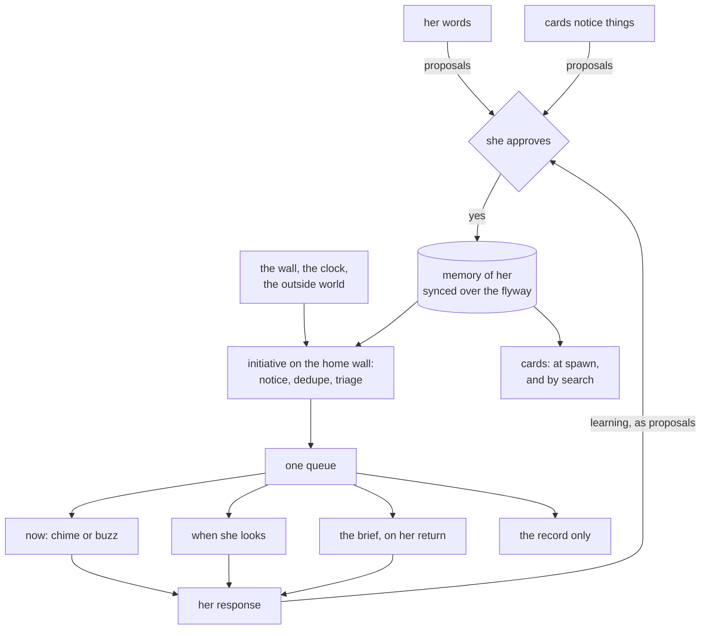
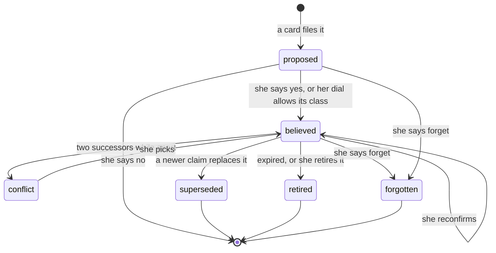
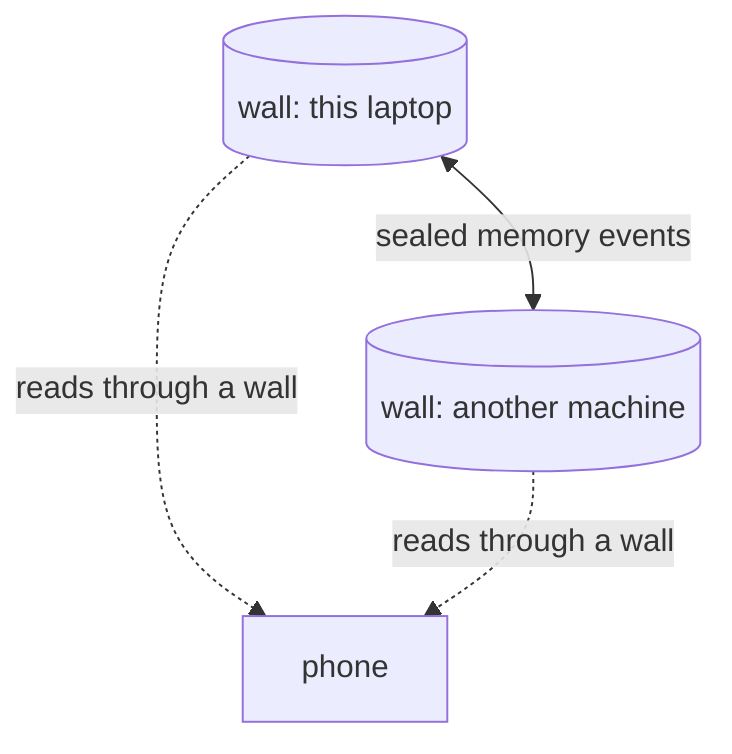
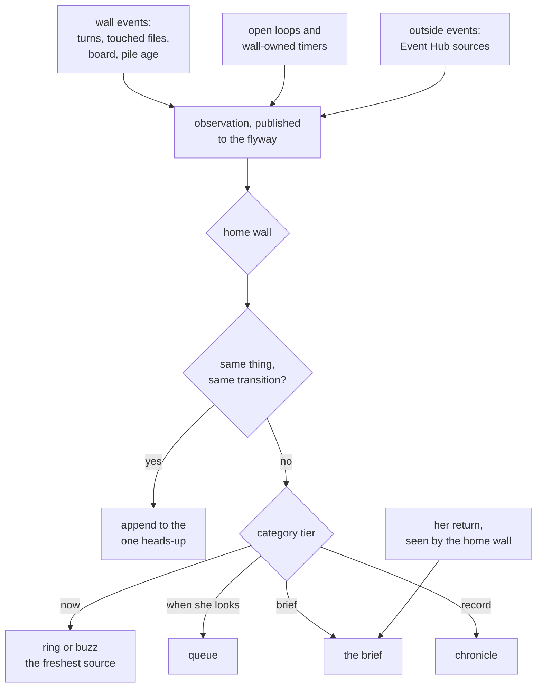

# The assistant: memory of Lyss, and initiative

Design, in progress with Lyss. Nothing here is built. Started 2026-11-12 on card `8229c01e`,
opened by the front desk (`048e88e4`) after Lyss asked how Volery compares to the market for
"Jarvis tier".

**Status:** draft 3. Two rounds of adversarial review are folded in (section 9 says what each
changed). Five rulings are in; O1 and the account point, then O8, O2 and O3, are on her pile.
The decision log is at the end.

## The short version

Volery is already good at the part most assistants get wrong: many agents at once, on several
machines, with her consulted only when it matters. Two things are missing for it to feel like
one assistant:

1. **A memory of her** that every card can draw on, that follows her across machines and
   projects, and that she can read and correct.
2. **Initiative**: the wall noticing something that started outside any card, and telling her
   at the right moment, in the right form, or not at all.

They are one design because the second needs the first. Knowing what she cares about is what
turns "a pipeline went red" into either a buzz on her phone or a line in tomorrow's brief.

## 1. What exists today

Read out of the code on 2026-11-12. Every organ below was built for its own reason, and none of
them has her as its subject.

| organ | what exists | what it lacks |
|---|---|---|
| standing instructions | `guidance.rs`: the wall's and each territory's text, 4,000 characters each, appended to every card's system prompt through the one `supervisor::system_prompt` path. Only she writes them. | Flat prose, hand kept, no source or date per line, one slot per scope. |
| Claude Code's auto memory | Each card's CLI writes notes under `~/.claude/projects/<folder>/memory/`. Volery reads none of it (no match for `MEMORY.md` or `projects/*/memory` in `src-tauri/src` or `src`). | Split per repository. Today: 138 `feedback`, 151 `project`, 96 `reference` and 1 `user` entry across 7 project folders. Facts about named colleagues sit in 4 separate folders. A card in one repository cannot see what another learned about her. |
| the chronicle | `chronicle.rs`, 41 writers. The trim keeps 2,000 seen rows and lets unseen ones grow to twice that (`store::CHRONICLE_KEEP`). | Nothing reads it back to decide anything, and it is lossy by design. |
| sink, board | Shared findings that outlive cards; notices about work in flight. | Both are about work. |
| transcripts | Every conversation as JSONL on disk; `recall` reads another card's last words. | Raw. Nobody distils them. |
| what she says | `prompt.rs` classifies each prompt and keeps no word of it. A filed question is deleted once answered. Phone speech is not kept. | There is no record of her own words outside the CLI's transcripts, which a card can write to. |
| timed wakes | `later.rs`: one-shot, 30s to 12h, at most 3 armed per card, 12 served per hour. | Every wake belongs to a card and dies with it (`later::clear_for`). There is no wall-owned schedule. |
| subscriptions | `subscribe/`: a card handed a turn when an Event Hub event matches. Event driven, no polling. | Belongs to a card. One kind of source. |
| notices and the queue | `notice.rs`: a card finished, asked in prose, failed, or called `notice`. One queue for asks and notices (`queue.ts`), whose every item names a card (`Waiting.card`). | Every item starts inside a card. |
| away | `presence.rs`: away is a timestamp; questions are filed into a pile instead of parked; the whole attention ladder goes silent. | Per wall. Per-person presence is being designed now (3.5). |
| the front desk | `assistant.rs`: one card per wall the phone talks to, its id in `flyway_setting` under `front_desk`, standing in `workbench`, briefed by `assistant::BRIEF`. A project card, so it runs with the bypass flag and `spawn`. | Remembers only what its own context holds, and compacts. This morning it compacted at 176k tokens. |
| outside watchers | Asana polls every 60s and Azure DevOps every 20s, **only while a widget is open** (`devops.svelte.ts`: "a poller is bounded by somebody watching"). | Nothing watches the world when no panel is open. |
| the phone | Joins the flyway with the wall's key in its Keystore, speaks and listens on device, answers the parked prompts of the wall it is connected to (`docs/PHONE.md`). | No OS push path. It hears the wall only while its node is connected. |
| flyway sync | The sink crosses as order-independent events (`flyway-core/src/sync.rs`); account settings as registers on a hybrid clock (`accountsync.rs`). Sealed with one key, which is full membership (`seal.rs`). | Nothing about her crosses. |

The pattern in that table: the raw material for both organs is here. What is missing is a
subject. Everything is keyed to a card, a repository or a wall, and she is none of those.

## 2. Memory of her

### 2.1 What it holds

Four kinds, borrowed loosely from the CoALA taxonomy and named for what they do.

| kind | examples | where it comes from today |
|---|---|---|
| **how to work with me** | lead with the answer; no em dashes; push to main on solo repos; no admin rights on this laptop | wall guidance, scattered `feedback` auto memories |
| **who and what** | her role on a product; which colleague files its testing tickets; the time zone she works in | a handful of auto memories, the front desk's guesses |
| **what happened** | what she decided about phone presence this morning, and why | the chronicle, transcripts, decision logs in `docs/` |
| **open loops** | "come back to the billing on Thursday"; waiting on a review; promised someone a reply | nowhere |

Open loops are the bridge to initiative. A loop is a memory with a time or a condition on it,
and most of what initiative says out loud is a loop coming due, going stale, or being closed by
something that happened.

"What happened" is mostly kept as a **reference**. The chronicle, transcripts and design docs
already hold it; the memory keeps a dated pointer and a one-line gist, so it does not become a
second, drifting copy of the record.

This document is in a public repository, so its examples are generic on purpose. The memory
itself is never committed anywhere.

### 2.2 The unit: a claim

Every entry is one claim with its own provenance. These are the fields the design needs; the
schema is for the build.

| field | why it exists |
|---|---|
| text | one sentence, her words where possible, written through `clip::keep` like every stored text |
| kind | one of the four above |
| scope | `work` or `personal`, plus optional project and person tags |
| source | **she said it** (the proposing card quotes her), **a card inferred it** (with the turn), or **imported** |
| taint | whether the proposing session had read anything untrusted (see below) |
| status | proposed, believed, in conflict, superseded, retired |
| confirmed | when she last said yes to it |
| valid until | for loops and anything time bound |
| inward | true for judgements about other people: handed to the front desk only (2.5, section 4) |

**Taint is sticky per session**, and Rust computes it from the events it already folds; a card
never reports its own. A proposal is untainted only if, since its card's last renewal or
`/clear`, every tool result came from a short allow list: her prompts and answers,
repositories only she commits to, and the wall's own tools. A compaction does **not** reset it,
because the summary it leaves is made of what was read. Web pages, the browser, other MCP
servers, Asana or review comments by other people, and repositories other people commit to all
taint. So does any subagent's result, which Volery sees only as events tagged
`parent_tool_use_id`, and any shell output, because a shell call cannot be classified. Text read
out of a wall store (the sink, the board, relays, `recall`) taints too, until those rows carry
their writer's taint; then it taints only if its writer was tainted, so a store cannot launder a
web page.

This is strict on purpose. Most project cards' proposals will be tainted, so the later relaxing
of approval (D3) will mostly apply to her conversations with the front desk, which is where her
own statements about herself happen anyway.

**A newer claim supersedes an older one, and both are kept.** "Prefers PRs on this repo"
replaced by "this repo is solo now, push to main" keeps the first with a pointer to the second.
This is Zep's temporal graph idea at the size of one person, and it is what lets a card answer
"why do you think that" and lets her see that a belief changed. Research this year (STALE,
Memora) found that agents keep using memories they should have known were obsolete, so
staleness is designed in from the start.

### 2.3 A claim's life

**Everything starts as a proposal, her own words included.** That matches her ruling (D3,
"so I can see the feature in action"), and it is also the only honest option today. A fast path
for "she said it" would need proof that she said it, and Volery keeps none: `prompt.rs` stores
no word of a prompt, a filed question is deleted once answered, phone speech is never kept, and
a card's quote of her proves nothing since the card can write its own transcript, which also
holds relays, wake notes and handover briefs as `user` records. So a claim a card files as
"she said it" arrives marked that way, with her sentence beside it, for a one-tap yes.

A fast path later would have to be built on a record Volery keeps itself: her raw sentences,
captured on its own send path, with a claim accepted only when its text **is** one of those
sentences verbatim (a paraphrase can invert it: "never push to main" contains "push to main").
Even then, such a claim would start personal and inward until she scopes it, and the sensitive
categories (health, family, relationships, money, beliefs) would still need her yes.

This is the shape `guidance.md` already pointed at when it refused cards a write to the
standing instructions: *"the shape to build is not a write but a proposal"*. A card speaking in
her voice without her yes is the failure that rule exists to stop, and memory poisoning attacks
(MINJA, MemoryGraft) are that failure on purpose.

**Approval is a dial, starting fully on.** The wall keeps the acceptance rate per source class,
so the later decision to relax it is made on numbers. Two classes can never be relaxed: tainted
proposals, and the sensitive categories.

**Only she changes what is believed.** Cards can search and propose. Approving, correcting,
retiring and forgetting happen in the panel, on the phone, or through a question she answers;
no card holds a tool that does them alone (2.5).

**What forget reaches, and what it cannot.** A forget is a tombstone event that outranks every
other event about that claim, in any order, and clears anything parked about it (the sink's
fold parks statements about ids it has not seen yet). On receipt each wall scrubs the claim's
text from its stored flyway payloads and serves a redacted event for that id from then on, so a
wall that missed the forget is handed the tombstone and never the text. That needs flyway
payloads to be rewritable, which the sink's are not today (`sinksync.rs` keeps and re-serves
every payload), so it is new work. Delivery uses the acknowledged outbox `prompt_tombstone`
already has (`promptvault.rs`), bounded: a wall not heard from within a set time is listed to
her by name, and a retired wall can be struck off. Locally the claim's rows go with
`secure_delete` on, the full-text index is rebuilt, and the database runs
`wal_checkpoint(TRUNCATE)` and `VACUUM`, since deleted text otherwise survives in the WAL and
the index's shadow tables. What a forget **cannot** reach, and the panel says so when she
forgets something: transcripts of cards that were handed or cited the claim (those cards are
renewed, 2.5), requests already sent to a model provider, and the original auto memory files,
unless she deleted them at import.

### 2.4 Where it lives: on the flyway (D1)

Her ruling: *"memories need to be synchronised across machines, I am the same person on
different machines, there shouldn't be a different memory of who I am as a person and the
history."*

The sink already solved most of this. `flyway-core/src/sync.rs` ships what happened rather
than what is, every event is idempotent, and the fold gives the same result in any order
(`events_in_any_order_agree`). Memory takes the same shape: `proposed`, `approved`,
`superseded`, `retired`, `confirmed`, `forgotten` are events, and each wall folds them into its
own copy. Two places need more than the sink has:

- **Order between two writes to one claim.** Retire on one wall against reconfirm on another
  needs a real last-writer rule, so these events carry the hybrid clock `accountsync.rs`
  already keeps. The sink's `at` is a wall clock.
- **Two walls superseding the same claim while apart.** Each successor points at the original,
  so nothing looks contradictory. The fold treats two live successors of one claim as a
  **conflict**: neither is handed to any card until she picks.

Every wall holds a full copy. The phone never joins the memory's flyway room, and reads through
a wall. That keeps the memory off the phone's disk; it does not make a stolen phone safe,
because the phone holds the flyway key in its Keystore, and that key is full membership
(`seal.rs`). The hardening design on card `c311f9dc` (second factor, machine-bound
credentials) is what protects against that, and this design is one more reason it matters.

### 2.5 How a card gets it

| tier | what | when | cost |
|---|---|---|---|
| always | "how to work with me", identity, the scope rules | at the start of a session, in the system prompt | small, cached |
| on topic | claims tagged with the card's territory | at the start of a session | bounded per card |
| on demand | everything else, searched by words, including people and loops | the `memory` search tool | only when asked |

People and subjects are on demand because the system prompt is composed in `spawn_now`, and a
card opened from the wall has not been told what it is for yet at that moment. Only its
territory is known.

**The system prompt is written once per conversation.** The installed CLI (2.1.322) records the
appended prompt on a conversation's first request and re-sends that record on every resume,
"even when a later launch passes different text, until the conversation is compacted"
(`--system-prompt-snapshot`, on by default; Volery never passes it). So the spawn tiers reach
a card once, and a claim approved after that does not arrive on its next wake. This probably
already breaks a promise the guidance panel makes, filed as sink `8106ae99`. For memory:

- a new session gets the two spawn tiers in its system prompt, through
  `supervisor::system_prompt`, the one path that appends (`guidance.md` explains why there is
  only one);
- after that, a change that concerns a live or dormant card (a claim approved in its scope, a
  supersession of a claim it was handed) is carried in as a short marked note with the next
  prompt that card receives, so it costs no turn of its own. The carrier does not exist yet:
  today only a child's folded stops ride along on another prompt (`spawn::folded_for`), and the
  relay inbox delivers a row as a prompt of its own, which opens a turn. The build generalises
  `folded_for` into a prepend channel with its own table. A card mid-turn gets the note on its
  next prompt, after it has already acted on the old belief, and the design accepts that. Each
  wall folds the same memory events and notifies only its own cards. Chat cards get nothing,
  matching the tool refusal below. Changes are rare, so the accumulation `guidance.md` warns
  about stays small;
- a forget or a conflict about a claim a card was handed **renews** that card, because a note
  cannot unsay what is already in its context. That renewal differs from `renew.rs`'s, which a
  card schedules for itself, writes its own note for, and may not repeat within an hour
  (`MIN_GAP`). A forget renewal is started by the wall, ignores the gap, waits for a running turn
  to end, and scrubs the claim's text from the carried note before it is stored. The panel says
  that the old transcript, whose path the new session is told, still holds the text.

Two probes come before any of this is built, in the shape of `tools/probe-guidance.ts`: that the
snapshot behaves as its help text says under `--print` and `--resume`, and what
`--append-system-prompt-file` (named in the same help) does beside `--append-system-prompt`.
The second matters because the system prompt rides the command line today, Windows caps a whole
argv at 32,767 UTF-16 units, and that cap is why `guidance::LIMIT` is 4,000 characters.

A claim is handed over with its id, so a card that acts on one can cite it ("going by what you
said on 3 November..."), and the citation is where a correction starts.

Search is plain word search over the claims first (SQLite full text). Benchmarks in this area
are disputed (the same LoCoMo setup has been reported at 58%, 75% and 84% depending on who ran
it), but vendor results this year put a plain filesystem agent ahead of graph memories, which
is reason enough not to start with embeddings.

**The tools.** Two, both in the deferred tier so no card pays for them on every spawn:

- `memory`, read only (`readOnlyHint`, so a planning card can use it), searches believed
  claims;
- `propose` files a claim.

Neither is offered to chat cards, which receive MCP tools despite `--tools` and can fetch from
the web (`chat.md`; `relay.md` refuses them `list` and `send` for the same reason). What scope
a caller may read is decided by who is calling (its `/mcp/<id>`), never by an argument.

**Personal claims reach only the front desk for now** (D5). What that buys, stated plainly: it
narrows *which* cards and outward channels can carry a personal claim. What reaches a model
provider is unchanged, since the front desk runs on the same work-email accounts as every other
card. The front desk's spawn tiers carry personal and inward claims; every other card's carry
work claims only, and its searches return work claims only. The narrowing is enforced, because
a paragraph is not enforcement (`guidance.md`):

- the front desk gets a **territory of its own, locked**: no Edit, Write or NotebookEdit. The
  lock is a column on the project row (`project.read_only`, schema v29) and applies to every
  card standing there, so locking `workbench`, where the front desk stands today
  (`assistant::PREFERRED`), would lock all her other work there too. A territory of its own
  keeps what she chose `workbench` for: `Read` still reaches her projects by path, and `spawn`
  still opens cards in them by name. This changes a choice she made, so it is O9. Its shell is
  still there (the lock does not deny the shell, sink `b3230b03`), which is the residual risk;
- other cards are refused `recall` of the front desk, decided by the caller's card identity
  (`/mcp/<id>`), the only caller a wall can trust;
- a brief the front desk passes to `spawn` is checked against the text of personal and inward
  claims, and a match is refused. That catches a pasted claim and misses a paraphrase, and the
  design says so rather than claiming more.

### 2.6 What happens to the standing instructions and the auto memory

- **Standing instructions stay hers**, with their panel, as the text she writes herself. Her
  approved "how to work with me" claims appear beside them in the same panel and travel in the
  same always tier.
- **Auto memory keeps the repository facts.** Facts about a codebase belong next to it. Facts
  about her do not, so the always tier tells every card that what it learns about Lyss goes to
  `propose` rather than into `MEMORY.md`.
- **A one-time import** reads the existing `user` and `feedback` entries and her guidance, and
  files each as a proposal. That is about 140 proposals, so they are offered in batches of ten
  over days, most cited first, and an accepted entry can delete its source file so a later
  forget has nothing left behind. Every imported text goes through `clip::keep`: at least one
  existing `feedback` memory contains a NUL byte, and one NUL in the always tier would make the
  API refuse every card's requests.
- **The import also proposes moving judgements about people out of the wall's guidance.** Her
  wall guidance today holds an opinion about a named colleague, and every card on the wall is
  handed it, including cards that write Asana comments that colleague reads. As an `inward`
  claim it would reach the front desk only.

### 2.7 Being wrong

| how it goes wrong | what catches it |
|---|---|
| a belief went stale | inferred claims carry a review date; old ones come up in the brief as "still true?" |
| a belief was never right | a card citing it gives her the id to correct, from wherever she is |
| two claims contradict | supersession forces one to point at the other; two successors of one claim are a conflict, shown to her and handed to nobody |
| it learned something she would rather it had not | forget, with the limits in 2.3 |

## 3. Initiative

### 3.1 How it differs from the queue she has

Today every item in her queue starts inside a card: a card stopped, or a card asked.
Initiative adds items that start **outside any card**:

| origin | examples |
|---|---|
| the world | a colleague asked for her review two days ago; an Asana task of hers is due tomorrow; main has been red three runs in a row |
| the clock | an open loop is due: "come back to this on Thursday", and it is Thursday |
| the wall | two cards are editing the same file in one tree; a card has been blocked on a filed question for three days; the weekly allowance runs out Wednesday at today's pace |

They land in the **same queue**, as a new kind beside asks and notices, marked with where they
came from. Two things change in the queue for that:

- **An item no longer has to name a card.** `Waiting.card` is required today, and every reader
  of the queue assumes it: the glance, `settleHold`'s same-card-first rule, per-card wakes, and
  the digest other walls draw from. A heads-up is a first-class kind with an origin in place of
  a card, each of those readers learns it, and the hold rule keys on the item's key rather than
  its card. Its place in the order is after asks, beside notices, because an ask holds an agent
  mid-turn and a heads-up holds nobody.
- **The hold rule is kept, by appending.** The item in front of her never changes under her
  (`queue.ts::settleHold`). A heads-up updated while she is on it shows "updated since you
  opened this" with the new line below, and is rewritten only once she has moved on.

### 3.2 The pipeline

The choices that carry the weight:

- **No tick.** The engine is a channel loop like `subscribe/engine.rs`: it wakes for an event,
  a timer due, or a turn ending, and with nothing pending it blocks. CLAUDE.md lists the only
  places Volery is allowed to go and look; this does not add one.
- **One wall decides.** Every wall publishes what it observes as flyway events, and only the
  **home wall** triages and delivers: the wall the front desk lives on, which she can move.
  If the home wall has been silent past the roster's quiet bound (`fleet::QUIET_AFTER_MS`), the
  present wall with the lowest id takes over until it is heard again. Every wall reading the
  same Event Hub gets every event (`subscriptions.md`, *Several walls, one stream*), so without a
  single decider two walls would ring for one thing. Quiet is judged from one side, so a
  network split can leave two walls each believing it decides. Before delivering, the decider
  writes a claim event on the heads-up's key (idempotent, on the hybrid clock), and a wall that
  has seen an earlier claim for that key stands down. A split can still double-fire once, while
  neither side can hear the other, and the design accepts that. The phone also dedupes by key.
- **One heads-up per thing and transition.** The key is the thing (a pull request, a file pair,
  a loop) plus the transition it is about. Main going red, then green, then red again is two
  heads-ups, so a breakage she dismissed cannot come back silently as an "update". Within one
  transition, more observations append to the same heads-up.
- **The interrupt path runs no model.** A "now" heads-up is worded from a template per
  category, so it is never late and costs nothing.
- **The brief is written by a call that has no tools to call.** Not a CLI spawn: the steward's
  `--tools ""` may not remove anything (`chat.md` records the CLI swallowing an empty argument
  and handing back the full default set; sink `c8240c0b`). The shape to copy is
  `provider::answer_question`, a direct Messages API request to DeepSeek flash with no `tools`
  field at all, which cannot call a tool by construction. It is handed the batch and the
  relevant **work** claims; personal loops are worded from a template instead, since they are
  her own reminders and need no composing, and that keeps personal claims away from a second
  consumer (D5). Outside text (a colleague's comment, a pull request title, a look's findings)
  only ever reaches a model there, as quoted data. The finished brief goes to her, and the front
  desk may read that finished text aloud; it never ingests the raw outside text.

### 3.3 Where it gets its signal without polling

Her standing rule is events over polling, and CLAUDE.md asks anything new that looks to argue
for it. The design keeps to that in four ways.

| signal | how it arrives |
|---|---|
| the wall's own state | already events: turn ends, file touches (`file_touch`), board posts, the pile |
| time | a **wall-owned timer table**, the one genuinely new mechanism; `later.rs` timers belong to cards and die with them |
| the outside world | a small relay in Azure turns Asana, Azure DevOps and GitHub webhooks into events on the Event Hub path the wall already reads (`eventhub.rs`). Which service-hook targets each supports is **unverified** and is the first thing to check before building |
| anything with no events | asked **once, on her return**, while the brief is being written. Her coming back is an event (3.5), the same move `update.rs` makes with window focus |

The last row means the wall can have an opinion about Asana without a widget open and without a
timer, by asking at the one moment the answer is about to be read.

### 3.4 Tiers, and how a category earns one

| tier | what it does | made of |
|---|---|---|
| **now** | chime at the wall, buzz on the phone | the attention ladder (`attention.svelte.ts`), the phone |
| **when she looks** | waits in the queue, no sound | the dock queue |
| **the brief** | one item, written when she comes back, readable aloud | new; sits beside the away pile, which keeps what needs her answer while the brief says what happened and what is coming |
| **the record** | a chronicle row | `chronicle.rs`, which trims, so this tier is allowed to be forgotten |

Categories start where O1 puts them, and a loop she made herself ("remind me Thursday") is
"now" by definition, since being told is what she asked for. After that, a category moves only
on her responses. She answers a heads-up with one of four gestures: **act**, **dismiss**,
**not about this again**, **more like this**. The wall counts them per category and, after
enough, proposes a change ("you dismissed 9 of the last 10 pipeline heads-ups; move pipelines to
the brief?"). The proposal goes through the same approval as a memory, because a tier is a
belief about her. Nothing moves itself.

### 3.5 Presence decides where

Presence is designed in `docs/PRESENCE-PHONE.md` by card `d1e5adfe`, which **has not landed
yet** (it is under its own second review). This design reads from it rather than redesigning
it. The two cards compared notes on 2026-11-12, and what that design will and will not provide
shaped this section:

| what initiative needs | what presence gives | so this design |
|---|---|---|
| is she reachable | `person(w)`: some source is present **and covers wall w**. Reachability is relative to the wall asking | asks `person(w)` of the home wall |
| where she is | each source's `idle_ms`, an age since her last deliberate input, minute-rounded (proposed there as D5b) | rings on the freshest source; a tie goes to the phone, since that is the one in her hand |
| in what form | nothing on the wire, and none needed: the phone's voice is a delivery channel there, never a presence source | lets the receiving node pick the form; a phone narrating with the screen off speaks it, a wall shows it |
| why she is away | one bit per source; chosen and idle look the same from another wall | needs nothing more, except the pocket question below |
| when she comes back | no per-person edge exists; walls only see their own switch flip | folds its own edge, on the home wall only |

**The comeback edge is this design's to build.** The brief fires when `person(home)` goes from
false to true after an absence of at least a threshold, at most once per absence. The proposed
threshold is the wall's own idle floor, 20 minutes (`machine::IDLE_FLOOR_MS`), and it is the
hysteresis: a source flickering around presence's 90-second quiet bound is not an absence. A
lunch break gets a brief; a trip to the kitchen does not. Computing it on the home wall alone
is what keeps it to one brief rather than one per wall.

**The pocket question is the one gap that is hers.** "Now" exists to reach her when she is not
looking, and a phone in her pocket is idle by presence's rules. So "now" needs a reading
presence does not have: may this node be buzzed although she is idle on it. The smallest
version is one additive per-source bit, `buzzable`: the node is connected, not switched away,
and not in Android's do not disturb. Whether switching the phone to away also means "do not
buzz me" is open decision O8.

**An away that a card set does not mute "now".** Any card can call `mcp__skein__away` when she
says she is leaving, and that must not be a way for a card to silence the one tier meant to
reach her. Only her own switch, on a node, stops that node buzzing.

A buzz on a phone that is not connected cannot happen at all today: the phone has no OS push
path, only the foreground notification its node service runs (`NodeService.kt`). Until push
exists, "now" reaches the phone only while its node is connected.

Focus, a "present but do not disturb" state, is not in presence's model, which knows Android's
do not disturb only as "the phone cannot reach her". It is a later extension on top of it,
raised here rather than there.

### 3.6 Looking before telling (D4)

When a heads-up would be more useful with an answer attached ("main is red, the failing test is
X, the likely cause is Y"), the home wall may open a **look**: a short-lived card that can read
and nothing else. A look is a new card kind, because no existing kind is safe enough:

| a look | why |
|---|---|
| no bypass flag, `--tools Read,Grep,Glob` | the planning gear is set over the wire after spawn, and a failed set is not fatal (`gears.md`), so a look must be unable to write from birth |
| `--strict-mcp-config` with no skein tools | no `spawn`, no `ask_user`, no `recall`, no memory |
| a cheap model | DeepSeek flash or Haiku. A DeepSeek look sends repository code to DeepSeek, as every DeepSeek card already does; a Haiku look spends the same five-hour window as everything else |
| a cap per look | `--max-budget-usd` for Claude (a `--print` flag in 2.1.322); for DeepSeek, which the CLI prices at $0, Volery's own `priceOf` |
| a daily budget | she sets it, it covers looks **and** briefs, and it is a setting so it can grow (she ruled to start cheap and not paint the design into a corner) |

A look reads a repository, its logs and its failing test output, any of which can carry
somebody else's text, so **what a look says is outside text too.** It arrives on the look's
stdout as its `result` (no MCP needed), is marked tainted, and goes through the brief's
tool-less composer as quoted data. It is shown to her and may be spoken by the phone; it is
never placed in the front desk's context. `Read` is not confined to a card's directory, so a
look also carries a deny list in its `--settings` layer: paths outside its project, and secret
files (`.env` and the like).

A look costs a spawn (about 0.8 GB and 5 to 7 seconds on this laptop), which is why a category
earns looks the same way it earns a tier. New work it implies, none of it present today: a
`look` kind that `kind_of`, `turn_mark` and the roster carry, so it does not appear on the wall
as an ordinary card; a probe that `--max-budget-usd` holds under `--print` (no code passes it
yet); and for DeepSeek, `priceOf` read against the stream with a kill at the cap.

### 3.7 Silence

- **Not about this again** mutes that thing's key for good.
- **A tier change** moves a whole category.
- **Switching a node to away** stops that node ringing or buzzing, including for "now" (subject
  to O8). With every node switched away, everything waits for the brief.
- **The never list** (open decision O2): subjects the assistant must never bring up, whatever
  it knows. Applied at triage, so a never-list subject cannot reach any tier.

## 4. Privacy and safety

A model of a person with permission to interrupt is the most sensitive thing this app would
hold. The choices above that exist for this reason, with what each stops and what it does not:

| risk | trigger | what the design does |
|---|---|---|
| memory poisoning | a web page or a colleague's comment says "Lyss wants X" and a card files it | everything is a proposal; taint is sticky per session and survives wall stores; tainted proposals always need her yes |
| a card rewriting her | a card that just read hostile text calls forget or correct | no card has those tools; only she approves, corrects and forgets |
| outside text steering an agent | a pull request title or a CI log carries an instruction | outside text, a look's findings included, reaches only a direct API call with no tools field, as quoted data; never the front desk's context |
| a dossier on colleagues | an opinion about a person ends up in a PR description | judgements about people are `inward` and reach the front desk only, which stands in a territory of its own locked against writing files (O9) |
| personal leaking into work | a personal fact surfaces in a commit | personal reaches the front desk only (D5), enforced by the lock, the `recall` refusal and the spawn brief check; a paraphrase through its shell is the residual risk |
| a lost phone | someone holds the unlocked phone | the memory is not on it; the flyway key is, so the hardening on `c311f9dc` is the real protection |
| stale beliefs acting on her | an old preference drives today's work | review dates, citation when used, supersession, conflicts held back |
| forget that does not forget | the text survives somewhere | tombstones outrank everything, payloads are scrubbed, `secure_delete`; the panel names what a forget cannot reach |
| creep | it knows things she never told it | sensitive categories always need her yes; she can read every claim and its source |
| a card muting her | a card sets away | a card's away never mutes "now" |
| spam | initiative becomes noise | strict start, one heads-up per thing and transition, earned tiers, the never list |
| cost | initiative spends on its own | no model on the interrupt path, a tool-less cheap brief, a cap per look, one daily budget for both |

## 5. What this needs from her

| kind | what | status |
|---|---|---|
| data | Asana, Azure DevOps, GitHub credentials | already in the integrations panel |
| data | a webhook relay in Azure feeding the Event Hub path | new; needs an Azure resource somewhere she is allowed to create one |
| data | a DeepSeek key, for the brief and cheap looks | already on the wall (the front desk runs on DeepSeek) |
| data | Outlook calendar and mail, Teams, via Microsoft Graph | **needs IT**: she has no admin rights, and Graph app consent is a tenant decision. Without it, "a person owed a reply" and "a meeting approaching" stay blind |
| habit | saying "remember that" and "remind me" in plain words to any card | costs nothing; this is how loops and proposals get made |
| habit | reviewing proposals, a few minutes, on the phone or the wall | needed while approval is on (D3) |
| habit | answering heads-ups with act, dismiss, never again, or more | how tiers are earned |
| habit | working through the import, ten at a time | the first weeks |
| permission | a daily budget for looks and briefs | D4 |
| permission | the never list | O2 |

## 6. Build order

Each phase is useful on its own and none depends on a later one.

| phase | delivers | done when |
|---|---|---|
| 0 | presence over the flyway (`docs/PRESENCE-PHONE.md`), plus `buzzable` if O8 says so | that design's own criteria |
| 1 | the two probes (snapshot, prompt file); the memory: claims, proposals, approval, the panel, `memory` and `propose`, spawn tiers, change notes, renew on forget, flyway sync, the import | a preference she approves on one machine is cited by a card on another, with its date and source, whether that card is fresh or was already running; a tainted proposal cannot be believed without her yes; a forget leaves no text in any wall's store and names what it could not reach |
| 2 | open loops, the wall-owned timer table, the comeback edge, the brief on return (needs 0, 1) | "remind me Thursday", said by voice, reaches her on Thursday on whichever node she is on, once |
| 3 | initiative over the wall's own events: collisions, pile age, allowance pace, red gates (needs 1, 2) | two cards editing one file raises one heads-up on one node, before either commits |
| 4 | outside events through the Azure relay; Graph if IT agrees (needs 3) | a review request reaches her with no widget open and no timer running on the laptop |
| 5 | looks with a budget; tier proposals from her responses (needs 3) | a look cannot write, never exceeds its cap or the day's budget, and a tier never changes without her yes |
| 6 | relaxing approval where the numbers say so; personal beyond the front desk | her call, made on the acceptance rates phase 1 records |

Names the design implies, not written: a `memory_event` ledger table with a projection and a
full-text index, both with `secure_delete`; a flyway room for memory events, with rewritable
payloads and a redacted serve for tombstoned ids; a `wall_timer` table; a `headsup` table with
its responses, per-category tiers and delivery claims; a prepend-on-next-prompt table
generalising `spawn::folded_for`; writer taint on sink, board and relay rows; new `STEPS` rungs
in `store.rs` for each; the deferred `memory` and `propose` MCP tools; a heads-up kind in
`queue.ts` and its readers; a `look` card kind carried by `kind_of`, `turn_mark` and the roster;
a home-wall setting in `flyway_setting` beside `front_desk`; a territory of its own for the
front desk. Probes before building: the prompt snapshot, `--append-system-prompt-file`,
`--max-budget-usd` under `--print`, and which webhook targets Asana, Azure DevOps and GitHub
can reach.

## 7. Open decisions

| # | question | recommendation |
|---|---|---|
| O1 | which categories may interrupt "now" | loss, breakage, and people waiting on her (on her pile) |
| O2 | the never list | ask her; nothing defaulted |
| O3 | Graph access through IT, and where the Azure relay lives | ask her whether IT is worth approaching |
| O4 | when the brief comes: only on return after 20 minutes away, or also at a fixed hour | on return only |
| O5 | does the phone keep a copy of the memory | no, it reads through a wall (2.4 says what that does and does not buy) |
| O6 | is the front desk one per wall or one per person | a role on the home wall, with continuity in the memory; see below |
| O7 | what the memory and its panel are called | hers to name |
| O8 | may "now" buzz the phone in her pocket while she is idle on it, and does switching the phone to away stop that | yes while idle; no once she switches it away or the phone is in do not disturb |
| O9 | move the front desk out of `workbench` into a locked territory of its own | yes: it keeps reading her projects by path and opening cards in them, and can no longer write files |

On O6: `assistant.rs` keeps one front desk per wall today. With the memory on the flyway the
card no longer has to be the thing that remembers, so it can be a role: the home wall hosts it,
it reads the same memory as every wall, and "what we talked about this morning" becomes an
episode in the memory instead of a stretch of one card's context.

## 8. Decision log

| date | # | ruling, in her words where given |
|---|---|---|
| 2026-11-12 | D1 | Memory lives on the flyway, the front desk speaks. "Memories need to be synchronised across machines, I am the same person on different machines." |
| 2026-11-12 | D2 | One assistant, work and personal. |
| 2026-11-12 | D3 | Approval first, "so I can see the feature in action", likely relaxed later "if it makes sense most of the time". |
| 2026-11-12 | D4 | Looks before telling: "start cheap with daily budget", and do not hard-code it. |
| 2026-11-12 | D5 | Personal memory reaches the front desk only for now, "potentially any card later". She questioned the account reasoning; the answer (storage is local, every use is a send) is on her pile for confirmation. |

## 9. What review changed

**Round 1, 2026-11-12**, an adversarial pass (`volery:red-team`) over draft 1. Fourteen
findings, all taken:

- **A running card never hears a memory change.** CLI 2.1.322 snapshots the system prompt for
  the life of a conversation. Draft 1 said "the next wake does". Changes now travel as marked
  notes, forgets renew the card, and two probes come first. The same fact probably breaks the
  guidance panel's promise today, filed as sink `8106ae99`.
- **"Her words go straight in" had nothing to check against.** Volery keeps no record of what
  she says. Dropped: everything is a proposal, which is also what D3 asked for.
- **Any card could forget or rewrite her memory.** The tool is now search and propose only.
- **Looks could come up able to write, and outside text reached the front desk.** Looks are a
  locked-down card kind; the brief is composed by a tool-less call.
- **Privacy rows were instructions only.** The front desk is locked, `recall` of it is refused,
  spawn briefs are checked, and D5 is described for what it buys.
- **Forget could not reach every copy.** Tombstones outrank everything, payloads are scrubbed,
  and the limits are named.
- **Concurrent supersession went unnoticed.** Two successors are now a conflict.
- **Several walls would each ring.** One home wall decides, keys carry the transition.
- **The queue's hold rule would have been broken** by in-place updates. Updates now append.
- **The cost was understated.** No model on the interrupt path, a cheap tool-less brief, a cap
  per look.
- **Taint was per turn and laundered through wall stores.** Now sticky per session, carried by
  stores, shell output taints.
- **The import would have broken every card** on a NUL byte in an existing memory. Every write
  goes through `clip::keep`, and the import is paced.
- **A card's `away` could mute "now".** It no longer does.
- **Stale and contradictory prose**, including three antithesis lines and two quotable ones.

**Round 2, 2026-11-12**, a narrower pass over round 1's fixes only. Ten findings, all taken:

- **The "tool-less" brief call would have had a shell.** Draft 2 copied the steward, whose
  `--tools ""` the CLI may swallow (sink `c8240c0b`). The brief is now a direct API call with no
  tools field, the shape `provider::answer_question` already has.
- **A look's findings were outside text reaching the front desk.** They now go through the same
  composer, marked tainted, and a look's `Read` is fenced to its project, without secret files.
- **"A note with the next prompt" had no carrier.** Named: `spawn::folded_for`, generalised.
  Mid-turn and cross-wall behaviour stated.
- **Renewal on forget would have carried the text forward** and been refused inside an hour.
  It is wall-started, ignores the gap, and scrubs the note.
- **Locking the front desk's territory would lock all of `workbench`.** It gets a territory of
  its own, which changes a choice she made, so it is O9.
- **Taint reset on compaction, and missed subagents.** It now resets only on renewal or
  `/clear`, and subagent results taint.
- **A network split made two home walls.** A delivery claim on the key comes first; one double
  ring during a split is accepted and said.
- **The queue's readers all assume a card.** They are named, and the hold keys on the item.
- **Forget left text in the WAL and the index**, and assumed rewritable flyway payloads. Both
  handled, and the second named as new work.
- **The look kind and its cap were assumed to exist.** Both named as new work, with a probe.
