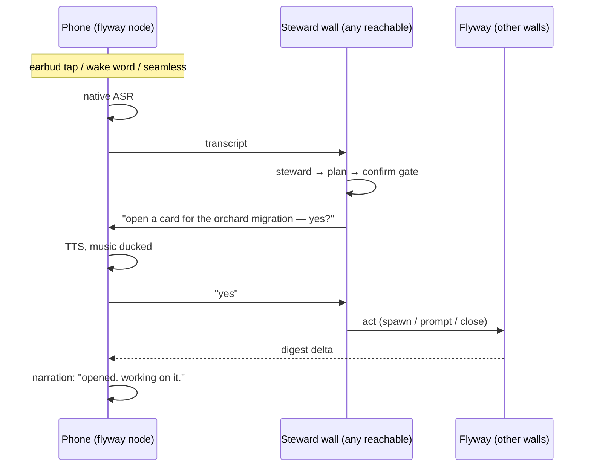

# The phone companion (Volery in your ear)

Design work 2026-11-09, from the request: *control Volery and the full flyway from a phone
while walking, earbuds-only, with audio narration.* Voice in, voice out, mesh connectivity —
a phone app that is itself a node on the flyway.

**Status: M0 through M5 are built and run on the Pixel 7a.** M1 landed the flyway's pure
core as the workspace crate `src-tauri/flyway-core`, which the desktop re-exports module for
module (`src/flyway/mod.rs`) and a phone links with no Tauri in its graph. M2 brought the app
and the node, M3 the ears and the mouth, M4 the modes and audio, and M5 the steward, the
confirm gate and answers. **2026-11-11 made the walking mode usable**: every parked prompt is
drawn and answerable, the narration loop runs in the foreground service, and a first-launch
introduction says what all of it is for. iOS (M6) and chat view (M7) are still later.

## What this is

A phone companion, Android first (Pixel 7A), that joins the flyway the way a wall does — it
dials walls by key, reads the roster, receives what is worth knowing, and sends acts back. It
has native ears (on-device speech recognition) and a native mouth (speech synthesis), because
the phone's recogniser is a different class from the desktop's, and the desktop voice has
never worked on this network (see `docs/VOICE.md`, sink `4caa13ed`).

### How it finds a wall (2026-11-11)

A phone used to hold one wall name and dial only that. When the laptop
it named was shut, the phone dropped off the flyway even though the other
laptops were still meshed with each other: it had one name to dial, and no
memory of the rest. `Node::sight_any` now walks three lists in order, the
wall it was pointed at, the walls its last sighting showed (the app persists
them), then every name the flyway's directory holds, and returns the wall that
opened, which becomes the address every later call uses. The directory read is
one small HTTP request, made only after the known walls have had their
attempts, so the ordinary dial pays nothing for it. The walk reserves room for
the directory on purpose: a roster of dead laptops must not consume every
attempt and leave the phone unable to ask the one place a wall it has never met
can come from. **The phone reads the directory and never writes it:** a name
there is an invitation to dial, and this node answers no dials. It reached the
roster by dialling, which is the half that matters.

**A configured wall is optional.** The first door is the *preferred* wall if
one is set, else the wall last read, else nothing, and a phone with neither
starts at the directory. The preference is a setting, not a requirement: a
tap on a wall chip that answers makes that wall the preference, while an
automatic fallback moves only the wall being read, so the laptop you meant is
tried again next time rather than being replaced by whichever wire answered.
`phone.host` seeds the preference at build time and defaults to empty.

### What the phone does with a wall (2026-11-11)

The first cut spoke questions and drew a count. That is not usable on a walk.
A card parked on a question on the laptop was heard, or it was not, and there
was nothing to read if the words went past you. Three things changed.

**Every parked prompt is drawn, and a tap answers it.** The wall's digest
already carried the words for every kind of thing that waits: an agent's
`ask_user` (`asks`), the questions filed into its pile while nobody was at the
wall (`filed`), a removal (`removals`), a close (`closings`), every other
confirmation such as a pull request or an Asana write (`confirms`), and the
notice queue (`notices`). `phone-node/src/prompts.rs` reads the snapshot into
rows for a phone screen: a kind, the card it belongs to, the question's own
words and options, and the exact `answers` value the owning wall reads. The
roster's first section is the blocking ones, live questions first and then the
pile; notices are drawn on the card's page and flagged on its roster row. A
single question with options is answerable from the roster
without opening a card. The card's own page draws the whole sheet, several
questions included, and sends them in the numbered shape an agent expects.

The answer is the same wire a spoken one takes: a fleet prompt naming the
parked ask, `notice:<id>` for a notice, or `deferred:<row>` for a pile row.
Nothing about the answer knows it came from a phone.

**The prose that led to a prompt is a tap away.** A short question sometimes
needs the paragraph before it. `Node::tail` pulls the card's conversation on
demand through `tail.rs`, and `prompts::said_before` keeps only the person's
and the agent's own lines. Tool calls, results, compaction summaries and skills
never cross. Nothing is polled for this: it is fetched when a prompt's **what
led to this** is opened, and kept for the session.

**The loop runs in the foreground service, not on a screen.** It used to be a
`LaunchedEffect` gated on the activity being resumed, so putting the phone in a
pocket stopped the whole hands-free story: the screen went off, the coroutine
was cancelled, and nothing read the wall until the app was opened again. The
service kept the process alive and read nothing. `Narrator` now owns the poll
on a process-wide scope started with the node, and `Listening` shares one
`VoiceController` and `Steer` with every surface, so the service and the screen
drive one set of ears rather than two recognisers fighting for one microphone.

**Android will not give a background app the microphone for free.** A
foreground service must declare `microphone` to use the mic with the screen
off, and Android 14 refuses both the declaration without `RECORD_AUDIO` and the
start of such a service while the app is not visible. Declaring the type in the
manifest and calling `startForeground` in `onCreate` killed the app at launch
on a phone that had never been asked for the microphone. So the service chooses
its active type per call: data and microphone when the permission is held, data
alone when it is not, with a catch that falls back rather than taking the
process down. Granting the permission in settings promotes the running service
while the settings screen is in front, which is the one moment the platform
allows it.

### The prerequisites for hands-free, in order

This is the path the first cut never said out loud, and the reason the mode was
hard to find:

1. install the app (it carries the flyway key at build time);
2. open it once. The loop starts with the node and keeps polling;
3. settings, **hands-free, ask me out loud**. That sets seamless listening,
   raises the chatty level if it was off, and asks for the microphone;
4. allow the microphone. The service widens to carry it;
5. leave it. A card that stops on a question is spoken, the music ducks, and
   the ears open when the words are done. Answer in your own words. The screen
   can be off.

The roster says when the three conditions do not all hold: **hands-free is
off**, or **hands-free needs the microphone**, with one tap to the screen that
fixes it. Settings has a **try it** button once it is on, which speaks a line
and opens the ears after it.

### A question is not a command (2026-11-11)

The steward turns a sentence into a plan, and it declines anything that is not
a Volery command. "what's the weather" used to be answered with "not
understood". Now the phone asks the wall a second question, and the wall answers
it from its own **DeepSeek** balance: `deepseek-flash`, thinking on at low
effort (`output_config.effort: "low"`). No card, no plan, no Claude turn, and
the key never leaves the wall.

- **The wire is the steward's.** One more word in the same exchange
  (`steward::StewardMsg::General`), answered on the stream it was asked on and
  never gossiped. The answer rides the same envelope as a plan with
  `{ "kind": "general", "text": … }`, so the phone reads one shape.
- **The key is read on the wall** (`creds.rs`, the `deepseek` service) at the
  moment of asking; the phone holds no provider secret and no provider balance.
  A wall with no key says so, and the phone reads that out.
- **It costs flash, not a subscription window.** The wall gates it on "take
  work from other walls", like the steward, because it spends money.
- **The answer is for the ear, not the page.** It is asked in plain spoken
  prose, capped at 1,200 characters, scrubbed like every other text, and read
  out with audio focus so the music ducks. The status line shows it too.
- **Both ends need this build.** An older wall passes the unknown word over and
  says nothing; the phone recognises "did not answer" for that word and falls
  back to "not understood" rather than reporting a fault.

### The introduction

First launch opens six slides over the roster: what the wall is, how the phone
finds a wall, hands-free, what waits on you, what led to this, and speaking a
command. Skip is on every slide and the last one starts the app. It is marked
seen when it is shown, so a skipped or interrupted read does not come back, and
**settings, the guide, how to use volery** reopens it for ever after.

### What is not here

- **The wake word.** Seamless is the walking mode; "hey volery" is still a
  disabled choice in settings.
- **Designs and files attached to a question.** The digest says a question has
  one and the phone says so, but the gallery is the wall's; the phone's viewer
  reads pictures and files a card produced.
- **Answering a filed question offline.** A pile answer is sent as a new
  message, so the wall must be heard for it to go. The wall refuses rather than
  holding it.

Proved on the Pixel on 2026-11-11 against the real flyway: with the configured
host set to a name that is not a wall and the remembered list emptied, the
phone found the flyway through the directory and drew AU-LT-285's cards. With
the host still dead and six dead remembered walls in front of it, it still
found AU-LT-285 through the directory, which is the case the attempt reserve
exists for. With a live host and the learned roster, it dialled the remembered
wall directly.

## The decisions, as made with Lyss

| question | answer |
|---|---|
| platform | Android first (Pixel 7A); iOS later, not now |
| the phone's role | **a true flyway node** (mesh), not a remote for one laptop |
| voice cost | free by default; a cheap premium tier (a few $/mo) as a setting |
| input modes | push-to-talk, "hey volery" hands-off, seamless hands-off — all three, as settings |
| narration density | a "chatty" setting: off / only-what-needs-you / murmur |
| music | duck or pause, a setting |
| chat mode | a later native screen, not in v1 — the node already carries prompt/recall/tail/answer, so it is a UI add, not a data-path add |
| viewing | pictures (shown/pinned), mockups (`ask_user` previews) and files (sent) are viewable on the phone, not just narrated — the flyway already carries them (`push_pictured`, `send_files`, `look`) |
| office TLS gate | not a design input — re-test the transport rather than assume. QUEERISFREEDOM is unrestricted and has admin; the work laptop's Netskope path is already handled by `forge::tls` |

## The architecture: the phone is an ear, a mouth, and a pair of hands. The wall stays the brain.

One clarification that "true flyway node" must not blur: **the phone runs no `claude` child,
and cannot.** The steward (a sentence → an ordered plan) is a `claude --print` child, so it
runs on a wall, always. What the phone's node-ness buys is *reach and resilience*, not a
brain of its own: it can dial any wall directly, so it never depends on one specific laptop.
If the work laptop is down, it parses through QUEERISFREEDOM. If QUEERISFREEDOM is down, any
other wall.

Everything smart and dangerous stays on the wall — the steward parse, the confirm gate, the
act verbs, the safety tables (`voice.md`, `spawn.md`). The phone only hears, speaks, and
relays text. That is not a compromise; it is the property that makes a misheard command safe.

Three loops, all thin on the phone:

| loop | what happens | reused from the flyway |
|---|---|---|
| **narration** | walls change, the phone folds the deltas into spoken lines | the digest, `ask_user` questions, notices — all of which already cross |
| **command** | you speak → a wall parses → act | `steward.rs`, `act.rs`, the confirm gate |
| **question** | a card's question is read aloud, you answer, it crosses back | `Ask::answers` already travels |
| **general** | a sentence that is not a command is asked of the wall and answered by DeepSeek flash | `steward::General`, `provider::answer_question` |

## What the phone is, concretely

- **A shared Rust core.** Extract the flyway's pure half — `seal`, `frame`, `session`, `wire`
  (iroh), `sync`, and the protocol-pure parts of `fleet` — out of `src-tauri/src/flyway/` into
  a workspace crate `flyway-core`, which the desktop consumes unchanged and the phone links.
  This is the same move the repo already argues for (one registry, no restated drift), and it
  de-risks the desktop flyway by making it testable without Tauri.
- **An Android app (Kotlin + Jetpack Compose).** A foreground service so it stays alive while
  walking, Bluetooth audio, audio-focus ducking, and home/settings/viewer screens. The Rust
  core is exposed through JNI (a JSON envelope — uniffi can't map the flyway's opaque
  `serde_json::Value` snapshot). Compose over Flutter: native feel + performance, no rewrite,
  and the Rust node is already cross-platform, so iPhone-later means redoing only the UI shell
  (SwiftUI), not the app.
- **Narration, derived phone-side.** No new wire vocabulary for v1: the phone folds the
  existing digest/ask/notice deltas into spoken lines, gated by the chatty filter. Pure logic,
  testable without a phone (`narration.ts` on the desktop, or its own module).

The node's primitives are `prompt`, `recall`, `tail`, `answer` and the digest — the same verbs
the desktop flyway already exposes. The app is **multi-screen from the start** (home +
settings, with a chat screen reserved) even though v1 ships only the walking modes: chat mode
is a later native screen over the same node, not a new data path. The one difference to keep:
transcripts are fetched lazily when a chat opens, where narration streams digest deltas
continuously.

## The modes (all settings, no one is forced)

1. **push-to-talk** — tap an earbud (or a volume key) to talk.
2. **"hey volery" hands-off** — a local wake word; on hearing it, duck/pause music and listen.
3. **seamless hands-off** — no wake word. When something needs you, duck/pause the music,
   speak it, and listen for an answer for a short window. The desktop already has this exact
   window (`SPOKEN_YES_MS` in `voice.md`); the phone inherits the semantics, not the engine.

Settings, one screen: mode · chatty level · duck vs pause · voice quality · preferred wall ·
wake-word sensitivity.

## Voice, at the cost asked

- **In (recognition):** Google's recogniser on the Pixel — free, excellent, cloud-assisted with
  an on-device fallback. The premium concern does not apply to input. Whisper on-device is a
  later, optional privacy tier, not v1.
- **Out (synthesis):** default **Google's natural voices** — free, genuinely good, on-device.
  A "premium voice" setting accepts a user-supplied key (OpenAI `tts-1` ≈ two dollars a month
  at walking usage, or ElevenLabs ≈ $5/mo) for a richer narration voice. Free first, upgrade
  later, never required.

## Milestones

| | what | gates on | proof |
|---|---|---|---|
| **M0** | the spike: does iroh 1.3.0 build and run on Android? | — | **done** — cross-compiles, links, and ran on the Pixel 7a, printing a node id |
| **M1** | extract `flyway-core`; desktop consumes it unchanged | M0 | `cargo test --lib` and the flyway lifts green with no behaviour change |
| **M2** | the app skeleton + node: foreground service, Rust core linked, dial by key, roster, digest receive | M1 | **done** — the phone dials the real wall (`queerisfreedom`) over the relay and reads its roster + cards digest |
| **M2v** | viewing: `Node::fetch` pulls a file/picture over the flyway's `seeing` exchange, and a Compose viewer draws them | M2 | **done** — fetch desktop-proven, Compose viewer built + installed. Honest limit: pinned far-wall images and `ask_user` previews do not cross yet |
| **M3** | ears + mouth + narration: ASR, TTS, the digest→speech fold, chatty filter | M2 | **done** — the phone speaks a line when the wall changes, at the chosen chatty level |
| **M4** | modes + audio: audio-focus duck/pause, push-to-talk, seamless (wake word deferred) | M3 | **done** — ducking wired (duck or pause), push-to-talk + seamless shipped, proven on-device |
| **M5** | control + questions: the steward over the flyway, then the spoken confirm loop, act verbs, `ask_user` answers | M4 | **done** — a transcript becomes a plan, the plan is spoken back, a spoken yes carries it out on the wall, and a question is answered aloud. The confirm is a `StewardMsg::Confirm` carrying only the plan's id; the wall holds the plan and runs `carry`, so the phone never sends the steps back. An answer rides a `fleet` prompt with `answers` set (`Ask::answers`). |
| **M6** | iOS (later) | M5 | — |
| **M7** | chat view (later) — a native chat screen over the node's `prompt`/`tail` verbs | after the walking modes | type to a card, read its thread |

## Risks and unknowns

- **iroh 1.3.0 on Android — proven 2026-11-09, not assumed.** The whole tree (ring, rustls,
  the Android platform-verifier, quinn) cross-compiled and linked clean under NDK r26d, and the
  resulting `aarch64` binary ran on the Pixel 7a and printed a node id. The one genuinely open
  question left is the on-device *dial* (reach the desktop flyway from the phone's network),
  which is M2's job.
- **On Android, `CaTlsConfig::system()` needs the app's Context.** The platform verifier's
  Android half reads the system trust store through `ndk-context`, so a process with no JNI
  Context panics — measured on the Pixel 7a: `ndk-context: android context was not initialized`
  → `rustls-platform-verifier: Expect rustls-platform-verifier to be initialized`. The app must
  initialize the verifier with its Context before `Node::start`; that is the one genuinely-new
  thing the phone does that the desktop never did, and it is M2b's to do.
- **The cross-network dial is closed.** Both causes were phone-side, not the desktop: the
  platform verifier's Android class was never bundled (the AAR wasn't a Gradle dependency, so
  the first dial hit `ClassNotFoundException: org.rustls.platformverifier.CertificateVerifier`),
  and the `.so` wasn't 16 KB-aligned. Both fixed; the phone now dials the real wall
  (`queerisfreedom`, not the key's stale `AU-LT-285` label) over the relay and reads its roster
  and cards digest.
- **Background life.** Android throttles background network (Doze). A foreground service, and
  the fact that walking means the screen is on or music is playing, is the mitigant; it still
  wants a battery measurement in M4.
- **A wake word on a pocketed phone** only works through the earbuds' own mic, which is
  Bluetooth and battery-costly to keep always-listening. Tested, not assumed, in M4.
- **Disk is near-full on this box** (memory). NDK + a second cargo target is 2–3 GB. Check and
  free space before the M0 toolchain install.
- **The office TLS gate** stays an open errand (`docs/FLYWAY-PROBE.md`), re-run when the phone
  dials the work laptop. It does not block QUEERISFREEDOM, and it does not decide this design.

## What M0 needs from Lyss

The cross-compile half of M0 needs nothing from you. The **on-device dial test** — the phone
actually exchanging a sealed frame with the desktop flyway from the network — needs the
Pixel 7A with USB debugging on and `adb`. The card will stop at that step and say exactly what
to do; it will not try to drive your phone itself.
