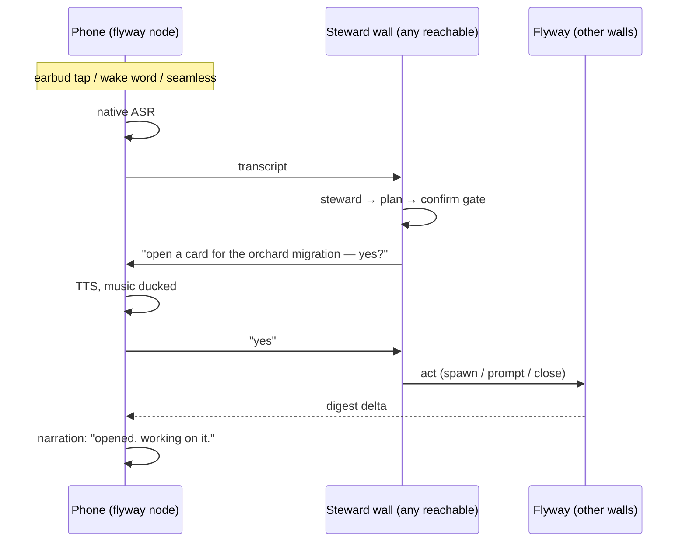

# The phone companion (Volery in your ear)

Design work 2026-11-09, from the request: *control Volery and the full flyway from a phone
while walking, earbuds-only, with audio narration.* Voice in, voice out, mesh connectivity —
a phone app that is itself a node on the flyway.

**Status: M0 answered 2026-11-09 — iroh 1.3.0 cross-compiles, links, and runs on the Pixel 7a
(see below).** M1 landed the same day: the flyway's pure core is the workspace crate
`src-tauri/flyway-core`, which the desktop re-exports module for module (`src/flyway/mod.rs`)
and a phone can link with no Tauri in its graph. M2 (the app + node) is next. This file will grow a `.claude/rules/` file when there is code to govern.

## What this is

A phone companion, Android first (Pixel 7A), that joins the flyway the way a wall does — it
dials walls by key, reads the roster, receives what is worth knowing, and sends acts back. It
has native ears (on-device speech recognition) and a native mouth (speech synthesis), because
the phone's recogniser is a different class from the desktop's, and the desktop voice has
never worked on this network (see `docs/VOICE.md`, sink `4caa13ed`).

## The decisions, as made with Lyss

| question | answer |
|---|---|
| platform | Android first (Pixel 7A); iOS later, not now |
| the phone's role | **a true flyway node** (mesh), not a remote for one laptop |
| voice cost | free by default; a cheap premium tier (a few $/mo) as a setting |
| input modes | push-to-talk, "hey volery" hands-off, seamless hands-off — all three, as settings |
| narration density | a "chatty" setting: off / only-what-needs-you / murmur |
| music | duck or pause, a setting |
| chat mode | a later native screen, not in v1 — the node already carries prompt/recall/tail/answer, so it is a UI add, not a data-path add |
| viewing | pictures (shown/pinned), mockups (`ask_user` previews) and files (sent) are viewable on the phone, not just narrated — the flyway already carries them (`push_pictured`, `send_files`, `look`) |
| office TLS gate | not a design input — re-test the transport rather than assume. QUEERISFREEDOM is unrestricted and has admin; the work laptop's Netskope path is already handled by `forge::tls` |

## The architecture: the phone is an ear, a mouth, and a pair of hands. The wall stays the brain.

One clarification that "true flyway node" must not blur: **the phone runs no `claude` child,
and cannot.** The steward (a sentence → an ordered plan) is a `claude --print` child, so it
runs on a wall, always. What the phone's node-ness buys is *reach and resilience*, not a
brain of its own: it can dial any wall directly, so it never depends on one specific laptop.
If the work laptop is down, it parses through QUEERISFREEDOM. If QUEERISFREEDOM is down, any
other wall.

Everything smart and dangerous stays on the wall — the steward parse, the confirm gate, the
act verbs, the safety tables (`voice.md`, `spawn.md`). The phone only hears, speaks, and
relays text. That is not a compromise; it is the property that makes a misheard command safe.

Three loops, all thin on the phone:

| loop | what happens | reused from the flyway |
|---|---|---|
| **narration** | walls change, the phone folds the deltas into spoken lines | the digest, `ask_user` questions, notices — all of which already cross |
| **command** | you speak → a wall parses → act | `steward.rs`, `act.rs`, the confirm gate |
| **question** | a card's question is read aloud, you answer, it crosses back | `Ask::answers` already travels |

## What the phone is, concretely

- **A shared Rust core.** Extract the flyway's pure half — `seal`, `frame`, `session`, `wire`
  (iroh), `sync`, and the protocol-pure parts of `fleet` — out of `src-tauri/src/flyway/` into
  a workspace crate `flyway-core`, which the desktop consumes unchanged and the phone links.
  This is the same move the repo already argues for (one registry, no restated drift), and it
  de-risks the desktop flyway by making it testable without Tauri.
- **An Android app (Kotlin + Jetpack Compose).** A foreground service so it stays alive while
  walking, Bluetooth audio, audio-focus ducking, and home/settings/viewer screens. The Rust
  core is exposed through JNI (a JSON envelope — uniffi can't map the flyway's opaque
  `serde_json::Value` snapshot). Compose over Flutter: native feel + performance, no rewrite,
  and the Rust node is already cross-platform, so iPhone-later means redoing only the UI shell
  (SwiftUI), not the app.
- **Narration, derived phone-side.** No new wire vocabulary for v1: the phone folds the
  existing digest/ask/notice deltas into spoken lines, gated by the chatty filter. Pure logic,
  testable without a phone (`narration.ts` on the desktop, or its own module).

The node's primitives are `prompt`, `recall`, `tail`, `answer` and the digest — the same verbs
the desktop flyway already exposes. The app is **multi-screen from the start** (home +
settings, with a chat screen reserved) even though v1 ships only the walking modes: chat mode
is a later native screen over the same node, not a new data path. The one difference to keep:
transcripts are fetched lazily when a chat opens, where narration streams digest deltas
continuously.

## The modes (all settings, no one is forced)

1. **push-to-talk** — tap an earbud (or a volume key) to talk.
2. **"hey volery" hands-off** — a local wake word; on hearing it, duck/pause music and listen.
3. **seamless hands-off** — no wake word. When something needs you, duck/pause the music,
   speak it, and listen for an answer for a short window. The desktop already has this exact
   window (`SPOKEN_YES_MS` in `voice.md`); the phone inherits the semantics, not the engine.

Settings, one screen: mode · chatty level · duck vs pause · voice quality · steward wall ·
wake-word sensitivity.

## Voice, at the cost asked

- **In (recognition):** Google's recogniser on the Pixel — free, excellent, cloud-assisted with
  an on-device fallback. The premium concern does not apply to input. Whisper on-device is a
  later, optional privacy tier, not v1.
- **Out (synthesis):** default **Google's natural voices** — free, genuinely good, on-device.
  A "premium voice" setting accepts a user-supplied key (OpenAI `tts-1` ≈ two dollars a month
  at walking usage, or ElevenLabs ≈ $5/mo) for a richer narration voice. Free first, upgrade
  later, never required.

## Milestones

| | what | gates on | proof |
|---|---|---|---|
| **M0** | the spike: does iroh 1.3.0 build and run on Android? | — | **done** — cross-compiles, links, and ran on the Pixel 7a, printing a node id |
| **M1** | extract `flyway-core`; desktop consumes it unchanged | M0 | `cargo test --lib` and the flyway lifts green with no behaviour change |
| **M2** | the app skeleton + node: foreground service, Rust core linked, dial by key, roster, digest receive | M1 | **done** — the phone dials the real wall (`queerisfreedom`) over the relay and reads its roster + cards digest |
| **M2v** | viewing: `Node::fetch` pulls a file/picture over the flyway's `seeing` exchange, and a Compose viewer draws them | M2 | **done** — fetch desktop-proven, Compose viewer built + installed. Honest limit: pinned far-wall images and `ask_user` previews do not cross yet |
| **M3** | ears + mouth + narration: ASR, TTS, the digest→speech fold, chatty filter | M2 | a digest change becomes a spoken line, at the chosen chatty level |
| **M4** | modes + audio: audio-focus duck/pause, push-to-talk, wake word, seamless | M3 | music ducks on a question, resumes on the answer |
| **M5** | control + questions: spoken confirm loop, act verbs, `ask_user` answers | M4 | speak "open a card for X", confirm aloud, it opens on the far wall |
| **M6** | iOS (later) | M5 | — |
| **M7** | chat view (later) — a native chat screen over the node's `prompt`/`tail` verbs | after the walking modes | type to a card, read its thread |

## Risks and unknowns

- **iroh 1.3.0 on Android — proven 2026-11-09, not assumed.** The whole tree (ring, rustls,
  the Android platform-verifier, quinn) cross-compiled and linked clean under NDK r26d, and the
  resulting `aarch64` binary ran on the Pixel 7a and printed a node id. The one genuinely open
  question left is the on-device *dial* (reach the desktop flyway from the phone's network),
  which is M2's job.
- **On Android, `CaTlsConfig::system()` needs the app's Context.** The platform verifier's
  Android half reads the system trust store through `ndk-context`, so a process with no JNI
  Context panics — measured on the Pixel 7a: `ndk-context: android context was not initialized`
  → `rustls-platform-verifier: Expect rustls-platform-verifier to be initialized`. The app must
  initialize the verifier with its Context before `Node::start`; that is the one genuinely-new
  thing the phone does that the desktop never did, and it is M2b's to do.
- **The cross-network dial is closed.** Both causes were phone-side, not the desktop: the
  platform verifier's Android class was never bundled (the AAR wasn't a Gradle dependency, so
  the first dial hit `ClassNotFoundException: org.rustls.platformverifier.CertificateVerifier`),
  and the `.so` wasn't 16 KB-aligned. Both fixed; the phone now dials the real wall
  (`queerisfreedom`, not the key's stale `AU-LT-285` label) over the relay and reads its roster
  and cards digest.
- **Background life.** Android throttles background network (Doze). A foreground service, and
  the fact that walking means the screen is on or music is playing, is the mitigant; it still
  wants a battery measurement in M4.
- **A wake word on a pocketed phone** only works through the earbuds' own mic, which is
  Bluetooth and battery-costly to keep always-listening. Tested, not assumed, in M4.
- **Disk is near-full on this box** (memory). NDK + a second cargo target is 2–3 GB. Check and
  free space before the M0 toolchain install.
- **The office TLS gate** stays an open errand (`docs/FLYWAY-PROBE.md`), re-run when the phone
  dials the work laptop. It does not block QUEERISFREEDOM, and it does not decide this design.

## What M0 needs from Lyss

The cross-compile half of M0 needs nothing from you. The **on-device dial test** — the phone
actually exchanging a sealed frame with the desktop flyway from the network — needs the
Pixel 7A with USB debugging on and `adb`. The card will stop at that step and say exactly what
to do; it will not try to drive your phone itself.
