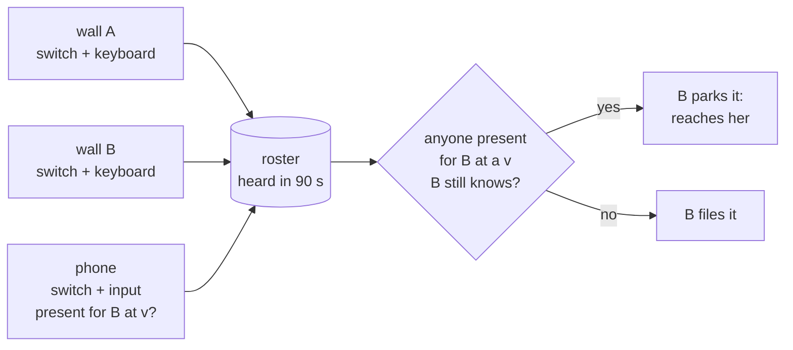
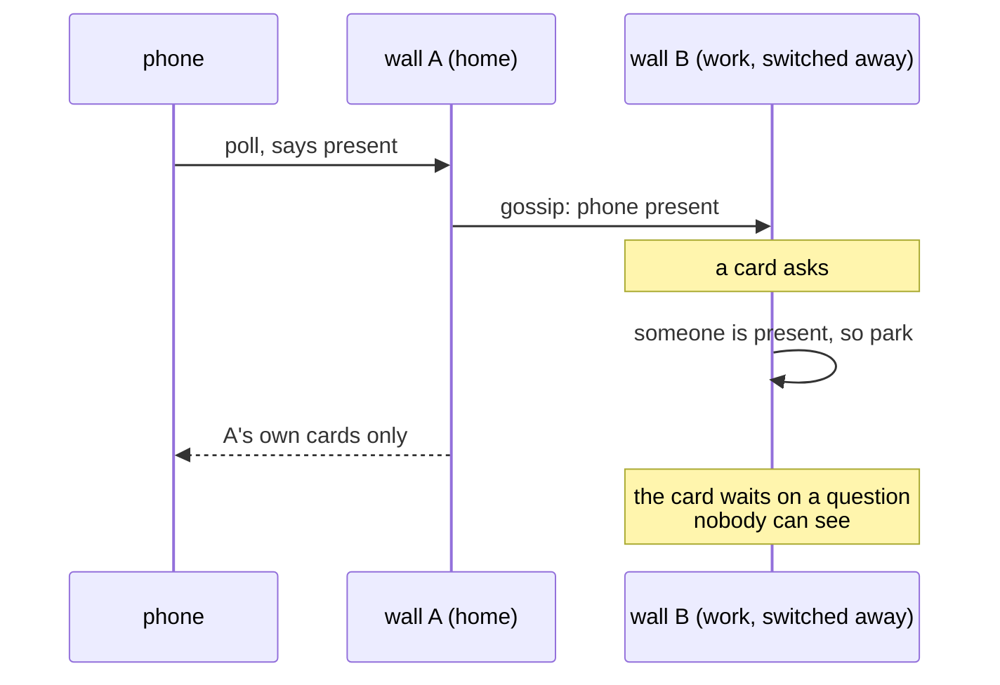

# Presence on the phone

**Status: design, 2026-11-12. Nothing here is built.** Asked by Lyss by voice from the phone,
through the front desk, while the wall had her down as away and was filing every question
her cards asked:

> I'm away from my laptop, so it's fine to be considered away. There is an open topic of
> "I'm away or not" when I'm on the phone like here. I guess being active on the phone
> should prevent my "I'm away" status on the flyway. But being inactive on the phone should
> count as I'm away, with an intentional way to say I'm away even if I'm on the app. Same as
> the walls that have intentional "I'm away" and automatic "I'm away".

## Decisions at a glance

Plain text first, because the phone's viewer draws neither tables nor diagrams.

1. **What counts as active on the phone.** Recommended: you touched Volery on the phone, or
   pressed to talk to it, in the last 15 minutes. Speech the phone merely overheard does not
   count. Unlocking the phone could count later, once the phone can notify you of a question.
2. **What quiet means.** Recommended: the roster's existing 90 second rule tells whether the
   phone is alive, and the 15 minute window tells whether you are using it. No new timer.
3. **The switch on the phone.** Recommended: the phone gets its own away switch (a chip on the
   roster, a quick settings tile, "I'm away" and "I'm back" spoken). It can say back for itself
   only, never for a laptop.
4. **How sources combine.** Unchanged: you are present if any source heard in the last 90
   seconds says so. A laptop switched away plus you active on the phone means present.
5. **What it unlocks.** Recommended: only whether a question is parked or filed. Laptop away
   screens, gates and chimes keep following their own switch. The phone rings only when it is
   the place you touched most recently, and in hands-free mode it also reads out filed
   questions, taking a spoken answer only after reading it back to you.
6. **Failures.** A dead, offline, pocketed or drawered phone reads as away within 90 seconds
   or 15 minutes. A wall only counts the phone if the phone holds that wall's current
   questions, and the wall checks that itself.

Two things have to be built before the phone may say it is present: it must see every wall's
questions (today it sees one), and it should be able to notify you of one (today it cannot).

## The short version

Presence is already one question asked of a list of sources. Every wall announces a single
`present` bit on the flyway's 30 s tick, and a wall files a question only when it is away
itself and no other source heard in the last 90 s says `present`. The phone is already on
that list: it announces itself on every poll, with `present` hard-wired to false.

So the phone becomes a presence source by announcing honestly, built the way a wall builds
its own: an intentional switch, plus recent deliberate input. Two rules came out of two
rounds of review and carry the design:

- **Presence comes only from her hand.** A passive condition (earbuds connected, screen on, a
  dock, speech the phone overheard) can widen how a question reaches her. It can never keep
  her present, because a card parked on a passive condition has no bound.
- **A wall counts the phone only if the phone can see that wall's questions.** Otherwise the
  wall parks a question where nobody will ever look. So the phone never says a bare
  `present`. It names the walls it is present for and the snapshot of each it holds, and each
  wall checks the claim against its own snapshot.



## How it works today

Read out of the code on 2026-11-12.

| piece | where | what it does |
|---|---|---|
| the switch | `presence.rs::away_here` | this wall's intentional away, a timestamp in SQLite |
| the automatic half | `machine.rs::idle_away` | no input for the machine's lock timeout, floored at 20 min (30 with no lock) |
| what a wall says | `link.rs:629` | `present = !away_here && !idle_away`, each 30 s tick and at once on a flip |
| quiet | `fleet.rs:130` | `QUIET_AFTER_MS`, 90 s without hearing a source |
| the union | `fleet.rs:339` | `present_elsewhere`: another entry says `present`, heard within 90 s |
| filing | `presence.rs:412` | `nobody_to_ask`: (switched or idle) and not (travels and present elsewhere) |
| the backstop | `presence.rs:503` | `watch_idle`, on the 25 s tick a parked question already has, files once nobody is present |

The local switch and the union are kept apart on purpose. The away screen, the gate on the
way back, the muted notification ladder and the morning pile follow **this wall's switch
only**. The union decides one thing: whether a question is parked (put to her now, wherever
she is) or filed (queued, and the card carries on).

`Facts.present` is a positive word, so anything that does not send it reads as away. Nothing
in the front end reads it; `present_elsewhere` is its only reader. Roster ages are counted
per hop, so a wall heard through gossip goes quiet at the same moment everywhere, and no
machine's clock is ever compared with another's (`fleet.rs`, `Heard`).

## What the phone already does

- **It is already in the roster.** Every exchange opens with the greeting a wall sends,
  including an announcement of itself (`phone-node/src/node.rs:555`), with
  `Facts::default()` (`node.rs:575`), so `present: false`. The wall it dials folds it in and
  gossips it to the rest of the flyway.
- **It polls about every 15 s.** `Narration.kt` waits `NARRATION_CADENCE_MS` after each walk
  finishes, from the foreground service. Each poll is a full dial, so each poll re-announces
  the phone. Whether it keeps that pace with the screen off and no media playing is **not
  measured**: no wake lock is held, and `docs/PHONE.md` lists background life as open. A
  stalled poll makes the phone read quiet, which is the safe direction.
- **It sees one wall's questions.** A wall answers a dial with its own snapshot only
  (`cards.rs::say` returns `mine`), though it holds every peer's (`theirs`).
- **It answers blind.** `Node::answer` is fire and forget: a refusal looks exactly like an
  acceptance (`node.rs:473`). And in seamless mode, whatever the microphone hears in the 60 s
  after a question is read out is sent as the answer, with no read-back (`Narration.kt` arms
  the question, `Steer.kt` sends the next transcript; sink `50849a7d`).
- **It speaks only some parked questions.** Narration speaks a card *changing into* asking,
  once (`narration.rs`, `TRANSITIONS`). A second question on a card already asking, a
  confirmation, a removal, a close, and anything at all with the voice set to off, is never
  spoken. Filed questions are drawn and never spoken.
- **It cannot interrupt her.** The only notification channel is the foreground service's own,
  at low importance (`NodeService.kt`).
- **It has no idea of away.** No switch, no input tracking, no Do Not Disturb check.

## Why turning the bit on is not enough

Setting `present` to true in `node.rs:575` is one line, and it would make things worse:



Today that question is filed. With the bit on it parks on B, the phone never sees it, and the
card waits until the phone stops claiming presence.

## The model

One fold over named sources. Each source builds the same predicate from its own evidence.
The wall that would park decides whether a source's claim applies to it.

```
heard(s)    s announced within 90 s
present(s)  heard(s), not switched(s),
            active(s), reaches(s)
counts(s,w) present(s) and s covers w
person(w)   counts(s, w) for some source s
```

| | wall | phone |
|---|---|---|
| switched | z, the header, a card's `away` tool | the phone's own switch (D3) |
| active | input on the machine within its lock timeout | a touch or a press in Volery within 15 min (D1) |
| reaches | always: window, peek, chime | Volery in front, or a notification or spoken question Do Not Disturb lets through (D5, P2) |
| covers | every wall, through the digest it already carries | a wall whose current snapshot it holds, checked by that wall (P1) |
| says | `present: bool` | `present_for`: each wall it covers, with the snapshot version it holds |
| heard | 30 s tick | each poll |

Each source has the same two kinds of fact. **Intentional**: a claim by the person, on the
source it is about, durable, cleared only by the person. **Automatic**: folded from events
that already happen, never stored, ended by the next input. The asking wall never needs to
know which kind made another source go quiet; both arrive as a source claiming nothing.

## The decisions

### D1. What counts as active on the phone

The test: would a question put to her now reach her and get an answer within minutes.

| option | counts | weakness |
|---|---|---|
| A. Volery in front | the app on screen | a pocketed phone between taps reads away |
| **B. Volery input, 15 min (recommended)** | taps, keys, presses | reading another app reads away after 15 min |
| C. B plus unlocking | picking the phone up at all | needs P2; every glance counts |
| D. C plus earshot | earbuds in, hands-free on | rejected, below |

**Recommendation: B.**

```
active = last_input within 15 min
input  = a touch or key in a Volery screen
       | a push-to-talk or media press
         Volery handled
       | an utterance in a listening
         window that press opened
       | a notification action
```

- **Only what her hand started.** The first fix said an utterance counts once it was
  accepted as an answer or a command. The second review showed that is anything at all: in
  seamless mode the phone sends whatever it hears in the 60 s after a question as the answer
  (sink `50849a7d`). So a television would answer a card, count as input, keep her present,
  and the next question would park and be answered the same way. A window the phone opened by
  itself is never evidence. A window her press opened is.
- **Option D was the first draft's recommendation and the review broke it.** Earshot held
  presence for as long as a headset was connected, ended only by a spoken question going
  unanswered. Narration does not speak most parked items (a second question, a
  confirmation, anything with the voice off), so the ending never came and a card stayed
  parked indefinitely. The walking mode gets what it needs another way, in D5.
- **Option C is the natural next step**, and closer to her words (*active on the phone*).
  Two cautions from the review: on a Pixel with face unlock every glance is an unlock, so a
  3am look at the clock means 15 min of parked questions buzzing unless Do Not Disturb is on;
  and an unlock only matters if a notification can reach her in another app, which is P2.
  Build B, live with it, then decide on C.
- **A docked, charging phone is not active.** No state counts, only input, so a phone on a
  dock with the screen kept on reads away after 15 min.

### D2. What quiet means, and what it costs

| what | today | new cost |
|---|---|---|
| alive and on the network | the poll re-announces; the roster reads quiet after 90 s | none |
| the claim (`present_for`) | the phone sends `present: false` | a few bytes in the announcement it already sends |
| input | not tracked | callbacks the app registers once; no timer |
| Do Not Disturb | not read | `ACTION_INTERRUPTION_FILTER_CHANGED`, an event |
| a switch flip | n/a | one poll at once, like `link::announce_soon` |

Presence adds **no timer and no radio wake.** The claim is computed as each poll goes out, from
timestamps the events wrote, measured on `SystemClock.elapsedRealtime` so a time zone change
or a clock step cannot move it.

**The window, `PHONE_QUIET`:**

| value | effect |
|---|---|
| 5 min | filed sooner; a glance barely counts |
| **15 min (recommended)** | a question parked on a phone she has put down is filed 16 to 17 min after her last input: 15 min, then a poll, the next exchange between walls (up to 30 s) and a 25 s tick; or, if the poll has stalled, 90 s of quiet and the tick |
| 30 min | the wall's no-lock default; half an hour blocked on a phone in a bag |

The wall errs long (a 20 min floor) because `machine.md` says filing early put a question in a
pile that does not cross the flyway. **That stopped being true on 2026-10-20**, when the pile
started travelling (`away.md`, *The pile is hers*). Filing early now costs only the
synchronous exchange, which is why the phone can use a shorter window. The wall's floor may be
worth re-arguing too (sink `23c5db3f`).

### D3. The intentional switch on the phone

**Where.** One verb, several doors: a chip at the top of the roster (*here* or *away*, tap to
change); a quick settings tile; an action on the persistent notification; settings; and
spoken, *"I'm away"* and *"I'm back"*.

**Spoken, with three guards from the review.** Two-word forms only, since a one-word *"back"*
is a fine answer to a question. Matched only outside an open answer or plan window, so it can
never steal an answer (`Steer.kt` routes an armed answer first today). And it is matched on the
phone itself, before anything goes to a wall, so no model or card is in the path. The phone
opens its ears in two places today: after reading out a question (`Narration.kt`) and after
answering one of her own commands (`Steer.kt`). While switched away it opens only the second,
so *"I'm back"* can only be heard in a conversation her press started.

**Switched away**, the phone claims nothing (`present_for` empty) and stops notifying and
reading questions out. It still answers her own commands aloud, including the confirmation
that she is away. One case needs naming: the front desk answers her through `ask_user`, and
with nobody present that reply is filed. A front desk question that follows a command she gave
in the last few minutes is a reply to her, so the phone reads it out anyway and takes the
answer through D5c's read-back. The pile stays drawn. A switch the phone cannot read counts as
off, as `away.md` requires of a wall: an unreadable setting must not silence anything. That
cannot make the phone claim presence, because presence also needs input.

**Shared, per source, or travelling.** A card may say *away* and never *back*, because where
a person is, is a claim only she can make.

| option | phone says away | phone says back |
|---|---|---|
| **a. per source (recommended)** | the phone stops counting | the phone counts again |
| b. one shared switch | every source away | every source back: a claim about keyboards it cannot see |
| c. a, plus *away everywhere* | the phone, or every source | the phone only |

| who says it | away | back |
|---|---|---|
| her, at a wall | that wall | that wall |
| her, on the phone | the phone (c: or everywhere) | the phone |
| a card's `away` tool | its wall | never |
| the front desk, hearing her | its wall | never |

The phone may say *back* for itself because the claim is made by her hand on the device it is
about, as pressing z is on a wall.

**What option a gets wrong.** She tells the phone *"I'm off to bed"*. The front desk card hears
it and switches its own wall. The phone, which she just used, stays present for 15 min, and a
question parked then buzzes in the bedroom unless Do Not Disturb is on. Option c fixes it with
a person-wide claim carried as an age (`gone_ms` at `said_at`, the way the roster already
carries ages). Every source treats it as absence newer than any earlier input, and any later
input outweighs it, so a wrong claim costs her one tap and nobody ever says *back* for her. The
`away` tool would grow an `everywhere` flag for *going to bed*, *done for the day*.

Recommendation: **a** now; **c** written down for the first time the bedroom case happens.

### D4. How the sources combine

Unchanged. A question that can travel is parked if this wall is here or a source that covers
it is present, and filed otherwise. A question that cannot travel (`ask::Stay`) is parked
only if this wall is here. The phone adds rows to the table, and the rule gains one
condition: the phone counts only toward a wall its `present_for` names, at a snapshot that
wall still recognises (P1).

W is the wall the card asks on. *Here* means not switched and not idle.

| W | phone | other walls | the question |
|---|---|---|---|
| here | any | any | parks; W rings |
| switched | present, covers W | away | **parks; reaches her on the phone** |
| switched | present, not covering W | away | filed |
| switched | quiet or idle | away | filed |
| idle | present, covers W | away | parks |
| switched | any | one present | parks; reaches her there |

The brief's rows: away on this wall with the phone present is **present**; away everywhere
with a quiet phone is **away**. Automatic quiet on a wall and on the phone are one row, since
both arrive as a source claiming nothing.

When the phone stops being present with a question parked, nothing new is needed:
`watch_idle` asks again on every 25 s tick and files it.

### D5. What the phone's presence unlocks

Filing is the one thing the union decides on a wall. That stays true.

| surface | follows | change |
|---|---|---|
| park or file a question, a waiting notice, a confirmation | the person | the phone counts, where it covers |
| `watch_idle` | the person | same |
| notices sent to the pile when a wall goes away | the person | same; see sink `8ba86399` |
| a wall's away screen, gate, morning pile | that wall's switch | none |
| a wall's peek, taskbar flash, chime | that wall's switch | none |
| the phone's notifications and speech | the phone's switch, D5b, D5c | new |

A laptop's away screen is about that laptop; her being on the phone says nothing about who is
in front of it.

**D5b. Which source rings.** Today the phone reads a question aloud even while it is on her
laptop screen in front of her.

| option | rule | needs |
|---|---|---|
| a. all ring | today | nothing |
| **b. freshest rings (recommended)** | the phone rings only if its last input is newer than any present wall's | each source says how long since its input |
| c. phone defers | the phone rings only if no wall is present | nothing |

Option c fails the common case: she leaves the laptop without switching it, and it reads
present for 20 min while she is on the phone. Option b follows her. Each source announces
`idle_ms` as of its own `said_at`, and the hearer adds `quiet_for`, so clocks are never
compared across machines. Rounded to the minute, so a company laptop holds no finer record
of her phone use than that. The same field is what sink `ae696b3a` asks for (*no input for
40m* on a far wall's heading). A wall's figure can be a minute old (its last tick, plus the
relay) and the rounding adds half a minute, so when two sources are within 2 min of each other
both ring. The walls' own ladder stays as it is.

**D5c. The walking mode.** In hands-free mode with a headset connected, the phone reads out
**newly filed** questions as well as parked ones, and a spoken answer to a filed one goes back
as `deferred:<row>`, the path a tap already uses. That is how the walking mode works without
earshot holding her present: a filed question blocks no card. A spoken answer is read back
and sent only on a spoken *yes* through the same gate a plan already uses (`answeredIn`), or
on a press, because answering wakes a card and the window it was heard in was the phone's,
not hers. The same read-back should apply to a parked question's spoken answer, which is
sink `50849a7d`. Speech also follows Do Not Disturb (P2's rule), so a Bluetooth speaker on a
nightstand does not read questions out at night.

### D6. The failure directions

| what happens | reads | why |
|---|---|---|
| the phone dies, is killed or loses the network | away at 90 s on every wall; parked questions filed within about 2 min | ages are per hop; then the 25 s tick |
| Doze stops the poll | away at 90 s | same |
| a drawer, app alive | away 15 min after the last input | no input |
| the app restarts | away until touched | input times are memory only |
| Do Not Disturb blocks Volery | away, unless Volery is in front | `reaches` |
| the phone cannot see wall W | W files as before | W is not in `present_for` |
| the phone's copy of W falls behind | W stops counting it about 60 s after it changed | W checks the version (P1) |
| a clock is wrong | no effect | ages, W's own clock, `elapsedRealtime` |
| an older wall | never counts the phone | it does not read `present_for` |
| an older wall relays the phone's entry | the fields it drops read as "present nowhere", so the phone may count on fewer walls until that wall is updated | absence is the safe reading |
| wall A loses its link to B while B is idle | B goes on counting the phone until its next change, then stops within about 60 s and files | the version check |

The brief's last condition, that a present phone must never make a wall withhold a question
from a person at its keyboard: phone presence can only turn a filing into a parking. It never
files, never mutes, never moves a question off its wall. Whoever is at that keyboard can still
answer. The real danger is a question parked where nobody looks, and P1 is what closes it.

## Prerequisites

**P1. The phone covers a wall only if it can see and answer that wall's questions.**

The wall that would park does the check, which is what makes it hold by construction.

- **The phone never says `present: true`.** Its claim is `present_for`: each wall it covers,
  with the version of that wall's snapshot it holds. Empty means present nowhere. A wall from
  before this change does not read the field, so it never counts the phone. A wall that
  relays the phone's entry through an older one loses the field, and a missing field reads as
  present nowhere. Every way the claim can be lost is the safe way. (The second review found
  that a separate `node` flag beside a bare `present` failed here: an older relay dropped the
  flag and kept the bit.)
- **The wall checks its own snapshot.** Wall B counts the phone only if the version named for
  B is B's current one, or one B replaced less than about 60 s ago by B's own clock. B already
  stamps its versions from its own clock (`cards.rs:115`); what is new is a short memory of
  when each recent version was replaced. No relayed age and no other machine's clock is
  involved. When B parks a question its snapshot changes, so the phone has about a minute to
  fetch it before B stops counting the phone and `watch_idle` files the question.

How the phone comes to cover a wall:

| option | how | cost |
|---|---|---|
| **a. the dialled wall relays (recommended)** | it sends every peer snapshot it holds that is newer than what the node has | after the first poll, bytes only when something changed |
| b. the phone dials every wall | one dial per live wall per poll | bytes and walk time; a walk through dead walls can take a minute |
| c. cover only the dialled wall | no relay; every other wall ignores the phone and files | none; the useful first step |

Details that decide whether a works:

- **Freshness needs no new idea.** A snapshot's age says when it was published, and an idle
  wall's is legitimately an hour old, so age cannot be the test. The version check above is
  the test: a copy the dialled wall holds only by gossip, frozen, names a version its wall has
  long replaced, and that wall stops counting the phone by itself.
- **Relay only to a node.** Any wall would accept a relayed `Cards{host: B}` under the
  existing tag (`Cards::on`), so the relay goes only to an entry that announces itself as a
  node. Departures are relayed too. The versions the phone holds are memory only, so its first
  poll after a restart carries everything.
- **Answer through the dialled wall.** The fleet already relays a prompt addressed to another
  wall (`fleet.rs`, `hear_ask`) and pushes it on at once (`link.rs`, `route`), and both a
  parked answer and a `deferred:` answer go through it. What is missing is the outcome: the
  phone drops `Answer` frames today (`node.rs`, `Sighting::read`), and B's answer reaches A
  only on their next exchange, so the phone learns it within a tick and a poll. That can
  outlast `SENT_TRUST_MS` (45 s, `Steer.kt`), which has to grow. A refusal (the question was
  filed meanwhile) must be said on the phone.
- **Voice must cover what it vouches for.** Narration should speak each new parked item the
  phone covers, keyed by its id, rather than a card's first change into asking.

**P2. The phone can interrupt her.** A notification channel for parked questions, high
importance, one notification per card with the options as actions, removed when the question is
answered anywhere. It is the phone's peek. Do Not Disturb, defined once and used for both
notifications and speech:

- filter *all*: reachable;
- *priority only*: reachable only if she let the channel bypass Do Not Disturb;
- *alarms only* or *none*: unreachable.

Pixel's bedtime mode may or may not turn Do Not Disturb on, so it is no substitute for the
switch.

## What would change

No schema change and no migration on any wall. The phone's switch lives in its preferences.

| | change | where |
|---|---|---|
| W1 | `Facts.present_for`, filled by the phone from D1 and P1; `present` stays false; the announcement version floored and persisted (sink `bc3081a4`) | wire, phone |
| W2 | a node says which snapshot versions it holds; the wall relays newer ones and departures | wire |
| W3 | `Facts.node`, so walls know an entry is a phone and relay to it, and stop dialling and pushing to it (sink `0fc0061c`) | wire |
| W4 | `Facts.idle_ms`, minute-rounded (D5b) | wire |
| W5 | `gone_ms`, only for D3 option c | wire |
| | a wall remembers when each recent snapshot version was replaced; `present_elsewhere` reads `present_for` for itself | wall |
| | input and Do Not Disturb folds, the switch and its doors, P2, D5c's read-back, reading `Answer` frames, a longer `SENT_TRUST_MS` | phone |

Every new field is `#[serde(default)]`, and in every one absence is the safe reading. An
older wall passes over a message it does not know (`frame.rs::read`, `Read::Unknown`), and
serde drops a field it does not know, so W2 is safe to send to one.

**Prose this makes false, to change with it.** The `away` tool's description tells every card
that `ask_user` "stops parking" (`presence.rs:914`), which is already false whenever she is
present elsewhere and would be false most of the day. Also the `Facts.present` doc comment
(`fleet.rs:261`), `present_elsewhere`'s "some other wall", `cards.rs`'s note that snapshots
are not relayed, `node.rs`'s module note that the phone's facts are empty, and a presence
section in `docs/PHONE.md`, `away.md` and `elsewhere.md`.

## What other designs can read from this

`docs/ASSISTANT.md` (initiative, being written beside this) asked what a per-person reading
can give it. As designed here:

- **Is she reachable** has an answer per asking wall: `person(w)`. A flyway-wide "anyone
  present" exists, but it is not what decides parking, so anything delivering from a wall
  should ask that wall's reading.
- **Where** is the source with the smallest `idle_ms` (D5b). **How** (wall screen, phone
  screen, phone voice) is not on the wire; it would be a new field. The phone's voice is a way
  of delivering a question, never evidence that she is there.
- **Intentional or automatic** does not cross: each source sends one bit. With D3 option a,
  an intentional away is a claim about one source, not about her. The only person-wide
  intentional claim is option c's `gone_ms`.
- **A comeback edge** for the person does not exist. The union is computed when asked, and
  the only edge is a wall's own switch. One folded from the roster would flicker around the
  90 s bound and would need hysteresis.
- **Present but not to be disturbed** is outside this model. Do Not Disturb enters only as
  "the phone cannot reach her".

## Found in the existing code

None of these is about presence. Each is in the sink.

- **`b692c7c0`** The phone downloads up to 1 MiB of sink history on every poll: its `Hello`
  carries an empty watermark, so the wall sends the oldest events every time and the phone
  throws them away. Plus the whole cards snapshot, changed or not. At one poll every 15 s that
  could reach gigabytes a day on mobile data, depending on the sink's size.
- **`0fc0061c`** Every wall dials the phone each tick and pushes cards and boards to it,
  though it accepts nothing. Dials back off to 5 min for ever; pushes do not back off at all;
  the phone's name is persisted as a known wall, so this survives restarts.
- **`bc3081a4`** The phone's announcement version is raw `now`, unfloored, so a clock stepped
  back makes every wall ignore it. Two phones left on the default name share one identity.
- **`23c5db3f`** Several places still say the pile does not cross the flyway, including the
  stated reason for the wall's 20 min idle floor.
- **`8ba86399`** Notices raised on a switched wall while she is present elsewhere never join
  the pile when she leaves the other source. Exists today with two walls; the phone would make
  it daily.
- **`50849a7d`** In seamless mode the phone sends whatever the microphone hears in the 60 s
  after a question is read out as the answer, with no read-back, to a card that runs with the
  machine in its hands. A television can answer a card today, presence or not.

## What the review changed

Two adversarial passes (`volery:red-team`), each reading the draft against the code. Both
returned *fix first*; both confirmed the diagnosis of today's system and broke part of the
proposal.

**The first pass:**

- **Earshot no longer keeps her present.** The first draft held presence while a headset was
  connected, ended by an unanswered spoken question. Narration speaks only a card's first
  change into asking, so that ending often never comes and a card would stay parked
  indefinitely. Presence now needs deliberate input; the walking mode is served by reading out
  filed questions (D5c).
- **Unlocking is no longer recommended yet** (face unlock makes every glance count; it needs
  P2 first).
- **Coverage moved to the wall that parks** (`covers`), with freshness defined as a direct
  exchange. The first draft's guard either failed for every idle wall or passed walls known
  only by gossip.
- **Answers go through the dialled wall**, since a blind dial to another wall may not reach it
  and cannot report a refusal.
- **Times are carried as ages**, never compared across clocks, for D5b and D3 option c.
- **Do Not Disturb has one definition** and gates speech as well as notifications.
- **The spoken switch got its guards**: two words, never inside an answer window, *back* only
  after a press.
- **Corrections**: the 15 s poll with the screen off is unmeasured; the timing bounds were
  restated (ages are per hop, so gossip adds nothing to quiet); the W2 compatibility question
  was already answered by `frame.rs`.
- **More in the existing code**: the 1 MiB sink pull per poll, pushes with no backoff, and the
  unfloored version, all filed.
- **Prose to change with it**: the `away` tool's "stops parking" and four doc comments.
- **A missing alternative**: reading filed questions aloud, which became D5c.

**The second pass**, over the fixes only:

- **A spoken answer stopped counting as input.** "An utterance accepted as an answer" turned
  out to be anything heard within 60 s of a question being read, so a radio could answer a
  card and keep her present. Input is now what her hand started, and a spoken answer to a
  filed question is read back and confirmed (D1, D5c, sink `50849a7d`).
- **`covers` became `present_for`, and the phone stopped saying `present`.** An older wall
  relaying the phone's entry drops fields it does not know, which would have kept a bare
  `present` and lost the flag saying it was a phone. With the claim carried in a field whose
  absence means "present nowhere", every way of losing it is safe, and the withholding rule
  for older walls (and its unbounded guess of "under two minutes") is gone.
- **Freshness became the parking wall's own version check.** "Last direct exchange" was state
  no wall keeps, and a relayed age went stale by up to three minutes. Each wall now checks the
  version the phone holds against its own, on its own clock.
- **The answer relay was confirmed to exist**, and the missing half named: the phone reading
  `Answer` frames, and a longer `SENT_TRUST_MS`.
- **The front desk's reply to her own command** is read out while the phone is switched away.
- **Corrections**: the D2 bound is 16 to 17 min, and D5b rings both sources when they are
  within 2 min of each other.

The second pass's own fixes were checked by hand against the code rather than by a third
pass, so that fixing and reviewing do not loop. That check added the two `present_for` rows
at the end of D6.
