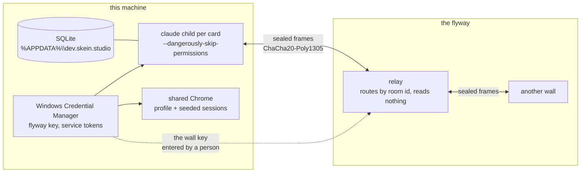

# Security and trust in Volery

This is the working document for the card that hardens Volery's security. It records what
exists, what it protects against, what it does not, and the two pieces of work already
planned: a second factor for the flyway, and credentials that do not work on another
machine.

It is written to be argued with. Every claim names the file it comes from, so a reader can
check it rather than trust it.

## The short version

Volery keeps its own data on this machine. It has no account, no server and no telemetry.
The one thing that leaves is the flyway, and what crosses it is sealed before it is sent.

The weak point is the wall key. One 32-byte secret is membership: whoever holds it can join
the flyway and, on any wall that accepts work, open a card that runs with the project's
permissions. That is the gap the second factor closes.

The second weak point is that a card is an agent with your authority. A project card runs
with `--dangerously-skip-permissions`, which is the same authority a terminal gives it. No
amount of app-level hardening changes that, and any plan that claims to should be read with
suspicion.

## The trust boundary, drawn

Read the dotted line as the whole argument. The key is what turns a stranger into a member,
and nothing else does.

## What is stored, and where

| asset | where | protection | who can read it |
|---|---|---|---|
| conversations, turns, cards, layouts | SQLite at `%APPDATA%\dev.skein.studio` | none at rest, by design | any process running as you |
| Claude Code transcripts | `~/.claude/projects`, written by the CLI | none at rest | any process running as you |
| the flyway key | Credential Manager, `dev.skein.studio/flyway-key` | DPAPI, user and machine scoped | any process running as you, via `CredRead` |
| service tokens (Azure DevOps, Asana, Spotify, Anthropic, DeepSeek) | Credential Manager, one entry each | DPAPI | any process running as you |
| event-source connection strings | Credential Manager, `dev.skein.studio/source/<name>` | DPAPI | any process running as you |
| Claude account credentials | Claude Code's own credential store, one per account | the CLI's | any process running as you |
| the browser profile | `%APPDATA%\dev.skein.studio\browser-profile` | none at rest | any process running as you |
| the browser session vault | `%APPDATA%\dev.skein.studio\sessions\wall.json` | none at rest, plain JSON | any process running as you |
| the control token | `control.json` beside the database | file permissions | any process running as you |

Two things follow, and they are worth saying plainly rather than burying.

**The database is not encrypted.** Transcripts contain source code, tool output, and
whatever an agent read. `vault.rs` argues at length that the database is the wrong place for
a secret, which is why tokens are not in it. It does not argue that the database is private,
because it is not. Anyone with your Windows account can read every transcript on the wall.

**The Credential Manager is not a boundary against code running as you.** It is a boundary
against another account, against a copied database, and against a stolen disk. It is not a
boundary against an agent with a shell, because the agent is you.

## The flyway

`src-tauri/flyway-core/src/seal.rs` is the whole of the cryptographic design, and its header
is the best explanation in the repository. The parts that matter:

- **One 32-byte key, generated by the system CSPRNG.** No passphrase, no key derived from a
  person's entropy. It is held in the vault and shown only when you press to see it.
- **The room id is `HMAC-SHA256(key, "volery/flyway/room/v1" || scope)`, truncated to 16
  bytes.** The relay routes by it and learns a hex string rather than the name of your
  project.
- **The content key is HKDF over the same secret with a different label.** The public room
  id and the key that decrypts its traffic are not the same bytes.
- **Frames are ChaCha20-Poly1305 with a random 96-bit nonce, and the room id is the
  associated data.** A frame cannot be lifted into another room and opened there.
- **No per-frame signature, deliberately.** Holding the key is already full membership, so a
  signature would defend against an insider who is trusted by construction. `seal.rs` states
  the condition that would reverse this: a flyway with a member who is not trusted with the
  machine.

The transport is iroh QUIC with a relay fallback. The design rule is that **the transport is
never trusted**, so swapping it is an engineering decision rather than a security one.

### What crosses, and what does not

`flyway/mod.rs` states the rule: **the wire carries work, never secrets.** Transcripts, card
state, questions, answers, notices, screens and the roster cross. No token ever does. The
wall key is the single exception, and it travels because a person carries it in an invite.

A remote card that needs a credential the far machine lacks is refused, naming the credential
and the machine (`spawn.md`, `needs`). This is a deliberate capability boundary: a token
entered once must not come to exist in two places.

### The gate on accepting work

`flyway/here.rs` keeps a per-wall switch, and `flyway/key.rs` makes the point that no
machine can be conscripted by a key alone. A person at that machine must have put the key in
the vault, and the accepting switch must be on. That is a brake, not a security boundary.

## What exists, and what it is for

| control | where | what it actually buys |
|---|---|---|
| the wall key in the vault | `flyway/key.rs`, `vault.rs` | membership is a human act on that machine |
| sealed frames | `flyway-core/src/seal.rs` | confidentiality and integrity, room binding |
| no secret on the wire | `flyway/mod.rs`, `spawn.rs` | a token exists in one place only |
| the accepting switch | `flyway/here.rs` | a wall can refuse remote work |
| chronicle row naming the origin host | `chronicle.rs`, `flyway/here.rs` | attribution among trusted members |
| remote spawn resolves a territory, never a path | `spawn.rs` | a model cannot choose a directory |
| chat cards have `--tools WebSearch,WebFetch` | `supervisor.rs`, `chat.md` | a chat card reaches nothing on this machine |
| plan mode beats the bypass flag | `gears.rs`, `supervisor.rs` | a planning card loses its writing tools |
| MCP writes that leave the machine ask first | `ask.rs`, `smith.rs`, `docket.rs` | a pull request, a task, a credential lend is a person's click |
| `PreToolUse` deny works under bypass | `hooks.rs`, `remove.rs` | a tool call can be refused, confirmed on 2.1.241 |
| the control surface is loopback and token-gated | `control.rs` | a local process cannot drive the wall without the token |
| every spawn is in a job object | `jobs.rs`, `supervisor.rs` | a card's tree dies with the wall |
| the updater re-asks GitHub and re-checks the file | `update.rs` | a cached URL is not trusted, a short file is deleted |
| the installer is launched by the exit handler | `lib.rs`, `update.rs` | a running exe is not rewritten under a card |
| TLS merges the Windows store with webpki roots | `forge.rs` | the corporate interception CA is trusted without trusting only it |

Two of these deserve more than a row.

**The control token.** `control.rs` binds `127.0.0.1`, mints a random token, writes it to
`control.json` beside the database, and requires it in a header. `health` needs no token.
The token is taken away on exit. It is how the wall tests drive a running app, and it is a
real local capability, which is why it is published on a file rather than on a port.

**The installer is not signed.** `release.yml` has a `sign` step that is a deliberate no-op,
and `update.rs::verify` checks the length the release states, a plausible size band, and the
`MZ` header. It does not verify a signature. The download is HTTPS from GitHub, and the
argument for that trade is in `update.rs`: `tauri-plugin-updater` would add a minisign
signature over the same HTTPS bytes, at the cost of a TLS stack that fails on this network,
a second async runtime, and an exit path that skips the teardown. The honest summary is that
today the update chain trusts HTTPS and GitHub, not a signing key.

## Gaps, in the order I would fix them

Each one states a trigger, a consequence, and what it would take. None of these is
hypothetical; all of them are reachable by somebody with the stated access.

### 1. The flyway key is a single factor

**Trigger.** Someone obtains the invite: a shoulder-surf of the reveal, a copy of the vault,
a screenshot in a chat, a paste into the wrong window, or a member who leaves badly.

**Consequence.** They can join the flyway, read every transcript it carries, answer
questions as you, and open a card on any wall that accepts work. That card runs with the
project's permissions. On a machine whose project is your repository, that is remote code
execution.

**What exists now.** The key is hidden until pressed, dropped when the panel closes, and the
invite names the wall handing it out. The accepting switch and the chronicle row are brakes
and witnesses, not barriers.

**What to build.** Option A below.

### 2. A credential copied off the machine may still work elsewhere

**Trigger.** A copy of the Windows Credential Manager entry, a restored profile backup, or a
sync tool that copies `%APPDATA%\Microsoft\Credentials`.

**Consequence.** The service token is usable on another machine. Credential Manager uses
DPAPI under the user's master key, which is machine-bound in principle, so a copied entry
should fail to decrypt. That is platform behaviour, not a guarantee this repository has
tested or stated, and it does not cover a plaintext copy made through the app or through a
process running as you.

**What to build.** Option B below.

### 3. A card has your authority, and prompt injection is in the loop

**Trigger.** A repository file, a web page, a build log or a tool result contains
instructions that the model follows.

**Consequence.** The card can edit, delete, push, deploy, read the vault through a shell, or
write code that runs later. `--dangerously-skip-permissions` means there is no prompt to
catch it.

**What exists now.** Plan mode removes the writing tools for a card put into it. A chat card
has no filesystem tools. The `PreToolUse` hook can deny a call, and it works under bypass.
The removal path has a hook and a confirmation. None of that is a general defence against a
model that has been persuaded, because the model is the thing with the shell.

**What to do.** This is a design decision rather than a patch: per-card scopes, which
repositories a card may push to, which credentials it may lend, and a visible record of what
it reached. See "Smaller work" below.

### 4. The browser is you

**Trigger.** A card drives the shared Chrome.

**Consequence.** It acts as you on any site you are signed into, because each card's browser
context is seeded from your sessions. `browser_run_code_unsafe` runs code in the page.

**What exists now.** The browser is one Chrome the wall owns, with a profile under the app's
data directory, and a session vault that is written back.

**What to do.** A visible "signed in as" line before a card takes the wheel, a per-project
profile option, and a bound on `browser_run_code_unsafe` that names the sites it may reach.

**And the vault itself is plaintext**, which is its own gap: see gap 9.

### 5. The job object has one hole, and it is deliberate

**Trigger.** A card calls `Win32_Process.Create` through WMI.

**Consequence.** The process is parented to `WmiPrvSE.exe`, outside the job and outside
`owned_pids`. It survives the wall and cannot be attributed to it.

**What exists now.** Every ordinary spawn is in a job object with `KILL_ON_JOB_CLOSE`, proved
by rebuilding the chain and closing the handle. The escape is documented in `processes.md`,
and the fix there is not detection but removing the reason to reach for it.

**What to do.** Keep giving cards a sanctioned way to run something that outlives a turn
(the `server` tool and the updater are two), and say in the rules that WMI is outside what
the wall can clean up.

### 6. Spawn quantity bounds are switched off

**Trigger.** A card, or a compromised key, opens cards in a loop.

**Consequence.** Unbounded processes, unbounded spend, and a wall that becomes unreadable.
`spawn.rs` has `MAX_LIVE`, `MAX_PER_HOUR`, `ONE_GENERATION` and `MAX_PROMPT` all parked at
`None`, on the argument that the wall is the instrument: a fan-out you can see is one you can
stop. That argument holds for a person watching. It does not hold for a wall driven remotely
while nobody is in front of it.

**What exists now.** `admit.rs` queues a spawn when the landing account's five-hour window is
past 85% and another card is mid-turn on that account. That bounds spend near a limit, not
fan-out.

**What to do.** Re-enable `MAX_LIVE` at every generation for cards opened over the flyway, or
add a per-wall admission count that a remote key cannot exceed. Keep the local wall's
judgement-based behaviour if that is wanted, but do not leave the remote path unbounded.

### 7. The wall has no audit trail beyond the chronicle

**Trigger.** A question about who did what across two machines.

**Consequence.** The answer is a scroll through several transcripts, or nothing. The
chronicle names the origin host for a remotely born card. It does not name every
cross-machine verb.

**What to do.** One row per cross-machine verb: join, accept, spawn, send, answer, close,
move. See plan A, item 4.

### 8. The database and transcripts are plaintext

**Trigger.** Disk access, a backup, a stolen laptop, another account with admin.

**Consequence.** Every transcript is readable. There is no second layer.

**What to do and what not to do.** Encrypting only Volery's SQLite buys little: the CLI's own
session files are plaintext in `~/.claude/projects`, and they hold the same text. A real
answer is full-disk encryption (BitLocker) plus not storing secrets in either. Say that
rather than shipping a half-encryption that reads as protection.

### 9. The browser session vault is a plaintext file

**Trigger.** Read access to `%APPDATA%\dev.skein.studio\sessions\wall.json`, or to the
browser profile beside it.

**Consequence.** The file is Playwright's `storageState` shape: cookies and localStorage for
every origin you have signed into, written back when a card's context closes or when you press
save. It is the most concentrated credential store the app has, and unlike every service token
it is neither in Credential Manager nor encrypted.

**What exists now.** Nothing at rest. The file is created empty at setup and written
atomically, which protects against a torn write and not against a reader.

**What to do.** Wrap the vault with the same machine-bound DPAPI treatment as plan B, or
store the wrapping key in Credential Manager. The browser host has to read it at startup, so
the unwrapped form must never be written to disk. Until then, say in the panel what the file
is and where it lives.

### 10. Installers are unsigned

**Trigger.** A compromise of the GitHub release, or a network attacker who can serve bytes
that pass the length and `MZ` checks.

**Consequence.** Arbitrary code as you, at install time, with no prompt from Windows beyond
SmartScreen's reputation check.

**What to do.** Land the SignPath certificate, or verify a minisign signature in
`update.rs` before arming. The second is a small change to `fetch_to` and `verify`;
the first is an organisational step.

## Plan A: a second factor for the flyway

**The property to establish:** holding the wall key is not sufficient to join a flyway or to
control another wall.

That property does not require a particular mechanism. Three options follow, with what each
buys and costs. The recommendation is at the end.

### Option 1: TOTP at join and at accept

A shared secret per flyway, stored in the vault on each member, and a six-digit code from an
authenticator app.

- **Joining** requires the key phrase and a current code.
- **Accepting work from a new wall** requires a code on the wall that accepts, or an
  approval on an existing wall.
- **Driving a wall** (spawn, send, answer, close, move) can require a code per session rather
  than per action, cached for N minutes.

**Buys:** a copied invite is not enough. This is exactly the stated threat.
**Costs:** the TOTP secret sits in the same vault as the key, so a full vault compromise
gets both. It is a defence against a leaked key, not against a stolen laptop.
**Effort:** moderate. `ring` does not ship TOTP; it is an HMAC over a counter, about forty
lines, and a test against RFC 6238 vectors. The UI is one field in `Flyway.svelte`.

### Option 2: a device key in the TPM

Each wall generates a non-exportable key pair in the Windows platform crypto provider
(`NCrypt`, `NCRYPT_PLATFORM_KEY` or a TPM-backed key). The public half is published in the
flyway directory, and the private half signs a join or accept challenge.

**Buys:** the key material cannot be copied off the machine, even by code running as you
without admin. It binds membership to a device rather than to a string.
**Costs:** TPM availability varies; a virtual machine or a machine with the TPM disabled
needs a software fallback, and the fallback is the weak case. It does not stop someone
holding an unlocked laptop.
**Effort:** higher. `NCryptOpenStorageProvider`, key creation, signing, and a fallback path.
It also needs a recovery story for a dead motherboard.

### Option 3: approval by an existing member

Joining requires a second wall already on the flyway to approve the new device, out of band.
The existing wall shows a short fingerprint of the new device's key, and the person at the
joining wall reads the same fingerprint. Approval is one click on the existing wall.

**Buys:** a stolen key alone cannot join, even if the thief also has the TOTP secret. It also
gives a revocation list: an existing member can remove a device.
**Costs:** someone must be at another wall to approve. A single-machine flyway cannot use it,
which means the first wall's own security is the TOTP or the device key alone.
**Effort:** moderate, and it wants Option 2's device key to have something to approve.

### Recommendation

Do **Option 1 now**, as the smallest change that makes the key insufficient on its own, and
design the join flow so **Option 3 can be added without a second wire format**: the join
message carries a device public key and a TOTP code from the first day, and approval is an
optional second gate that a flyway can require.

Concretely, the first release:

1. A TOTP secret generated when a flyway is started, stored in the vault under
   `dev.skein.studio/flyway-otp`. The invite stays the key phrase and the host; the OTP
   secret never travels in it.
2. `flyway_join` takes the phrase and a code, and refuses without a valid one.
3. A wall that accepts remote work requires a code to turn the switch on, and remembers the
   decision for a session.
4. Recovery codes, printed once, because a lost authenticator must not orphan a flyway.

The second release adds the device key and member approval, and makes the TOTP one factor of
two.

Where it lands: `flyway/key.rs::join` and `start` (the secret's home and the join gate),
`flyway/here.rs` (the accepting switch and what a wall announces), and `flyway/link.rs` for
the verbs that cross. The join frame gains a versioned field, and an older wall refuses it by
version rather than ignoring it, so a mixed flyway fails loudly and in the safe direction.

### What to test

- A join with a valid phrase and a wrong code is refused, and says why.
- A join with a valid phrase and an expired code is refused.
- A replay of a code is refused inside its window (store the last accepted counter).
- A wall with the accepting switch on and no valid session code refuses a remote spawn.
- The invite alone, replayed on a clean machine, cannot join.
- The recovery code joins once and is then spent.

## Plan B: credentials bound to this machine

**The property to establish:** a vault entry copied to another machine does not work there,
and that is guaranteed by this code rather than by an untested platform default.

The current state is Credential Manager, which is DPAPI underneath. DPAPI's user scope
derives its master key from the user's password and a machine-specific secret, so a copied
entry should not decrypt elsewhere. That is likely true and it is not written down or tested
anywhere in this repository.

### Option 1: prove the platform, then add a machine tag

Read back each secret with a small wrapper that includes the machine's identity, and refuse a
blob whose tag does not match. The wrapper is not encryption. It turns "the platform
probably binds this" into "this app refuses a blob from another machine", which is a fact a
test can hold.

- Store `v1.<machine-guid>.<secret>` as the credential blob.
- On read, split, compare the GUID, and refuse with a sentence that names the machine.
- Migrate existing entries on first successful read.
- Cost: a credential restored from a backup made on another machine must be re-entered. That
  is the intended behaviour, and the panel should say so rather than fail silently.

### Option 2: DPAPI with machine-derived entropy

Wrap the secret with `CryptProtectData` and an optional entropy built from the machine GUID
and the app's identifier, then store the wrapped blob in Credential Manager.

- **Buys:** a second lock that is explicitly machine-bound, even if Credential Manager's
  default changes.
- **Costs:** a second decryption on every read, and a migration. It also makes the credential
  unreadable by any tool that expects the plaintext blob, which is a feature here.
- **Recovery:** the same as Option 1. Re-enter it.

### Option 3: a TPM-wrapped key

The secret is encrypted under a TPM key that is non-exportable and bound to this machine.
This is the strongest and the most brittle. It needs a fallback for VMs and disabled TPMs,
and it makes the "move my wall to a new laptop" story explicit.

### Recommendation

Do **Option 1 and Option 2 together**, in that order. Option 1 gives a test and an honest
error message; Option 2 gives the binding by construction. Skip Option 3 until there is a
reason to pay for it.

Where it lands: `vault.rs::store_at` and `read_at`, so every service goes through one place.
A read of an untagged blob wraps it and writes it back, which is the migration. `creds.rs` and
`integrations.ts` do not change, because a service id still names a target.

Also cover the **Claude account stores**. `accounts.rs` keeps one credential store per
account under a directory selected by `CLAUDE_SECURESTORAGE_CONFIG_DIR`, and `signin.rs`
writes into it. Those are the CLI's files, not ours, but the account registry is ours, and a
copied store is the same class of problem. At minimum, name it in the panel: a credential
store is machine-local.

### What to test

- A blob written by this machine reads back.
- A blob with another machine's GUID is refused, and the error names the machine.
- A blob with no tag is treated as pre-migration and wrapped on read.
- Copying the credential file to a second machine and reading it there fails, and the panel
  says to re-enter the credential. This is a two-machine test or it is nothing.
- `portage.rs` still exports a layout with no secret in it.

## Smaller work, in no particular order

- **Sign the installer.** See gap 9. The SignPath step is already in `release.yml` as a
  no-op, and the argument in `update.md` is that signing makes the plugin's signature
  redundant rather than necessary. Landing it closes the update chain.
- **Bound the remote path.** Gap 6. At minimum, `MAX_LIVE` and `MAX_PER_HOUR` should apply to
  a spawn asked for over the flyway, where nobody is watching the wall.
- **A visible session line in the flyway panel.** Which device key is approved, when it was
  last heard from, and a revoke button. This is the UI half of plan A.
- **A per-card scope.** Which accounts, which services it may write to, which folders a spawn
  may open. `spawn.rs` already refuses a path and resolves a territory; extending that to the
  other three is the shape.
- **Redact the vault from a card's environment.** `lend.rs` deliberately puts one credential
  into one card's environment on request. Make the default nothing, and make a lend expire
  with the card.
- **Say what the browser is signed into.** Before a card drives it, show the origins with a
  live session. That is the one line that turns a silent capability into a decision.
- **A cross-machine audit row for every verb.** Gap 7.
- **A threat-model test for the seal.** `seal.rs` has assertions for the frame format. Add
  one for a frame replayed into another room, one for a truncated frame, and one for a
  version mismatch, if they are not already there.

## What not to do

- **Do not store a secret in the database.** `vault.rs` is right, and the database is
  exported by `portage.rs`.
- **Do not add a signature to every frame without changing the membership model.** The
  design note in `seal.rs` is explicit: a signature over a fully trusted insider buys
  nothing. It becomes worth it only when a flyway has a member who is not trusted with the
  machine.
- **Do not encrypt only Volery's SQLite** and call it done. The CLI's transcripts hold the
  same text in the same directory tree.
- **Do not claim the agent's authority is bounded.** A project card can delete the
  repository. Say so, and put the guard where the act leaves the machine.

## Open questions for Lyss

1. Should a flyway be able to require a second factor for **joining only**, or also for
   **every remote verb**? The first is cheaper and closes the stolen-key case. The second
   also covers a member who has gone bad while already joined.
2. Is a single-machine flyway a case worth supporting with TOTP, or is "no flyway" the
   answer until there are two machines?
3. For credentials, is losing a credential on a new laptop acceptable if the panel says to
   re-enter it? The alternative is a portable encrypted export, which is a different product
   with its own key management.
4. Should the accepting switch default to **off** after a join, so a stolen key that has been
   used to join still cannot spawn until somebody at that machine turns it on? That is a
   one-line change with a real cost in convenience.

## Where the code is

| file | what it holds |
|---|---|
| `src-tauri/flyway-core/src/seal.rs` | the key, the room, the content key, the frame |
| `src-tauri/src/flyway/key.rs` | the vault entry, the invite, the join, the leave |
| `src-tauri/src/flyway/here.rs` | what a wall announces and whether it accepts work |
| `src-tauri/src/flyway/link.rs` | the running link, the pushes, the commands |
| `src-tauri/src/vault.rs` | where every secret lives, and why |
| `src-tauri/src/creds.rs` | the service ids and the targets, one list |
| `src-tauri/src/accounts.rs` | one credential store per account |
| `src-tauri/src/signin.rs` | signing in without a terminal |
| `src-tauri/src/control.rs` | the loopback control surface and its token |
| `src-tauri/src/update.rs` | the download, the checks, the arming, the restart |
| `src-tauri/src/hooks.rs` | the `PreToolUse` gate and the deny path |
| `src-tauri/src/remove.rs` | the safe delete and its confirmation |
| `src-tauri/src/spawn.rs` | the bounds, the territory rule, the parentage |
| `src-tauri/src/relay.rs` | the message guards and the spiral bound |
| `src-tauri/src/browser.rs` | the profile, the port, the session vault |
| `src-tauri/src/ask.rs` | the parked question, and every confirmation |
| `src-tauri/src/jobs.rs` | the job object |
| `src-tauri/src/forge.rs` | the TLS roots, and why they are merged |
| `.claude/rules/elsewhere.md` | what crosses the flyway, and what does not |
| `.claude/rules/processes.md` | the orphan hunt, the job proof, the WMI hole |
| `.claude/rules/gears.md` | plan mode against the bypass flag |
| `.claude/rules/remove.md` | why a permission cannot refuse and a tool can |
