# Chat view

A second way of looking at the same wall: one conversation in front of you, every other
conversation listed down the side, and a message box at the foot — the shape people already
know from ChatGPT, Claude.ai and Gemini, carrying everything Volery's agents can do.

Designed 2026-10-18 by card `53aaf7db` for card `34b07397`, from Lyss's request the same day:

> volery is great for me, but for the vast majority of users it's way too complex. I'd like to
> build a mode that looks and behaves like more traditional chat interfaces, for people that
> are more familiar (or only familiar) with chat gpt and claude and gemini online. It should be
> as powerful. UI should be state of the art. … take the time to do it right and design it
> properly.

And, added while this was being designed: *"it should look polished, smooth, gradients, motion
instead of snaps when relevant."*

**Nothing here is built.** The phased plan is `docs/chat-mode-plan.md`. The mockups are under
`docs/chat-mode/` — each screen as a self-contained HTML page drawn in the studio's own tokens
and as a `.webp` of it at 1280×800, plus `motion.html`, which plays the motion. The pages are
generated from `docs/chat-mode/src/` (`bun docs/chat-mode/src/build.ts`), so a change to the
stylesheet reaches every screen.

---

## 1. Decisions

Lyss decided five things on 2026-10-18, each over pictures of the alternatives:

| question | answer |
|---|---|
| the look | **lamplight**: the studio's warm ink, gradients as light, colour still only meaning status. Chosen over *aurora* (decorative colour washes) and *daylight* (plain light, sans-serif throughout). |
| where a first launch lands | **ask the person**, on a screen that shows both views side by side — chat on the left, the wall on the right — each with what it is good at and what it costs, in plain writing. The screen was drawn and approved (§6.9). |
| how much of an agent's work shows | **the live parts**: finished steps folded to one line, the live step showing only what it is doing now, the plan as a strip above the message box, the side pane on demand. Chosen over *everything open* after seeing both (§6.4). |
| what a newcomer's first project may do | **no change**: an agent in a project acts, exactly as on the wall. *"People install it to reach the full power, they're supposed to know what it does."* |
| names | **wall** and **chat**. |

Decided in this design rather than asked, each argued where it appears: the sidebar's groups,
where a question appears (§5.3), what "settled" means (§5.4), how typing behaves while an agent
works (§5.6), the key map (§10.1), and that the wall stays mounted underneath (§7.5).

---

## 2. What state of the art looks like in late 2026

Two research passes on 2026-10-18 (consumer chat; agent and coding chat), plus a look at
the public pages of ChatGPT, Gemini, T3 Chat and Perplexity in the shared browser. The full
reports were long; what follows is what this design took from them. Sources are at the end of
this section.

### 2.1 Where the products went this year

Every vendor shipped the same agent skeleton in 2026: a sidebar of sessions, a worktree per
agent, a changes pane and a terminal (Claude Desktop's Code tab in April, Cursor 3 "Glass",
the Codex app, Zed, Windsurf 2.0, the VS Code Agents window). And every consumer product spent
the year **taking modes away**: ChatGPT folded Chat, Work and Codex into one app in July and its
president called the result "kind of a mess" a fortnight later; Anthropic merged Chat and
Cowork on 16 September so that "Claude works out which kind of task it has been given". The
shared lesson is that a person should not have to pick a mode before they type.

That bears on this design twice. Chat view is a *view*, never a mode a conversation is in — the
same conversation is on the wall and in chat, and switching looks at it differently. And the
one choice a new conversation does ask for, *where it works* (a project folder, or nowhere),
is a context with a default (the last place you used), not a mode (§6.3).

### 2.2 Genuinely good, and taken

- **Generation survives leaving the conversation, and says when it finishes.** ChatGPT's blue
  dot, Gemini's notification beside the thread. When the dot cannot be trusted (ChatGPT's macOS
  regression, 9 October) people go back to polling every chat. Volery's notices already are this;
  chat view draws them as the sidebar's *finished* group.
- **"Needs you" above "working".** Five agent products converged on it independently (Claude's
  agent view: Needs input · Working · Completed; Claude Projects: Waiting on you · Working;
  T3 Code; Warp; VS Code). Attention is the scarce thing and working is the least actionable
  state. The sidebar is ordered this way.
- **A settled state distinct from finished.** T3 Code's *settled*, Claude Projects' *resolved*.
  "It finished" and "I've dealt with it" are different facts. Volery already holds the second
  (`restSeen`, `notice.md`); §5.4 is how chat view uses it.
- **Questions and approvals inside the conversation.** Claude Desktop moved its permission
  requests and questions *into the thread* on 2026-10-15, reversing the earlier above-the-box
  placement. Codex surfaces a question from an inactive thread as an overlay naming that thread.
  Both are here (§5.3).
- **Folding reads, keeping edits and commands visible.** Reads carry little; edits and commands
  are where the risk is (Cursor's "Explored N tools", Claude Code's "Read 3 files"). The
  anti-pattern is Cursor 3.10's density setting that went on folding at "Detailed" — a setting
  that lies is worse than none.
- **Queued messages drawn as pending bubbles.** Claude Desktop's queued messages "look like sent
  messages" with *Send now*. The anti-pattern is Claude's earlier queue, where messages were
  "silently absorbed". Volery already marks a prompt `pending` until the CLI takes it up.
- **Warn before blocking, name the reset, keep what was typed.** Claude names the reset time and,
  since 15 September, queues messages typed at the limit and sends them at reset. No first-party
  product switches *accounts* at a limit; Volery's waterfall already does, and its held messages
  are written to disk. Chat view only has to draw that well (§5.7).
- **Collapsed thinking with a duration.** "Thought for 12s". Cheap and clear.
- **Shimmer only with a clock beside it.** Shimmer text is now an off-the-shelf component and,
  alone, cannot tell a working agent from a stalled one. Every live step here carries its elapsed
  time.
- **One menu next to Send for model and effort** (Claude). With one "how hard" lever rather than
  two.
- **Side questions** (`/btw`, Claude's side chat, Perplexity's Side Chat): asking about running
  work without derailing it. Volery has `/btw` (`commands.md`).
- **The shortcut family** Ctrl+Shift+O new chat, Ctrl+K search, Ctrl+Shift+S sidebar,
  Ctrl+Shift+C copy last response, Ctrl+/ shortcuts. ChatGPT and Claude now share it, so the
  muscle memory is real. Matched where it does not collide (§10.1).

### 2.3 Merely familiar: followed cheaply, not designed around

A greeting on the empty screen; suggestion chips; the user's bubble on the right with the
answer full width; thumbs up and down; Today / Yesterday grouping; pinning. People expect them
and none changes an outcome. Thumbs are left out (there is nobody to send them to). Pinning a
conversation is left for later: *needs you* and *working* already lift whatever is live, and a
pin would be a sixth group to explain.

### 2.4 Anti-patterns people tolerate, avoided

- Choosing a mode or tab before typing (above).
- Branches reachable only through tiny `‹ 2/3 ›` arrows. If branching comes (§11), it is a
  visible *new conversation* in the sidebar, the way ChatGPT's "Branch in new chat" does it.
- Silent capability loss: a model fallback nobody is told about, a connector skipped without a
  word. Volery says which account a card is on and why a message is held.
- A blocked state that looks like "still working" (Codex: an approval button "small and low on
  the screen"). Here a question turns its conversation amber everywhere it is drawn.
- Sparkles, animated avatars and decorative gradients as the status language. The colour here is
  status and nothing else (§8).
- A question that times out counting as consent (Cursor). Volery's questions have no deadline
  (`ask.md`), and that stays.

### 2.5 What an agent chat must do that a chatbot does not

Condensed from the agent research, and each is a section below: show a turn's lifecycle
outside the thread (§5.1); treat *blocked on you* as the most important state (§5.3); separate
what the agent did from what it said (§6.4); define what typing means while it works (§5.6); bind
the workspace before the first message and keep it in view (§6.3); draw the delegation tree
(§5.5); be honest about budget (§5.7); recap on return (§5.4); survive restarts without losing a
draft, a queued message or a needs-you mark (already true of the model; §7 keeps it true).

### 2.6 A warning about the genre

Jim Nielsen, 2026-07-29: sparkles and gradients now *mean* "AI"; shimmering text means
thinking; beige grounds, orange accents and serif type are recognisably Claude's palette. The
studio's warm ink and Sitka serif predate this and are Volery's own, but it is the reason the
gradients here are light rather than colour, and the reason the aurora direction was shown
honestly as "trendiest" rather than recommended.

### Sources

Consumer: ChatGPT release notes via releasebot.io and releases.sh (Sept–Oct 2026); 9to5Mac
2026-07-29; TechCrunch 2026-09-16; Claude release notes (support.claude.com, to 2026-10-07);
claude.com/docs/cowork/changelog (2026-09-04 → 10-15); support.claude.com usage-limit and
model/effort articles; 9to5google 2026-05-19 and 2026-01-17 (Gemini's gradient design notes);
aiuxplayground.com teardowns (June–Oct 2026); github.com/openai/codex/issues/52459.
Agent: code.claude.com docs (desktop, agent view, projects, errors, permission modes);
claude.com/blog/projects-redesigned (2026-09-17); cursor.com/changelog (3.0, 2.4, auto-review);
forum.cursor.com (density complaint, July 2026); every.to Codex vibe check (2026-02-02);
community.openai.com (approval visibility, 2026-05-17); flaviocopes.com/t3-code; librechat.ai
changelogs v0.8.5 and v0.8.8; zed.dev parallel agents; docs.warp.dev agent notifications;
code.visualstudio.com chat sessions; blog.jim-nielsen.com/2026/ai-aesthetic. Writing: Wikipedia,
*Signs of AI writing*; github.com/blader/humanizer.

---

## 3. The shape

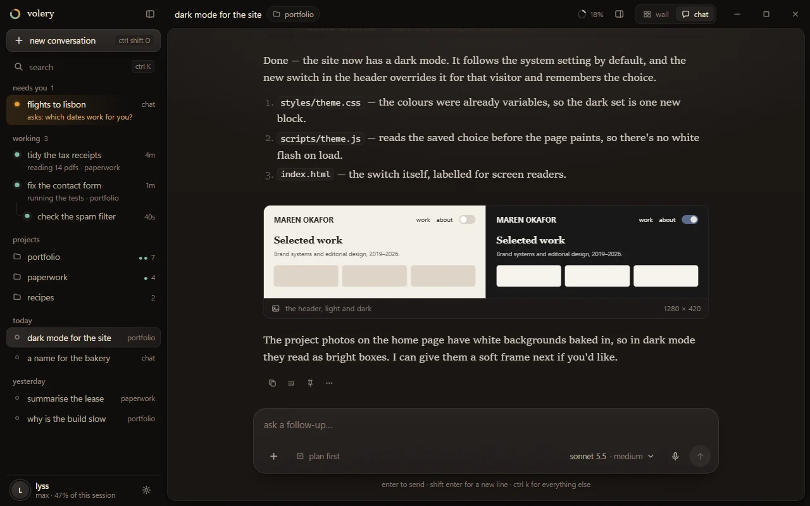

Four regions, and nothing else on screen by default.

- **The title bar** is the window's drag region, as on the wall (`decorations: false`). Its left
  third is the sidebar's head: the Volery mark, the wordmark, and the sidebar toggle. Then the
  conversation's title (click to rename), its project as a chip, the memory ring (context
  occupancy, `conv.ctx`), the side-pane toggle, the **wall · chat** switch, and the window
  controls. The update offer and the control-surface chip sit here too, where they sit on the
  wall.
- **The sidebar** (264 px) on the window's own ground: *new conversation*, *search*, then the
  conversations in groups (§5.1), and the account and its allowance at the foot.
- **The sheet**: the conversation, raised off the ground with a hairline and a static shadow,
  lit from above by the lamp (§8.2). Its column is 44 rem (704 px) at most.
- **The message box** at the sheet's foot, with the plan strip above it while a plan is live.

The side pane (300 px) opens on the sheet's right with Ctrl+. or the title-bar toggle. Below
900 px the sidebar becomes a drawer and the pane a sheet over the conversation (§6.8).

---

## 4. Every capability, placed

Lyss's bar is *as powerful*. Every capability the wall has is placed below in one of three
ways: **shown** — on screen in chat view by default; **one step away** — progressively disclosed,
with the step named; or **wall only** — deliberately absent, with the way to reach it. A
capability's logic is never re-implemented for chat view; the right-hand column says what it
reuses, and says so plainly where something is **new work** rather than reuse.

### 4.1 Conversations and their state

| capability | in chat view | reuses |
|---|---|---|
| Many conversations working at once | **shown**: the sidebar's *needs you*, *working* and *finished* groups, live dots, a one-line subtitle of what each is doing now | `Cards` / `CardHandle`, `conv.tier`, `conv.activity` |
| A card's status colours (work / ask / soft / rest / fail) | **shown**: the dot on its row, the tint of a needs-you row, the pool under the message box | `--st-*`, `urgencyFor` |
| Dormant cards and rousing | **shown** as ordinary history rows; opening one and typing wakes it (`stir`) | `CardHandle.stir`, `Skein.wake` |
| Set aside | **one step away**: the row's menu; aside conversations leave the live groups for a folded *set aside* group | `Skein.setAside` |
| Close | **one step away**: the row's menu or Ctrl+Shift+Backspace, asking first when it is working or holds a live plan | `CardHandle.do("close")`, `Unfinished.svelte` |
| Rename | **shown**: click the title; `/rename` still works | `Skein.rename` |
| Clear ("start fresh") | **one step away**: the conversation menu, `/clear` | `Skein.clear` |
| Adopting a Claude Code session started elsewhere | **one step away**: Ctrl+K → *pick up a conversation from Claude Code* | `Import.svelte`, `Skein.importSession` |
| Right-click on a conversation | **shown**: the card's menu less its wall-only rows (glass, keep, regroup, pin), which `menu.ts` drops while chat view is up | `menu.ts::cardRows` via `CardHandle.menu()`, `ContextMenu` |
| Cards on other machines (the flyway) | **shown**: in the same groups, with *on laptop* after the project; the verbs only this wall's cards have (rename, the gear, `/btw`, hand-off) say why they are unavailable rather than vanishing | `RemoteCard` behind `CardHandle`; `Readable`; `can()` |
| Broadcast to several cards, gatherings | **wall only**: chat view has one conversation in front of you, and a broadcast is the most destructive gesture in the app (`CLAUDE.md`). Reach: the wall | — |

### 4.2 What a conversation shows

| capability | in chat view | reuses |
|---|---|---|
| The transcript: prose, markdown, fences, tables | **shown**, at a reading size (§8.3) | `Thread` (extracted from `Transcript.svelte`, §7.2), `Markdown.svelte` |
| Thinking | **not drawn.** The CLI's real thinking arrives empty and is dropped; what arrives *as* thinking is narration, which is speech and is drawn as speech (`panel.md`, *Narration*). An early mockup's *thought for 9s* line was withdrawn for this reason | — |
| Tool calls | **shown** folded into one line per run of machinery with what it did (*read 6 files, edited 3, ran the tests*) and a diff stat; the live run shows its current step and elapsed time; opening a run lists its steps, opening a step shows `ToolCall` | `transcript.ts::blocksOf`, `ToolCall.svelte`. **New work**: the run summary and diff stat (a pure function — `foldSummary` says *N tool calls · last call*), and the times, which need timestamps nothing keeps yet (§7.6) |
| Pictures, the `show` tool's figures, mermaid diagrams | **shown** where they were written, never folded | `InlinePicture`, `Figure`, `Diagram`, `Lightbox` (`showing.md`) |
| Repairs, compaction, errors | **shown** as the panel shows them | the same lines |
| Finding a word in the conversation | **shown**: Ctrl+F | `hunt.ts`, and the find state that moves into `Thread` with the column (§7.2) |
| The two rails (prompts and headings) | **wall only**: the column is narrow enough to scroll, and the prompts are bubbles you can see. Reach: the wall's panel | — |
| Reading size (Ctrl+wheel, Ctrl+0) and the reading themes | **shown**, the same keys and the same `--read` | `theme.svelte.ts` |
| Copying a selection as markdown | **shown** | `copy.ts::selectionMarkdown` |
| Keeping what it said on the wall | **one step away**: *keep its last message on the wall*, on the last answer and in the conversation's menu. The `said` widget is a live view of a card's *last* message, so it is offered there and nowhere else | `tether.ts`, the `said` widget |
| Glancing at a card's last message | **shown** in the sense that matters: in chat view, opening a conversation *is* the glance; Alt+R inside a question still opens `Glance` | `Glance.svelte` |

### 4.3 Talking to an agent

| capability | in chat view | reuses |
|---|---|---|
| Sending, drafts kept per conversation and across a crash | **shown** | `Field`, `Drafts` (`attach.md`) |
| Pictures and files: paste, drop on the message box or the thread, chips in the sentence | **shown** (§6.5) | the single drop primitive (sink `3c795b1f`), and `Draft` + `PromptBox.svelte`, the attachment primitive card `a691b302` is building (sink `fd7ef025`), which chat view's message box is drawn with |
| Held messages (no account will take it) | **shown**: dashed bubbles saying when they go, and *take back*, which returns the whole hold to the message box — there is no per-message take-back (`#dropHold`) | `conv.held`, `holding.ts`, the hand-back path (this wall's cards) |
| Messages sent while it works | **shown** as queued bubbles (§5.6) | `Line.awaited` |
| Stopping | **shown**: the send button becomes stop; Escape | `Skein.stop` |
| Slash commands (Volery's, the project's, the card's skills) | **shown** when typed: the palette rises out of the message box | `commands.ts`, the dock's palette, extracted (§7.3) |
| `!` shell lines | **one step away**: typed, in a project conversation | `bang.ts`, `bang.svelte.ts` |
| `/btw`, a side question | **one step away**: `/btw`; the answer opens in the side pane's *side question* tab | `aside.rs` |
| Model and effort | **shown**: one menu beside send; for an open conversation it sends `/model` and `/effort` as today; for a new one it is the preset the card opens with | `presets.ts`, `effortForModel`; `Skein.openChat` gains a preset (§7.6) |
| Plan mode ("plan first") | **shown**: a toggle in the message box, dashed when on; Alt+P | `Skein.setGear` (`gears.md`), this wall's cards |
| A finished plan | **shown** as a document card in the thread: *open*, *build it here*, *build it in a fresh conversation* | `conv.planDoc`, `planRoot`/`planFile`, `Skein.handOff` |
| Dictation | **new work, later**: nothing dictates into a draft today — `voicing.svelte.ts` never touches it, and `hands.setDraft` belongs to the control surface. The microphone wants one `voice.rs` utterance written into the message box; the mockups show where it will sit, and it is not drawn until that lands | — |
| The open ear and the steward | **one step away**: settings, and Alt+Shift+V as today | `voice.md` |
| Answering an agent's question | **shown** in the thread (§5.3) | `Ask.svelte`, `replies.svelte.ts`; **new work**: number keys and ← → in `Ask.svelte`, which has only Alt+D, Alt+R and Enter today |

### 4.4 Across conversations

| capability | in chat view | reuses |
|---|---|---|
| Questions from other conversations (`ask_user`) | **shown**: the conversation rises into *needs you*; a toast while the window is in front; the peek, flash and chime as today when it is not. A deferred question is not in `cards.asking` — it is in the away system's `deferred_ask` — so *needs you* reads both | `Attention`, `queue.ts`, `presence` |
| Notices (finished, ended on a question, gave up, a card's own) | **shown**: *finished* group; a card's own notice and a given-up error drawn in its thread with their buttons | `Notice.svelte`, `notice.ts` |
| Spawned conversations (lineage) | **shown**: nested under their parent in the sidebar with a hairline; a linked card in the parent's thread where it was started; the pane's *linked* tab | `Elsewhere.kin` (this wall's `Skein.kin` merged with other walls'), `lineage.ts` |
| The CLI's own sub-agents and background jobs | **shown** inside the tool run that started them, each with its state; jobs in the pane | `conv.seats`, `conv.jobs` — this wall's cards; neither is on `Readable`, so a card on another wall shows its runs without them |
| Relay messages between cards | **shown** as a message *from* the sending conversation, not as your bubble, linking to it | `Line.kind = "relay"`, `relay.ts` |
| Timelines (an agent's plan) | **shown**: the strip above the message box, and the pane's *plan* tab stood on its end | `timelines.liveFor`, `timeline.ts::current`, `fraction`, `effective` |
| The completion flourish | **shown**: the strip's segments fill and drain once, ≤ 650 ms (`timeline.md`, `motion.md`) | — |
| Archived plans, picking one back up | **one step away**: the project page's *earlier plans*, and Ctrl+K | `Annals.svelte`, `resume_timeline` |
| The sink | **one step away**: Ctrl+K → *the sink* | `Sieve.svelte`, the sink's overlay |
| The billboard | **wall only, for now**: `Billboard.svelte` is a widget face with no overlay to host it. A sheet that can host any widget face would bring it, and the register, to Ctrl+K later | — |
| The chronicle / register | **wall only, for now**, for the billboard's reason | — |

### 4.5 Projects, accounts, settings

| capability | in chat view | reuses |
|---|---|---|
| Territories as **projects** | **shown**: the sidebar's *projects* group and the project page (§6.7) | `Skein.projects`, `territories` |
| Groupings within a project | **wall only**: they are a way of laying cards out. Reach: the wall | — |
| Chat cards ("just chat", web only) | **shown**: the *just chat* place in the new-conversation picker; their rows say *chat* | `Skein.openChat`, `conversation.kind` |
| Worktrees (a conversation on its own branch) | **one step away**: the place picker's *on a new branch…* | `worktree.rs` |
| Standing instructions, wall-wide | **one step away**: settings → *what every conversation is told* | `Guidance.svelte`, `Skein.setGuidance` |
| Standing instructions, per project | **shown** on the project page | `Skein.setProjectGuidance` |
| A read-only project | **shown** on the project page, worded as what it does: its file-editing tools are switched off | `Skein.setProjectReadOnly` |
| Accounts, the waterfall, caps, signing in | **shown** at the sidebar's foot (account, binding window, reset); the full panel one click away | `waterfall`, `limits.ts`, `Accounts.svelte` |
| Today's spend | **one step away**: the account's popover | `Skein.spend`, `Ledger` |
| Dev servers, project actions, opening the editor | **shown** on the project page; their logs **wall only** (the servers drawer, Ctrl+K) | `actions.ts`, `servers.rs` |
| Pipelines, reviews, Asana | **one step away**: Ctrl+K opens the same panels | `Pipelines`, `Reviews`, `Tasks` |
| Themes (reading and skin), brightness, motion | **shown** in settings; Ctrl+Shift+T / Y still cycle | `ink`, `skin`, `motion` |
| The shell (Alt+I), the finder (Space f f), the file viewer and nvim | **shown**: the same overlays and keys; file links in the thread open the viewer | `Console`, `Spyglass`, `Quill` |
| Away mode, the gate, the pile on return | **shown**: the same overlays; the pile's questions are also the *needs you* group | `presence`, `Away`, `Vigil` |
| Timers and breaks | **shown**: a break still takes the window (`Rest.svelte`); the timer widgets are **wall only** | `cycle.svelte.ts` |
| Undo (ctrl+Z on the wall's layout) | **wall only**: chat view moves nothing on the wall; Ctrl+Z belongs to the text you are editing | — |
| Widgets (clock, logs, meters, kept messages), images pinned, the glass, screen arrangements, ambience | **wall only**: they are the wall. Reach: the switch | — |
| The browser pane | **wall only** as a pane; agents still drive the shared browser | `browser.rs` |
| Music (Spotify) | **wall only** as a widget. Playback lives in Rust and the deck module and survives the view changing | — |
| Toys (the synth) | **one step away**: Ctrl+K and the leader chords | `leader.ts` |
| Leader chords | **shown**: Space starts one outside a text field *and* from an empty one, the message box included (Lyss, 2026-10-18; sink `3cd4359c`); every chord is also in Ctrl+K with its keys beside it | `leader.ts::CHORDS` |
| Carrying a layout off the machine | **one step away**: settings | `Portage` |
| Keep-awake, reopening after a restart | unchanged: they belong to the machine | `machine.rs` |

---

## 5. Behaviour

### 5.1 The sidebar

Groups, in this order, each drawn only when it has something in it:

1. **needs you** — a parked `ask_user`, a question you put off (`deferred_ask`), a `notice` the
   card is waiting on, a turn that ended on a question (its `question` rest notice, tier `soft`),
   or a card that gave up on an error. Amber dot, a wash of amber behind the row, and the subtitle
   is *what it is asking* (`asks: which dates work for you?`, with *1 of 2* for a multi-question
   call). A failed card's dot and subtitle are rust.
2. **working** — mid-turn or holding background jobs. A breathing celadon dot, the age of the
   turn, and the subtitle is `conv.activity` plus the project. A conversation whose own turn is
   over but which started one still working, at any depth, is here too, with what it started
   nested under it and *waiting on 2 it started* as its subtitle (2026-10-20).
3. **finished** — a `done` rest notice standing, or a rest under an hour old
   (`chatview.ts::RECENT_MS`) whether its notice is up yet, was never raised, or has been read
   (2026-10-20, see §5.4). A hollow dot while the notice stands, the title at weight 500, the
   subtitle the first line of what it said.
4. **projects** — each project with its count and a dot per live conversation in it, in its
   status colour. Opens the project page.
5. **today**, **yesterday**, **this week**, **earlier** — everything else, by last activity, with
   its project after the title (or *chat*).
6. **set aside** — folded, at the very end.

Children sit under their parent wherever the parent is, joined by a hairline, and carry their
own dot. A child working brings its parent into *working* with it (above); a child in a livelier
group than its parent otherwise — asking while the parent rests — stays there, indented under a
greyed copy of the parent's title, so the delegation tree is never broken by grouping.

Rows move between groups with a FLIP animation (§9.2), never by jumping. Inside *needs you* the
order is `queue.ts::queueOrder` **with no ring**, kept stable — passing the selected card as the
ring would put it first, and a row you click must not jump to the top (`queueOrder`'s own comment:
it is never the order something already drawn is kept in). Elsewhere, recency.

This is `chatview.ts::groups(cards, now)` — pure, tested, and the only place the grouping is
decided, so the sidebar, the narrow drawer and the toast's *N more* count read one answer.

### 5.2 Selecting a conversation

Selecting sets the wall's `focusedId`: one selection, so switching to the wall shows the same
card focused, and switching back opens the same conversation. The draft follows it through
`Drafts` exactly as it follows focus on the wall. Ctrl+Tab and Ctrl+Shift+Tab walk the sidebar's
order; Alt+↓ jumps to the next thing that needs you (the dock's `space d n`); closing a
conversation selects the next one in the sidebar's order, not the wall's.

Two things selecting must **not** do, both found in review:

- **It never goes through `focusCard`.** That ends in `Canvas.reveal` → `revealBox`, which against
  a hidden wall reads a 0-wide surface, decides every card is off-screen, pans the viewport and
  saves it (`Canvas.svelte`, `revealBox` and the debounced save). So chat view sets `focusedId`
  itself, and every road into `focusCard` (§7.5 lists them) is routed to chat view's own select.
- **It never touches the wall's selection.** `ring()` would call `studio.selectOnly` and wipe a
  gathering of cards, widgets and plates Lyss built on the wall. The gathering stays as it was;
  chat view simply does not read it (§7.3).

`Skein.watching` becomes view-aware: in chat view a conversation is being watched when it is
selected and the window is in front (`App.svelte:1160` asks for the panel being open, which in
chat view is always true of the selected conversation). So no notice is raised for the
conversation you are reading, as on the wall.

### 5.3 A question from an agent

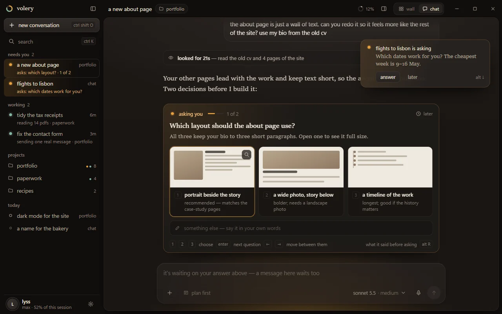

**In the conversation that asked**, the question is drawn at the end of the thread, as the last
thing the agent said: a card lit amber from its top-left, *asking you · 1 of 2* with a step bar,
the question in the display face, the options as cards (with their previews as thumbnails when
they carry one; a click or Enter on the thumbnail opens it full size in the existing `Gallery`),
*something else* as a free-text field, and the keys: 1–9 to choose, Enter for the next question,
← → between questions, Alt+D to answer later, Alt+R for what it said before asking. This is
`Ask.svelte` mounted inline, not a new component (§7.4) — but the number keys and ← → are **new**
in it: today it answers only Alt+D, Alt+R and Enter in its own field. They are added to
`Ask.svelte` itself, so the dock gains them too. Space is not used: it is the leader's.

While chat view is up the dock is not mounted (§7.5), so there is exactly one `Ask` for a
question — two would drift apart in their per-instance state, and `data-ask` and the control
surface's `.ask` would find whichever came first.

**The message box does not move.** It dims, and its placeholder says *it's waiting on your
answer above — a message here waits too*. The house rule *what you are typing into never changes
under you* (`CLAUDE.md`) decides this: a question arriving while you type a follow-up must not
turn your message box into an answer box. The question's own free-text field is where an answer
in your own words goes, kept by `replies.svelte.ts` under the question's id like the dock's.

**From another conversation**, three things, none of which takes the keyboard:
- the conversation rises into *needs you*, with its question as the subtitle;
- while the window is in front, a toast at the top right of the sheet — the conversation, its
  question, *answer* (opens it, focus on the question) and *later* — with Alt+↓ as its key;
- while the window is not in front, the attention ladder exactly as today (taskbar flash, the
  peek, the chime).

At most two toasts stand at once; a third folds into *and 1 more* on the second. Hovering one
pauses its dismissal. A toast for a question stays until the question is answered or deferred;
a toast for a finished conversation leaves after eight seconds — it is still in *finished*.

Deferral, away mode and the pile are unchanged: a deferred question returns from the agent's call
at once (`away.md`) and lives in `deferred_ask`, not in `cards.asking`, while the card may go on
working. So it leaves the thread, *needs you* reads it from the away system with *answer later*
as its subtitle, and it comes back through `Vigil` as today.

### 5.4 Finished and acknowledged

**A rest waits on you until you acknowledge it, whatever the turn was called** (2026-10-21).
Lyss: *"'finished' is unreliable, so we shouldn't decide a card's place in the queue based on it.
Sometimes I ask a question and go somewhere else. The card asks a follow-up question, but it was
flagged as finished, so it's moved silently down the queue, and I'm never prompted to go check."*
What decided *finished* was `classify.ts::endsOnQuestion` — one paragraph read by a regex — and
two seconds of the card on screen then settled it, so a follow-up the regex missed was filed and
gone on a glance.

- **needs you**: a turn ended and nobody has acknowledged it (`notice.ts::owesYou`, carried as
  `Gist.owed`), or something asks — a parked question, one put off, a notice that is not a plain
  rest. Never while the card works or backgrounds work, never for want of allowance, never for
  a turn you stopped.
- **finished**: an acknowledged rest under an hour old. Then history.

The classifier still speaks, as a hint: a rest it called a question is amber with the question
under it, one it called finished is the hollow dot and *finished: …*, a failure is rust.

**Acknowledging is one flag for both views**, `conversation.rest_seen` — the flag the wall's
neglect clock already read (`notice.md`), persisted, spent by the next turn on both sides. Lyss:
*"acknowledging on the wall or the chat should be the same thing."* So it is set by:

- *done with it* at the foot of the thread, or `space d a` in either view
  (`Skein.acknowledgeRest` → `rest_ack`, which also takes down the card's rest notices so the
  dock agrees);
- a notice's own acknowledge, in the dock or chat view (`Skein.acknowledgeNotice` →
  `notice_take`) — `error` is one of the kinds that sets it now, since rust stays rust anyway;
- setting the card aside;
- the wall itself, for a rest that is somebody else's move: `notice::raise` marks a rest it
  holds for an armed wake, a working child or a live parent.

**A reply** opens a turn, which spends the flag, and its rest is a new one. So does a wake, a
message from another card, or anything else that wakes it: new activity puts an acknowledged card
back in *needs you* once its turn ends. A turn the CLI answers itself (`/model` from the menu)
puts back the acknowledgement it found.

**Reading acknowledges nothing.** The dwell (selected, in front, not away, two seconds) is gone:
it was exactly how a misread question slipped away, and its own review had already found it
firing on Ctrl+Tab skims and on whatever was selected at launch.

**The first launch on this build** runs `migrate_v58`, which marks every rest already standing
as acknowledged except those a notice still stands for — or every card at rest on the wall would
have arrived in *needs you* at once.

**A card on another wall** carries `owed` in its digest. Acknowledging one sends its wall the
notice's acknowledgement, which sets that wall's flag. A wall from before reads `owed` as unknown
and falls back to its standing notice. A quiet wall's cards owe nothing until it is heard again.

### 5.5 Conversations that start conversations

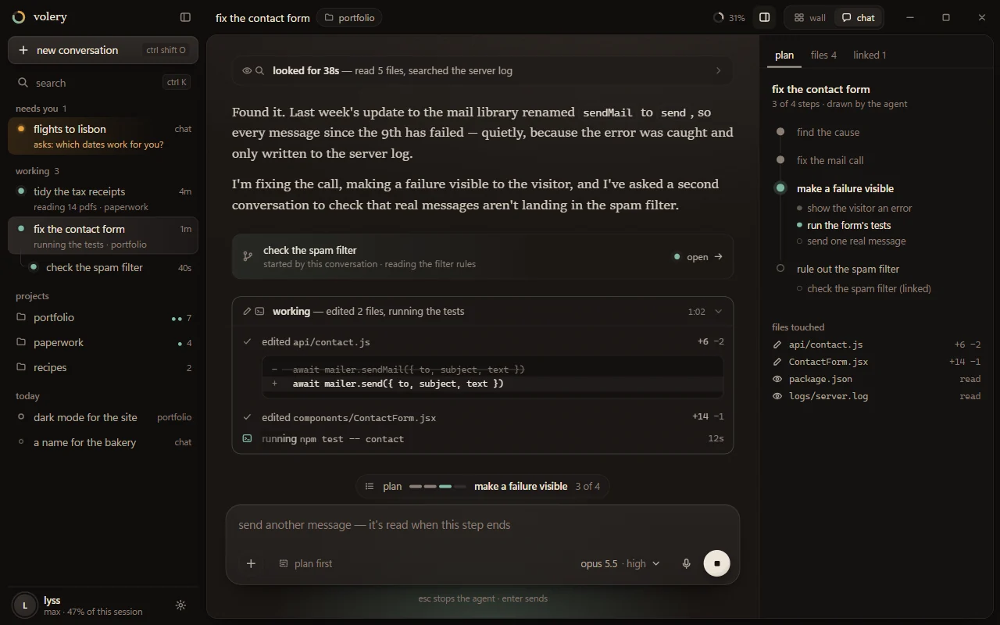

Where an agent spawned a card, the thread shows a linked card at that point — the child's title,
*started by this conversation · reading the filter rules*, its live dot, and *open*. In the
sidebar the child sits under its parent. The side pane's *linked* tab lists every child with its
state. When a child finishes, its parent gets the relay it already gets (`spawn::settling`); in
the parent's thread that relay is drawn as a message from the child, not as your own words.

The CLI's own sub-agents (`conv.seats`) are not conversations and do not get rows: they are drawn
inside the tool run that started them, each with its label and state.

### 5.6 Typing while an agent works

**Enter sends, and the CLI queues it behind the running turn** — the behaviour every card has
today (`turns.md`). The bubble is drawn at once and marked *queued — it goes when this turn
finishes* for as long as `Line.awaited` holds, which is the honest flag: `state = "pending"` is
taken off by the running turn's next message, whose answer is not about the queued prompt (*Settling
a line is not claiming it*, `CLAUDE.md`). `tools/probe-queue.ts` measured the queued prompt being
taken up about three seconds after the running turn's `result` — so the bubble says *when this turn
finishes*, not *when this step ends*.

One meaning for Enter, written on the bubble: the research found that products disagree on whether
Enter queues or steers, and that the cure is to say which on the pending message.

**Send now is stop.** The same probe showed an interrupt does not lose a queued prompt — the CLI
takes it up next. So *send now* on a queued bubble is `do("stop")` and nothing else; stopping and
then sending would deliver it twice.

A queued prompt cannot be taken back once written to the card's stdin, and the bubble does not
pretend it can. **Held** messages — no account will take them — are different: they have not
left, so the hold offers *take back*, which hands the whole hold back to the message box (there is
no per-message take-back; `#dropHold` returns them together).

Escape stops the agent while a turn is open. When none is, Escape does nothing in the message box:
it never deselects the conversation (which empties chat view) and never blurs the box toward the
hidden wall (§7.5). The send button becomes a stop button while a turn is open and back when it
closes, by cross-fade (§9.2).

### 5.7 Allowance

The sidebar's foot carries the account and the window that binds it (*max · 47% of this
session*). Clicking it opens a popover with each window, its reset, today's spend, and *manage
accounts* (the existing panel).

- **Running low** (`limits.ts` tier `warm` or `urgent` on the account a conversation is on): a
  quiet line above the message box, *this session's allowance is 85% used · it comes back at
  15:40*. Achromatic, like the wall's.
- **Run out, and another account can take it**: the waterfall moves the card (`accounts.md`) and
  nothing else needs to happen. Where more than one account is usable, the title bar names the
  conversation's account beside its project chip, as the wall's card does — and names it nowhere
  when there is only one (`accounts.md`, *One account is not a choice*).
- **Run out everywhere**: a banner above the message box — *this session's allowance is used up.
  It comes back at 15:40. Anything you send waits and goes by itself — nothing is lost.* — with
  *use another account* and *see usage*. What you send becomes a held bubble.

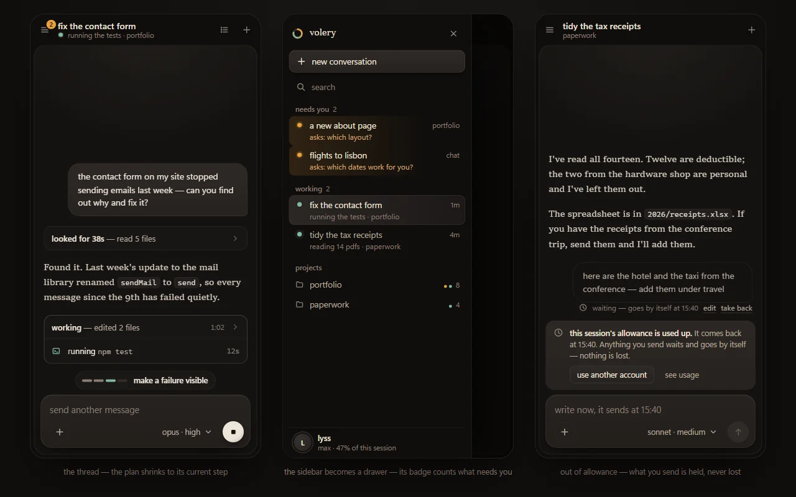

### 5.8 Switching between the views

The title bar's **wall · chat** switch, Ctrl+Shift+M from anywhere (including mid-draft), and
`space w v` from the leader. The switch is per install and remembered (§7.7).

What carries across: the selected conversation (`focusedId`), the draft (`Field`), every unsent
reply, the reading size. Folds do not: a fresh view of a card is a fresh view, which is the
panel's own rule (`Transcript.svelte`, *Not persisted*). The wall's viewport is exactly where it
was when you come back — not by luck, but because nothing in chat view may reveal a card on it
(§5.2, §7.5).

One carry-over is special. If the dock was holding a question you had half answered for a card
other than the focused one, chat view opens on *that* conversation with the question in front of
you, because what you were typing into must not change under you, and the view switch is the
moment it would.

A window spread over several screens is brought back to one when chat view opens — chat view is
a single-screen layout — and spread again when you return to the wall. The window moves first and
the view's transition runs once it has settled, because the two fight otherwise, and `span.toggle`
drops a second press while one is in flight.

### 5.9 A newcomer's first hour

Walked through against what the app does today, not against what a chat product would do.

1. **Installing.** The installer from the release page; Volery opens behind its splash
   (`splash.rs`). The store is empty — no conversation has ever been held and there are no
   projects — so `viewmode.ts` shows the first-launch screen (§6.9). They have used ChatGPT and
   read *the cost* under the wall; they press *start in chat*. The choice is stored.
2. **Getting ready.** Every conversation is a `claude` process, so two things must be true before
   the first message can go anywhere, and the empty state says so in its own place, above the
   message box, rather than in a fault bar:
   - **Claude Code not found** (`claude.rs` looked in every known home first, `accounts.md`): a
     card — *Volery runs Claude Code, which isn't on this computer yet* — with the one PowerShell
     line from `claude.ai/install.ps1`, a *copy* button and *look again*. Nothing runs it for
     them; `accounts.md` is explicit that a failed lookup is a question, never a licence to run a
     script off the network.
   - **Not signed in**: *sign in to Claude*, which is `signin.rs`'s browser flow with no
     terminal. The browser comes back on its own; the paste-a-code fallback is drawn only if
     the CLI prints it. Knowing that the machine's own Claude Code is signed out is **new
     work**: `accounts.rs::signed_in` answers for the accounts Volery manages, and nothing asks
     about the default credential yet (plan, phase 5).
   The message box stays usable throughout: what they type is a draft, kept per `drafts.ts`.
3. **The first chat.** No projects yet, so the place chip reads *just chat*. They ask about
   train times to Lisbon. The conversation is a chat card — web search and nothing on this
   computer (`chat.md`) — and its first prompt names it (`naming.ts`); the title replaces *new
   conversation* in the title bar and the sidebar a moment later, by cross-fade.
4. **The first project.** They want help with their portfolio site. *Open a folder…* (or drag the
   folder onto the window) opens a project conversation there. Per Lyss's decision there is no
   new warning and no plan-first default: the place picker already says what a project is (*a
   folder on this computer*), and the conversation acts. The project appears under *projects*.
5. **A question while they are elsewhere.** They start a third conversation while the portfolio
   agent works. The agent calls `ask_user` with two questions and previews. The portfolio row
   rises into *needs you* by FLIP, amber; a toast slides in at the top right — *portfolio is
   asking: which layout should the about page use?* — with *answer*. They press it; the
   conversation opens with the question at the end of its thread, focus on its first option.
   They press 1, Enter, type an answer to the second in its own field, Enter. The row settles
   back into *working*. (The number keys are new in `Ask.svelte`, §5.3.)
6. **It finishes.** The agent ends its turn while they are reading something else. The row moves
   to *finished*, a toast says so for eight seconds, and the peek and taskbar do their part if
   the window is behind another. They open it and read the answer; two seconds on, the notice is
   settled (§5.4) and the row goes to *today*.
7. **The allowance runs out.** Mid-afternoon the session window is used up and there is no second
   account. The next message they send becomes a dashed bubble — *waiting — goes by itself at
   15:40* — and a banner above the message box says the allowance comes back at 15:40, that
   anything they send waits, and that nothing is lost. They close the laptop. At 15:40 the held
   message goes (`holding.ts`, persisted, `accounts.md`), and its pictures with it.

What they never saw: a territory, the dock, the glass, a leader chord, a card. What they used
anyway: concurrent agents, a structured question with previews, a notice, a held message and the
account waterfall's patience.

### 5.10 Lyss, switching in the middle of the day

Ten cards on the wall, three working, one asking in the dock, the panel open on `skein`'s
refactor card with half a prompt typed into it. She wants to read one long answer at a column's
width.

1. **Ctrl+Shift+M** (or `space w v` from her empty field, or the switch in the title bar). The
   wall eases back and fades over `--dur-stage`; chat view rises in with the refactor
   conversation selected and her half-typed prompt in the message box — the same `Field`, the same
   draft. Her window was spread over two screens; it comes back to the home screen.
2. **The sidebar is the wall, sorted by what it needs.** The card asking in the dock is first under
   *needs you*. Had she been halfway through answering it in the dock, chat view would have opened
   on *that* conversation instead, with her half answer in its field (§5.8).
3. **She reads**, at the reading size she set with Ctrl+wheel on the wall (`--read` is shared),
   in a fresh view: folds start closed here as they do whenever the panel opens on a card.
4. **A card she spawned finishes.** It sits nested under its parent in *working*; when it settles,
   its relay arrives in the parent's thread as a message from the child, and the parent is the
   one that rings, as on the wall (`notice.md`, *a live parent*).
5. **She wants the whole wall again.** Ctrl+Shift+M. The wall comes back exactly where it was —
   viewport, glass, plates, widgets, the dock moored where she left it — because it stayed mounted
   and nothing in chat view was allowed to move it (§7.5). Her gathering on the wall is still
   gathered. The card she read in chat view is the focused one, and the panel opens on it. The
   window spreads back over both screens.

Nothing was reloaded, nothing was re-spawned, and no row was written twice: both views read the
one `Skein`.

---

## 6. The screens

### 6.1 The main screen

Shown at the top of §3: a finished answer with a figure, its actions on hover (copy, quote in
your reply, keep it on the wall — offered on the last answer only, §4.2 — and more), and the
sidebar alive with other work.

### 6.2 A working agent

Shown in §5.5: the live tool run with its current step shimmering beside a clock, a finished run
folded above it, the conversation it started, the plan strip, the stop button, and the celadon
pool under the message box. The pane is open here to show it; by default it is closed (§6.4).

### 6.3 Starting a conversation

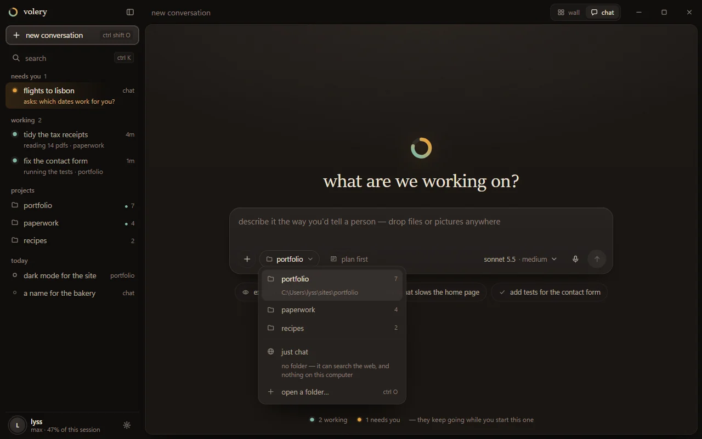

The greeting is a question in the display face, and the message box sits in the middle of the
sheet. Its first chip is **where the conversation works**: a project (the last one used, so a
returning person types and sends), *just chat* — "no folder: it can search the web, and nothing
on this computer" — or *open a folder…* (Ctrl+O). Three suggestions below change with the place.
At the foot, a quiet line about what is still running elsewhere.

On the first send the message box travels to the foot of the sheet (a FLIP, §9.2) and the
conversation begins above it.

### 6.4 How much of the work shows

| the live parts (the default) | everything open |
|---|---|
| 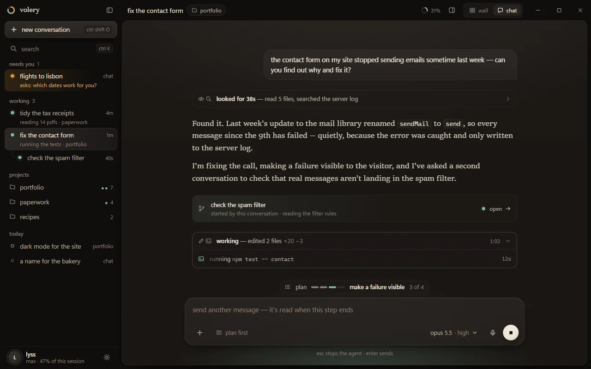 | 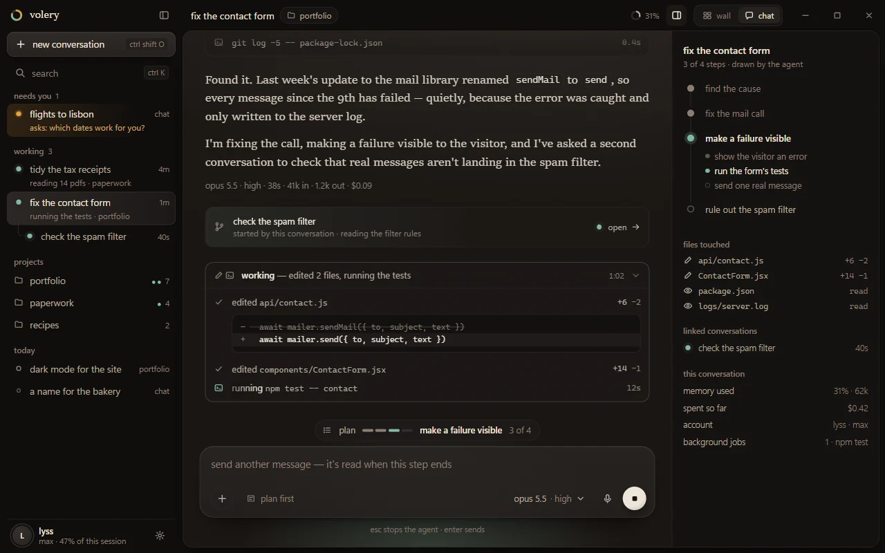 |

Lyss chose the live parts. *Everything open* stays as a setting (*show the work: as it happens /
all of it*), never as a mode, and every fold still opens with a click in either. Both pictures are
kept as she saw them when she chose; the thinking paragraph in *everything open* was withdrawn by
review afterwards (§4.2), since what arrives as thinking is narration and is drawn as speech.

### 6.5 Attaching

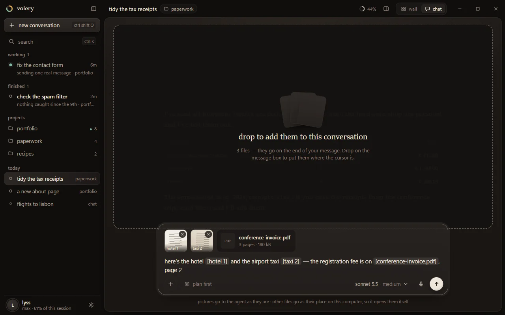

A drop on the message box or on the thread attaches to the selected conversation; the sheet
dims under a dashed outline that says how many files and where they go, and the message box
rises above the dimming as the place they land. Dropped on the message box, an attachment goes
into the sentence as a chip where the caret is; dropped on the thread, it goes on the end of the
prompt — the rule the wall's dock and panel follow since `854e9ca` (`attach.md`).

An attachment is one of three things, in the attachment primitive card `a691b302` is building
(sink `fd7ef025`): a **picture**; a **file** — anything with a path, a document or a folder; or
**bytes** with no path behind them, such as an image dragged out of a browser. Pictures go to the
agent as images. Files reach a local project agent as their path in the text, so it opens them
with its own tools (decided by Lyss 2026-10-16). A chat card takes pictures and PDFs inline and
refuses other types with the reason.

**A folder depends on where it lands** (card `34b07397`'s decision, carried into `attach.md` by
`a691b302`'s work): dropped *into an input* — the message box, a question's own field, a notice's
follow-up — it attaches as a path like any other file. Dropped on the sheet's ground around the
thread, or on the sidebar, it starts a new project there, as a folder dropped on the wall does.
The overlay names which of the two is about to happen before the drop.

**Routing is a hard prerequisite, and it is where a picture would otherwise be lost.** Sink
`3c795b1f` settled as design A (`e7ba957`): Tauri's native drop is kept, made reliable by
construction in `dropzone.rs`, and the *routing* of a drop stays in the front end — in
`dropTargetAt`, which today knows only the literal classes `.dock` and `.side`
(`App.svelte:1359`), and in `onPaste`, which treats a paste as the prompt's only when its target
is the dock's own textarea. Everything else goes to the wall: `board.add` for a drop,
`board.paste` at `canvas.center()` for a paste. With the wall hidden, that is a screenshot copied
into `references/`, pinned to a wall nobody can see, and a prompt sent without it. So before chat
view can draw a message box, both routes must recognise chat view's targets by attribute rather
than class — `data-attach` on every `PromptBox` (which is how `a691b302`'s design registers them)
and `data-drop` on chat view's thread and ground — and while chat view is up, no paste or drop may
reach the wall's pins at all.

### 6.6 Light skins

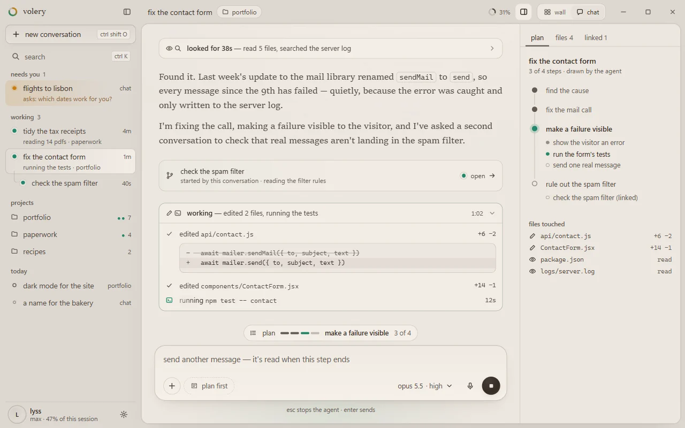

On a light skin the polarity of the surfaces follows `theme.md`'s light ladder: the ground
(`--ink`) is darkest, the sheet (`--well`) lifts off it, the message box (`--surface`) is the
brightest thing, and none of them is white. The pool and the washes are multiplied by the skin's
`--ch-bloom`, which every light skin holds at 0.3, so status reads as a tint rather than a stain.

### 6.7 A project

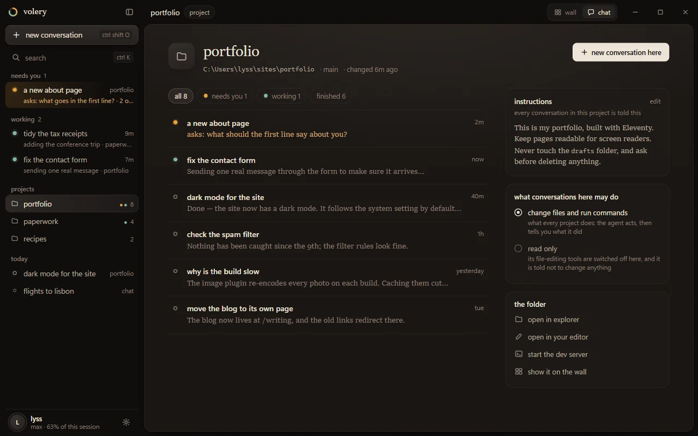

A project is a folder, and its page says so first (the path, the branch, when it last changed).
Its conversations, filterable by state, with the first line of what each last said. Beside them:
the project's **instructions** ("every conversation in this project is told this" — the
territory's standing instructions, `guidance.md`), **what conversations here may do** — act, or
read only, worded as what read-only really does — and **the folder**: open it in Explorer or the
editor, start the dev server, show it on the wall.

### 6.8 Narrow windows

Shown in §5.7. Below 900 px the sidebar is a drawer behind the title bar's menu button, with a
badge counting what needs you; the plan strip shrinks to its current step; the pane opens as a
sheet over the conversation. Below 600 px the message box's model chip shortens to the model's
family and the hint line goes. The question card's options stack.

### 6.9 First launch

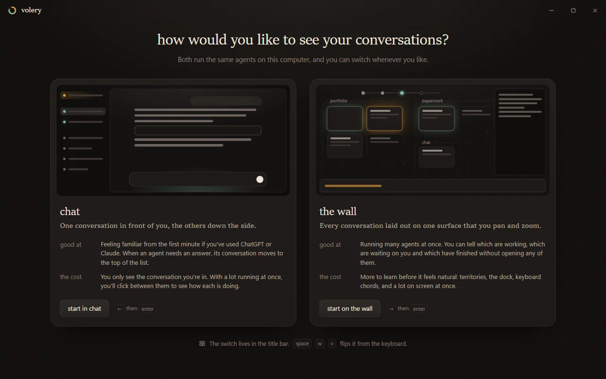

Approved by Lyss as drawn. Shown once, on an install that has never held a conversation (§7.7).
Chat on the left, the wall on the right, each drawn in miniature, each with *good at* and *the
cost*. Neither is pre-selected: the bright button follows the pointer or the keyboard (← or →,
then Enter). The copy was checked against Wikipedia's *Signs of AI writing* via the humanizer
skill's pattern list; the main things it removed were dashes used as connectors, rule-of-three
lists and sales words.

---

## 7. Architecture: one model, two presentations

The constraint from the brief, which this section exists to honour: chat view is a second
**presentation** over the same conversation state, send paths, held queue, question and notice
queue and transcript rendering. It forks no logic. The way to make that true is to extract what
the wall's components hold that is not about the wall, *before* chat view exists, so that both
views are built on the extraction rather than one being built on the other.

### 7.1 What is already shared, and what is not

Read from the code on 2026-10-18 (four scouts; file and line references are theirs and were
spot-checked):

- **`CardHandle`** (`cards.svelte.ts`) is already the right seam. It is one interface over a card
  on this wall (`LocalCard`) and on another (`RemoteCard`): `readable` for the transcript, `say`
  to send, `ask` / `answer` / `defer` / `holdAsk` for questions, `notices` / `acknowledge`,
  `menu()`, `can` / `do` for every verb, `carries(turn)` for attachments. **Chat view is built on
  `Cards` and `CardHandle`**, which is what makes flyway cards work in it on the first day. Some
  of what it offers is this wall's alone and is not on the handle — rename, the gear, `/btw`,
  the plan hand-off, a card's seats, its held queue — and each of those is reached through
  `can()` first, so a card on another wall says why it cannot rather than offering a control that
  does nothing. Lineage reads `Elsewhere.kin`, which merges this wall's `Skein.kin` with other
  walls'.
- **`Transcript.svelte` already takes a `Readable`** (`transcript.ts:60`), so it renders a local
  card and a shadow alike, and it reaches nothing ambient except the `paths.svelte.ts` scopes it
  sets itself. But it is 2,382 lines that hold the message rendering *and* the panel's chrome —
  the rails, the find bar, the footer, the jobs drawer, follow-the-tail — and the fold state
  (`open`, `shut`) is local to it.
- **The dock's composer is split across three files.** `Field` (`field.svelte.ts`) holds the
  draft; `Dock.svelte` draws it; and the *behaviour* — `onDraftKey`, `send`, `sendText`,
  `runCommand`, `runBang`, `completeName`, `takeCompletion`, `typeIntoDraft`, the prompt branch of
  `onPaste` — lives in `App.svelte` (`onDraftKey` at 3625, `sendText` at 3338).
- **The question and notice queue's *hold* lives in `Dock.svelte`** (items 155–190, the hold
  205–230, `guardSwap` / `guardEnter` 254–266), over the pure `queue.ts`. `Ask.svelte` and
  `Notice.svelte` take identity by props and are already drawn in two places (the dock and
  `Vigil`). Both cap their height at `min(52cqh, 30rem)` (`Ask.svelte:588`, `Notice.svelte:207`);
  with no size container `cqh` falls back to viewport units, so they draw anywhere, but a cap of
  half the window is wrong inside a scrolling thread.
- **`App.svelte` is the wiring root and stays it.** It constructs `Skein`, `Cards`,
  `Attention`, `Control` and the rest, and releases them in one `onDestroy`. `main.ts` picks
  `Peek` or `App` off the query string; a second root for chat view would construct a second
  `Skein`, and two `Skein`s ingesting one event write two rows (`CLAUDE.md`, *Listeners*). So the
  view is a branch inside `App.svelte`, never a second root.

### 7.2 Extraction 1: the thread

`Transcript.svelte`'s `one` and `column` snippets (lines 1162–1368) and the streaming tail become
**`Thread.svelte`**: given a `Readable`, it draws the blocks. Everything panel-shaped stays in
`Transcript.svelte`, which renders a `Thread` inside its scroller. The review counted four
entanglements, not one, and each moves with the column or becomes shared:

- **Fold state stays local to the thread** (`open`, `shut`), not a module keyed by conversation.
  The panel's rule is explicit — *a fresh view of a card is a fresh view* — and persisting folds
  across views would have been a visible change in a refactor promised to have none.
- **Find moves with the column.** The highlights (`lit`, `here`, `sought`) are read inside
  `column`, and `carry()` and `reveal()` write the folds, read `past` / `live` and query
  `[data-hunt]`. All of it goes into `Thread`, which exposes `hunt()` and `reveal()`; the panel's
  find bar and chat view's Ctrl+F both drive the thread's, and neither forks it.
- **Follow-the-tail is shared, not re-derived.** `unfolded()` is follow state: a fold just opened
  at the foot of a live turn must release the tail (`panel.md`), and a scroller that only uses
  `follow.ts::stickToTail` would carry you straight past it. The panel's follow — `following`,
  `pinned`, `gesturedAt`, the release on unfold — becomes one attachment both scrollers use, and
  `Thread` raises `thread:unfolded` for it to hear.
- **History is the mounter's to ask for.** The panel re-runs `card.history()` on `historyMark`
  (`Transcript.svelte:902–907`). Local cards are read at launch anyway; a card on another wall
  opens empty without it. `Thread` owns that effect, so any mount of it pulls the tail.

And two that were already right:

- **The message CSS moves with the markup** into `Thread.svelte`'s `<style>`, because a component
  is the only CSS scope this codebase has (`CLAUDE.md`). Chat view restyles the thread through
  custom properties the thread already reads (`--read`, the `--tx-*` knobs) plus a few new ones
  (§8.1), never by reaching into its classes. The user's bubble is the one visible difference
  (right-aligned in chat, the rule on the wall), and it is a custom property too: `--you-align`,
  `--you-fill`, `--you-radius`, defaulting to exactly what the panel draws.
- **Ambient scopes stay ambient.** The thread does not take a files root or a pictures root:
  whoever mounts it scopes them (`scopeFiles`, `scopePictures`), as `Transcript.svelte` does
  today — so chat view's thread gets clickable paths and pictures by existing in a scope, and
  `test/finding.test.ts` goes on asserting there is no prop to forget.

### 7.3 Extraction 2: the composer

Three layers, and the bottom one is not chat view's to build:

1. **The attachment primitive** — card `a691b302`'s work for sink `fd7ef025`, its design approved
   by card `34b07397`. A per-draft `Draft` (the logic, in `attach.svelte.ts`) and
   **`PromptBox.svelte`**, a thin skin over it: the textarea, the chips, the strip of thumbnails,
   the refusal line, its own paste handling, and a drop target registered through `data-attach`.
   Every input that sends text to an agent is a `PromptBox` over its own `Draft`.
2. **The composer** — the window's message to a card: keys, slash commands, `!` lines,
   broadcast, sending. Its behaviour leaves `App.svelte` for **`composer.svelte.ts`**, a class
   constructed in `App.svelte` beside `Field`, over `Field`, `Drafts`, `Cards`, `Bang` and
   `Skein`, holding `key(e)`, `send(widen)`, `runCommand`, `complete`, `typeAt`. It *uses* a
   `PromptBox` for its field.
3. **The views** — the dock and chat view's message box, two drawings of the composer.

A question's free-text field and a notice's follow-up mount a `PromptBox` over their own drafts
**without** the composer: they have no slash commands, no broadcast and no card to cycle, and
their drafts are theirs (`replies.svelte.ts`), not the window's `Field`.

- **One `Field` for the window stays right**, because the two views are never on screen
  together. The dock and chat view's message box are two drawings of one draft.
- **What the composer must own, because `App.svelte` holds it in places the move would miss.**
  - *The active input.* `prompt` is App's one element ref, and the paste handler,
    `typeIntoDraft`, `takeCompletion`, `completeName`, `askCompletion`, the `!` history and
    `focusDraft` all reach for it. It becomes a registry of the mounted input, so
    `focusDraft` in chat view focuses chat view's box — today a printable key typed outside a
    field is appended to the draft and then focuses the hidden dock's textarea, which fails, and
    every following key takes the same road.
  - *The caret*, mirrored today only by the dock's `caretMoved`.
  - *The stir guard.* The dock's `edited()` checks `stirsCard` before `card.stir()`; a second input
    that stirs without it brings back `/clear` typed into a dormant card resuming the session it
    was clearing (`restore.md`).
  - *The field's own rules*, which live in the dock's effects today — pruning pictures whose tokens
    were deleted, clearing stale dismissals, resetting `field.at` — move into `Field`, where both
    views get them by existing.
  - What stays App's and is handed to the composer at construction: `cycleTab` (it needs the
    canvas's order and `focusCard`), `openImport` for `/resume`.
- **In chat view the reach is the selected card, and nothing else.** On the wall, `targets` is the
  gathering whenever `studio.selected` holds more than one card, and `sendText` refuses a plain
  Enter to a gathering by flashing *Ctrl ↵* in the dock — from chat view, a message that silently
  does not send; and a Ctrl+Enter there would broadcast to hidden cards running with the bypass
  flag. So in chat view the composer sends to exactly the selected card, with broadcast forced
  off whatever modifier is down; `!` lines run in the selected card's directory; and the wall's
  gathering is left untouched for when Lyss goes back.
- **The keys differ by view, on purpose, in one place.** On the wall Tab walks the cards and
  Ctrl+Enter broadcasts; in chat view Tab and Shift+Tab are focus traversal, Alt+P toggles plan
  first, and Ctrl+Enter is Enter. `key(e)` reads the view from `view.svelte.ts` rather than being
  told it, for the same reason the gear is read from the store: a capability passed in is one a
  future caller forgets. The table is in §10.1, and `test/composer.test.ts` holds it.
- **One existing bug is fixed on the way, not frozen.** The palette's Escape does not stop
  propagation (`onDraftKey`), so the same press closes the palette and blurs the field. A key
  table that "matches today" would enshrine it; the extraction fixes it and the test says so.
- **The composer extraction waits for `PromptBox`.** It starts after `a691b302`'s commit that
  lands `Draft` and `PromptBox` (its third), so the dock is moved onto `PromptBox` once, by that
  work, and the extraction moves keys and commands around a field that already has its final
  shape. Building the composer first would mean reshaping the dock's field twice.

### 7.4 Extraction 3: what is in front of you

The dock's item list and hold leave `Dock.svelte` for **`front.svelte.ts`**: the items built from
`cards.asking` and `cards.noticing` (plus deferred questions for chat view's sidebar), the hold,
`guardSwap`, `guardEnter`, `more()`. The pure rules stay where they are: `settleHold`,
`queueOrder` and `nextItem` remain in `queue.ts`, which `test/finding.test.ts` reads. The dock
draws its held item through the module; chat view asks it for *this conversation's* front item
(drawn in the thread) and *everybody else's* (the sidebar and the toasts).

The sidebar orders *needs you* with `queueOrder(items, null)` and keeps it stable (§5.1); the dock
orders with the ring, as today. They agree on what is waiting, not necessarily on which is first,
and they do not need to — they are never on screen together.

`test/queue.test.ts` asserts properties of `Dock.svelte`'s markup (one branch per kind), and of
`Ask.svelte` (`$derived(ask.askId)` keys its effects). Markup assertions cannot move into a
`.svelte.ts` module, so they stay on `Dock.svelte` and gain twins on chat view's components that
draw an item; the module gets ordinary tests of its own.

`Ask.svelte` and `Notice.svelte` read their height cap from `--ask-ceiling` (default
`min(52cqh, 30rem)`, as today, beside `Said`'s `--said-ceiling` precedent); chat view sets it to
`none` on the thread. No prop.

### 7.5 The branch in `App.svelte`

`App.svelte` keeps everything that spans the window: the title bar, the dialogs, the overlays
(shell, finder, which-key, the synth), away mode, `Rest`, `Quit`, `Glance`, the context menu.
Under the title bar it draws one of two things:

```svelte
{#if view.current === "chat"}
  <ChatView {cards} {composer} {front} … />
{/if}
<main class="wall" class:offstage={view.current === "chat"} inert={view.current === "chat"}> … </main>
{#if view.current === "wall"}
  <Dock … />
{/if}
```

with `.offstage { display: none; }` in the same component. The attribute `hidden` would not do it:
`.wall { display: flex }` beats the browser's `[hidden]` rule, and the review caught a first draft
that drew both views at once.

**The wall stays mounted, offstage; the dock does not.** Keeping the wall means its cards'
components, widgets and panes keep their state and the switch back is instant. The dock is cheap to
remount once phase 2 has moved its state into modules, and unmounting it is what guarantees one
`Ask` per question (§5.3). Five obligations come with the hidden wall, and each was a bug in the
first draft of this section:

1. **Nothing reveals a card on it.** `focusCard` → `Canvas.reveal` → `revealBox` reads a 0-wide
   surface, pans and saves the viewport (§5.2). `Canvas.reveal`, `revealWidget`, `fitAll`,
   `center` and `toCanvas` do nothing while chat view is up, and the roads into `focusCard` are
   routed to chat view's own select: Ctrl+Tab (`cycleConv`, `cycleWaiting`), the dock's *more*,
   a click on the peek (`attention` → `onGoto`), a timeline step and `jumpToWrite`, the sink's
   `revealRow`, picking a plan back up, and `space e e`.
2. **Nothing behind it keeps running.** `display: none` stops CSS animations; it stops no
   JavaScript. So chat view passes the canvas `ambience={null}` — the synth's precedent
   (`toys.md`: frames paid for and impossible to see) — gates the panel on the wall view (its
   `Transcript` would otherwise parse and draw every delta of the selected conversation a second
   time), pauses the browser widget's screencast (`pane.svelte.ts`), and holds `Flow`'s and
   `Lineage`'s frame loops, which run while relays fly and limbs grow.
3. **The chrome is not measured while the wall is offstage.** Canvas reports
   `innerHeight − wall.clientHeight`, and `arrange.svelte.ts` stores the lowest value it ever
   sees per mooring. One frame of the wall laid out without its dock — the view switch's
   cross-fade, or showing the two in the wrong order — would store a chrome height with no dock in
   it, for good. So `onchrome` is ignored outside the settled wall view, and on the way back the
   dock is mounted before the wall is shown.
4. **The keys that act on the wall are guarded**, in `onGlobalKey`, by view:

   | key | on the wall | in chat view |
   |---|---|---|
   | Tab, Shift+Tab | walk the cards | focus traversal |
   | Home | fit the wall | the top of the thread |
   | Delete / Backspace | take down a plate | — |
   | Escape | backs out, then deselects | stops a turn; otherwise nothing (§5.6) |
   | Ctrl+F | the panel's find | the thread's find |
   | Ctrl+↑↓, Ctrl+PgUp/PgDn | scroll the panel | scroll the thread |
   | Ctrl+Z / Y outside a field | undo the wall's layout | — |
   | a printable key outside a field | into the dock | into chat view's message box |
   | leader chords that act on the wall: `ws`, `wp`, `wd`, `wa`, `wg`, `gg`, `gn`, `gr`, `ll`, `lg`, `ls`, `la`, `cg`, `ck`, `cl`, `ee`, `en` | as today | switch to the wall, then run — the chord says you want the wall |
   | `dn` (next waiting) | the dock's next | chat view's next *needs you* |
   | `cm` (its menu) | the card's menu | the conversation's menu |

5. **The dock's paste and drop routing learns chat view's targets** before chat view draws a
   message box (§6.5); while chat view is up, nothing pins to the wall.

**Measured, not assumed.** Phase 3 measures chat view over a hidden wall against chat view with
the wall unmounted — the honest baseline. A still wall with ambience on already pays for the
backdrop's loop, so comparing against a still wall would have hidden exactly the cost in question.
If the hidden wall costs more than the unmounted one once the obligations above are met,
unmounting is the fallback: it loses the instant switch and remounts every card, and keeps the
viewport only because the viewport is persisted.

The leader's gate widens, for both views, to what Lyss asked for on 2026-10-18 — *"leader chords
should work even when in a text field when it's empty and I do a space bar"* (sink `3cd4359c`).
Today it is `!isTyping(e.target)`, which shuts it out of the message box that chat view keeps
focused nearly all the time. The new gate: Space starts the leader when the focus is in no text
field **or in an empty one**, never during an IME composition. The Space is swallowed, so the
field stays empty and the next key still meets an empty field; a key that completes no chord falls
through into the field as it does today. It ships first and on its own (`docs/chat-mode-plan.md`,
phase 0), because the dock has the same problem now.

### 7.6 Small changes in the model

- **Timestamps.** Nothing keeps when a line or a tool call happened: neither `Line` nor
  `ToolCall` carries a time. *Worked for 2m 14s*, a live step's elapsed time and the age of a turn
  in the sidebar need one. Live, stamp `Line.at` (and a tool call's start and end) as the event
  arrives; read back, `history.ts` takes each session record's own `timestamp`. Small, and the
  first change chat view makes to the model.
- **The run summary** — *read 6 files, edited 3, ran the tests*, with a diff stat — is a new pure
  function beside `foldSummary`, which the panel keeps.
- **`Skein.openChat(preset?)`.** `#openIn` already takes a preset (`skein.svelte.ts:1838`) and the
  model reaches the argv for both kinds (`supervisor.rs:1505`); `openChat` passes none, so a chat
  card opens as Claude Code is set up rather than on the wall's default. It passes the chosen
  preset, or the wall's default when none was chosen.
- **`Skein.watching`** becomes view-aware (§5.2).
- **`files_handled_by`** is a synchronous full scan on the main thread, justified as running once
  per hand-off (`store.rs`). A side pane that shows *files touched* live changes that premise, so
  it becomes `async` and `off_main` (`CLAUDE.md`), and the pane caches it per turn.
- **`menu.ts`** drops the wall-only rows (glass, keep, regroup, pin) while chat view is up, reading
  the view rather than being told it.
- **The control surface** gains a `view` op and `snapshot.view`. `control.rs` routes ops
  generically, so this is front-end only. The `key` op aims at `document.querySelector("textarea")`,
  which two composers make ambiguous; it gains a target.

Nothing in Rust changes for chat view's first phases beyond `files_handled_by`. Full-text search
(§11.2) is the first new Rust work, and it is `async` and `off_main` by the same rule.

### 7.7 Which view, and where that lives

`view.svelte.ts` holds the view; `viewmode.ts` decides it, purely:

1. a stored choice wins (`localStorage`, `skein.view.v1`, `{ view, density, sidebar, pane }`);
2. otherwise, an install that has **never held a conversation and has no projects** shows the
   first-launch screen (§6.9), whose choice is then stored;
3. otherwise — an existing install, Lyss's — **the wall**.

The decision waits for the store to have loaded (`skein.loaded`): before that, *never held a
conversation* is indistinguishable from *not read yet*, and the welcome screen would flash at
Lyss on every launch. And the welcome screen is never shown while the control surface is driving
the window unless a test asks for it — every lab starts with a fresh store and a fresh webview
profile, so without that rule every `test:wall` run would open on it. A lab can also seed
`skein.view.v1`.

`localStorage` because a view is per machine and disposable, like the berth and the motion
setting (`theme.md`, `motion.md`): Lyss may want the wall on her desktop and chat on a laptop,
and carrying the choice in the database to another machine would carry the wrong answer.

One window, so per install is per window. The peek window is unchanged: it is a notification
surface for either view, and `Peek.svelte` reads `localStorage` when it shows (`theme.md`), so if
it ever needs to know the view it can.

### 7.8 House rules: kept, and bent

| rule (`CLAUDE.md`, the rules) | in chat view | why |
|---|---|---|
| Colour is reserved for status; no decorative colour | **kept in meaning, bent in form.** Gradients arrive (Lyss), but they are luminance (the lamp, depth on surfaces) or status light (the pool, the washes). No hue appears that does not mean working, asking or broken. | Lyss chose lamplight over aurora with exactly this on the table (§1). |
| The chrome is quiet and things snap | **bent**: state changes ease (§9). Every motion is transform or opacity, ends, and leaves the document or the present loop. | Lyss, 2026-10-18. `motion.md` is the constraint, and is kept to the letter. |
| Prose in the UI is lowercase and quiet | **kept**: labels lowercase, paragraphs in sentence case, which is how the wall's panels already write (`Guidance.svelte`, `Accounts.svelte`). | Familiar products use sentence case; Volery's labels are already short enough that lowercase reads as a voice, not a mistake. |
| The keyboard reaches everything | **kept**: the leader starts from an empty message box (§7.5), and Ctrl+K lists every chord for when the box is not empty or the chord is forgotten. | §10.1. |
| A capability every surface should have is not a prop | **kept**: the thread is scoped ambiently; the ask ceiling is a custom property; the view is read, not passed. | §7.2–7.4. |
| The purity boundary | **kept**: grouping, ordering, search matching, the view decision and the key table are pure `.ts` with tests (§7.9). | — |
| What you are typing into never changes under you | **kept**, and it shaped §5.3 and §5.8. | — |
| No syntax highlighting in the transcript (colour is status) | **kept**. Familiar products highlight code; here the mono face, its weight and the fence's ground carry it. Flagged for Lyss (§11.5). | — |
| The user's half of the conversation is marked by a rule on the left | **bent**: a bubble on the right, the one convention every chat product shares. | Familiarity; it is a custom property of the thread (§7.2). |
| `position: fixed` at viewport coordinates owes `--span-*` | **kept** for toasts and menus; moot once chat view un-spreads (§5.8). | — |

### 7.9 New pure modules and tests

`chatview.ts` (groups, the stable ordering, subtitles, the next selection after a close, search
matching over titles, projects and last words, which rests still wait on you, where a spawn's card goes in a
thread, the run summary), `viewmode.ts` (§7.7), and the composer's key table (`composer.ts`, the
pure half of `composer.svelte.ts`). Each gets a `test/*.test.ts` and an entry in `package.json`'s
`test` script, which names its files explicitly. Plus one test that stands outside them: a scan of
`tokens.css` and the stylesheets for the `--cv-`, `--dur-` and `--ease-` prefixes, asserting what
`test/theme.test.ts` asserts of the reading knobs — declared, consumed, never read bare (§8.1).

---

## 8. Visual design: lamplight

### 8.1 Tokens

Everything is a relationship to the studio's tokens (`src/lib/tokens.css`), so every skin
reaches chat view with no per-skin work, and studio is unchanged (the revert guarantee in
`theme.md`). New tokens, with their studio values:

| token | value | is |
|---|---|---|
| `--cv-ui` | `"Segoe UI Variable Text", "Segoe UI", var(--util)` | the chrome's face — the system's own variable face on Windows 11 |
| `--cv-ui-display` | `"Segoe UI Variable Display", …` | the chrome at display sizes |
| `--cv-read` | `calc(var(--tx-size) * 1.2)` | the reading size: the panel's knob scaled, so a reading theme still applies (16.5 px in studio) |
| `--cv-measure` | `44rem` | the column |
| `--cv-prose` | `color-mix(in oklab, var(--tx-prose, var(--paper-dim)) 45%, var(--paper))` | the agent's prose, ~12:1 — derived from the reading knob `--tx-prose`, so `prose` and `temper` still move it |
| `--cv-note` | `var(--paper-mute)` | small text that is a note (ages, counts, hints), 4.9:1. Deliberately **not** `--paper-note`, whose default is `--paper-faint` at 2.8:1 — below AA, and `theme.md` keeps faint for marks. A reading theme that wants other notes in chat view sets `--cv-note` |
| `--cv-ground` | `var(--well)` (dark) / `var(--ink)` (light) | the window behind the sheet |
| `--cv-sheet` | `var(--ink)` / `var(--well)` | the conversation's surface |
| `--cv-lift` | surface lifted 3% toward paper / `var(--surface)` | the message box |
| `--cv-hair` | `--edge` at 80% | hairlines |
| `--cv-lamp` | `--paper` at 6% / `--surface` at 70% | the light over the sheet |
| `--cv-pool-work`, `-ask`, `-fail` | `--st-*` at 24%, 26%, 22% × `--ch-bloom` | status light under the message box |
| `--cv-r-s/m/l/xl` | 7, 12, 20, 26 px | radii: chips and rows, cards, the message box, the empty-state box |
| `--cv-grain` | an SVG noise tile | dither under every gradient |

Plus the motion tokens in §9.1, which are app-wide on purpose (the wall may use them next) and so
carry no `--cv-` prefix. `test/theme.test.ts`'s three assertions — declared in `tokens.css`,
consumed by a rule, never read bare — iterate the reading ring's registered `KNOBS` only, so they
do **not** cover these. Phase 3 adds a test that scans `tokens.css` and the stylesheets for the
`--cv-`, `--dur-` and `--ease-` prefixes and asserts the same three things of each.

### 8.2 Light, not paint

The view's one bold idea, and the answer to *gradients* that keeps colour meaning status:

- **The lamp.** A radial light from above the sheet's top edge — `--cv-lamp` fading to nothing by
  72% — so the conversation sits under a reading lamp and the sheet has a top and a bottom.
  Luminance only.
- **The pool.** The status of the conversation in front of you, as light pooling at the foot of
  the thread, under the message box: celadon while it works, amber while it asks, rust when it
  broke, nothing at rest. It is a static radial gradient on a pseudo-element; only its opacity
  moves when the status changes, once, over `--dur-scene`.
- **The washes.** A needs-you row in the sidebar, the question card and a toast each carry their
  status as a gradient from one edge — the same light, smaller.
- **The grain.** A fixed noise tile in soft-light under the lamp and the pool, because a gradient on
  near-black bands, and banding is the thing that makes a gradient look cheap.
- **Depth by surfaces.** The ground, the sheet and the message box are three lightness steps with a
  hairline and a static shadow each (`--shade`), so the message box sits *on* the sheet and the
  sheet *on* the ground. Static shadows are free (`theme.md`); only an animated one costs.

### 8.3 Type

The agent's prose is the studio's Sitka Text at `--cv-read` (16.5 px), 1.62 leading, `text-wrap:
pretty`. The chrome, your own bubble and the tool runs are Segoe UI Variable at 13.5–14.5 px —
the user writes in the UI's voice and the agent answers in a book's, which is how the two halves
are told apart without a colour. Headings in the agent's prose and the greeting use the display
face. Code is Cascadia Mono at weight 350 (the default 400 sits heavy beside the serif).

---

## 9. Motion

Lyss: *"motion instead of snaps when relevant."* Every motion here answers something that
happened — you sent, it arrived, it moved, it opened — and none plays to decorate. `motion.html`
plays the main sequence.

### 9.1 Tokens

| token | value | for |
|---|---|---|
| `--dur-tap` | 90 ms | hover, press, a colour change |
| `--dur-quick` | 160 ms | menus, chips, tooltips, a row's state |
| `--dur-step` | 240 ms | a message arriving, a pane opening, a fold |
| `--dur-scene` | 360 ms | switching conversation, the message box settling, a row moving |
| `--dur-stage` | 520 ms | switching between the wall and chat |
| `--ease-out` | `var(--ch-ease)` — a reference, not a copy, so a skin's ease moves it | arrivals |
| `--ease-in` | `cubic-bezier(0.55, 0, 0.75, 0.2)` | departures |
| `--ease-move` | `cubic-bezier(0.65, 0, 0.35, 1)` | things that travel |
| `--ease-pop` | `cubic-bezier(0.34, 1.36, 0.64, 1)` | small confirmations (the send button's press) |

### 9.2 What moves

| when | what moves | how |
|---|---|---|
| you send | your line leaves the message box and lands as a bubble | FLIP from the box's text origin: translate + scale 0.97 → 1, opacity 0 → 1, `--dur-scene`, `--ease-out` |
| the first message of a conversation | the message box travels from the middle of the sheet to its foot | FLIP translate, `--dur-scene`, `--ease-move` |
| send ↔ stop | the arrow and the square cross-fade | opacity + translate 4 px, `--dur-quick` |
| a block arrives in an answer (paragraph, list, fence, figure) | it rises 6 px into place | opacity + translate, `--dur-step`, `--ease-out`; within a block, text appears as it streams, without per-token animation |
| a tool run, a question, a linked card appears | rises 8 px | as above |
| a fold opens or closes | its body | height is layout, so the body cross-fades (opacity, `--dur-quick`) while the column jumps once; follow-the-tail re-pins |
| the status changes | the pool, the row wash | opacity, `--dur-scene` |
| a conversation rises into *needs you* | its row travels to its new place | FLIP translate, `--dur-scene`, `--ease-move`; the other rows slide by the same rule |
| a toast | slides down 10 px and fades in; leaves by fading | `--dur-scene` in, `--dur-quick` out |
| switching conversation | the thread cross-fades | out 120 ms `--ease-in`, in `--dur-step` with a 6 px rise |
| the side pane | slides in from the right | translate + opacity, `--dur-step`; the column re-centres by FLIP rather than animating its width |
| the drawer (narrow) | slides from the left over a scrim | translate, `--dur-step` |
| wall ↔ chat | the incoming view rises from 1.015 and fades in over the outgoing, which goes offstage as the transition starts | `--dur-stage`, `--ease-move`. The wall is never laid out without its dock (§7.5, obligation 3), so the outgoing wall does not linger; on the way back the dock mounts before the wall is shown |
| a plan completes | the strip's segments fill and drain | ≤ 650 ms, then removed (`timeline.md`'s flourish) |

**What keeps moving**, and only while an agent works: the working dot's breath (opacity on a
pseudo, the card glow's own technique) and the live step's shimmer (a band translated across the
words, never `background-position`). Both stop the moment the turn ends, so a window with nothing
working is a still window and presents nothing.

### 9.3 The rules, from `motion.md`

- **Transform and opacity only**, on anything that persists. Never `box-shadow`, `filter` or
  layout properties — an animated `box-shadow` was 8% of the GPU per working card.
- **The cost is the present rate, not the area.** One breathing 8 px dot costs what the whole
  window costs (7.4% against a still 0.6%), so the rule is not "animate less" but *animate only
  while something is happening*. When nothing works, nothing moves.
- **Everything ends.** A one-shot animation hands the compositor its idle frame back when it ends;
  anything celebratory leaves the document (`motion.md`, *What this does not forbid*).
- **The three settings hold.** `full` as above; `spare` steps the breath and the shimmer
  (`steps(6)`, `steps(8)`); `still` removes both. It touches nothing else: a transition or an
  entrance ends by itself and costs nothing once it has (revised 2026-10-21, `motion.md`).
  **`prefers-reduced-motion`** stops the endless ones too and turns the entrances into fades. Each
  `[data-motion]` arm is written beside the block it neutralises, as the wall's are.

---

## 10. Keyboard and accessibility

### 10.1 The key map

| keys | does | notes |
|---|---|---|
| Ctrl+Shift+O | new conversation | the ChatGPT / Claude standard |
| Space, from an empty message box or outside any field | the leader: every chord the wall has | Lyss, 2026-10-18 (§7.5) |
| Ctrl+K | search and everything: conversations, projects, every command with its chord, settings | for when the box has text in it, and for finding a chord you forgot |
| Ctrl+Shift+S | sidebar | |
| Ctrl+. | side pane | |
| Ctrl+Shift+M | wall ↔ chat | works mid-draft; `space w v` from the leader |
| Ctrl+Tab / Ctrl+Shift+Tab | next / previous conversation | sidebar order |
| Alt+↓ | the next thing that needs you | `space d n` |
| Shift+Esc | focus the message box | |
| Esc | stop the agent; inside a menu or overlay, close it | innermost first; never deselects (§5.6) |
| Enter / Shift+Enter | send / new line | Enter queues while it works (§5.6) |
| Alt+P | plan first on / off | Shift+Tab stays reverse focus traversal |
| Ctrl+Shift+C | copy the last answer | may reach WebView2's inspector in debug and lab builds; check before relying on it |
| Ctrl+Shift+Backspace | close the conversation | asks first when it is working or holds a plan |
| Ctrl+F | find in the conversation | |
| Ctrl+/ | every key on one sheet | which-key's style |
| 1–9, Enter, ← →, Alt+D, Alt+R | inside a question | the number keys and arrows are new in `Ask.svelte`, and reach the dock too |
| Ctrl+Shift+T / Y, Alt+I, Alt+V | as on the wall | |

Collisions checked against `onGlobalKey` and `onDraftKey` on 2026-10-18: Ctrl+K, Ctrl+Shift+O, S,
M, C, Backspace, Ctrl+., Ctrl+/ and Alt+P are unbound today. Tab and Ctrl+Enter change meaning in
chat view only, in `composer.ts` (§7.3); the keys that act on the hidden wall are in §7.5.

### 10.2 Accessibility

- **Landmarks**: the sidebar is `nav`, the thread `main`, the pane `complementary`, the message
  box a labelled `form`. Each sidebar group is a heading with a list.
- **Status never by colour alone**: every dot has its group heading, and its row an accessible
  name that says the state (*fix the contact form, working, running the tests*). The asking
  dot is also the only one with a wash, and a failed row's subtitle says it failed.
- **Streaming is announced by the paragraph**, not the token: a polite live region on the thread's
  tail announces each settled block and *finished* at the end. A question announces itself
  assertively once.
- **Focus is never taken** by anything arriving — not a question, not a toast, not a finished
  conversation (§5.3). Keys reach each one instead (Alt+↓, the toast's *answer*).
- **The question card** is a group labelled by its question; its options a single-select
  listbox whose selection follows the arrows and the number keys, Enter confirming; its step bar
  announced as *question 1 of 2*. A listbox rather than a radio group because the radio pattern
  checks with Space, and Space is the leader's — a documented departure, not an oversight.
- **Contrast**: prose ~12:1, your own text 15:1, notes 4.9:1, nothing that is text in
  `--paper-faint`. Light skins inherit `theme.md`'s ladder floors.
- **Size**: Ctrl+wheel and Ctrl+0 scale the reading as on the wall; the chrome follows the
  system's text scale.
- **Motion**: §9.3.
- **Targets** are at least 28 px, the message box's buttons 32–34 px.

---

## 11. Open questions

1. **Branching.** *Branch in new chat* is the good version (§2.4) and needs the CLI to fork a
   session at a given message. `--fork-session` exists (`aside.rs` uses it for `/btw`); whether a
   resume can stop at a chosen message has not been probed. Probe before designing the gesture.
2. **Searching inside conversations.** Ctrl+K matches titles, projects and last words from day one
   (`chatview.ts`). Searching *inside* every conversation means reading the session files under
   `~/.claude/projects` — ripgrep in Rust, `async` and `off_main`, scoped to sessions this wall
   holds. Its own phase.
3. **Hidden or unmounted.** §7.5 keeps the wall mounted offstage with five obligations, and phase 3
   measures it against unmounting. If the obligations cost more to keep than a remount costs to
   pay, the answer changes; the doc says which way the measurement went once it has.
4. **A signed-out default credential.** *Answered in phase 5* (`tools/probe-auth.ts`,
   `claude.rs::claude_auth`): `claude auth status --json` in Volery's own environment, ~1s, no
   turn; signed out exits 1 with a good record. A usable managed account is ready whatever the
   default credential says, and signing in from the empty state signs into a managed account.
5. **Code highlighting.** Kept off on the house rule. Familiar products all colour code; Lyss may
   want to revisit it for chat view, where the rule's cost is most visible. Not asked yet.
6. **Thumbs and feedback.** Left out — there is no one to receive them. Revisit only if Volery
   ever learns from them.

Settled by the review rather than left open: *send now* is a stop (§5.6), dictation is new work
(§4.3), and music survives a view switch because it lives in Rust (§4.5).

